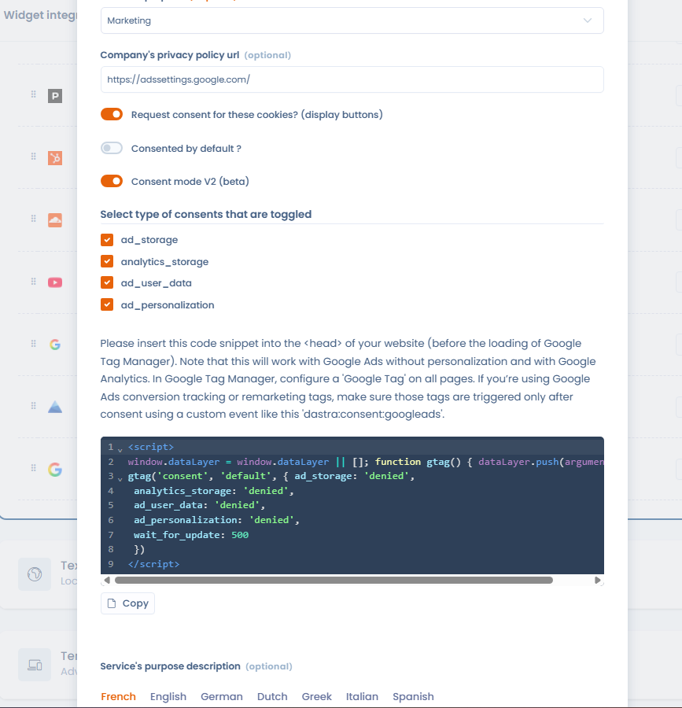

# Google Consent Mode V2

Dastra ondersteunt **Google Consent Mode V2** standaard. Deze integratie stuurt een `consent_update`-signaal naar Google Tag Manager (GTM) zodra een gebruiker toestemming geeft, zodat de Google-tags deze keuze respecteren voordat er tracking wordt gestart.

## Vereisten

* Het standaard toestemmingsfragment (zie stap 2) moet in de `<head>` van uw website worden geplaatst, vóór het laden van Google Tag Manager.
* Configureer in Google Tag Manager een **"Google Tag"** die op alle pagina's wordt geactiveerd.
* De integratie werkt met Google Ads (zonder personalisatie) en Google Analytics.
* Als u Google Ads-tags voor conversietracking of remarketing gebruikt, zorg er dan voor dat deze tags alleen na toestemming worden geactiveerd, met behulp van een aangepaste gebeurtenis zoals `dastra:consent:{service-slug}` (voorbeeld: `dastra:consent:google-ads`).

## Stap 1: Consent Mode V2 activeren voor de dienst

Klik in de sectie **Diensten** van de banner op de betreffende dienst (bijvoorbeeld Google Analytics of Google Ads) en activeer de schakelaar **Toestemmingsmodus v2 (bèta)**. Eenmaal geactiveerd, stuurt de Dastra-banner automatisch het `consent_update`-signaal naar GTM telkens wanneer een gebruiker met de toestemmingsbanner interageert.

Selecteer vervolgens de toestemmingstypen die voor deze dienst worden aangestuurd (standaard allemaal aangevinkt):

* `ad_storage`
* `analytics_storage`
* `ad_user_data`
* `ad_personalization`

<figure><figcaption><p>Consent Mode V2 activeren voor een dienst van de cookiewidget</p></figcaption></figure>

Het standaard toestemmingsfragment dat u in uw website moet plaatsen, wordt rechtstreeks in de interface weergegeven: gebruik de knop **Kopiëren** om het over te nemen en volg daarna stap 2.

## Stap 2: De standaard toestemmingscode vóór GTM plaatsen

Om ervoor te zorgen dat de Google-tags op het toestemmingssignaal wachten voordat ze worden geactiveerd, plaatst u het volgende fragment **vóór** de GTM-initialisatiecode op uw pagina:

```html
<script>
  window.dataLayer = window.dataLayer || [];
  function gtag() { dataLayer.push(arguments) }
  gtag('consent', 'default', {
    ad_storage: 'denied',
    analytics_storage: 'denied',
    ad_user_data: 'denied',
    ad_personalization: 'denied',
    wait_for_update: 500
  });
</script>
```

Dit fragment geeft de Google-tags de instructie om maximaal 500 ms te wachten op het `consent_update`-signaal voordat de tracking wordt uitgevoerd. Als de gebruiker de betreffende diensten accepteert, activeert de Dastra-banner dit signaal automatisch en kunnen de tags worden uitgevoerd.


Dit fragment moet **vóór** de GTM-initialisatie worden geplaatst. Als het erna wordt geladen, kunnen de Google-tags worden geactiveerd zonder op toestemming te wachten.



De Dastra-SDK roept de globale functie `gtag` aan, die het bovenstaande fragment definieert. Verwijder de definitie van `gtag()` niet uit dit fragment: zonder die functie kan de SDK de toestemmingsupdate niet verzenden.


## Installatie: rechtstreeks in de code of via GTM

Het Dastra-CMP-script kan rechtstreeks in de broncode van de pagina worden geïntegreerd of via GTM worden geladen. Beide methoden zijn geldig. Een installatie rechtstreeks in de code verdient de voorkeur, omdat die garandeert dat het standaard toestemmingsfragment (hierboven) vóór GTM wordt uitgevoerd, een vereiste om Consent Mode V2 goed te laten werken.

## Nieuwe diensten toevoegen en toestemming opnieuw instellen

Dastra toont de toestemmingsbanner niet automatisch opnieuw aan bezoekers die al een keuze hebben gemaakt wanneer er nieuwe diensten aan de configuratie worden toegevoegd. Voegt u een nieuw hulpmiddel toe (bijvoorbeeld een nieuwe analysedienst) en moet u voor die dienst toestemming van bestaande bezoekers verzamelen, dan moet u de toestemming opnieuw instellen vanuit de Dastra-interface. De actie **Het verzamelen van bewijs van toestemming opnieuw instellen** in het menu **Acties** van de banner dwingt af dat de banner bij hun volgende bezoek opnieuw aan alle bezoekers wordt getoond, ook aan wie al een keuze had gemaakt. Zie [De cookiebanner voor toestemming instellen](../../banner/configure.md#het-verzamelen-van-bewijs-van-toestemming-opnieuw-instellen).

## Verder gaan

Voor het activeren van tags op basis van toestemmingen (dataLayer-gebeurtenissen, blokkeringstriggers...), zie de pagina over Google Tag Manager:


[Google Tag Manager](google-tag-manager.md)

