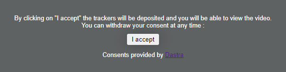

# Iframes blokkeren (twitter/youtube...)

## Voorbeelden van diensten die iframes gebruiken

* Videospelers: YouTube, Vimeo, Dailymotion enzovoort.
* Sociale media: Twitter, Facebook enzovoort.
* Podcastspelers.
* Audiospelers.

## Methode 1: de SDK gebruiken

De SDK blokkeert de iframes van de pagina die aan een selector voldoen en toont in plaats daarvan een aanpasbaar blokkeringsbericht:

<figure><figcaption><p>Het blokkeringsbericht in plaats van de video</p></figcaption></figure>

Een klik op de knop van het bericht legt automatisch toestemming voor de dienst vast en laadt de iframe. Trekt de bezoeker later de toestemming voor deze dienst in, dan wordt de iframe opnieuw geblokkeerd. Het bericht biedt alleen een acceptatieknop.

Een voorbeeld met iframes van de YouTube-videospeler:

```html
<iframe width="560" height="315" src="https://www.youtube.com/embed/aJ1qDx8lv2Y" allowfullscreen></iframe>
<script>
  // Set up youtube iframe blocking
  dastra.push(['iframeBlock', {
    selector: 'iframe[src*="youtube.com"]',
    service: 'youtube', // service slug (check your banner configuration)
    body: '<p>By clicking on "I accept" the trackers will be deposited and you will be able to view the video. You can withdraw your consent at any time :</p>',
    buttonLabel: 'I accept',
    buttonClass: 'btn btn-primary',
    footer: '<p>Consents provided by <a href="https://www.dastra.eu">Dastra</a></p>'
  }])
</script>
```

De opties van `iframeBlock` zijn:

| Optie | Doel |
| --- | --- |
| `selector` | CSS-selector van de iframes die worden geblokkeerd. |
| `service` | Identificatie (slug) van de dienst waarvan de toestemming de iframe deblokkeert. |
| `body` | HTML-tekst van het blokkeringsbericht. |
| `buttonLabel` | Label van de acceptatieknop. |
| `buttonClass` | CSS-klassen van de knop. |
| `footer` | HTML-tekst die onder de knop wordt weergegeven. |


U kunt het uiterlijk van het bericht (achtergrond, lettertypen enzovoort) aanpassen met uw CSS-stylesheet. Het blokkeringsbericht wordt aan de pagina toegevoegd met de klasse `.datra-blocking-iframe`.


## Methode 2: handmatige implementatie

U kunt ook uw eigen logica implementeren:

```html
<script>
  // Select all youtube iframes
  var iframes = document.querySelectorAll('iframe[src*="youtube.com"]');

  // For each iframe, disable it by moving the "src" attribute to "data-blocked-src"
  iframes.forEach(function (iframe) {
    var iframeSrc = iframe.getAttribute('src');
    iframe.setAttribute('data-blocked-src', iframeSrc);
    iframe.setAttribute('src', 'about:blank');
    var divAlert = document.createElement('div');
    divAlert.classList.add('alert-iframe-cookie');
    divAlert.innerHTML = '<p>By clicking on "I accept" the trackers will be deposited and you will be able to view the video. You can withdraw your consent at any time.</p><div class="button-container"><button type="button" onclick="SetConsent(\'youtube\', true)" class="btn btn-success">I accept</button></div><p>Consents provided by <a href="https://www.dastra.eu">Dastra</a></p>';
    iframe.after(divAlert);
  });

  // On consent, load the iframes and hide the message
  window.addEventListener('dastra:consent:youtube', function () {
    document.querySelectorAll('iframe[data-blocked-src*="youtube.com"]').forEach(function (iframe) {
      iframe.setAttribute('src', iframe.getAttribute('data-blocked-src'));
      iframe.removeAttribute('data-blocked-src');
    });

    document.querySelectorAll('.alert-iframe-cookie').forEach(function (alert) {
      alert.style.display = 'none';
    });
  });

  function SetConsent(service, consent) {
    dastra.cookieConsent.consent.setServiceConsent(service, consent);
    dastra.cookieConsent.consent.save();
  }
</script>
<style>
  .alert-iframe-cookie {
    background-color: #ccc;
    padding: 20px;
    color: #333;
    text-align: center;
  }

  .button-container {
    margin: 10px auto;
  }
</style>
```
