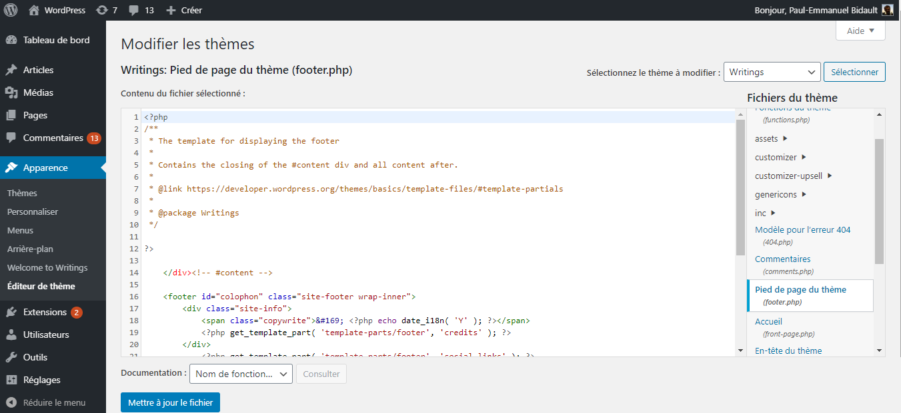

# Wordpress

## De Dastra-plugin installeren

De Dastra-plugin is de aanbevolen methode: updates van het thema overschrijven ze niet.

1. Open in de banner de sectie **Installatie** en klik op de kaart **Wordpress**.
2. Klik op **Bezoek de plugin-pagina**, of zoek de plugin "Dastra" in de lijst met plugins van uw WordPress-beheer. U kunt de plugin ook in dit venster downloaden en handmatig installeren.
3. Installeer en activeer de plugin.
4. Open in WordPress **Settings** > **Dastra** en klik op **Link with Dastra** om de plugin aan uw banner te koppelen.

<figure><figcaption>
De kaart "Wordpress" van de sectie Installatie
</figcaption></figure>

## Of de code in het thema plakken

Kunt u geen plugin installeren, plak dan de bannercode in het thema. Een update van het thema overschrijft deze wijziging: pas ze daarom toe in een child theme.

1. Klik in de sectie **Installatie** van de banner op de kaart **JavaScript** en kopieer de code.
2. Klik in het beheer van uw WordPress-site op **Appearance** en daarna op **Theme Editor**.
3. Selecteer het bestand `footer.php` en voeg de code net vóór de tag `</body>` in.

4. Klik op **Update File** en vernieuw daarna de pagina van uw website. De banner verschijnt.

Voeg ook een knop toe die de banner opnieuw opent, zoals beschreven in [Snel aan de slag](README.md#de-banner-vanaf-een-knop-opnieuw-openen).
