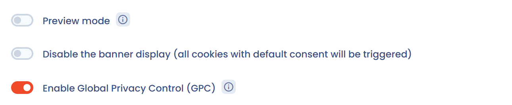

# De integratie van een banner testen

## De preview-modus inschakelen

Open in de sectie **Configuratie** van de banner het blok met geavanceerde instellingen en schakel **Preview-modus** in.

<figure><figcaption><p>De schakelaar "Preview-modus"</p></figcaption></figure>

De preview-modus schakelt de cache van de bannerconfiguratie uit: u ziet uw wijzigingen direct. Ze schakelt ook het verzamelen van statistieken uit.


Laat de preview-modus in productie niet ingeschakeld: ze verslechtert de prestaties van de banner.


Adressen van `localhost` met een poort, bijvoorbeeld `http://localhost:3000`, worden altijd geaccepteerd, met of zonder preview-modus.

## De banner op uw website bekijken

Klik bovenaan in de editor op **Voorbeeld**. De knop is uitgeschakeld zolang er geen adres is ingesteld bij **Geautoriseerde URL's (CORS)**. Kies de website, voer indien nodig het pad van een pagina en de taal in en klik op **Start de preview**. De bannercode moet al op de gekozen website zijn geïnstalleerd.

## Gebruik de volgende API-sleutel

```
dastra00-0testing1-key
```


Deze sleutel toont een voorbeeld van een toestemmingsbanner. U kunt de configuratie ervan niet wijzigen. Ze dient voor integratietests, bijvoorbeeld in een jsFiddle.

