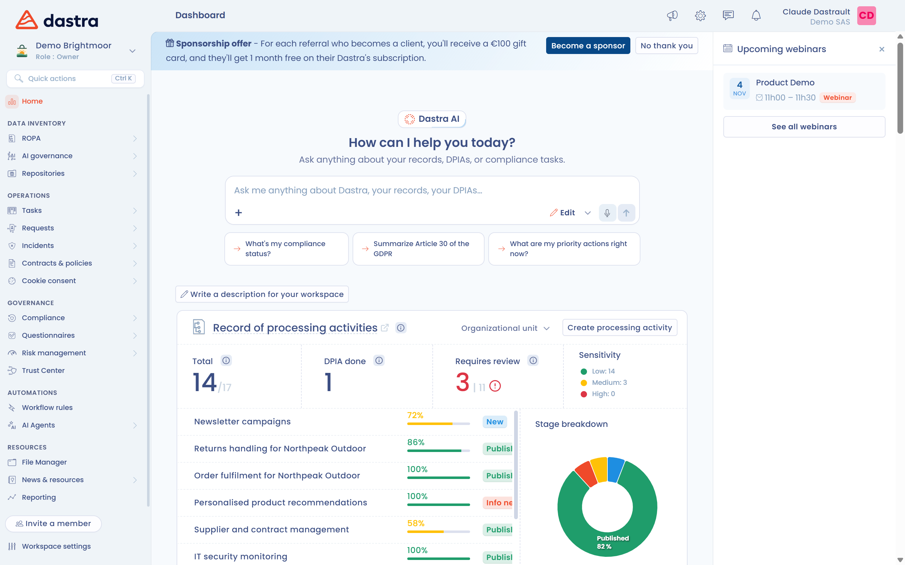

# Dashboard

Het dashboard is de eerste pagina die u ziet wanneer u een werkruimte binnengaat. Het vat de stand van uw naleving van de AVG samen en geeft toegang tot de modules. Om vanaf elke pagina naar het dashboard terug te keren, klikt u bovenaan het linkermenu op **Dashboard**.

## De gebieden van het scherm

Het scherm heeft drie gebieden:

* **Het linkermenu**: de keuzelijst voor de werkruimte, die ook uw rollen in de werkruimte toont, en daaronder de modules gegroepeerd onder **Data inventory**, **Operations**, **Governance**, **Automations** en **Resources**. De knop **Invite a member** en het item **Instellingen voor werkruimte** staan onderaan het menu. Een module verschijnt alleen als uw abonnement ze omvat en uw rechten u er toegang toe geven.
* **Het middelste gedeelte**: boven de tegels vindt u, afhankelijk van uw rechten en abonnement, de prompt van de AI-agent (**How can I help you today?**), de kaart met de laatste release note, de kaart **Handleiding om aan de slag te gaan** (de handleiding om aan de slag te gaan) en de **Project presentatie**, een vrije tekst die de werkruimte aan de gebruikers voorstelt.
* **Het gemeenschapstabblad**, rechts van het scherm: het opent het paneel **Aankomende webinars**. U kunt het paneel inklappen; het tabblad blijft dan rechts van het scherm staan om het opnieuw te openen, en uw keuze wordt onthouden in uw browser.

<figure><figcaption>
Het dashboard van een werkruimte
</figcaption></figure>

## De tegels van het dashboard

De tegels vatten de activiteit van elke module samen. Standaard verschijnen ze in deze volgorde, voor de modules waartoe u toegang hebt:

* **Gegevensverwerking**
* **Conformiteit**
* **Nieuws**
* **Taken**
* **Oefeningen over rechten van betrokkenen**
* **Laatste incidenten**
* **Contracten en beleidslijnen**
* **AI-systemen**
* **Risicobeheer**
* **Uw audits**
* **Activa**

De meeste tegels (verwerkingsactiviteiten, taken, verzoeken, incidenten, contracten, AI-systemen, risico's en vragenlijsten) hebben een filter op organisatorische eenheid. Gebruik het om de tegel te beperken tot de items van één entiteit of afdeling.

### De tegels herordenen

Om de volgorde van de tegels te wijzigen, sleept u de greep naast een tegel, of klikt u op de knoppen **Monteren** en **Naar beneden** die erbij horen. De volgorde wordt opgeslagen in uw browser: ze verandert niet voor andere gebruikers.

<figure><figcaption>
Een tegel en de knoppen om ze te verplaatsen
</figcaption></figure>

## Een lid uitnodigen

Hebt u het recht om gebruikers te beheren, dan verschijnt onderaan het linkermenu de knop **Invite a member**. Die opent het formulier om een nieuwe gebruiker uit te nodigen. Voor de details van de velden, zie [Gebruikers uitnodigen](../getting-started/setup/users.md).

<figure><figcaption>
Het formulier om een lid uit te nodigen
</figcaption></figure>

## Verder lezen

Ontdek de functies:


[Verwerkingsregister](ropa/README.md)



[Gegevensvisualisatie](ropa/visualization/README.md)



[Risicobeheer](risks/README.md)



[Planning](tasks/README.md)



[Verzoeken van betrokkenen om hun rechten uit te oefenen](requests/README.md)



[Incidenten en datalekken](incidents/README.md)



[Cookietoestemming beheren](cookies/README.md)



[Vragenlijsten](questionnaires/README.md)



[Geavanceerde configuratie](settings/README.md)

