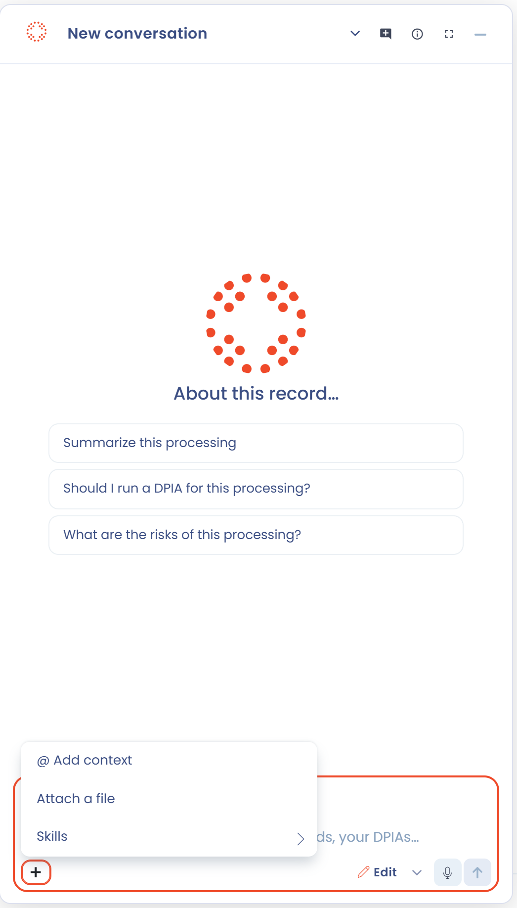

# AI-assistent

Met de AI-assistent van Dastra genereert en verrijkt u elementen van uw werkruimte op basis van korte tekstbeschrijvingen. Hij gebruikt generatieve AI-modellen die op Azure worden gehost, in Frankrijk en in de Europese Economische Ruimte. Gegevens van uw organisatie worden niet gebruikt om die modellen te trainen.

Dastra AI brengt alle AI-functies van Dastra samen in twee groepen:

* De **AI-assistenten** zijn strak afgebakende generatiefuncties. Een knop in een module dekt één precies gebruiksscenario: een verwerking, een informatiebericht of een risicoanalyse genereren.
* De **gespreksmodus** omvat de Dastra AI-chat, de [agents](agents/README.md) en de [MCP-server](mcp.md). Hij is opener: u stelt vragen en vertrouwt taken toe in gewone taal.

Deze pagina behandelt beide.

De beschikbaarheid van de AI-assistent hangt per module af van het abonnement van uw organisatie. In een module die niet in uw abonnement zit, zijn de AI-knoppen grijs, of ze verschijnen niet voor enkele functies. Neem contact op met ons team om de reikwijdte van uw abonnement te wijzigen.

## AI als startpunt, niet als eindantwoord

De AI-assistent is bedoeld om uw conformiteitswerk te versnellen, niet om menselijke expertise te vervangen. Alle inhoud die de assistent genereert, of het nu een beschrijving van een verwerkingsactiviteit, een informatiebericht of een conformiteitsanalyse is, is een voorstel dat een gekwalificeerd persoon moet nakijken en valideren voordat u het gebruikt.

Dat betekent in het bijzonder:


Door AI gegenereerde inhoud vormt geen juridisch advies. Ze kan het oordeel van een gegevensbeschermingsdeskundige of van een jurist niet vervangen.

Conformiteitsbeoordelingen zijn analytische hulpmiddelen. Scores en aanbevelingen van de AI zijn uitsluitend gebaseerd op de informatie in uw werkruimte. Ze weerspiegelen de kwaliteit van die documentatie en vormen geen onafhankelijk juridisch advies.

U houdt de controle. Geen enkel door AI gegenereerd resultaat wordt automatisch toegepast of meegedeeld. Elk resultaat vraagt een bewuste handeling van een persoon voordat u het gebruikt.


## Gegevensbescherming en vertrouwelijkheid

Gegevens van uw organisatie worden nooit gebruikt om AI-modellen te trainen. De modellen die Dastra gebruikt, worden gehost op de infrastructuur van Microsoft Azure in Frankrijk, onder contractuele garanties die uw gegevens uitsluiten van training of van uitwisseling met derden. Alle details vindt u onder [Werking](how-it-works.md).

## Waarmee de AI-assistent u helpt

De assistent is beschikbaar in meerdere modules van het platform:

* Verwerkingsactiviteiten: beschrijvingen, datasets, beveiligingsmaatregelen, informatieberichten, de beoordeling van de DPIA-criteria en conformiteitsanalyses genereren
* AI-systemen: beschrijvingen, berichten, de motivering van de rol, risicoanalyses en de beoordeling van de zakelijke waarde genereren
* Vragenlijsten: een sjabloon genereren, het vertalen, en door AI ondersteunde antwoorden genereren voor DPIA's en risicoanalyses
* Verzoeken van betrokkenen: antwoorden opstellen in meerdere talen en registers, en documenten automatisch caviarderen
* Datalekken: een postmortem genereren
* Activa en actoren: gestructureerde items genereren op basis van een URL of een vrije beschrijving
* Contracten: metagegevens uit een geïmporteerd document halen
* Conformiteit: controles, tests en vereistenreferenties voorstellen en testbewijs analyseren
* Workflowregels en integraties: een HTTP-actie genereren of een veldmapping voorstellen
* Eigen documenten en rapporten: inhoud genereren op basis van uw eigen instructies

Een stapsgewijze uitleg van elke functie vindt u onder [Gebruiksscenario's](use-cases.md).

## Dastra AI, agents en de MCP-server

Naast het genereren van inhoud biedt Dastra AI een gespreksmodus die u bevraagt vanuit het dashboard of met de knop **Open Dastra AI** rechtsonder op het scherm. U kunt ook uw eigen [agents](agents/README.md) maken, conversational of autonoom, en uw AI-hulpmiddelen met Dastra verbinden via de [MCP-server](mcp.md). Deze functies hangen af van het abonnement van uw organisatie en van de rechten van elke gebruiker.

Alle AI-functies delen het maandelijkse quotum aan AI-credits dat wordt beschreven onder [Werking](how-it-works.md#ai-credits-en-quota).

## Chatten met Dastra AI

**Dastra AI** beantwoordt vragen over uw werkruimte in een gesprek. Het zoekt uw records op met alleen-lezentools, zodat u kunt vragen om een samenvatting, een lijst van achterstallige verzoeken of de verwerkingsactiviteiten die geen DPIA hebben.

Om te antwoorden kan Dastra AI ook steunen op de door Dastra geïndexeerde regelgevingsbank, op de Dastra-documentatie en op een webzoekopdracht. In de modus Edit kan Dastra AI records aanmaken, velden wijzigen, een actieplan, een vragenlijst, een opmerking of een label aanmaken en recordacties starten, zoals het wijzigen van de workflowstap. Het kan u verduidelijkende vragen stellen voordat het handelt en u doorverwijzen naar het betrokken record.

1. Klik rechtsonder op het scherm op **Open Dastra AI**, of druk op **Ctrl+J** (**Cmd+J** op Mac).
2. Typ uw vraag, of kies een van de **Suggested prompts**. Ze veranderen met de pagina waarop u zich bevindt: het record dat u bekijkt, het register, verzoeken, AI-systemen.
3. Lees het antwoord. Wanneer de assistent op uw records steunt, toont hij zijn stappen en citeert hij ze. Gebruik de **Suggested follow-up questions** om verder te gaan.

<figure><figcaption>
Het paneel Dastra AI, met het menu + geopend
</figcaption></figure>

Het paneel biedt verschillende hulpmiddelen:

* **Toggle fullscreen** vergroot het paneel naar volledig scherm. Een link naar de pagina van de AI-agent van een werkruimte opent de assistent op volledig scherm en gaat daarna terug naar het dashboard van die werkruimte.
* **New conversation** start een nieuw gesprek. De gesprekkenlijst bewaart uw eerdere gesprekken: u kunt ze daar hernoemen of verwijderen. Het verwijderen van een gesprek verwijdert al zijn berichten.
* **Choose an agent** schakelt tussen de standaardassistent en de [agents](agents/README.md) die uw werkruimte heeft ingeschakeld.
* **Add context** en **Attach a file** geven de assistent een record of een document om mee te werken. Typ `@` om een record of een gebruiker te vermelden.
* Typ `/` of klik op **Skills** om een [skill](agents/skills.md) uit te voeren, een herbruikbare prompt.
* **Dictate a message** neemt uw stem op en transcribeert die in het berichtenveld. Uw browser vraagt de eerste keer om toegang tot de microfoon.
* Beoordeel een antwoord met **Good response** of **Bad response** en voeg een opmerking toe om feedback naar Dastra te sturen.

### Ask- en Edit-modus

In de modus **Ask** leest de assistent alleen: er verandert niets in uw werkruimte. In de modus **Edit** kan hij ook records aanmaken en bijwerken, en vraagt hij om uw bevestiging voordat hij een wijziging toepast. De modusselector verschijnt voor gebruikers die de schrijfmachtiging van de assistent hebben. De modus **Edit** vereist de bijbehorende optie in het plan van uw organisatie. Zonder die optie is ze vergrendeld.


Dastra AI is beschikbaar wanneer uw plan het omvat en wanneer uw rol de machtiging voor de AI-assistent heeft. De berichten tellen mee voor het maandelijkse quotum aan AI-credits en een banner waarschuwt u wanneer het quotum bijna is opgebruikt.


## Bètafuncties

Sommige AI-functies verschijnen in bèta: ze werken, maar worden verder verfijnd op basis van de feedback van gebruikers. Bètafuncties zijn in de interface duidelijk herkenbaar.

Wanneer u een bètafunctie gebruikt:

* kunnen de resultaten minder consistent zijn dan bij stabiele functies en moet u ze extra zorgvuldig behandelen;
* worden de onderliggende prompts en criteria actief verbeterd, zodat de resultaten tussen versies kunnen veranderen;
* is feedback welkom en helpt die Dastra de functie te verbeteren. Gebruik daarvoor de feedbackoptie in de interface.


Baseer een conformiteitsbeslissing nooit uitsluitend op een bètafunctie. Bètafuncties ondersteunen een grondige menselijke controle, ze vervangen die niet.


Momenteel in bèta: de AI-conformiteitsanalyse, beschikbaar op verwerkingsactiviteiten, AI-systemen, contracten, activa, stakeholders en samenvattingen van auditantwoorden. Open ze met de knop **AI analysis (beta)** van het record, of vraag Dastra AI om een record te analyseren. Het resultaat geeft een score van A tot F, de beoordeelde criteria en voorgestelde taken, en kan worden afgedrukt, opnieuw gestart of voortgezet in de chat.

***


[Werking](how-it-works.md)



[Gebruiksscenario's](use-cases.md)



[Veelgestelde vragen](faq.md)



[Dastra AI-agents](agents/README.md)



[De MCP-server](mcp.md)

