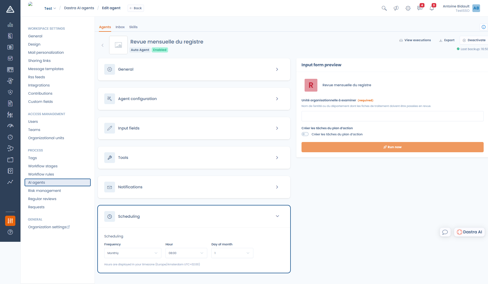

# Een autonome agent aanmaken

Een autonome agent voert een taak van begin tot eind uit, zonder toezicht: een deel van het verwerkingsregister nalopen, een actieplan opstellen, een maandelijkse samenvatting maken.

Ga naar **Instellingen voor werkruimte** > **AI agents**, klik op **Create agent** en daarna op **Auto Agent**.


Een autonome agent kan u niets vragen. De hulpmiddelen die interactie vereisen, zoals een vraag stellen, door de interface navigeren of om bevestiging vragen, zijn eruit verwijderd. De instructie moet dus elk geval dekken, ook wat te doen als informatie ontbreekt.


***

## Configuratie van de agent

De **System instruction** (maximaal 10.000 tekens) beschrijft de hele opdracht. In tegenstelling tot een conversational agent, waarbij u vooral een persoonlijkheid definieert, is dit een procedure.

Een goede systeeminstructie is genummerd, duidelijk over haar grenzen en nauwkeurig over de verwachte uitvoer:

```
You carry out the monthly review of the record of processing activities.

Steps to follow:
1. List the processing activities of the organizational unit given in the
   input field.
2. For each record, check that the purpose, the legal basis, the retention
   period and the security measures are filled in.
3. Group the gaps you find by record.
4. Create an action plan with one task per incomplete record, stating which
   fields must be completed.

Do not modify any processing activity: restrict yourself to creating the
action plan tasks.

Finish with a summary stating the number of records reviewed, the number of
incomplete records and the tasks created.
```

***

## Invoervelden

Invoervelden vormen het korte formulier dat u invult voor een uitvoering. Elke waarde bereikt de agent onder haar technische naam: gebruik die namen in de systeeminstructie om de agent te vertellen wat hij ermee moet doen.

<figure><figcaption><p>De invoervelden en hun voorbeeld, rechts</p></figcaption></figure>

Elk veld wordt gedefinieerd door:

| Instelling | Doel |
| --- | --- |
| **Label** | Wat de persoon ziet die de uitvoering start |
| **Name** | De technische naam waaronder de waarde de agent bereikt |
| **Type** | Text, Number, Boolean of Select |
| **Required** | Voorkomt dat de uitvoering start zolang het veld leeg is |
| **Default** | Vooraf ingevulde waarde |
| **Description** | Hulptekst onder het veld |

Een agent zonder invoervelden draait zonder iets te vragen.


De **Name** wordt automatisch uit het label gegenereerd. Wijzigt u hem, controleer dan de uiteindelijke waarde: die moet u in de systeeminstructie aanhalen.


Het formuliervoorbeeld (**Input form preview**), rechts van de editor, toont precies wat uw gebruikers zien en is ook de plek waar u een testuitvoering start.

***

## Hulpmiddelen

Dit werkt precies zoals bij een [conversational agent](conversational.md#hulpmiddelen): standaard zijn alle hulpmiddelen beschikbaar en u kunt de lijst beperken.

De inzet is hier wel groter, want niemand controleert de agent terwijl hij werkt. Geef hem de hulpmiddelen met leesrechten die hij nodig heeft en alleen de bewerkingshulpmiddelen die zijn opdracht vereist.

## Notificaties

De te notificeren gebruikers (**Notified users**) ontvangen een Dastra-notificatie wanneer de agent een uitvoering voltooit, en nog een wanneer een uitvoering mislukt. Een uitvoering die eindigt met een verzoek om menselijke controle, geldt als voltooid.

***

## Planning

<figure><figcaption><p>Een autonome agent plannen</p></figcaption></figure>

Kies een **Frequency** (**No schedule**, **Daily**, **Weekly** of **Monthly**), daarna het uur en, afhankelijk van het geval, de dag van de week of de dag van de maand.


De uren worden getoond in uw eigen tijdzone, zoals onder het formulier staat. Dastra bewaart ze in UTC, daarom kan de kaart van de agent in de lijst een ander uur tonen dan het uur dat u hebt ingevoerd.

De trigger draait elk uur op het hele uur. Een schema kan dus niet op een bepaalde minuut mikken.


Alleen actieve, niet-gearchiveerde autonome agents worden door de planner opgepikt.

***

## De drie manieren om een uitvoering te starten

### 1. Handmatig

Vul het formulier in het voorbeeld in en klik op **Run now**. De uitvoering komt in de wachtrij: u wordt doorgestuurd naar de inbox, waar u ziet hoe ze van **Running** naar haar eindstatus gaat.

### 2. Volgens het schema

De agent start zelfstandig met de ingestelde frequentie. De standaardwaarden van zijn invoervelden worden gebruikt.

### 3. Vanuit een workflowregel

In **Instellingen voor werkruimte** > **Regels voor de workflow** start de actie **Execute an AI agent** een agent vanuit een gebeurtenis op een record, zoals een fasewijziging, een aanmaak of een deadline.

Daar kiest u de agent, een bericht en de waarden van zijn invoervelden. Die waarden accepteren aangepaste variabelen die worden opgelost vanuit het record dat de regel heeft geactiveerd, zodat de agent bij elke uitvoering een andere context krijgt.

***

## Grenzen van een uitvoering

| Grens | Gedrag |
| --- | --- |
| 30 iteraties van hulpmiddelen per beurt | Daarna moet de agent afronden: de uitvoering eindigt als **Incomplete execution** |
| Contextgrootte | De oudste uitwisselingen met hulpmiddelen worden samengevat; bij overschrijding eindigt de uitvoering als **Context limit reached** |
| 10.000 tekens invoer | Een langer bericht wordt geweigerd |
| Creditquotum | Een uitvoering wordt geweigerd wanneer het maandelijkse quotum is bereikt |

Deze statussen, en de andere, staan beschreven in [Uitvoeringen volgen](inbox.md).

***


[Uitvoeringen volgen](inbox.md)

