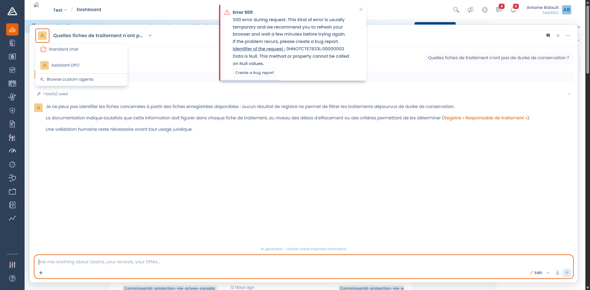

# Een conversational agent aanmaken

Een conversational agent is een chatassistent die u op een onderwerp specialiseert: een DPO-assistent die alleen antwoordt op basis van het verwerkingsregister, een inkoopassistent die leverancierscontracten controleert, een beveiligingsassistent die helpt een incident te kwalificeren.

Ga naar **Instellingen voor werkruimte** > **AI agents**, klik op **Create agent** en daarna op **Conversational Agent**.

***

## Algemeen

De naam en de beschrijving identificeren de agent in de lijst en in de keuzelijst van agents. U kunt de agent ook een logo geven, dat zijn avatar in het gesprek wordt.

De naam is beperkt tot 120 tekens, de beschrijving tot 1000.

## Chatconfiguratie

<figure><figcaption>
De editor van een conversational agent, met rechts het chatvoorbeeld
</figcaption></figure>

### Welkomstbericht

Het eerste bericht dat de gebruiker ziet wanneer het gesprek opent (maximaal 1000 tekens). Gebruik het om aan te geven wat de agent kan, en wat niet.

### Assistentinstructie

Dit is de kern van de agent: zijn persoonlijkheid en zijn gedragsregels, in maximaal 10.000 tekens.


Uw instructie vervangt niet de volledige prompt. Ze legt de persona van de agent vast. Dastra voegt zelf altijd eigen regels toe: de productterminologie, de beschrijving van de beschikbare hulpmiddelen en de regels van de modus Ask of Edit. U hoeft dus niet opnieuw uit te leggen wat een verwerkingsactiviteit is of hoe een hulpmiddel werkt.


Een goede instructie vermeldt:

* de rol: "U bent de functionaris voor gegevensbescherming van de organisatie."
* de bron van waarheid: "Antwoord altijd op basis van de records die in de werkruimte zijn opgeslagen: zoek eerst het relevante record en verwijs er altijd naar."
* wat te doen als iets ontbreekt: "Bestaat de informatie niet in de werkruimte, zeg dat dan uitdrukkelijk in plaats van iets te verzinnen."
* het verwachte formaat: taal, lengte, verplichte vermeldingen.

### Gespreksstarters

De voorgestelde vragen onder het welkomstbericht. Ze fungeren als impliciete gebruikershandleiding: kies er die de gebruiksmogelijkheden tonen die u wilt stimuleren. Voeg er zoveel toe als nodig met **Add starter**.

***

## Hulpmiddelen

Standaard heeft een agent toegang tot alle hulpmiddelen. Antwoord **Ja** op de vraag "Do you want to customize the list of tools this agent can use?" om die lijst te beperken.

<figure><figcaption>
De hulpmiddelen zijn gegroepeerd in hulpmiddelen met leesrechten en bewerkingshulpmiddelen
</figcaption></figure>

Er zijn twee groepen hulpmiddelen:

* **Read-only tools**: zoeken in de werkruimte, een record lezen, opmerkingen en bestanden lezen, de Dastra-documentatie en het corpus van regelgeving doorzoeken, zoeken op het web.
* **Editing tools**: records aanmaken en bijwerken, opmerkingen toevoegen, de workflowstatus wijzigen, taken en labels aanmaken, vragenlijsten plannen en invullen.


Hulpmiddelen beperken is de veiligste manier om een agent op koers te houden. Een assistent die vragen moet beantwoorden, heeft geen enkel bewerkingshulpmiddel nodig: geef hem er geen.


## Te notificeren gebruikers

De personen die een Dastra-notificatie ontvangen wanneer een uitvoering van de agent eindigt (**Notified users**).

***

## Modus Ask en modus Edit

In het gesprek schakelt een keuzelijst tussen twee modi:

* **Ask**: de agent heeft alleen leesrechten. Hij kan zoeken, lezen en analyseren, maar er wordt niets gewijzigd.
* **Edit**: de agent kan records aanmaken en bijwerken. Bewerkingshulpmiddelen zijn alleen in deze modus beschikbaar.

De modus Edit hangt af van uw abonnement en van de bijbehorende machtiging. Is die niet beschikbaar voor u, dan verschijnt de keuzelijst niet en blijven de bewerkingshulpmiddelen inactief, ook als ze in de definitie van de agent zijn aangevinkt.

***

## Testen voor het publiceren

Het chatvoorbeeld (**Chat preview**), rechts van de editor, is een echt gesprek met de agent zoals hij op dat moment is geconfigureerd. Gebruik het om de toon, de lengte van de antwoorden en de naleving van uw regels te controleren voordat u de agent inschakelt. Met de knop **Reset** begint u een nieuw gesprek.

## De agent dagelijks gebruiken

Zodra de agent **Actief** is, bereiken de gebruikers van de werkruimte hem:

* via het paneel **Dastra AI**, rechtsonder in het scherm;
* met de sneltoets **Ctrl+J** (**Cmd+J** op Mac);
* via de Dastra AI-pagina op volledig scherm.

Met de keuzelijst **Choose an agent**, boven aan het gesprek, schakelt u tussen agents.

<figure><figcaption>
De agent toont zijn welkomstbericht en zijn gespreksstarters
</figcaption></figure>

Elk antwoord kunt u beoordelen met een duim omhoog of omlaag, met een opmerking. Die feedback helpt u de instructie van de agent te verfijnen.

***


[Een autonome agent aanmaken](autonomous.md)

