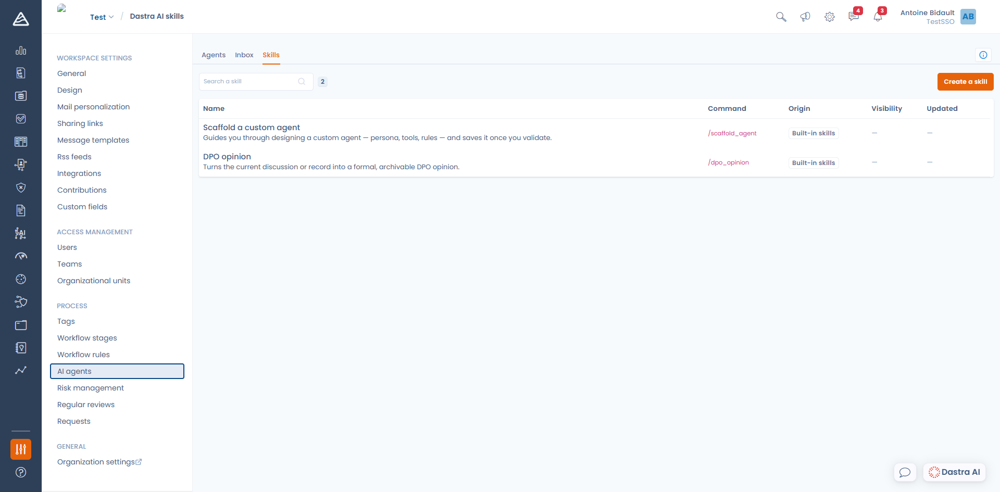

# Skills

Een skill is een instructie die u eenmalig opslaat en daarna oproept met een commando, door `/` te typen in het gesprek. Zie het als een promptsjabloon die in de hele organisatie wordt gedeeld.

U beheert skills via **Instellingen voor werkruimte** > **AI agents** > **Skills**.

<figure><figcaption>
Het tabblad Skills, met de ingebouwde skills van Dastra
</figcaption></figure>

***

## Ingebouwde skills

Dastra levert twee skills mee, beschikbaar in elke werkruimte en niet bewerkbaar:

| Commando | Wat het doet |
| --- | --- |
| `/scaffold_agent` | Begeleidt u bij het ontwerpen van een eigen agent (persona, hulpmiddelen, regels) en slaat hem op zodra u bevestigt. Dit start de optie **Generate with Dastra AI** in het scherm voor het aanmaken van een agent. |
| `/dpo_opinion` | Zet het huidige gesprek, of het record dat u bekijkt, om in een formeel, archiveerbaar advies van de functionaris voor gegevensbescherming. |

## Uw eigen skill aanmaken

Klik op **Create a skill** en vul in:

* **Name**: het label dat in de lijst met commando's staat.
* **Command**: de tekst die u na de `/` typt. Kleine letters, met underscores, en uniek binnen de organisatie, bijvoorbeeld `steering_committee_summary`.
* **Description**: één zin die uitlegt wanneer u de skill gebruikt. Ze staat in de chat naast het commando.
* **Prompt**: de instructie die naar de assistent wordt gestuurd, tot 10.000 tekens.
* **Visibility**: houd de skill voor uzelf of deel hem met de andere leden van de werkruimte.

## Een skill gebruiken

Typ `/` in een gesprek met Dastra AI: de lijst met beschikbare skills verschijnt. Kies er een, vul zo nodig uw bericht aan en verstuur het.


Een skill geldt voor het huidige gesprek, met de agent en de modus (Ask of Edit) die op dat moment zijn geselecteerd. Een skill die records moet wijzigen, vereist dus de modus Edit.


***

## Skill of agent

Beide laten u een instructie hergebruiken, maar niet op hetzelfde moment:

* Een skill is eenmalig. U start hem midden in een gesprek, op de context die dan voorhanden is.
* Een agent is permanent. Hij heeft een eigen identiteit, eigen hulpmiddelen en, indien van toepassing, een eigen planning.

Typt u steeds hetzelfde verzoek opnieuw, maak dan een skill. Wilt u een gespecialiseerde gesprekspartner of een geautomatiseerde taak, maak dan een [agent](README.md).
