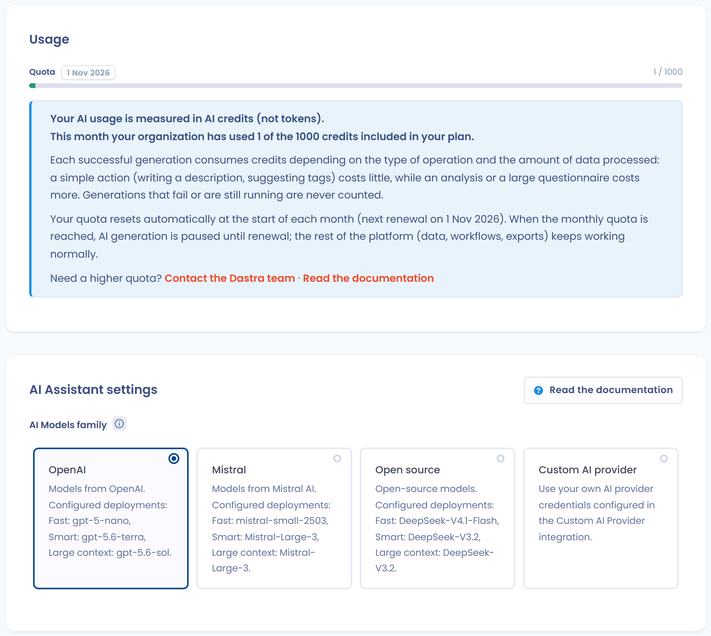
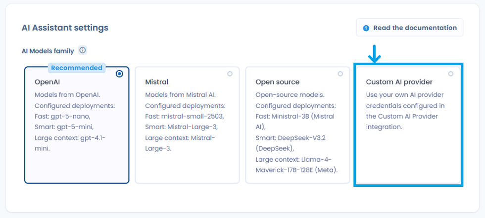
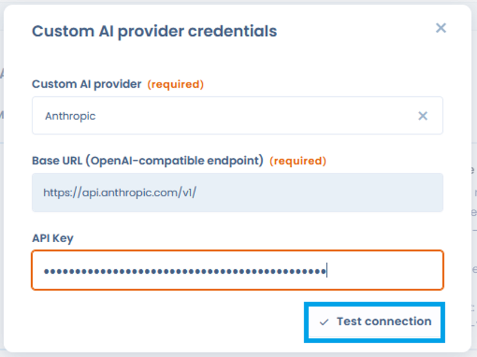
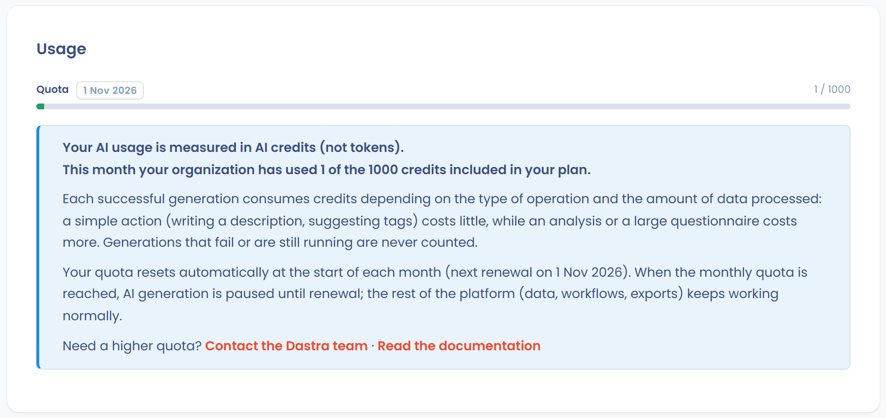

# Werking

## Modellen en hosting

<figure><figcaption>
Organisatie-instellingen > Assistent IA: kies de modelfamilie en volg de credits
</figcaption></figure>

Dastra gebruikt vooraf getrainde generatieve AI-modellen, beschikbaar in vier families waaruit u kiest:

| Familie | Geconfigureerde modellen | Hosting |
| --- | --- | --- |
| OpenAI (aanbevolen standaard) | Fast: gpt-5-nano · Smart: gpt-5.6-terra · Large context: gpt-5.6-sol | Azure, Frankrijk / EER |
| Mistral | Fast: mistral-small-2503 · Smart: Mistral-Large-3 · Large context: Mistral-Large-3 | Azure, Frankrijk / EER |
| Open source | Fast: DeepSeek-V4.1-Flash · Smart: DeepSeek-V3.2 · Large context: DeepSeek-V3.2 | Azure, Frankrijk / EER |
| IA-leverancier (eigen AI-leverancier) | Uw eigen leverancier via een API-sleutel (zie hieronder) | Afhankelijk van uw configuratie |

Voor de eerste drie families worden de modellen gehost op de infrastructuur van Microsoft Azure in Frankrijk. Ze worden niet rechtstreeks beheerd door OpenAI of Mistral: Dastra gebruikt beheerde Azure-diensten, zodat uw gegevens niet via de eigen infrastructuur van OpenAI of Mistral lopen.


**Bleu-aanbod.** Op [Bleu](../../../security/bleu.md) lopen de AI-functies niet via Azure: ze worden uitgevoerd door Mistral AI, een Frans bedrijf buiten de Bleu-perimeter. De tabel hierboven geldt niet. Alleen de Mistral-familie wordt gebruikt, en elke voorkeur voor OpenAI of Open source wordt vervangen door Mistral: Mistral Small voor het niveau Fast, Mistral Large voor de niveaus Smart en Large context. Dastra AI en agents gebruiken Mistral Medium, en spraakdictaat gebruikt Mistral Voxtral.


Voor elke familie worden afhankelijk van de complexiteit van de taak drie modelniveaus gebruikt:

* Fast (eenvoudige acties): beschrijvingen genereren, labels voorstellen
* Smart (acties die meer redeneerwerk vragen): gestructureerde objecten genereren in Dastra
* Large context (acties die grote hoeveelheden gegevens verwerken): een vragenlijst beantwoorden, conformiteitsanalyse

De eigenaar van de organisatie kiest de modelfamilie in **Organisatie-instellingen** > **Dastra AI**, in de kaart **Instellingen van de AI-assistent**, veld **Familie van AI-modellen**. De wijziging wordt opgeslagen zodra u een familie selecteert.

## Eigen AI-leverancier

<figure><figcaption>
De eigen AI-leverancier tussen de modelfamilies
</figcaption></figure>

Met Dastra koppelt u uw eigen AI-leverancier met een API-sleutel, op voorwaarde dat die compatibel is met de OpenAI-API-standaard. De aangeboden leveranciers zijn OpenAI, Google, Anthropic, Mistral en Azure AI Foundry. De optie **Other** accepteert elk ander compatibel endpoint, waaronder een zelfgehoste LLM. De eigen leverancier geldt voor de generatiefuncties van de AI-assistent (de knoppen in de modules). Dastra AI (chat), agents en de MCP-server blijven de modellen van Dastra gebruiken.

Om een eigen leverancier te configureren, selecteert u de familie **Aangepaste AI-aanbieder** in **Organisatie-instellingen** > **Dastra AI**. Klik in het blok **Inloggegevens van aangepaste AI-aanbieder** op **Inloggegevens toevoegen**, voer de leverancier en de bijbehorende API-sleutel in en wijs daarna een model toe aan elk van de drie niveaus (Fast, Smart, Large context).

Voor herkende leveranciers wordt de **Basis-URL** vooraf ingevuld: voor Anthropic is dat `https://api.anthropic.com/v1/`. Voor Azure AI Foundry en voor **Other** voert u hem zelf in.

* Met de knop **Test de verbinding** controleert u de geldigheid van de inloggegevens vóór het opslaan.
* U kiest voor elk niveau het te gebruiken model, met standaard een aanbevolen model.
* De API-sleutel wordt nooit meer in leesbare tekst getoond, en het beheer van de inloggegevens is voorbehouden aan eigenaren van de organisatie.

<figure><figcaption>
Configuratie van Anthropic: vooraf ingevulde Basis-URL, API-sleutel en knop Test de verbinding
</figcaption></figure>


Bij een eigen AI-leverancier vallen de gegevens die naar het model worden gestuurd onder het privacybeleid van uw leverancier, niet onder de Azure-garanties die op deze pagina worden beschreven. Lees de voorwaarden van uw leverancier voordat u deze optie inschakelt, vooral als uw prompts persoonsgegevens kunnen bevatten.


## Wat Dastra naar het model stuurt

Dastra stuurt alleen de informatie door die nodig is voor de gevraagde generatie: de tekst die de gebruiker invoert en, indien van toepassing, de gestructureerde velden van het betrokken object (verwerkingsactiviteit, AI-systeem, verzoek van een betrokkene enzovoort).

De exacte gegevens per functie staan in de sectie [Gegevens die naar het model worden gestuurd](how-it-works.md#gegevens-die-naar-het-model-worden-gestuurd).

Bij sommige generatiefuncties past Dastra vóór het versturen een filter toe dat de e-mailadressen, telefoonnummers, postadressen en postcodes die het in de tekst herkent maskeert, evenals namen die door een aanspreekvorm worden voorafgegaan (Dhr., Mevr., Dr...). Het filter volgt Europese formaten. Het laat datums, identificatoren en standaardnummers zoals ISO 27001 ongewijzigd, zodat het model de zakelijke gegevens behoudt die het nodig heeft. Dit filter wordt niet op alle functies toegepast: het geldt met name niet voor Dastra AI, agents, AI-analyse en redactie. Het garandeert niet dat een tekst geanonimiseerd is: vermijd het invoeren van onnodige persoonsgegevens.

**Spraakdictaat** in het berichtenveld van Dastra AI stuurt uw opname naar een spraak-naar-tekstdienst, die de getranscribeerde tekst teruggeeft. Dastra bewaart de opname niet. Dastra gebruikt Azure Speech op het standaardplatform en Mistral Voxtral op [Bleu](../../../security/bleu.md).

## Wat Dastra niet doet

Microsoft Azure garandeert de volgende punten contractueel voor alle modellen van de families OpenAI, Mistral en Open source:

* Uw prompts en resultaten zijn niet beschikbaar voor andere Azure-klanten.
* Uw gegevens worden niet doorgegeven aan OpenAI, Mistral of enige andere derde.
* Uw gegevens worden niet gebruikt om basismodellen te trainen of te verbeteren.
* De modellen zijn stateless: er wordt tussen twee aanvragen geen prompt in het model bewaard.

## Misbruikcontrole en menselijke beoordeling

Microsoft Azure heeft een geautomatiseerd mechanisme om mogelijk misbruikte inhoud op te sporen. In uitzonderlijke gevallen waarin inhoud wordt gemarkeerd, kan een steekproef van prompts tijdelijk worden bewaard in een opslagomgeving die van andere klanten is afgeschermd, met het oog op controle. Voor resources die in de EER zijn geïmplementeerd (zoals bij Dastra het geval is), bevinden eventuele menselijke beoordelaars zich eveneens in de EER.

Deze bewaring blijft uitzonderlijk en geldt niet voor het normale gebruik van het platform. Zie voor meer informatie de [Microsoft-documentatie over gegevensprivacy van Azure Direct Models](https://learn.microsoft.com/en-us/azure/ai-services/openai/concepts/data-privacy).


**Bleu-aanbod.** Dit onderdeel beschrijft Azure en geldt niet voor Bleu: verzoeken worden daar verwerkt door Mistral AI, onder diens eigen voorwaarden. Raadpleeg voor de geldende toezeggingen uw Dastra-contract of neem contact op met ons team.


## Logboeken van het AI-gebruik

Dastra bewaart een geschiedenis van de aanroepen van de AI-assistent. De kaart **AI usage** van **Organisatie-instellingen** > **Dastra AI** toont de **laatste 90 dagen** in het tabblad **Logs (90 days)**, dat is voorbehouden aan eigenaren van de organisatie. Voor elke aanroep wordt de volgende informatie vastgelegd:

| Veld | Beschrijving |
| --- | --- |
| Datum | Tijdstip van de aanroep |
| Status | Succes of mislukken van de generatie |
| Operation | Type van de gebruikte prompt |
| Model name | Naam van het gebruikte model |
| Credits | Verbruikte credits. Alleen geslaagde generaties verbruiken credits |
| Duur | Verwerkingstijd van de aanvraag |
| Gebruiker | Lid van de werkruimte dat de generatie heeft gestart |

De tabbladen **Credits by user** en **Credits by operation** tellen het verbruik van de huidige maand op.

## AI-credits en quota

Dastra meet het gebruik van de AI-assistent in AI-credits (geen tokens). Het quotum is maandelijks en wordt gedeeld door alle werkruimten van de organisatie: het hangt af van het abonnement en wordt automatisch vernieuwd op de eerste dag van elke maand. Gesprekken met Dastra AI en uitvoeringen van agents gebruiken hetzelfde quotum.

Een geslaagde generatie verbruikt credits volgens het type bewerking. Een mislukte of lopende generatie wordt nooit geteld.

| Bewerking | Credits |
| --- | --- |
| Een verwerkingsactiviteit, activum, stakeholder, dataset, beveiligingsmaatregel, AI-systeem of AI-model genereren; informatiebericht; labelsuggestie; antwoord op een verzoek van een betrokkene; extractie van contractmetadata; suggesties voor controles en tests; een vragenlijstsjabloon genereren; motivering van de verantwoordelijkheid van een AI-systeem; suggestie van een mapping of een HTTP-actie | 1 |
| Risicoanalyse, analyse van de zakelijke waarde, beoordeling van de DPIA-criteria, verificatie van testbewijs, postmortem van een datalek, aangepast rapport | 2 |
| Een vragenlijst beantwoorden en een vragenlijst vertalen | 1 per 25 vragen |
| Automatisch caviarderen van een document | 1 per verzonden documentsegment |
| Bericht naar Dastra AI of een agent | 1 per bericht, ongeacht het aantal gebruikte tools |

De kaart **Gebruik** van **Organisatie-instellingen** > **Dastra AI** toont het verbruik van de huidige maand, het quotum van het abonnement en de vernieuwingsdatum. De voortgangsbalk verandert van kleur naarmate een groter deel van het quotum is verbruikt:

* Groen: minder dan 80% van het quotum
* Oranje: van 80% tot 99%
* Rood: het quotum is bereikt

Zodra het maandelijkse quotum is bereikt, krijgt u een melding die voorstelt contact op te nemen met het Dastra-team.

In het paneel Dastra AI zien alle gebruikers de status van het quotum: een discrete teller vanaf 50%, een oranje banner vanaf 80% en een rode banner bij 100%, die het versturen van nieuwe berichten blokkeert (de geschiedenis blijft raadpleegbaar).

<figure><figcaption>
Volgen van het AI-creditverbruik van de huidige maand
</figcaption></figure>


Wanneer het quotum is bereikt, worden de AI-functies uitgeschakeld tot de volgende vernieuwing. De rest van het platform (gegevens, workflows, exports) blijft normaal werken.



Eigen AI-leverancier, geen creditberekening: wanneer uw organisatie een eigen AI-leverancier gebruikt, geldt het creditsysteem van Dastra niet voor de generatiefuncties van de AI-assistent. Het verbruik wordt rechtstreeks door uw eigen leverancier beheerd volgens zijn eigen factureringsvoorwaarden. Dastra AI en agents gebruiken de modellen van Dastra: hun berichten verbruiken nog steeds het creditquotum en worden geblokkeerd zodra het is bereikt.


## Gegevens die naar het model worden gestuurd


Dastra stuurt geen gegevens uit uw werkruimte naar het AI-model tenzij u daarom vraagt. Alleen de hieronder vermelde informatie, afhankelijk van de gebruikte functie, wordt opgenomen in de aanvraag die naar het model gaat.


| Functie | Naar het model gestuurde gegevens | Mogelijke persoonsgegevens |
| --- | --- | --- |
| Een verwerkingsactiviteit genereren | Vrije tekst die de gebruiker invoert | Nee, tenzij de gebruiker personen noemt in de beschrijving |
| Een verwerkingsactiviteit genereren met de optie Gebruik bestaande elementen | Vrije tekst die de gebruiker invoert, plus de labels van de bestaande beveiligingsmaatregelen, activa en gegevensvelden in de werkruimte | Nee, tenzij bestaande labels met naam genoemde verwijzingen bevatten |
| Een activum genereren | Vrije tekst plus de opgegeven URL van het privacybeleid | Nee |
| Een actor genereren | Vrije tekst plus de opgegeven URL of bijlage | Nee |
| Een dataset genereren | Vrije tekst die de gebruiker invoert | Nee |
| Een beveiligingsmaatregel genereren | Vrije tekst die de gebruiker invoert | Nee |
| Een informatiebericht genereren | Gestructureerde velden van de verwerkingsactiviteit (doeleinden, wettelijke basis, bewaartermijnen, ontvangers, rechten) | Mogelijk, als de velden met naam genoemde verwijzingen bevatten |
| De beoordeling van de DPIA-criteria genereren | Naam, beschrijving, doeleinden, categorieën van betrokkenen (met aanduiding van kwetsbaarheid en maximaal volume), datasets en hun velden (waaronder gevoelige velden), activa en ontvangers van de verwerkingsactiviteit | Mogelijk, afhankelijk van de inhoud van de verwerkingsactiviteit |
| Een beschrijving genereren | Vrije tekst die de gebruiker invoert | Nee |
| Labels voorstellen | Tekstinhoud van het object (naam, beschrijving) | Nee |
| Een vragenlijstsjabloon genereren | Vrije tekst die de gebruiker invoert | Nee |
| Een vragenlijst beantwoorden (DPIA, risicoanalyse enzovoort) | Gestructureerde velden van de gekoppelde verwerkingsactiviteit plus eventuele eigen instructies | Mogelijk, afhankelijk van de inhoud van de verwerkingsactiviteit |
| Een antwoord op een verzoek van een betrokkene genereren | Voor- en achternaam van de aanvrager, bericht van het verzoek, taal, naam van de werkruimte, doeleinden, naam van de behandelaar, datum van het verzoek en resterende dagen, status en ID van het verzoek | Ja: voornaam, achternaam en inhoud van het verzoek |
| Een postmortem van een datalek genereren | Gestructureerde velden van het datalek (beschrijving, getroffen gegevens, genomen maatregelen) | Mogelijk, afhankelijk van de inhoud van het datalekdossier |
| Contractmetadata extraheren | Tekstinhoud van het verzonden document (bijlage of URL) | Mogelijk, afhankelijk van de inhoud van het contract |
| Een aangepast rapport genereren | Instructies van de gebruiker | Nee, tenzij de gebruiker gegevens in de instructies opneemt |
| Risicoanalyse (AI-systeem) | Gestructureerde velden van het AI-systeem (beschrijving, doeleinden, verwerkte gegevens, stakeholders) | Mogelijk, afhankelijk van de inhoud van het AI-systeem |
| De beschrijving van een AI-systeem genereren | Vrije tekst plus de opgegeven URL of bijlage | Nee |
| Een informatiebericht voor een AI-systeem genereren | Gestructureerde velden van het betrokken AI-systeem | Mogelijk |
| Controles, vereisten of tests voorstellen | Context van het betrokken object (naam, beschrijving, kader) | Nee |
| AI-analyse van testbewijs (Conformiteit) | Beschrijving van de testprocedure plus de inhoud van het bewijs (geëxtraheerde tekst, afbeelding of opgehaalde URL) | Mogelijk, afhankelijk van de inhoud van het bewijs |
| De rolverantwoording genereren (AI-systeem) | Naam en beschrijving van het AI-systeem, labels van de gekoppelde AI-modellen, type verantwoordelijkheid (aanbieder, gebruiksverantwoordelijke…) | Nee, tenzij de naam of beschrijving namen bevat |
| De evaluatie van de bedrijfswaarde genereren (AI-systeem) | Naam, beschrijving en AI-modellen van het systeem, de AI Act-rollen van de organisatie, labels van de gekoppelde verwerkingsactiviteiten, activa, categorieën van betrokkenen en datasets (met de labels van hun velden) | Onwaarschijnlijk, tenzij een label een naam bevat |
| Een AI-model genereren | Vrije tekst die de gebruiker invoert, tekst uit de bijgevoegde bestanden of uit de opgegeven URL | Mogelijk, afhankelijk van de inhoud van de bestanden of de pagina |
| AI-analyse van een record (verwerkingsactiviteit, AI-systeem, contract, actief, stakeholder, samenvatting van auditantwoorden) | Inhoud van het record en de opmerkingen, plus de gekoppelde records die de analyse met uw rechten raadpleegt. De inhoud van bijlagen wordt niet verzonden | **Ja**: een record kan namen van verantwoordelijken of contactpersonen bevatten |
| Een vragenlijstsjabloon vertalen | Alle teksten van het sjabloon: titels, beschrijvingen, secties, vragen, antwoordopties, voorgestelde taken en analyseblokken. Ingevoerde antwoorden worden niet verzonden | Nee, tenzij het sjabloon namen of contactgegevens noemt |
| Een document automatisch caviarderen (verzoek van een betrokkene) | Volledige tekst van het document, uitgelezen met optische tekenherkenning (OCR) en in blokken verzonden, eventueel met de vrije instructie. Sluit u de betrokkene uit, dan worden ook diens naam, e-mailadres, telefoonnummer en adres verzonden. Paginabeelden worden niet naar het model gestuurd. Het maskeringsfilter wordt niet toegepast, anders zouden de te caviarderen gegevens niet kunnen worden opgespoord. Dastra logt noch de tekst noch de gevonden waarden | **Ja**: de tekst van het document bevat van nature persoonsgegevens, ook van derden |
| Een document genereren vanuit de bestandsbeheerder | Instructie die de gebruiker invoert | Nee, tenzij de instructie personen noemt |
| Beschrijving van een workflowregel | Objecttype, trigger, actie en voorwaarden van de regel, en de reeds ingevoerde tekst | Nee, tenzij een voorwaarde een naam als waarde bevat |
| HTTP-actie van een workflowregel | Objecttype, instructie, geplakt fragment van de API-documentatie, kolommen van het object (naam, label, type, mogelijke waarden) en de huidige configuratie (URL met gemaskeerde parameterwaarden, methode, namen van de headers zonder waarden, aanvraagtekst). Nooit recordgegevens of inloggegevens | Onwaarschijnlijk, tenzij de geplakte documentatie of de aanvraagtekst er bevat |
| Veldmapping van een integratie | Connector, bronvelden en doelkolommen van Dastra (sleutel, label, type, mogelijke waarden), bestaande mappingregels. Alleen metagegevens, geen voorbeeldgegevens | Nee |
| Chatten met Dastra AI of een agent | Uw bericht en de gespreksgeschiedenis, de instructies van de agent, de waarden van zijn invoervelden, het resultaat van de tools (inhoud van de records waartoe u toegang hebt) en bijlagen. Afbeeldingen en pdf's worden naar het model gestuurd; andere formaten worden niet gelezen. Het maskeringsfilter wordt niet toegepast. Gesprekken worden in Dastra opgeslagen en u kunt ze verwijderen; bijlagen worden 180 dagen bewaard | **Ja**, afhankelijk van de geraadpleegde records en de bijlagen |

Bij de [MCP-server](mcp.md) worden de gelezen gegevens verzonden naar de AI-tool die u hebt gekoppeld, onder diens eigen voorwaarden, en niet naar een model van Dastra.


**Bleu-aanbod.** De gegevens uit de tabel worden naar Mistral AI gestuurd, niet naar Azure. Bij Dastra AI en agents worden bijgevoegde afbeeldingen naar het model gestuurd en andere bestanden als uitgelezen tekst. Automatische redactie gebruikt de optische tekenherkenning (OCR) van Mistral. Het uitvoeren van code in Dastra AI is niet beschikbaar.



Goede praktijk: voeg geen persoonsgegevens rechtstreeks in vrije tekstvelden (beschrijvingen, eigen instructies) in. Gebruik waar mogelijk identificatiecodes of algemene termen.


### Gegevens die nooit worden doorgegeven

De volgende gegevens maken nooit deel uit van de aanvragen die naar het AI-model gaan:

* Inloggegevens en wachtwoorden van Dastra-gebruikers
* Gegevens uit andere records in uw werkruimte (alleen het object waaraan u werkt valt binnen het bereik, behalve bij Dastra AI, agents en AI-analyse, die de nodige records raadplegen met uw rechten), behalve de labels van de bestaande beveiligingsmaatregelen, activa en gegevensvelden wanneer u de optie **Bestaande items gebruiken** inschakelt bij het genereren van een verwerkingsactiviteit
* Sessiemetadata (naam van de aangemelde gebruiker, IP-adres enzovoort)
* Bijlagen die niet uitdrukkelijk in de betrokken functie zijn opgegeven

### Bewaring van prompts

De Azure-modellen die Dastra gebruikt, zijn stateless: prompts en resultaten worden niet in het model bewaard en niet gebruikt om basismodellen opnieuw te trainen of te verbeteren.


Uitzondering, misbruikdetectie: Microsoft Azure heeft een geautomatiseerd mechanisme om mogelijk misbruikte inhoud te controleren. Als een prompt wordt gemarkeerd, kan een steekproef tijdelijk worden bewaard in een opslagomgeving die van andere klanten is afgeschermd, met het oog op controle. Voor resources die in de EER zijn geïmplementeerd (zoals bij Dastra het geval is), bevinden eventuele menselijke beoordelaars zich eveneens in de EER. Deze bewaring blijft uitzonderlijk en geldt niet voor het normale gebruik van het platform.


Zie voor meer informatie de [Microsoft-documentatie over gegevensprivacy van Azure Direct Models](https://learn.microsoft.com/en-us/azure/ai-services/openai/concepts/data-privacy).
