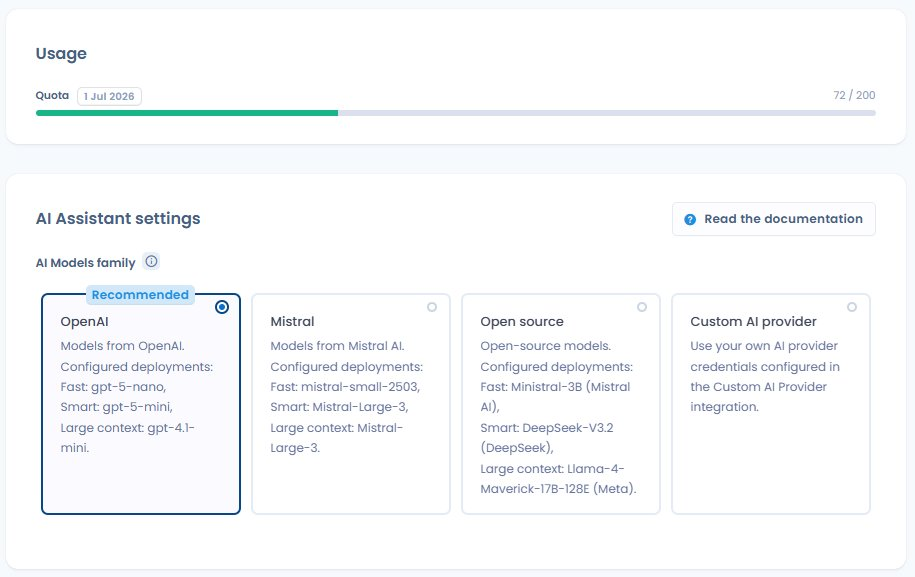
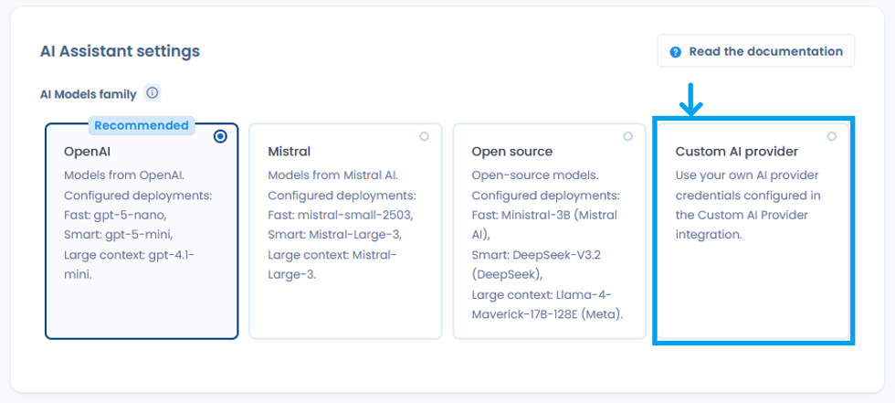
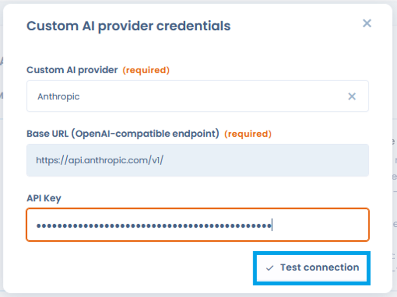
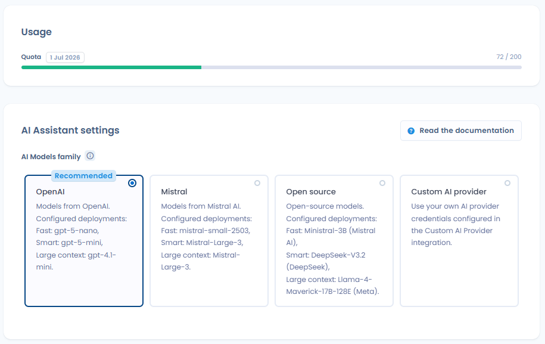

# Werking

## Modellen en hosting

<figure><figcaption>
Organisatie-instellingen > Assistent IA: kies de modelfamilie en volg het kredietquotum
</figcaption></figure>

Dastra gebruikt vooraf getrainde generatieve AI-modellen, beschikbaar in vier families waaruit u kiest:

| Familie | Geconfigureerde modellen | Hosting |
| --- | --- | --- |
| OpenAI (aanbevolen standaard) | Fast: gpt-4o-nano · Smart: gpt-5-mini · Large context: gpt-4.1-mini | Azure, Frankrijk / EER |
| Mistral | Fast: mistral-small-2503 · Smart: Mistral-Large-3 · Large context: Mistral-Large-3 | Azure, Frankrijk / EER |
| Open source | Fast: Ministral-3B · Smart: DeepSeek-V3.2 · Large context: Llama-4-Maverick-17B-128K | Azure, Frankrijk / EER |
| IA-leverancier (eigen AI-leverancier) | Uw eigen leverancier via een API-sleutel (zie hieronder) | Afhankelijk van uw configuratie |

Voor de eerste drie families worden de modellen gehost op de infrastructuur van Microsoft Azure in Frankrijk. Ze worden niet rechtstreeks beheerd door OpenAI of Mistral: Dastra gebruikt beheerde Azure-diensten, zodat uw gegevens niet via de eigen infrastructuur van OpenAI of Mistral lopen.

Voor elke familie worden afhankelijk van de complexiteit van de taak drie modelniveaus gebruikt:

* Fast (eenvoudige acties): beschrijvingen genereren, labels voorstellen
* Smart (acties die meer redeneerwerk vragen): gestructureerde objecten genereren in Dastra
* Large context (acties die grote hoeveelheden gegevens verwerken): een vragenlijst beantwoorden, complianceanalyse

U configureert de gebruikte modelfamilie in uw **Organisatie-instellingen** > **Assistent IA**.

## Eigen AI-leverancier

<figure><figcaption>
De eigen AI-leverancier tussen de modelfamilies
</figcaption></figure>

Met Dastra koppelt u uw eigen AI-leverancier via een API-sleutel, op voorwaarde dat die compatibel is met de OpenAI-API-standaard. Ondersteunde leveranciers zijn onder meer OpenAI, Anthropic (Claude), Google (Gemini), Mistral, Microsoft Foundry en elke compatibele zelfgehoste LLM.

Om een eigen leverancier te configureren, gaat u naar **Organisatie-instellingen** > **Assistent IA** > **IA-leverancier**, voert u uw inloggegevens in en koppelt u ze aan de drie modelniveaus (Fast, Smart, Large context).

Voor herkende leveranciers wordt de **Basis-URL** automatisch vooraf ingevuld. Voor Anthropic is dat `https://api.anthropic.com/v1/`. U hoeft alleen nog uw **API-sleutel** in te voeren.

* Met de knop **Test de verbinding** controleert u de geldigheid van de inloggegevens vóór het opslaan.
* U wijst voor elk type bewerking (fast, smart en large context) het te gebruiken model aan, met standaard een aanbevolen model.
* De API-sleutel wordt nooit meer in leesbare tekst getoond, en het beheer van de inloggegevens is voorbehouden aan gebruikers met rechten op integraties.

<figure><figcaption>
Configuratie van Anthropic: vooraf ingevulde Basis-URL, API-sleutel en knop Test de verbinding
</figcaption></figure>


Bij een eigen AI-leverancier vallen de gegevens die naar het model worden gestuurd onder het privacybeleid van uw leverancier, niet onder de Azure-garanties die op deze pagina worden beschreven. Lees de voorwaarden van uw leverancier voordat u deze optie inschakelt, vooral als uw prompts persoonsgegevens kunnen bevatten.


## Wat Dastra naar het model stuurt

Dastra stuurt alleen de informatie door die nodig is voor de gevraagde generatie: de tekst die de gebruiker invoert en, indien van toepassing, de gestructureerde velden van het betrokken object (verwerkingsactiviteit, AI-systeem, verzoek om rechten uit te oefenen enzovoort).

De exacte gegevens per functie staan in de sectie [Gegevens die naar het model worden gestuurd](#gegevens-die-naar-het-model-worden-gestuurd).

## Wat Dastra niet doet

Microsoft Azure garandeert de volgende punten contractueel voor alle modellen van de families OpenAI, Mistral en Open source:

* Uw prompts en resultaten zijn niet beschikbaar voor andere Azure-klanten.
* Uw gegevens worden niet doorgegeven aan OpenAI, Mistral of enige andere derde.
* Uw gegevens worden niet gebruikt om basismodellen te trainen of te verbeteren.
* De modellen zijn stateless: er wordt tussen twee aanvragen geen prompt in het model bewaard.

## Misbruikcontrole en menselijke beoordeling

Microsoft Azure heeft een geautomatiseerd mechanisme om mogelijk misbruikte inhoud op te sporen. In uitzonderlijke gevallen waarin inhoud wordt gemarkeerd, kan een steekproef van prompts tijdelijk worden bewaard in een opslagomgeving die van andere klanten is afgeschermd, met het oog op controle. Voor resources die in de EER zijn geïmplementeerd (zoals bij Dastra het geval is), bevinden eventuele menselijke beoordelaars zich eveneens in de EER.

Deze bewaring blijft uitzonderlijk en geldt niet voor het normale gebruik van het platform. Zie voor meer informatie de [Microsoft-documentatie over gegevensprivacy van Azure Direct Models](https://learn.microsoft.com/en-us/azure/ai-services/openai/concepts/data-privacy).

## Logboeken van AI-aanroepen

Dastra bewaart een geschiedenis van de aanroepen van de AI-assistent gedurende de laatste 90 dagen, beschikbaar via **Organisatie-instellingen** > **Assistent IA** > **AI invocation logs**. Voor elke aanroep wordt de volgende informatie vastgelegd:

| Veld | Beschrijving |
| --- | --- |
| Datum | Tijdstip van de aanroep |
| Status | Succes of mislukken van de generatie |
| Operation | Type van de gebruikte prompt |
| Model | Naam van het gebruikte model |
| Duur | Verwerkingstijd van de aanvraag |
| Gebruiker | Lid van de werkruimte dat de generatie heeft gestart |

## AI-credits en quota

Dastra volgt het gebruik van de AI-assistent met een systeem van AI-credits. Elke aanroep van een AI-functie verbruikt credits in verhouding tot het gebruikte model en het volume aan verwerkte gegevens.

| Modelniveau | Relatief verbruik |
| --- | --- |
| Fast | Laag |
| Smart | Gemiddeld |
| Large context | Hoog |

Beheerders openen het verbruiksoverzicht via **Organisatie-instellingen** > **Assistent IA** ([directe link](https://app.dastra.eu/general-settings/ai)): het AI-creditverbruik van de huidige maand, het beschikbare saldo en de vernieuwingsdatum.

Het gebruiksniveau wordt getoond in een gekleurde voortgangsbalk die verandert naarmate een groter deel van het quotum is verbruikt:

* Groen: gematigd verbruik, quotum grotendeels beschikbaar
* Oranje: hoog verbruik, quotum bijna bereikt
* Rood: quotum bereikt of bijna bereikt

Zodra het maandelijkse quotum is bereikt, krijgt u een duidelijke melding met een link naar de mogelijkheden om het quotum te verhogen.

<figure><figcaption>
Volgen van het AI-creditverbruik van de huidige maand met een gekleurde voortgangsbalk (groen, oranje, rood)
</figcaption></figure>


Wanneer het quotum is bereikt, worden de AI-functies uitgeschakeld tot de volgende vernieuwing. De rest van het platform (gegevens, workflows, exports) blijft normaal werken.



Eigen AI-leverancier, creditberekening uitgeschakeld: wanneer uw organisatie een eigen AI-leverancier gebruikt, geldt het creditsysteem van Dastra niet en worden er geen credits geteld. Het verbruik wordt dan rechtstreeks door uw eigen leverancier beheerd volgens zijn eigen factureringsvoorwaarden.


Neem contact op met het Dastra-team om uw quotum te verhogen.

## Gegevens die naar het model worden gestuurd


Dastra stuurt geen gegevens uit uw werkruimte naar het AI-model tenzij u daarom vraagt. Alleen de hieronder vermelde informatie, afhankelijk van de gebruikte functie, wordt opgenomen in de aanvraag die naar het model gaat.


| Functie | Naar het model gestuurde gegevens | Mogelijke persoonsgegevens |
| --- | --- | --- |
| Een verwerkingsactiviteit genereren | Vrije tekst die de gebruiker invoert | Nee, tenzij de gebruiker personen noemt in de beschrijving |
| Een verwerkingsactiviteit genereren met de optie Gebruik bestaande elementen | Vrije tekst die de gebruiker invoert, plus de labels van de bestaande beveiligingsmaatregelen, activa en gegevensvelden in de werkruimte | Nee, tenzij bestaande labels met naam genoemde verwijzingen bevatten |
| Een activum genereren | Vrije tekst plus de opgegeven URL van het privacybeleid | Nee |
| Een actor genereren | Vrije tekst plus de opgegeven URL of bijlage | Nee |
| Een dataset genereren | Vrije tekst die de gebruiker invoert | Nee |
| Een beveiligingsmaatregel genereren | Vrije tekst die de gebruiker invoert | Nee |
| Een informatiebericht genereren | Gestructureerde velden van de verwerkingsactiviteit (doeleinden, wettelijke basis, bewaartermijnen, ontvangers, rechten) | Mogelijk, als de velden met naam genoemde verwijzingen bevatten |
| De beoordeling van de DPIA-criteria genereren | Naam, beschrijving, doeleinden, categorieën van betrokkenen (met aanduiding van kwetsbaarheid en maximaal volume), datasets en hun velden (waaronder gevoelige velden), activa en ontvangers van de verwerkingsactiviteit | Mogelijk, afhankelijk van de inhoud van de verwerkingsactiviteit |
| Een beschrijving genereren | Vrije tekst die de gebruiker invoert | Nee |
| Labels voorstellen | Tekstinhoud van het object (naam, beschrijving) | Nee |
| Een vragenlijstsjabloon genereren | Vrije tekst die de gebruiker invoert | Nee |
| Een vragenlijst beantwoorden (DPIA, risicoanalyse enzovoort) | Gestructureerde velden van de gekoppelde verwerkingsactiviteit plus eventuele eigen instructies | Mogelijk, afhankelijk van de inhoud van de verwerkingsactiviteit |
| Een antwoord op een verzoek om rechten uit te oefenen genereren | Voor- en achternaam van de aanvrager, bericht van het verzoek, taal, naam van de werkruimte, doeleinden, naam van de behandelaar, datum van het verzoek en resterende dagen, status en ID van het verzoek | Ja: voornaam, achternaam en inhoud van het verzoek |
| Een postmortem van een datalek genereren | Gestructureerde velden van het datalek (beschrijving, getroffen gegevens, genomen maatregelen) | Mogelijk, afhankelijk van de inhoud van het datalekdossier |
| Contractmetadata extraheren | Tekstinhoud van het verzonden document (bijlage of URL) | Mogelijk, afhankelijk van de inhoud van het contract |
| Een aangepast document genereren | Instructies van de gebruiker plus eventueel bronmateriaal | Mogelijk, afhankelijk van de opgegeven instructies |
| Een aangepast rapport genereren | Instructies van de gebruiker | Nee, tenzij de gebruiker gegevens in de instructies opneemt |
| Risicoanalyse (AI-systeem) | Gestructureerde velden van het AI-systeem (beschrijving, doeleinden, verwerkte gegevens, stakeholders) | Mogelijk, afhankelijk van de inhoud van het AI-systeem |
| De beschrijving van een AI-systeem genereren | Vrije tekst plus de opgegeven URL of bijlage | Nee |
| Een informatiebericht voor een AI-systeem genereren | Gestructureerde velden van het betrokken AI-systeem | Mogelijk |
| Controles, vereisten of tests voorstellen | Context van het betrokken object (naam, beschrijving, kader) | Nee |
| AI-analyse van testbewijs (Conformiteit) | Beschrijving van de testprocedure plus de inhoud van het bewijs (geëxtraheerde tekst, afbeelding of opgehaalde URL) | Mogelijk, afhankelijk van de inhoud van het bewijs |


Goede praktijk: voeg geen persoonsgegevens rechtstreeks in vrije tekstvelden (beschrijvingen, eigen instructies) in. Gebruik waar mogelijk identificatiecodes of algemene termen.


### Gegevens die nooit worden doorgegeven

De volgende gegevens maken nooit deel uit van de aanvragen die naar het AI-model gaan:

* Inloggegevens en wachtwoorden van Dastra-gebruikers
* Gegevens uit andere records in uw werkruimte (alleen het object waaraan u werkt valt binnen het bereik), behalve de labels van de bestaande beveiligingsmaatregelen, activa en gegevensvelden wanneer u de optie **Gebruik bestaande elementen** inschakelt bij het genereren van een verwerkingsactiviteit
* Sessiemetadata (naam van de aangemelde gebruiker, IP-adres enzovoort)
* Bijlagen die niet uitdrukkelijk in de betrokken functie zijn opgegeven

### Bewaring van prompts

De Azure-modellen die Dastra gebruikt, zijn stateless: prompts en resultaten worden niet in het model bewaard en niet gebruikt om basismodellen opnieuw te trainen of te verbeteren.


Uitzondering, misbruikdetectie: Microsoft Azure heeft een geautomatiseerd mechanisme om mogelijk misbruikte inhoud te controleren. Als een prompt wordt gemarkeerd, kan een steekproef tijdelijk worden bewaard in een opslagomgeving die van andere klanten is afgeschermd, met het oog op controle. Voor resources die in de EER zijn geïmplementeerd (zoals bij Dastra het geval is), bevinden eventuele menselijke beoordelaars zich eveneens in de EER. Deze bewaring blijft uitzonderlijk en geldt niet voor het normale gebruik van het platform.


Zie voor meer informatie de [Microsoft-documentatie over gegevensprivacy van Azure Direct Models](https://learn.microsoft.com/en-us/azure/ai-services/openai/concepts/data-privacy).
