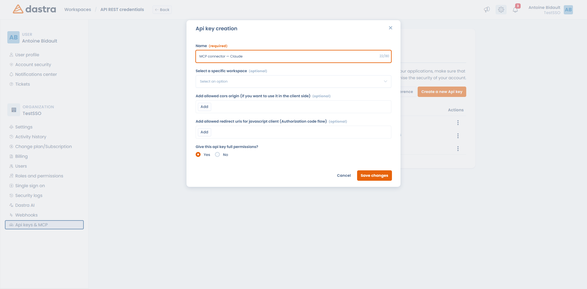

# De MCP-server

Met de MCP-server (Model Context Protocol) werken uw AI-assistent, uw code-editor of uw terminal met uw Dastra-gegevens: records zoeken, entiteiten aanmaken, velden bijwerken en meer.

Met andere woorden: in plaats van naar Dastra te gaan, vraagt u de tool die u al gebruikt (Claude, ChatGPT, Microsoft Copilot, Le Chat, Cursor enzovoort) om het voor u te doen.

Alles wordt geconfigureerd bij **Organisatie-instellingen** > **API-sleutels** > **MCP Server** ([directe toegang](https://app.dastra.eu/general-settings/api)).

<figure><figcaption><p>Organisatie-instellingen &#x3E; API-sleutels &#x3E; MCP Server</p></figcaption></figure>

***

## Voordat u begint


Aan drie voorwaarden moet zijn voldaan:

* De MCP-server maakt deel uit van het abonnement Dastra AI Pro. Zit hij niet in uw abonnement, dan blijft het tabblad zichtbaar maar wordt de verbinding geweigerd.
* Alleen een eigenaar van het account kan een AI-tool verbinden.
* Elke verbinding is beperkt tot één werkruimte: die welke u kiest wanneer de aanmelding wordt goedgekeurd, of die waaraan de API-sleutel is gekoppeld. Wilt u met twee werkruimten werken, maak dan twee verbindingen aan.


## URL van de server

Wijs uw client naar de URL die in het paneel staat:

```
https://api.dastra.eu/mcp
```

Het transport is HTTP (streamable). U hoeft niets lokaal te installeren: dit is geen `stdio`-server.


Wordt uw organisatie gehost op de soevereine infrastructuur, dan is de URL `https://api-bleu.dastra.eu/mcp`. Gebruik altijd de URL uit uw eigen paneel in plaats van hem van deze pagina te kopiëren.


***

## Een verbindingsmethode kiezen

Twee methoden werken, en het paneel toont ze voor elke tool naast elkaar.

### Aanmelden via de browser (aanbevolen)

Uw tool registreert zichzelf bij Dastra en opent een browservenster waarin u zich aanmeldt en de werkruimte kiest waartoe hij toegang krijgt.

Dit is de methode die de voorkeur heeft: u hoeft geen sleutel aan te maken, te kopiëren of te bewaren, en u kunt de toegang op elk moment intrekken.

### API-sleutel

Bedoeld voor automatisering en omgevingen zonder browser. U voegt een HTTP-header toe aan de configuratie van de connector:

| Naam van de header | Waarde |
| --- | --- |
| `X-API-Key` | De privésleutel van uw API-sleutel |


De API-sleutel moet aan een werkruimte zijn gekoppeld, anders wordt de MCP-verbinding geweigerd. Vul bij het aanmaken van de sleutel in het tabblad **API keys** het veld **Een specifieke werkruimte selecteren** in. Geschikte sleutels dragen in de lijst een badge `MCP`.


<figure><figcaption><p>Het veld "Een specifieke werkruimte selecteren" maakt een sleutel bruikbaar voor MCP</p></figcaption></figure>

De algemene procedure om een sleutel aan te maken staat in [Beheer van API-sleutels](../../settings/api-keys.md).

***

## Uw tool verbinden

Het paneel **Connect your AI tool** heeft één tabblad per tool, met de exacte stappen en de waarden om te kopiëren. Dit is de kern ervan.



Connectors worden ingesteld op uw Claude-account, dus de stappen zijn hetzelfde op claude.ai en in de desktopapp.

1. Open **Settings** in uw profielmenu en ga naar het tabblad **Connectors**.
2. Klik op **Add custom connector**.
3. Plak de URL van de server en voeg de connector toe.
4. Klik op **Connect** en meld u aan bij Dastra in het venster dat opent.

Om te controleren of het gelukt is, start u een nieuw gesprek en opent u het hulpmiddelenmenu in het berichtveld: de Dastra-hulpmiddelen moeten in de lijst staan.

Volg voor een verbinding met een API-sleutel dezelfde stappen, open daarna de **geavanceerde instellingen** van de connector en voeg de header `X-API-Key` toe.



Registreer de server met onderstaand commando, start daarna Claude Code en typ `/mcp` om de verbinding af te ronden:

```bash
claude mcp add --transport http dastra https://api.dastra.eu/mcp
```

Met een API-sleutel is geen interactieve aanmelding nodig:

```bash
claude mcp add --transport http dastra https://api.dastra.eu/mcp \
  --header "X-API-Key: YOUR_API_KEY"
```



Voeg de server toe aan `~/.cursor/mcp.json`:

```json
{
  "mcpServers": {
    "dastra": {
      "url": "https://api.dastra.eu/mcp"
    }
  }
}
```



Voeg de server toe aan `.vscode/mcp.json`:

```json
{
  "servers": {
    "dastra": {
      "type": "http",
      "url": "https://api.dastra.eu/mcp"
    }
  }
}
```



ChatGPT en Microsoft Copilot hebben elk hun eigen installatiewizard: volg de stappen van het bijbehorende tabblad in het Dastra-paneel. Copilot Studio gebruikt de OAuth 2.0-optie **"Dynamic discovery"**, die precies overeenkomt met de browseraanmelding van Dastra.

Mistral (Le Chat) ondersteunt alleen aanmelden via de browser: die tool stuurt geen header `X-API-Key`, dus de methode met een API-sleutel werkt niet.

Gebruik voor elke andere MCP-compatibele client het tabblad **Other**: dat geeft u de URL van de server en de in te stellen header.



***

## Wat uw tool kan doen

Zodra de verbinding tot stand is gebracht, beschikt uw tool over ongeveer dertig Dastra-hulpmiddelen.

### Hulpmiddelen met leesrechten

| Hulpmiddel | Wat het doet |
| --- | --- |
| De werkruimte doorzoeken | Brede zoekopdracht in alle soorten records, het gebruikelijke uitgangspunt |
| Records doorbladeren | Toont en filtert de records van een bepaald type |
| Een record lezen | Haalt één record op via type en identificatie |
| De structuur van een record inspecteren | Beschrijft de velden en kolommen van een recordtype |
| Bewerkbare velden controleren | Zegt welke velden kunnen worden bijgewerkt en in welk formaat |
| Opmerkingen lezen | Toont de opmerkingen bij een record |
| Bestanden lezen | Toont de bestanden van de werkruimte of van een record |
| Een bestand lezen | Haalt de tekst uit een PDF-, DOCX-, XLSX-, HTML-, TXT-, CSV-, JSON- of Markdown-bestand |
| Een vragenlijst lezen | Haalt een auditsjabloon of een geplande vragenlijst op met haar vragen |
| Organisatorische eenheden lezen | Geeft de hiërarchie van entiteiten en afdelingen |
| Gebruikers tonen | Toont de leden van de werkruimte |
| Labels tonen | Toont labels, eventueel gefilterd op type |
| Workflowstappen tonen | Toont de stappen die voor een recordtype zijn geconfigureerd |
| Regelgeving raadplegen | Bevraagt het door Dastra geïndexeerde corpus van regelgeving (AVG, NIS2, DORA, ISO 27001 enzovoort) met bronvermelding |
| Categorieën van regelgeving tonen | Geeft de categorieën die u voor het zoeken in regelgeving kunt gebruiken |
| De documentatie doorzoeken | Doorzoekt de Dastra-documentatie |
| Het web doorzoeken | Openbare zoekopdracht op het web, als laatste redmiddel |
| Het record analyseren | Maakt een conformiteitsanalyse met een score van A tot F en verbetervoorstellen |
| Links naar records | Bouwt aanklikbare URL's van de Dastra-webapp voor records |

### Bewerkingshulpmiddelen

| Hulpmiddel | Wat het doet |
| --- | --- |
| Een record aanmaken | Maakt een leeg record aan |
| Een record opstellen | Genereert een compleet record op basis van een beschrijving en importeert het |
| Records bijwerken | Werkt tot 50 records tegelijk bij |
| De workflowstatus wijzigen | Verplaatst een record naar een andere fase |
| Een opmerking toevoegen | Plaatst een opmerking bij een record, inclusief vermeldingen |
| Een actieplan aanmaken | Maakt tot 10 taken aan die aan een record zijn gekoppeld |
| Een label aanmaken | Maakt een label aan voor een recordtype |
| Een document schrijven | Maakt een Markdown-document aan of werkt het bij in het bestandsbeheer |
| Een bestand koppelen | Koppelt een bestaand bestand aan een record |
| Een vragenlijst plannen | Maakt een vragenlijst aan op basis van een sjabloon en wijst haar toe |
| Een vragenlijst bijwerken | Vult de antwoorden van een geplande vragenlijst in |


De MCP-server biedt alleen hulpmiddelen (tools) aan. Hij publiceert geen resources en geen prompts in de zin van het protocol: een client die `resources/list` of `prompts/list` opvraagt, krijgt een lege lijst terug.


***

## Beveiliging

Uw tool heeft nooit meer rechten dan u. De MCP-server heeft geen serviceaccount: hij stuurt uw eigen sleutel of uw eigen token door naar de Dastra-API. Elke lees- en schrijfactie valt dus onder de gebruikelijke machtigingen van de gebruiker of van de API-sleutel.

Enkele punten om te weten:

* Scope: een verbinding ziet maar één werkruimte, binnen één organisatie.
* Traceerbaarheid: schrijfacties via MCP worden herkend als afkomstig van een AI-agent. De datum van het laatste gebruik van elke sleutel staat in de lijst met API-sleutels.
* Intrekken: een verbinding die vanuit de browser is goedgekeurd, wordt een gewone API-sleutel, zichtbaar en intrekbaar in het tabblad **API keys**. Verwijdert u de sleutel, dan is de toegang meteen weg.
* Aanvraaglimieten: aanroepen zijn beperkt tot 60 verzoeken per minuut op de MCP-server en tot 120 verzoeken per minuut voor alle gebruik samen. Daarboven antwoordt de server met een fout `429` met de wachttijd.


Een API-sleutel die voor MCP wordt gebruikt, geeft lees- en schrijftoegang tot een hele werkruimte. Behandel hem als een wachtwoord: publiceer hem nooit en trek hem bij de minste twijfel in.


***

## Probleemoplossing

| Symptoom | Waarschijnlijke oorzaak |
| --- | --- |
| De verbinding wordt geweigerd met een melding over het abonnement | De MCP-server zit niet in uw abonnement: hij vereist Dastra AI Pro |
| "API key must be bound to a specific workspace" | De sleutel is zonder werkruimte aangemaakt: maak een nieuwe aan en vul dat veld in |
| Er verschijnt geen Dastra-hulpmiddel in uw client | De verbinding is niet afgerond. Open in Claude de connector en klik op **Connect**; typ in Claude Code `/mcp` |
| Le Chat weigert de API-sleutel | Verwacht: Le Chat ondersteunt alleen aanmelden via de browser |
| U moet zich steeds opnieuw aanmelden | Er is geen langdurige toegang verleend: verwijder de connector en verbind opnieuw |
| Fout `429` | U hebt de aanvraaglimiet overschreden; probeer opnieuw na de vermelde wachttijd |

***


[Dastra AI-agents](agents/README.md)

