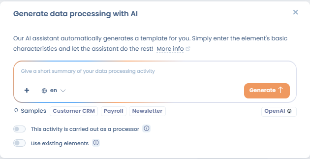
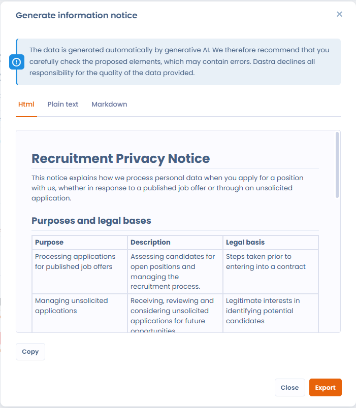
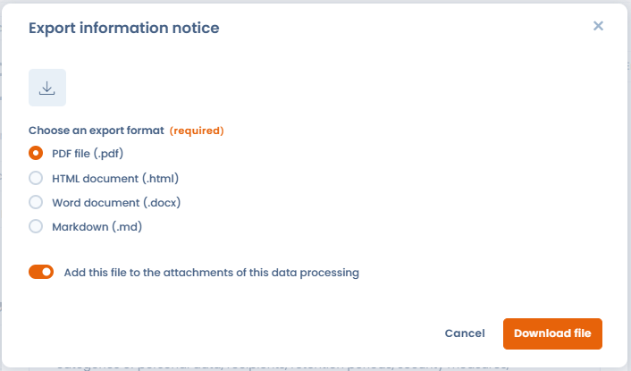
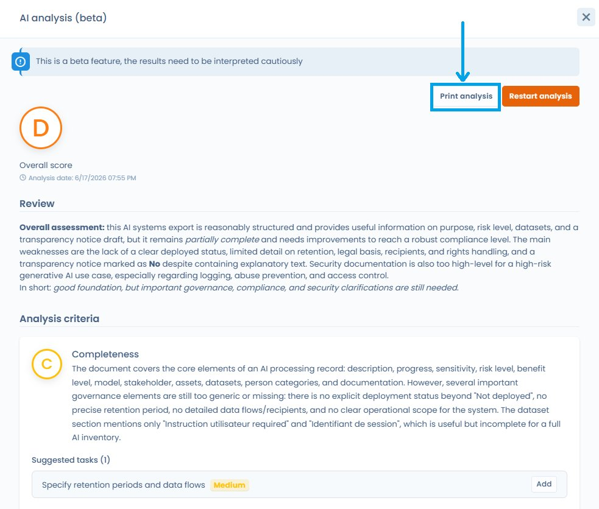

# Gebruiksscenario's


Opmerking over de kwaliteit van gegenereerde inhoud: alle inhoud die de assistent genereert, is slechts een voorstel. Een bevoegde persoon moet die controleren en aanpassen voordat u ze gebruikt. Dastra geeft geen enkele garantie over de kwaliteit van de voorgestelde informatie.


Alle generatiefuncties gebruiken hetzelfde venster: beschrijf het te genereren item (of begin met een van de voorgestelde **Voorbeelden**), kies zo nodig de generatietaal en klik op **Genereren**. Het voorstel verschijnt op een samenvattingsscherm, zodat u het kunt nakijken voordat u op **Valideren** klikt.

In lijsten is de generatieknop een AI-pictogram links van de knop om iets aan te maken. De knop is grijs als uw abonnement de functie niet bevat. Enkele functies, die in de betreffende secties worden aangegeven, verschijnen in dat geval helemaal niet. Elke generatie verbruikt [AI-credits](how-it-works.md#ai-credits-en-quota).

***

## Verwerkingsactiviteiten

### Een verwerkingsactiviteit genereren

Genereer snel een verwerkingsactiviteit in het formaat dat Dastra verwacht, op basis van een korte beschrijving. De assistent stelt een naam voor, een of meer datasets met hun velden, een bewaartermijn, beveiligingsmaatregelen, ontvangers en een beschrijving.

1. Klik in het verwerkingsregister op het AI-pictogram links van **Verwerkingsactiviteit aanmaken**, of klik op **Verwerkingsactiviteit aanmaken** en selecteer daarna **Gegenereerd met AI**.
2. Voer een korte beschrijving van uw verwerkingsactiviteit in, of klik op een van de **Voorbeelden** onder het invoerveld om de aanvraag vooraf in te vullen.
3. Kies zo nodig de generatietaal en schakel de gewenste opties in:
   * **Activiteit als verwerker**: genereert het dossier voor het register van de verwerker
   * **Bestaande items gebruiken**: geeft de assistent de labels van de bestaande beveiligingsmaatregelen, activa en gegevensvelden in uw werkruimte, zodat hij ze hergebruikt in het gegenereerde dossier in plaats van duplicaten aan te maken. De betrokken repositories staan onder de optie
4. Klik op **Genereren** en wacht enkele ogenblikken.
5. Controleer het voorstel op het samenvattingsscherm en klik op **Valideren**.

<figure><figcaption>
Een verwerkingsactiviteit genereren met de AI-assistent: voorbeelden, generatietaal en hergebruik van bestaande elementen
</figcaption></figure>

### Een informatiebericht genereren

1. Ga naar de bewerkingspagina van een verwerkingsactiviteit.
2. Klik in de sectie **Documentatie** op **Informatiebericht genereren**.
3. Kies het gewenste formaat (u kunt de instructies aanpassen door **Aangepast** te selecteren) en de **Taal van de privacyverklaring**; de taal van de interface wordt standaard voorgesteld.
4. Klik op **Genereren**. Met de voorbeeldweergave kopieert u de tekst van elk tabblad, of klikt u op **Exporteren** voor een PDF-, Word-, HTML- of Markdown-bestand.
5. In het venster **Informatie over de export** voegt de optie **Add this file to the attachments of this data processing**, standaard ingeschakeld, het geëxporteerde bestand toe aan de bijlagen van de verwerkingsactiviteit. Elke export maakt een nieuwe bijlage aan.

<figure><figcaption>
Het door AI gegenereerde informatiebericht exporteren
</figcaption></figure>

<figure><figcaption>
Het geëxporteerde bericht toevoegen aan de bijlagen van de verwerkingsactiviteit
</figcaption></figure>

### De beoordeling van de DPIA-criteria genereren

In het tabblad voor de analyse van een verwerkingsactiviteit beoordeelt de assistent de 9 criteria van de EDPB voor een DPIA op basis van de informatie van de verwerkingsactiviteit.

1. Open een verwerkingsactiviteit en daarna het tabblad **Impactanalyse**.
2. Klik in de sectie **Beoordeling van de 9 DPIA-criteria (EDPB)** op **Beoordeling genereren**.
3. Klik in het venster dat opent op **Genereren** en controleer daarna het resultaat.

De knop **Beoordeling genereren** verschijnt niet als uw abonnement deze functie niet bevat.

### Een complianceanalyse van een verwerkingsactiviteit genereren

De assistent kan een bestaande verwerkingsactiviteit analyseren en beoordelen in hoeverre ze voldoet aan de documentatievereisten van de AVG.


Bètafunctie: de resultaten kunnen minder consistent zijn dan bij een stabiele functie en vragen extra zorg. Deze analyse ondersteunt uw besluitvorming en is geen juridisch advies.


Klik nadat de analyse is gegenereerd op **Analyse afdrukken** om het resultaat als PDF te exporteren of rechtstreeks naar de printer te sturen. Dit document kunt u bij uw compliancedossier voegen.

### Een AI-systeem, een contract, een activum, een stakeholder of een samenvatting van antwoorden analyseren

Dezelfde analyse is beschikbaar op AI-systemen, contracten, activa, stakeholders en de samenvatting van de antwoorden op een vragenlijst. Open het record en klik daarna op de knop **AI analysis (beta)**. Het venster toont de algemene score van A tot F, de beoordeelde criteria met hun motivering en de voorgestelde taken. Gebruik **Analysis history** om met een eerdere analyse te vergelijken en daarna **Analyse afdrukken** om het resultaat te exporteren.

### Labels voorstellen

In een veld **Labels** dat nog leeg is, stelt een knop van de AI-assistent labels voor op basis van de naam en de beschrijving van het object. Klik erop: de voorgestelde labels vullen het veld. De knop bestaat op verwerkingsactiviteiten, AI-systemen, datalekken, contractdocumenten, verzoeken van betrokkenen, taken, stakeholders, activa en bewaarregels. Zie [Tagbeheer](../tags.md) voor het beheer van labels.

***

## Repositories

### Een activum genereren

Genereer snel een activum (software, hulpmiddel enzovoort) in het formaat dat Dastra verwacht. De assistent stelt een naam voor, links naar het privacybeleid van de actor en maakt een actor aan als uitgever.

1. Klik in de lijst met activa op het AI-pictogram links van **Activum toevoegen**, of klik op **Activum toevoegen** en selecteer daarna **AI-gegenereerd**.
2. Voer een beschrijving of de URL van een privacybeleid in.
3. Klik op **Genereren**, controleer en vul de voorgestelde informatie aan en klik daarna op **Valideren**.

### Een stakeholder genereren

1. Klik in de lijst met stakeholders op het pictogram **Actor genereren met AI**.
2. Geef een korte samenvatting van de stakeholder. De assistent zoekt op het web.
3. Klik op **Genereren**, controleer het voorstel en klik daarna op **Valideren**.

### Een dataset genereren

1. Ga naar de pagina **Gegevenssets**.
2. Klik op het pictogram **Een dataset genereren met AI**, of op **Nieuwe dataset** en daarna op **Door AI gegenereerd**.
3. Voer een korte beschrijving van uw dataset in.
4. Klik op **Genereren** en wacht enkele ogenblikken.
5. Pas op het samenvattingsscherm uw correcties toe en klik op **Valideren**.

### Een beveiligingsmaatregel genereren

Klik in de lijst met maatregelen op het pictogram **Genereer een maatregel met AI**, beschrijf de maatregel, klik op **Genereren** en daarna op **Valideren**. Deze functie hoort bij de risico-opties van uw abonnement.

***

## Vragenlijsten (DPIA, risicoanalyse enzovoort)

### Een met AI ondersteund antwoord genereren

1. Ga naar het onderdeel **Vragenlijsten** en selecteer het gewenste sjabloon (bijvoorbeeld CNIL-PIA).
2. Klik op **Plan een audit**.
3. Selecteer **Antwoord met AI-ondersteuning**.
4. Geef de verwerkingsactiviteit op die als bron moet dienen, of voer eigen instructies in.
5. Pas zodra het antwoord is gegenereerd uw correcties rechtstreeks toe in de vragenlijst.


Als een AI-analyse is uitgevoerd op het antwoord op een vragenlijst of op een DPIA, verschijnt in de kop van het analysepaneel een knop **Analyse afdrukken** zodra er een resultaat beschikbaar is. Het gestructureerde document bevat de algemene score (A tot F), de algemene beoordeling, de beoordeelde criteria met hun score en motivering, en de voorgestelde taken gerangschikt naar prioriteit, zonder schermafbeeldingen.


### Een vragenlijstsjabloon genereren

1. Ga naar het onderdeel **Vragenlijsten** en klik om een vragenlijstsjabloon aan te maken.
2. Selecteer **Aanmaken met AI**.
3. Geef een beschrijving van de vragenlijst (300 woorden) en een type op.
4. Pas het aantal secties en vragen aan.
5. Klik op **Genereren**.

### Een vragenlijst vertalen met AI

Klik in de builder van een opgeslagen vragenlijstsjabloon op **Vertaal de vragenlijst**: de AI vertaalt alle secties en vragen van het sjabloon naar een andere taal. Kies de doeltaal en de manier waarop het resultaat wordt opgeslagen.

***

## Verzoeken van betrokkenen

### Een antwoord op een verzoek genereren

Genereer antwoorden in meerdere talen, met aanpassingsopties (lengte, formele of informele toon enzovoort).

1. Open een verzoek dat in behandeling is.
2. Vul de informatie in tot de stap **Antwoord**.
3. Klik op **Genereer met AI**. De assistent genereert een antwoord op basis van de volgende informatie:
   * Voor- en achternaam van de aanvrager
   * Bericht van het verzoek
   * Te gebruiken taal
   * Naam van de werkruimte
   * Doeleinden van de betrokken verwerkingsactiviteit
   * Naam van de behandelaar van het verzoek
   * Datum van het verzoek en aantal resterende dagen
   * Status en ID van het verzoek
4. Pas de voorgestelde tekst aan of gebruik de herformuleringsopties (inkorten, verlengen, toon wijzigen).
5. Klik op **Validate this message**, voeg eventuele bijlagen toe en klik op **Verzenden**.


Voor deze functie geldt een limiet op het aantal aanroepen per minuut.


### Een document automatisch caviarderen

Vanuit een bijlage van het verzoek biedt de caviarderingseditor de knop **Automatisch weglakken met AI**: de AI spoort persoonsgegevens van derden op en plaatst de af te dekken zones, die u valideert. De knop verschijnt alleen als AI-afdekking in uw abonnement is opgenomen. Elk verzonden documentsegment verbruikt 1 credit. Zie [Documenten verbergen](../../requests/redaction.md).


AI-verordening, artikel 50: wanneer de AI-assistent een antwoord genereert, geldt de strikte verplichting van artikel 50, lid 1 (de persoon informeren dat hij met een AI-systeem communiceert) niet, omdat er geen rechtstreekse interactie is tussen het AI-systeem en de betrokkene: een menselijke gebruiker controleert, valideert en verstuurt het antwoord. Het blijft wel aanbevolen de betrokkene te informeren als goede praktijk volgens de AVG (artikel 5, lid 1, onder a, eerlijkheid). Zie de [veelgestelde vragen](faq.md) voor de volledige analyse.


***

## Datalekken

### Een postmortem genereren

Vanuit een bestaand datalekdossier genereert de assistent een gestructureerd postmortemdocument met een beschrijving van het incident, de getroffen gegevens en de genomen maatregelen.

Markeer in het tabblad Postmortem van het datalekdossier de postmortem als gedaan en klik daarna op **Genereren met AI**.

***

## Contracten

### Contractmetadata extraheren

Importeer een contractdocument (PDF, afbeelding of URL) en laat de assistent automatisch de metadata ervan extraheren: partijen, onderwerp, looptijd, belangrijke bepalingen enzovoort.

Klik in de module **Contracten en beleidslijnen** op de knop om iets aan te maken en daarna op **Importeer uw document**.

***

## Aangepaste documenten en rapporten

### Een aangepast document genereren

Voer uw eigen instructies in en geef eventueel bronmateriaal op. De assistent genereert een gestructureerd document volgens uw specificaties. Klik in de module **Contracten en beleidslijnen** op de knop om iets aan te maken en daarna op **Maak uw document met AI**.

### Een document genereren vanuit de bestandsbeheerder

Klik in de documenteditor van de bestandsbeheerder op **Genereer met AI**, beschrijf het document en kies zo nodig een activum en een verwerkingsactiviteit die als context dienen.

### Een aangepast rapport genereren

Klik in de module **Aangepaste rapportage** op het pictogram **Genereer een rapport op maat met AI** en beschrijf het gewenste rapport in natuurlijke taal. De assistent maakt een eerste versie die u daarna verfijnt.

***

## AI-systemen

### Een AI-systeem genereren

1. Klik in het register van AI-systemen op het pictogram **Genereren met AI** links van de knop om iets aan te maken.
2. Voer een korte samenvatting van uw AI-systeem in (naam, AI-model enzovoort).
3. Klik op **Genereren**, controleer het voorstel en klik daarna op **Valideren**.

Voor AI-modellen bestaat dezelfde werkwijze: beschrijf het model (naam, uitgever enzovoort).

### Een informatiebericht voor een AI-systeem genereren

Klik in het dossier van een AI-systeem op **Genereer uw informatiebericht** om automatisch het informatiedocument voor gebruikers of betrokkenen te maken.

### De motivering van de rol genereren

Klik in het dossier van een AI-systeem, naast de keuze van uw verantwoordelijkheid (aanbieder, gebruiksverantwoordelijke enzovoort), op het AI-pictogram **Een beschrijving van de verantwoordelijkheid genereren met AI** om een voorstel voor de motivering te krijgen.

### Een risicoanalyse voor een AI-systeem genereren

De assistent analyseert de ingevulde velden van het dossier van het AI-systeem en beoordeelt de bijbehorende risico's. In het dossier heet de knop **Classificatie genereren**; hij verschijnt niet als uw abonnement deze functie niet bevat.


Bètafunctie: met extra zorg te behandelen en door een deskundige te valideren voordat u een beslissing neemt.


Klik nadat de analyse is gegenereerd op **Analyse afdrukken** om het resultaat als PDF te exporteren. Dit document kunt u bij uw nalevingsdossier voor de AI-verordening voegen.

<figure><figcaption>
De knop Analyse afdrukken exporteert het resultaat van de analyse als PDF
</figcaption></figure>

### De beoordeling van de zakelijke waarde genereren

Klik in het deel van het dossier over het verwachte voordeel van het AI-systeem op **Beoordeling genereren** om een analyse van de zakelijke waarde te krijgen. De knop verschijnt niet als uw abonnement deze functie niet bevat.

***

## Workflowregels en integraties

* **Beschrijving van een regel**: klik in het titelvenster van een workflowregel op **Genereren** om een beschrijving van de regel te krijgen.
* **HTTP-actie**: klik in een actie van het type HTTP-verzoek op **Genereer met AI** om het verzoek vooraf in te vullen. De knop is voorbehouden aan gebruikers die de integraties beheren.
* **Veldmapping van een integratie**: klik op **Voorstellen met AI** om de mapping van alle velden voor te stellen, of op **Toewijzing van dit veld voorstellen met AI** op een rij voor één enkel veld.

Deze knoppen verschijnen niet als uw abonnement de AI-assistent niet bevat.

***

## Kaders en controles

### Controles, vereisten en tests voorstellen

Vanuit een kader in de module Conformiteit stelt de assistent controles en tests voor op basis van de context van het betrokken object (naam, beschrijving, gekoppeld kader).

* Controles: klik op de pagina van een vereiste op **Controles toevoegen** en daarna op **Aanmaken of koppelen met AI**. De resultaten zijn verdeeld over **Bestaande controles** uit uw bibliotheek en **Nieuwe controles** om aan te maken. De tests van de nieuwe controles worden samen met de controles gegenereerd.
* Tests: klik vanuit een controle op **Selecteer of genereer tests met AI**. De resultaten zijn verdeeld over **Bestaande tests** en **Nieuwe tests**.
* Vereisten: in het venster om een vereiste aan te maken stelt een AI-pictogram naast het referentieveld een referentie voor.

### Het bewijs van een test analyseren

Klik in de bewijstabel van een test op **Analyseren** in de AI-kolom. De assistent vergelijkt het bewijs met de testprocedure en toont het **Vertrouwen in de analyse** en de **Details**. Nieuw bewijs wordt automatisch geanalyseerd zolang **Automatische AI-analyse van bewijzen** is ingeschakeld, wat de standaardinstelling is: u schakelt de functie per werkruimte uit via **Instellingen van de werkruimte** > **Conformiteit**.
