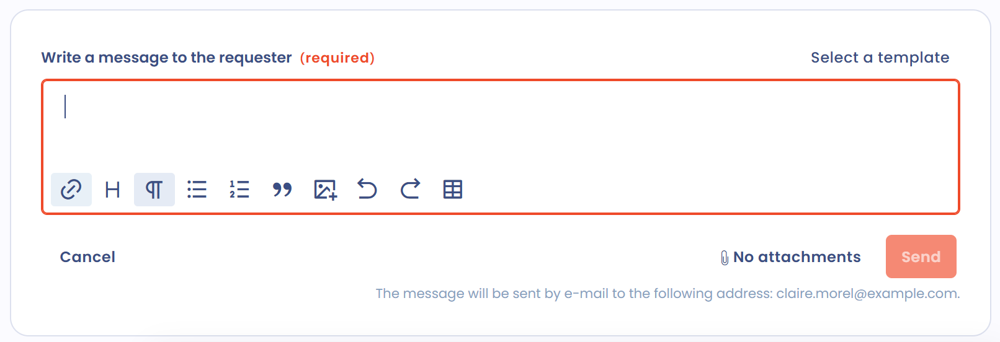
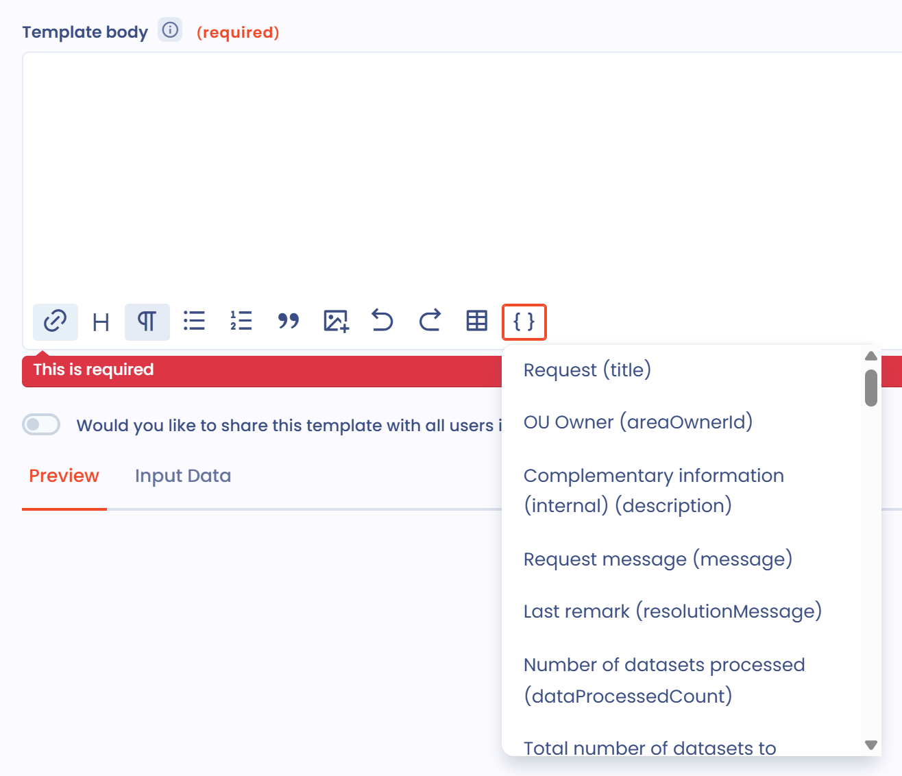

# E-mailsjablonen

## Algemeen

Berichtsjablonen zijn beschikbaar bij verzoeken van betrokkenen, taken, uitnodigingen voor vragenlijsten, uitnodigingen om een verwerkingsactiviteit of een datalek in te vullen, en workflowregels die een bericht versturen. Eenmaal opgeslagen zijn ze een snelle manier om met stakeholders te communiceren. De gegevens van het betreffende object kunnen in de tekst worden ingevoegd, met voorwaarden en lussen om meer informatie op te halen.

Deze pagina legt uit hoe u een sjabloon opstelt. Voor de sjabloontypen, het delen, het importeren en het exporteren, zie de pagina [Berichtsjablonen](../settings/message-templates.md).

## Gebruik

Om een sjabloon te gebruiken, klikt u naast het veld voor het opstellen van het bericht op **Selecteer een sjabloon**.

<figure><figcaption><p>De knop Selecteer een sjabloon bij een verzoek van een betrokkene</p></figcaption></figure>

Het paneel **Selectie van het model** opent. Zoek in de lijst een sjabloon, open de sjablonen onder **Gedeeld** of **Privé** van elk type, of kies een andere werkruimte waartoe u toegang hebt. Klik naast het gewenste sjabloon op **Selecteer**.

<figure><figcaption><p>Het paneel om een sjabloon te selecteren</p></figcaption></figure>

Past geen enkel sjabloon, klik dan op **Maak een sjabloon**. Het aanmaakvenster bevat:

* de naam van het sjabloon, zodat u het later terugvindt;
* de **Body van de template**, het invoerveld;
* de optie om het sjabloon te delen met alle gebruikers van de werkruimte;
* het tabblad **Overzicht**, dat de weergave van het bericht in real time toont;
* het tabblad **Input Data**, dat de gegevens toont van het object waarop het sjabloon betrekking heeft.

De tabbladen **Overzicht** en **Input Data** verschijnen alleen als u het sjabloon aanmaakt vanaf de plaats waar u het bericht schrijft, niet vanuit de instellingen.

<figure><figcaption><p>Het aanmaakvenster van een sjabloon</p></figcaption></figure>

## Het sjabloon aanpassen

In de body van het sjabloon past u stijlen toe en voegt u afbeeldingen of tabellen in. Het resultaat verschijnt in het tabblad **Overzicht**.

Om een gegeven van het object in te voegen, klikt u op het pictogram met accolades in de werkbalk (**Dynamische velden invoegen**) en kiest u een veld in de lijst. De waarde van het veld wordt op de cursor ingevoegd.

<figure><figcaption><p>Een dynamisch veld invoegen</p></figcaption></figure>

## Dynamische velden

Velden tussen dubbele accolades zijn variabelen: ze worden vervangen door de waarden van het bijbehorende object (hier een verzoek van een betrokkene).

### Een veld uit de Input Data gebruiken

Het tabblad **Input Data** toont de eigenschappen van het gekoppelde object. Om bijvoorbeeld het bericht van het verzoek weer te geven:

1. Zoek het veld in het tabblad **Input Data**.
2. Voer de naam ervan in de body van het sjabloon in met de syntaxis `{{message}}`.
3. Controleer het resultaat in het tabblad **Overzicht**.

U kunt verder gaan met lussen, voorwaarden en datumnotaties.

### Voorwaarden

Een voorwaardelijk blok wordt alleen onder bepaalde voorwaarden weergegeven. Het begint met een tag `if` en eindigt met een tag `endif`. Bijvoorbeeld:

```liquid

  You have an attachment

```

Het blok wordt alleen weergegeven als het verzoek een bijlage bevat.

### Lussen

Lussen werken op dezelfde manier, met een variabele die binnen de lus blijft:

```liquid

  {{ purpose }}

```

In dit voorbeeld doorloopt de lus de lijst `purposes` en toont elk item in de variabele `purpose`.

### Datumnotatie

De datums van de Input Data zijn zo niet presentabel. Pas er een notatie op toe:

```liquid
{{ dateCreation | date: "%d-%m-%Y at %H:%M" }}
```

Dit sjabloon geeft bijvoorbeeld 15-03-2023 at 15:40.

### Een completer voorbeeld

De onderstaande tekst gebruikt alle bovenstaande elementen:

```liquid
Hello,

We have received your data subject request on {{ dateCreation | date: "%d-%m-%Y at %H:%M" }} concerning {{ givenName }} {{ familyName }}.

The request relates to the following purposes:

* {{ purpose }}



We have received the following attachments:

* {{ attachment.fileName }}



We will keep you informed of the progress of your request.

Kind regards,
{{ operator.displayName }}
```

Voor het verzoek dat op dat moment wordt behandeld, wordt het bericht als volgt omgezet:

<figure><figcaption><p>De weergave van een volledig sjabloon</p></figcaption></figure>

## Verder gaan

Sjablonen gebruiken de Liquid-syntaxis. Zie de [Liquid-documentatie](https://shopify.github.io/liquid/) voor de lijst met tags en filters.
