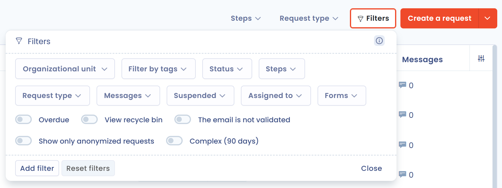
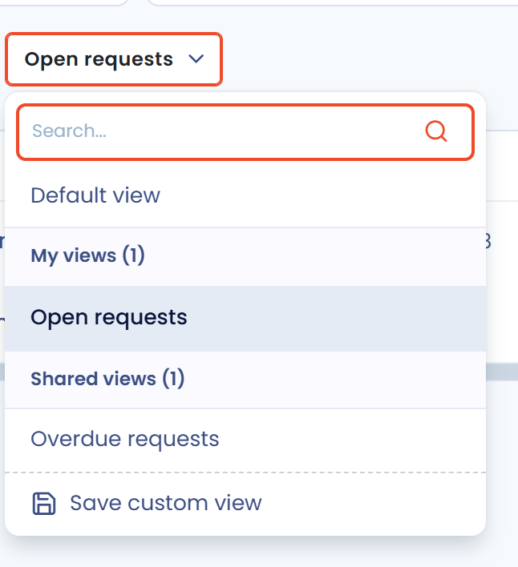

# Geavanceerde filters

## Gebruik

Met geavanceerde filters filtert u uw gegevens op bijna elk veld van uw entiteiten.

1. Ga naar een Dastra-module, bijvoorbeeld de module voor verzoeken van betrokkenen.
2. Klik rechtsboven in de gegevenstabel op de knop **Filters**.
3. Pas in het venster dat opent een van de meest gebruikte standaardfilters toe: de tabel wordt automatisch bijgewerkt.

<figure><figcaption><p>De standaardfilters van een lijst met verzoeken van betrokkenen</p></figcaption></figure>


Filters tellen op.

_Als u bijvoorbeeld filtert op de labels "complex" en "in behandeling" en op de organisatorische eenheid "Contoso", toont de tabel de rijen die beide labels hebben **en** die in de organisatorische eenheid "Contoso" staan._


4. Past geen enkel standaardfilter, klik dan op **Filter toevoegen** om de combinatie van voorwaarden samen te stellen die bij uw behoefte past.

Elke wijziging wordt meteen toegepast. Met de knop **Filters wissen** zet u de tabel terug in de oorspronkelijke staat.

Dastra bewaart de filters die u selecteert: ze blijven behouden als u van pagina wisselt of uw browser vernieuwt. Ze zijn specifiek voor uw browser, voor de lijst en voor uw werkruimte, en worden bewaard in de **LocalStorage** van uw browser.

## Kolommen aanpassen

Met de knop **Kolommen aanpassen** in de laatste cel van elke lijstkop kiest u welke kolommen worden weergegeven (**Zichtbare kolommen** en **Verborgen kolommen**), inclusief aangepaste velden, en bepaalt u hun volgorde. Klik op **Toepassen** om te bevestigen of op **Reset** om terug te keren naar de oorspronkelijke selectie.

U kunt kolommen ook rechtstreeks in de lijstkop herschikken: wanneer u over een kolomkop beweegt, verschijnt links van de kolomnaam een sleepgreep. Sleep de kolom naar de gewenste plaats: de nieuwe volgorde geldt onmiddellijk. Sommige vaste kolommen kunnen niet worden verplaatst.

Als u over een kolomkop beweegt, ziet u de aanvullende uitleg bij de kolom, wanneer die bestaat. Uw kolomselectie wordt bewaard op uw account.

## Aangepaste weergaven

Een aangepaste weergave bewaart de huidige staat van uw filters en uw kolomselectie onder een naam. De weergaveselector staat linksboven in elke lijst: hij toont **Alle elementen**, of de naam van de actieve weergave gevolgd door een sterretje als u die hebt gewijzigd zonder op te slaan.

Een weergave maakt u zo aan:

1. Pas de gewenste filters en kolomselectie toe.
2. Open de weergaveselector en klik op **Sla de aangepaste weergave op**.
3. Voer de **Naam van uw aangepaste weergave** in en bevestig.

<figure><figcaption><p>De selector voor aangepaste weergaven</p></figcaption></figure>

De selector toont **Alle elementen**, die filters en kolommen opnieuw instelt, uw eigen weergaven onder **Mijn persoonlijke mening** en de weergaven van uw collega's onder **Gedeelde weergaven**. Beweeg over een weergave om die te bewerken (potlood) of te verwijderen (prullenbak). Wanneer de actieve weergave is gewijzigd, vervangt de optie **Bijwerken** met de naam van de weergave de weergave door de huidige filters en kolommen.

Om een weergave te delen met de andere gebruikers van uw werkruimte, schakelt u bij het opslaan **Deel deze aangepaste weergave met andere gebruikers** in. Deze optie wordt alleen aangeboden aan gebruikers met geavanceerde toegang, die ook als enige een gedeelde weergave kunnen bewerken of verwijderen.

<figure><figcaption><p>Een aangepaste weergave opslaan, met de deeloptie</p></figcaption></figure>

Aangepaste weergaven zijn beschikbaar in de meeste lijsten: verzoeken van betrokkenen, verwerkingsregister, activa, contracten, AI-systemen, datalekken enzovoort.

## Groepen van voorwaarden

Met geavanceerde filters combineert u binnen één filter voorwaarden met de operatoren **En** en **of**.

### Principe

Standaard zijn alle voorwaarden van een filter verbonden met **En**: een rij moet aan _alle_ voorwaarden voldoen. Zodra een groep minstens twee items (voorwaarden of groepen) bevat, verschijnt er op de rand ervan een knop **En**: klik erop om die te wijzigen in **of**, en omgekeerd. Elke groep heeft een eigen operator, en de filter als geheel ook.

Voorbeeld:

```
Group 1: status = "In progress" AND priority = "High"
OR
Group 2: status = "Overdue"
```

Deze filter toont alle verzoeken met status "In progress" en prioriteit "High", en ook alle verzoeken met status "Overdue", ongeacht hun prioriteit.

### Een groep van voorwaarden aanmaken

1. Open het filtervenster en klik op **Filter toevoegen**.
2. Klik op **Voeg een voorwaarde toe** en kies daarna het veld, de vergelijkingsoperator en de waarde.
3. Klik op **Voeg een groep voorwaarden toe** om een onafhankelijk blok aan te maken en voeg er daarna voorwaarden aan toe.
4. Klik op de knop **En** of **of** om te kiezen hoe de voorwaarden van een groep, of de groepen onderling, worden gecombineerd.
5. Verwijder een voorwaarde of een groep met het prullenbakpictogram.

<figure><figcaption><p>Twee groepen van voorwaarden verbonden door of, met de knoppen Voeg een voorwaarde toe en Voeg een groep voorwaarden toe</p></figcaption></figure>


Een groep kan geen andere groep bevatten en een filter bevat maximaal 10 voorwaarden. Filters en aangepaste weergaven die vóór de groepen zijn aangemaakt, blijven bruikbaar.


## Bekende problemen

### Mijn gegevens worden niet meer weergegeven

Als een filter ervoor zorgt dat uw gegevens niet meer worden weergegeven, wist u de gegevens van uw browser (cookies, LocalStorage enzovoort). Daarmee worden de filters en de actieve weergave van uw werkruimte opnieuw ingesteld. U kunt ook op **Filters wissen** klikken en daarna **Alle elementen** kiezen.

### Sommige kolommen ontbreken in de geavanceerde filters

Om technische redenen kunnen sommige kolommen niet worden gefilterd. Exporteer in dat geval de ruwe gegevens en maak uw rapport in een hulpmiddel zoals Excel.

Is een filter essentieel voor uw activiteit, dien dan een functieverzoek in [via de Dastra-community of het ondersteuningssysteem](../../getting-started/support/request.md).
