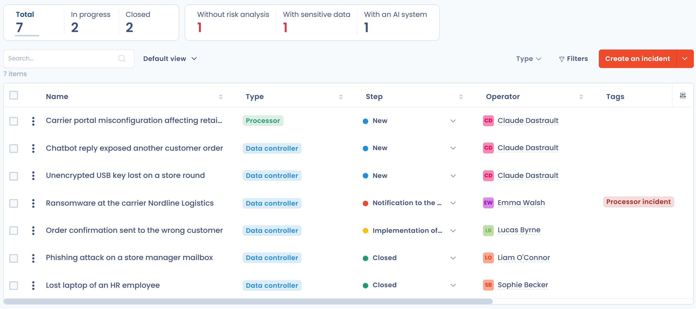

# Incidenten en datalekken

De module **Incidenten** van Dastra documenteert beveiligingsincidenten die persoonsgegevens treffen, volgt de meldingen aan de toezichthoudende autoriteit en aan de betrokkenen en houdt een register van elk incident bij. Ze is bedoeld voor functionarissen voor gegevensbescherming (FG's), beveiligingsteams en juridische afdelingen.

Om te weten wat een datalek is en wat uw verplichtingen zijn, leest u de pagina [Meldingen van datalekken](../../gdpr/concepts/breaches.md).

## Waarom een register van datalekken bijhouden

Artikel 33, lid 5, van de AVG verplicht elke organisatie alle inbreuken op persoonsgegevens te documenteren: de feiten, de gevolgen ervan en de genomen maatregelen. Dat geldt ook wanneer de inbreuk niet aan de toezichthoudende autoriteit wordt gemeld.

Het register helpt u ook de meldtermijnen na te leven en preventieve maatregelen te bepalen. Zie voor meer informatie de [speciale pagina op de website van Dastra](https://www.dastra.eu/en/product-features/data-breach).

## Het incidentenregister openen

Open in het linkermenu **Operations** > **Incidenten** > **Incidentenregister**.

<figure><figcaption>
De module Incidenten in het linkermenu
</figcaption></figure>

De module verschijnt alleen als de functie voor uw organisatie is ingeschakeld en uw rol toegang geeft tot incidenten.

## Het register lezen

Het register toont de incidenten van de werkruimte, één per rij.

<figure><figcaption>
Het incidentenregister
</figcaption></figure>

### Indicatorenbalk

Boven de tabel telt een indicatorenbalk de incidenten:

* **Totaal**, **Aan de gang** (status Actief) en **Gesloten**;
* **Zonder risicoanalyse** en **Met gevoelige gegevens**;
* **Inclusief een systeem van IA**, als de module AI-systemen is ingeschakeld.

Klik op een indicator om de tabel te filteren op de incidenten die ze telt.

### Kolommen en filters

U kiest de kolommen van de tabel. De kolom **Termijn voor kennisgeving aan de toezichthoudende autoriteit** toont, voor elk incident waarvan de melding verplicht is, het aantal resterende uren (groene badge) of de overschreden uren (rode badge), en daarna **U hebt de toezichthoudende autoriteit op de hoogte gebracht** zodra de melding is geregistreerd. Is geen melding nodig, dan toont de cel **Melding autoriteit niet vereist**.

De filters omvatten de organisatorische eenheid, labels, **Soorten incidenten**, **Status** (Nieuw, Actief, Gesloten), **Type** (verwerker of verwerkingsverantwoordelijke), de **Stappen** van de werkstroom en de **Persoon die verantwoordelijk is voor het opvolgen van de inbreuk**. Vink **Met melding** aan om alleen de incidenten te behouden die zijn gemeld, of **Gerelateerd aan een Systeem d'IA** voor de incidenten waarbij een AI-systeem betrokken is. Voor geavanceerde filters en aangepaste weergaven, zie [Geavanceerde filters](../general/filters.md).

### Acties op incidenten

* Klik op een rij om het incident te openen.
* Het menu rechts van een rij biedt **Bewerken**, **Velden bewerken** en **Verplaats naar de prullenbak**.
* Vink meerdere rijen aan om op de selectie te handelen: **De werkstroomfase wijzigen**, **Velden bewerken**, **Exporteren**, **Delen** of **Verplaats naar de prullenbak**.
* De knop **Een datalek toevoegen** maakt een incident aan. De pijl ernaast opent een menu met **Importeren**, **Exporteren**, **Delen** en **Lees de documentatie**.

### Prullenbak

**Verplaats naar de prullenbak** haalt het incident uit het register zonder het te wissen. Vink **Bekijk prullenbak** aan om de incidenten in de prullenbak weer te geven en kies daarna **Herstellen** om ze terug te zetten in het register of **Verwijderen** om ze te wissen.


**Verwijderen** wist het incident definitief. Artikel 33, lid 5, vereist nog steeds dat u elke inbreuk kunt rechtvaardigen: verwijder het spoor van een inbreuk die u moet documenteren niet.


## De statistieken bekijken

Open **Operations** > **Incidenten** > **Statistieken** voor een overzicht van het register. Met de knop **Afdrukken** maakt u een afdrukbare versie van de pagina.

<figure><figcaption>
De pagina Statistieken van de incidenten
</figcaption></figure>

De pagina toont:

* indicatoren: **Totaal aantal incidenten**, **Met opgestelde post-mortem**, **Met risicoanalyse**, **Zonder risicoanalyse**, **Met gevoelige gegevens** en **Inclusief een systeem van IA**;
* de grafieken **Opsplitsing per workflowfase**, **Opsplitsing per tag**, **Verdeling per rol** en **Incidenten per organisatorische eenheid**.

## Verder lezen


[Een nieuwe inbreuk documenteren](document-breach.md)



[Incidenten als verwerker](as-processor.md)



[Uw inbreuken exporteren](export.md)

