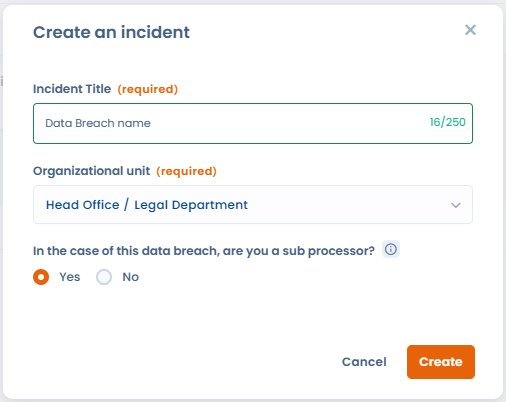

# Incidenten als verwerker

De module voor datalekken van Dastra past zich aan de rol van uw organisatie in het incident aan: verwerkingsverantwoordelijke of verwerker. Deze rol bepaalt de toepasselijke verplichtingen en welke stappen in het formulier worden getoond.

***

## Uw rol aangeven bij het aanmaken

Bij het aanmaken van een nieuw incident kiest u met een selector tussen:

* Verwerkingsverantwoordelijke: standaardverloop, met melding aan de toezichthoudende autoriteit, communicatie aan de betrokkenen en risicoanalyse.
* Verwerker: aangepast verloop. De verplichting om de toezichthoudende autoriteit rechtstreeks te melden geldt niet: de melding is de verantwoordelijkheid van de verwerkingsverantwoordelijke.

<figure><figcaption>
Geef bij het aanmaken van een incident aan of uw organisatie als verwerker optreedt, met de vraag <strong>Bent u in het kader van dit incident een subcontractant?</strong>
</figcaption></figure>


Wettelijke basis: artikel 33, lid 2 van de AVG.

De verwerker moet elke inbreuk op persoonsgegevens zonder onredelijke vertraging aan de verwerkingsverantwoordelijke melden nadat de verwerker kennis ervan heeft genomen. De verwerker hoeft de toezichthoudende autoriteit niet rechtstreeks te melden: die verplichting rust op de verwerkingsverantwoordelijke.


***

## Verschillen in het formulier bij de rol van verwerker

Wanneer u de rol van verwerker kiest:

| Element | Als verwerkingsverantwoordelijke | Als verwerker |
| ------- | -------------------------------- | ------------- |
| Stap voor de melding aan de toezichthoudende autoriteit | Getoond | Verborgen |
| Sectie communicatie aan de betrokkenen | Standaard | Vervangen door de sectie voor verwerkers (zie hieronder) |
| Sectie communicatie aan de klanten die verwerkingsverantwoordelijke zijn | Niet aanwezig | Aanwezig |

***

## Communicatie aan de klanten die verwerkingsverantwoordelijke zijn

Bij de rol van verwerker vervangt een speciale sectie de standaardsectie voor communicatie. Daarmee kunt u:

* de klanten die verwerkingsverantwoordelijke zijn en bij het incident betrokken zijn, koppelen: de lijst kan automatisch worden gesynchroniseerd vanuit de verwerkingsactiviteiten die aan het incident zijn gekoppeld
* de status van de melding aan elke verwerkingsverantwoordelijke opvolgen (gemeld of in behandeling)
* de lijst van betrokken verwerkingsverantwoordelijken exporteren voor uw nalevingsdossier

<figure><figcaption>
Het tabblad Communicatie RT toont de te informeren verwerkingsverantwoordelijken, met de knoppen Koppel een RT, Synchroniseer de RT's en Exporteer de RT
</figcaption></figure>

### Automatische synchronisatie van de verwerkingsverantwoordelijken vanuit gekoppelde verwerkingsactiviteiten

Zijn er verwerkingsactiviteiten aan het incident gekoppeld, dan kan Dastra de betrokken klanten die verwerkingsverantwoordelijke zijn automatisch uit die activiteiten afleiden en aan de meldingslijst toevoegen. Klik in de speciale sectie op **Synchroniseer de RT's** om die synchronisatie te starten.

***

## Goede praktijken

* Informeer uw klanten die verwerkingsverantwoordelijke zijn zonder onredelijke vertraging zodra u kennis hebt van het incident. De AVG stelt geen vaste termijn voor de melding van de verwerker aan de verwerkingsverantwoordelijke (anders dan de termijn van 72 uur die voor verwerkingsverantwoordelijken geldt tegenover de toezichthoudende autoriteit), maar snel handelen is essentieel.
* Leg de datum en het tijdstip van elke melding aan verwerkingsverantwoordelijken vast in de speciale sectie.
* Bewaar de ontvangstbevestigingen of reacties van verwerkingsverantwoordelijken in de bijlagen van het incident.
