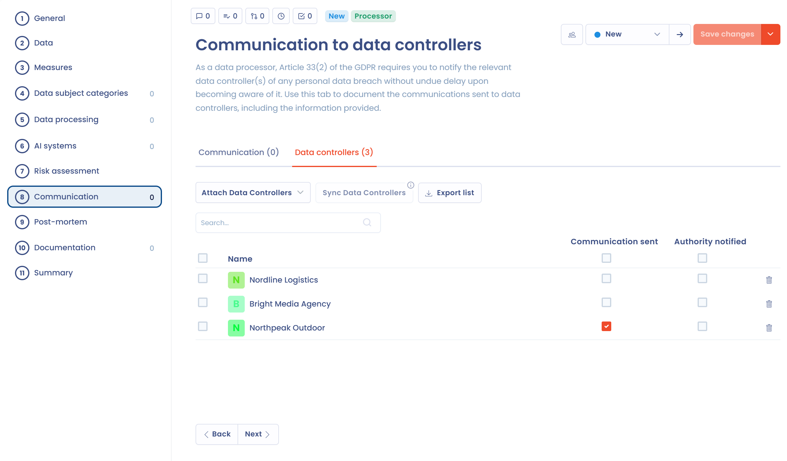

# Incidenten als verwerker

De module Incidenten van Dastra past zich aan de rol van uw organisatie in het incident aan: verwerkingsverantwoordelijke of verwerker. Deze rol bepaalt de toepasselijke verplichtingen en welke stappen in het formulier worden getoond.

## Uw rol aangeven bij het aanmaken

Wanneer u een incident aanmaakt, stelt het venster de vraag **Bent u in het kader van dit incident een subcontractant?**, met twee antwoorden:

* **Neen** (de standaardwaarde): u behandelt het incident als verwerkingsverantwoordelijke. Het verloop is het standaardverloop: melding aan de toezichthoudende autoriteit, communicatie aan de betrokkenen en risicobeoordeling.
* **Ja**: u behandelt het incident als verwerker. U hoeft de toezichthoudende autoriteit niet rechtstreeks te melden: dat is de verantwoordelijkheid van de verwerkingsverantwoordelijke.

<figure><figcaption>
Geef bij het aanmaken aan of uw organisatie als verwerker optreedt
</figcaption></figure>

Om het incident stap voor stap aan te maken, zie [Een nieuwe inbreuk documenteren](document-breach.md).


Artikel 33, lid 2, van de AVG: de verwerker meldt elke inbreuk op persoonsgegevens zonder onredelijke vertraging aan de verwerkingsverantwoordelijke nadat hij er kennis van heeft genomen. De verwerker heeft geen verplichting om de toezichthoudende autoriteit rechtstreeks te melden: die verplichting rust op de verwerkingsverantwoordelijke.


## Verschillen in het formulier

Wanneer u **Ja** antwoordt op de vraag over de rol, verandert het formulier als volgt:

| Element | Verwerkingsverantwoordelijke | Verwerker |
| --- | --- | --- |
| Stap **Kennisgeving** (toezichthoudende autoriteit) | Getoond | Verborgen |
| Stap **Communicatie** | Communicatie aan de betrokkenen | Communicatie aan de verwerkingsverantwoordelijken, met het tabblad **Verantwoordelijken voor verwerking** |

De andere stappen blijven hetzelfde. In de stap **Risicoanalyse** herinnert een melding u eraan de betrokken verwerkingsverantwoordelijken te informeren over de vereiste acties, zodat zij dienovereenkomstig kunnen handelen.

In het register maakt het filter **Type** onderscheid tussen incidenten die als verwerker worden behandeld en incidenten die als verwerkingsverantwoordelijke worden behandeld, en de pagina **Statistieken** toont de **Verdeling per rol**.

## Communiceren met de klanten die verwerkingsverantwoordelijke zijn

De stap **Communicatie** van een incident als verwerker heeft twee tabbladen.

Beantwoord op het tabblad **Communicatie** de vraag **Heeft u een communicatie aan de verantwoordelijken voor verwerking gestuurd?** met **Niet van toepassing**, **Ja** of **Neen**. Klik bij **Ja** op **Voeg een communicatie toe** om elk bericht met zijn datum vast te leggen. Geef bij **Neen** de redenen op bij **Om welke redenen heeft u niet gecommuniceerd met de verantwoordelijken voor verwerking?**.

Het tabblad **Verantwoordelijken voor verwerking** toont de klanten die verwerkingsverantwoordelijke zijn en door het incident worden getroffen. U kunt:

* een verwerkingsverantwoordelijke koppelen met **Koppel een RT**;
* de verwerkingsverantwoordelijken automatisch importeren met **Synchroniseer de RT's**;
* voor elk van hen **Verzonden communicatie** en **Geadviseerde autoriteit** aanvinken;
* de lijst exporteren met **Exporteer de RT**, voor uw nalevingsdossier.

<figure><figcaption>
Het tabblad Verantwoordelijken voor verwerking, met de acties Koppel een RT, Synchroniseer de RT's en Exporteer de RT
</figcaption></figure>

### De verwerkingsverantwoordelijken synchroniseren

Zijn er verwerkingsactiviteiten aan het incident gekoppeld (stap **Verwerkingen**), dan zoekt Dastra de klanten die verwerkingsverantwoordelijke zijn op in die activiteiten en voegt ze toe aan de lijst. Klik op **Synchroniseer de RT's** om dit te starten. Is er nog geen verwerkingsactiviteit of AI-systeem gekoppeld, dan vraagt Dastra u er eerst enkele te koppelen.

## Goede praktijken

* Informeer uw klanten die verwerkingsverantwoordelijke zijn zodra u kennis hebt van het incident. De AVG stelt geen vaste termijn voor de verwerker, anders dan de 72 uur die de verwerkingsverantwoordelijke heeft om de autoriteit te melden, maar snel handelen is essentieel.
* Leg de datum en het tijdstip van elke communicatie aan de verwerkingsverantwoordelijken vast.
* Bewaar de ontvangstbevestigingen en reacties in de stap **Documentatie** van het incident.
