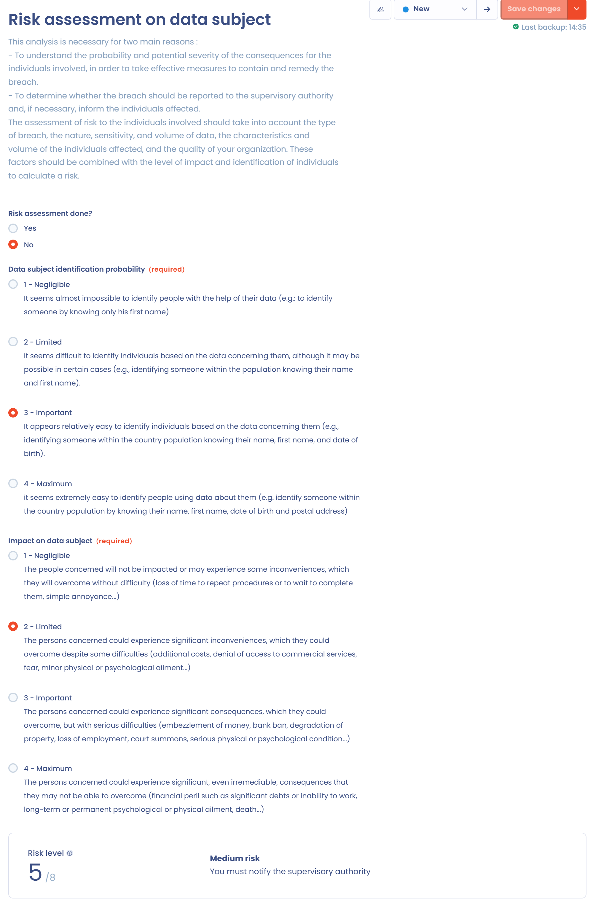
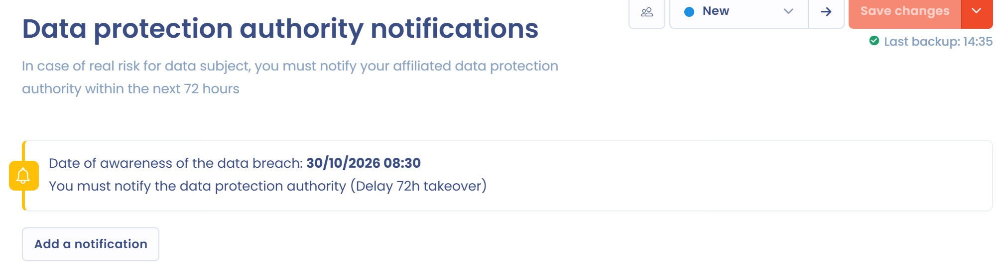
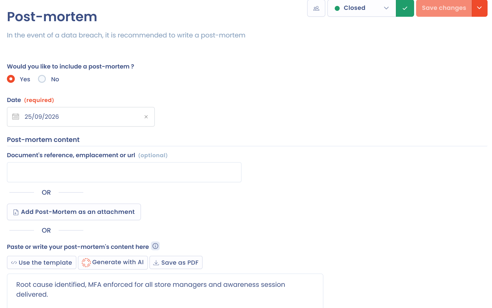

# Een nieuwe inbreuk documenteren

Deze pagina legt uit hoe u een incident in Dastra aanmaakt en hoe u elke stap van het formulier invult. Treedt uw organisatie op als verwerker, lees dan ook [Incidenten als verwerker](as-processor.md).

## Een incident aanmaken

Er zijn drie manieren om een incident aan te maken:

* handmatig, met de knop **Een datalek toevoegen**;
* door een Excel-, CSV- of tekstbestand te importeren: open in het register de pijl van de knop **Een datalek toevoegen**, kies **Importeren** en volg de wizard die wordt beschreven in [Uw gegevens importeren (Excel, CSV)](../general/import.md);
* per e-mail: een verzameladres zet elke e-mail die het ontvangt, met de bijlagen ervan, om in een incident. Zie [Gegevens verzamelen via inkomende e-mail](../settings/mailboxes.md).

### Een incident handmatig aanmaken

1. Open **Operations** > **Incidenten** > **Incidentenregister** en klik op **Een datalek toevoegen**.
2. Typ de **Titel van het datalek** en kies de **Organisatie-eenheid**. Beide velden zijn verplicht.
3. Beantwoord de vraag **Bent u in het kader van dit incident een subcontractant?**. Het standaardantwoord is **Neen**.
4. Klik op **Creëren**. Het incidentformulier opent op de eerste stap.

<figure><figcaption>
Het venster om een incident aan te maken
</figcaption></figure>

Antwoord alleen **Ja** als uw organisatie de getroffen gegevens verwerkt namens een verwerkingsverantwoordelijke. Het formulier wordt dan aangepast, zoals uitgelegd in [Incidenten als verwerker](as-processor.md).

## Door het formulier navigeren

De stappen van het formulier staan links. Een teller toont hoeveel items zijn ingevuld voor de stappen met een lijst. Doorloop ze in volgorde met **Volgende** en **Vorige**, of ga rechtstreeks naar de gewenste stap.

<figure><figcaption>
Het incidentformulier, hier op de stap Algemeen
</figcaption></figure>

* Klik op **Opslaan** om uw wijzigingen te bewaren, of open de pijl van de knop en kies **Opslaan en stoppen**.
* Bovenaan het formulier geven tabbladen toegang tot de discussies, de gerelateerde taken, de relaties met andere objecten, de geschiedenis en de audits.
* De keuzelijst voor de werkstroomfase brengt het incident vooruit in uw werkstroom. Zie [Workflowstappen](../settings/workflow-stages.md) om ze te configureren.
* Het menu van de knop **Opslaan** geeft ook toegang tot **Exporteren**, **Delen**, **Regel voor werkstromen**, **Aangepaste velden**, **Dupliceren** en **Verplaats naar de prullenbak**.

De stap **Kennisgeving** verschijnt niet voor een incident dat als verwerker wordt behandeld en de stap **AI-systemen** verschijnt alleen als de module AI-systemen is ingeschakeld.

## Stap Algemeen

Beschrijf het incident en de omstandigheden ervan:

* **Titel van het datalek**, **Interne referentie**, **Organisatie-eenheid** en **Labels**;
* **Type datalek**: **Verlies van confidentialiteit**, **Verlies van integriteit** of **Verlies van beschikbaarheid**. U kunt er meerdere aanvinken;
* **Startdatum en -tijd van inbreuk**, **Einddatum en -tijd van inbreuk** en het vakje **Inbreuk is nog aan de gang**;
* **Datum en tijd waarop de inbreuk werd vastgesteld**;
* **Persoon die verantwoordelijk is voor het opvolgen van de inbreuk**;
* **Algemene beschrijving van de inbreuk** en **Plaats van de inbreuk**;
* **Oorzaken van het datalek** (Onbekend, Opzettelijke interne handeling, Toevallige interne handeling, Opzettelijke externe handeling, Toevallige externe handeling of Andere), een optionele secundaire reden en verdere details over de oorzaak;
* **Zijn er verwerkers bij betrokken?** Antwoordt u **Ja**, vermeld dan de betrokken verwerkers onder de stakeholders van uw werkruimte.


De datum van vaststelling is het vertrekpunt van de meldtermijn. Voer de datum en het tijdstip in waarop u kennis kreeg van de inbreuk, niet het moment waarop ze begon.


## Stap Gegevens

Geef aan welke persoonsgegevens zijn getroffen:

* **Datasets die betrokken zijn bij de inbreuk**: selecteer de datasets van uw werkruimte;
* **Datavolume**: kies een waarde in een lijst (**Selecteer**) of typ een getal (**Voer een waarde in**). Dit is het geschatte aantal getroffen records;
* **Gegevensdragers die betrokken zijn bij de inbreuk**;
* **Zijn er gevoelige gegevens bij betrokken?** Het antwoord voedt de indicator **Met gevoelige gegevens** van het register.

## Stap Maatregelen

Beschrijf de beveiligingsmaatregelen in twee delen:

* **Maatregelen vóór het datalek**: selecteer bestaande beveiligingsmaatregelen en vul aan met een tekst;
* **Maatregelen genomen om de inbreuk te herstellen of om de negatieve gevolgen te verzachten**, op dezelfde manier weergegeven.

Dit is de informatie die artikel 33, lid 3, van de AVG u vraagt te beschrijven in de melding aan de toezichthoudende autoriteit.

## Stap Categorieën van betrokkenen

Klik op **Voeg een categorie betrokkenen toe** voor elke getroffen categorie. Kies in het venster de categorie, typ de **Geschatte hoeveelheid betrokkenen** en voeg zo nodig een opmerking toe. U kunt elke rij daarna bewerken of verwijderen.

## Stap Verwerkingen

Selecteer onder **Geef verwerkingen aan die verband houden met het datalek** de betrokken verwerkingsactiviteiten van het register en vul daarna zo nodig **Aanvullende waarnemingen** in. Dastra gebruikt deze koppelingen ook om de verwerkingsverantwoordelijken van een incident als verwerker te vinden.

## Stap AI-systemen

Wanneer een inbreuk een AI-systeem betreft, als oorzaak, als vector of omdat het de getroffen gegevens verwerkt, selecteert u het onder **Geef de systemen van IA gerelateerd aan het incident aan**. U kunt er meerdere koppelen, onder de AI-systemen van uw werkruimte.

<figure><figcaption>
De stap AI-systemen
</figcaption></figure>

Met deze koppeling kunt u:

* de kolom **AI-systemen** in het register weergeven en incidenten filteren met **AI-systemen** of **Gerelateerd aan een Systeem d'IA**;
* het aandeel incidenten waarbij een AI-systeem betrokken is volgen met de indicator **Inclusief een systeem van IA** van het register en van de pagina **Statistieken**;
* de door AI gegenereerde post-mortem deze systemen laten meenemen.

## Stap Risicoanalyse

De risicoanalyse bepaalt of u de toezichthoudende autoriteit moet melden en de betrokkenen moet informeren.

<figure><figcaption>
De stap Risicoanalyse, met het berekende risiconiveau
</figcaption></figure>

Beantwoord eerst **Is er al een risicoanalyse uitgevoerd?**.

* Bij **Neen** beoordeelt u het incident in Dastra. Kies een score van 1 (verwaarloosbaar) tot 4 (maximaal) voor **Identificatie van de betrokkenen**, die meet hoe gemakkelijk personen uit de gegevens kunnen worden geïdentificeerd, en voor **Impact op de betrokkenen**, die meet hoe ernstig de gevolgen voor hen zijn. Dastra telt de twee scores op en toont het **Risiconiveau**.
* Bij **Ja** hebt u al een eigen analyse uitgevoerd. Kies het niveau in **Conclusie van de risicoanalyse: geschat risiconiveau** en klik daarna op **Verstuur mijn analyse** om het document bij te voegen in de stap Documentatie.

| Som van de twee scores | Risiconiveau | Gevolg dat Dastra toont |
| --- | --- | --- |
| 2 en 3 | Verwaarloosbaar risico | Kennisgeving aan de toezichthoudende autoriteit en communicatie aan personen is niet nodig. |
| 4 en 5 | Reëel risico | Kennisgeving aan de toezichthoudende autoriteit verplicht |
| 6 tot 8 | Hoog risico | Kennisgeving aan de toezichthoudende autoriteit en communicatie aan de betrokken personen verplicht |

Voor het wettelijke kader van deze analyse (artikelen 33 en 34 van de AVG), zie [Meldingen van datalekken](../../gdpr/concepts/breaches.md).

## Stap Kennisgeving

De stap **Kennisgeving** volgt de melding aan de toezichthoudende autoriteit. De AVG verplicht u de inbreuk zonder onredelijke vertraging te melden en, indien mogelijk, uiterlijk 72 uur nadat u er kennis van hebt genomen (artikel 33).

<figure><figcaption>
De stap Kennisgeving en de aftelling ervan
</figcaption></figure>

Een uitgewerkte berekening van de score staat in [Risicoscores](../../examples/risk-scoring.md).

Zodra de risicoanalyse tot een reëel of hoog risico concludeert, telt een bericht de 72 uur af vanaf de datum van vaststelling. Het toont het aantal resterende uren, daarna "72 uur overschreden" wanneer u te laat bent, en vervolgens "U hebt de toezichthoudende autoriteit op de hoogte gebracht" zodra de melding is geregistreerd. Bij een verwaarloosbaar risico meldt het bericht dat u de autoriteit niet hoeft te melden.

Om een melding te registreren:

1. Klik op **Voeg een melding toe**.
2. Klik op de link "Go to the website of the competent authority" om de inbreuk op de website van de autoriteit te melden. Dastra verstuurt de melding niet: het houdt er een register van bij.
3. Vul de datum van de melding in (in de app **Datum communicatie** genoemd), het **Meldingsnummer (verstrekt door de toezichthoudende autoriteit)** en de **Aanvullende waarnemingen**.
4. Bevestig het venster en sla daarna het formulier op.

De aangeboden autoriteit is die van de organisatorische eenheid van het incident. Is er geen gedefinieerd, dan toont het venster "Er is geen toezichthoudende autoriteit gedefinieerd voor uw entiteit" en een link naar de instellingen van de organisatorische eenheid. Zie [Een leidende autoriteit toevoegen](../../getting-started/setup/lead-authority.md).

## Stap Communicatie

Deze stap volgt de informatieverstrekking aan de betrokkenen. Artikel 34 van de AVG vereist die wanneer de inbreuk waarschijnlijk een hoog risico inhoudt voor hun rechten en vrijheden.

Een bericht herinnert u aan wat de risicoanalyse impliceert. Beantwoord daarna **Heb je een bericht gestuurd naar de betrokkenen?** met **Niet van toepassing**, **Ja** of **Neen**.

* Klik bij **Ja** op **Voeg een communicatie toe** en vul de **Ondersteuning voor kennisgeving** (e-mail, brief, telefoongesprek, banner op de website, communicatiecampagne of een andere manier), de **Datum communicatie**, het **Aantal op de hoogte gebrachte personen** en de verzonden inhoud in.
* Beantwoord bij **Neen** de vraag **Waarom heeft u niet gecommuniceerd met de getroffenen**: "Het hoog risico zal zich wellicht niet langer voordoen" of "De gegevens zijn onleesbaar gemaakt". Licht uw keuze toe bij **Justificatie**.

<figure><figcaption>
Het venster Voeg een communicatie toe
</figcaption></figure>

## Stap Post-mortem

Een post-mortem is een gedetailleerde evaluatie van het incident zodra het is opgelost. Het wordt aanbevolen, niet verplicht. Beantwoord **Wilt u een post-mortem opstellen?**. Voer bij **Ja** de **Datum** in en kies daarna een van drie methoden:

* typ de **Documentreferentie, locatie of url** als het document al elders bestaat;
* klik op **Voeg een post-mortem als bijlage toe**;
* schrijf de tekst in de editor, met **Gebruik de template** om te beginnen met een standaardopzet, of **Genereren met de IA**.

<figure><figcaption>
De stap Post-mortem
</figcaption></figure>

**Genereren met de IA** schrijft een concept op basis van de informatie van het incident: context (met de gekoppelde verwerkingsactiviteiten en AI-systemen), tijdlijn, impact, maatregelen en risicoanalyse, communicatie, geleerde lessen en verbeterideeën. Controleer en corrigeer de tekst voordat u ze opslaat. **Opslaan als pdf** exporteert de geschreven post-mortem.

## Stap Documentatie

Verzamel hier alles wat het incident documenteert: vrije tekst met links en afbeeldingen, en bijgevoegde bestanden zoals de post-mortem of het meldingsverslag.

## Stap Samenvatting

De stap **Samenvatting** brengt alle informatie van het incident samen in een alleen-lezenvorm. Gebruik **Alles opvouwen** en **Implementeer alles** om door de secties te bladeren en **Afdrukken** voor een papieren kopie.

## Collega's uitnodigen om het incident aan te vullen

Vaak werken meerdere personen aan een incident. Klik rechtsboven in het formulier op de gebruikersknop, naast de keuzelijst voor de werkstroomfase. Kies in het venster de **Sectie** die moet worden aangevuld, **Selecteer de uit te nodigen gebruikers**, typ uw bericht (u kunt beginnen met een sjabloon via **Selecteer een sjabloon**) en klik daarna op **Verstuur een uitnodiging**.

<figure><figcaption>
Het venster om collega's uit te nodigen een incident aan te vullen
</figcaption></figure>

## Een incident delen

**Delen**, in het menu van de knop **Opslaan** of in het menu van de knop **Een datalek toevoegen** van het register, opent het venster om een deellink aan te maken. Voor de werking van deellinks in het algemeen, zie [Het verwerkingsregister delen](../ropa/share.md).
