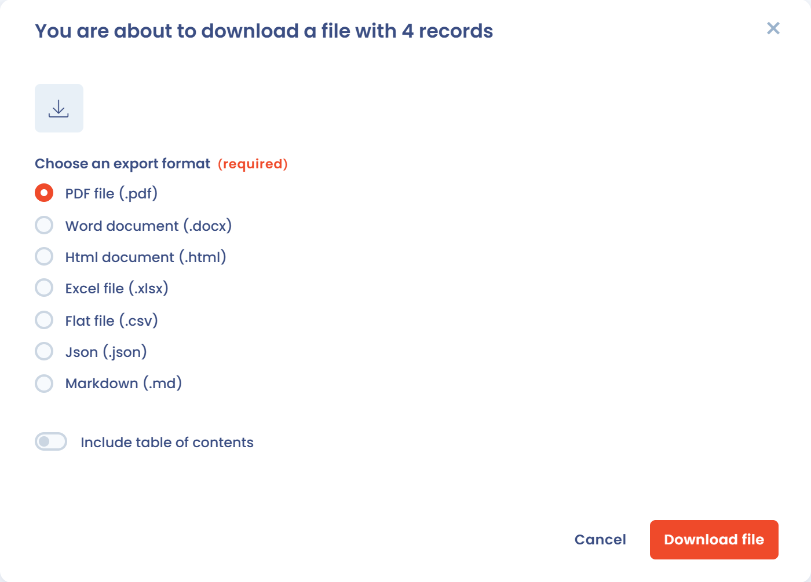

# Uw inbreuken exporteren

U kunt het hele incidentenregister, een selectie incidenten of één incident exporteren, bijvoorbeeld om een verzoek van de toezichthoudende autoriteit te beantwoorden of een afgesloten incident te archiveren.

## Het register exporteren

1. Open **Operations** > **Incidenten** > **Incidentenregister**. Pas filters toe als u maar een deel van het register wilt exporteren: de export gebruikt de actieve filters.
2. Klik op de pijl rechts van de knop **Een datalek toevoegen** en daarna op **Exporteren**.

   <figure><figcaption>
Het menu van de knop Een datalek toevoegen, met het item Exporteren
</figcaption></figure>
3. Selecteer in het venster dat opent onder **Kies het gewenste exportformaat** PDF, Word, HTML, Excel, CSV, JSON of Markdown.
4. Klik op **Bestand downloaden**.

   <figure><figcaption>
Het exportvenster
</figcaption></figure>

Het item **Exporteren** is grijs wanneer het register leeg is of wanneer uw rol exporteren niet toestaat.

## Opties per formaat

* **Een samenvatting opnemen** voor de formaten PDF, Word, HTML en Markdown.
* **Native kolomnamen gebruiken (handig voor het importeren van gegevens)** en **Specifieke kolommen exporteren** voor de formaten CSV en Excel. Met native kolomnamen kunt u het bestand opnieuw importeren: zie [Uw gegevens importeren (Excel, CSV)](../general/import.md).

PDF-, Word- en HTML-exports bevatten maximaal 500 incidenten en CSV-, Excel-, JSON- en Markdown-exports maximaal 10.000. Is uw selectie groter, dan waarschuwt het venster u dat alleen de eerste items worden geëxporteerd.

## Een selectie of één incident exporteren

* Vink in het register de gewenste rijen aan en klik daarna op **Exporteren** in de actiebalk van de selectie.
* Open in het formulier van een incident de pijl van de knop **Opslaan** en klik op **Exporteren**.

Het exportvenster is hetzelfde.
