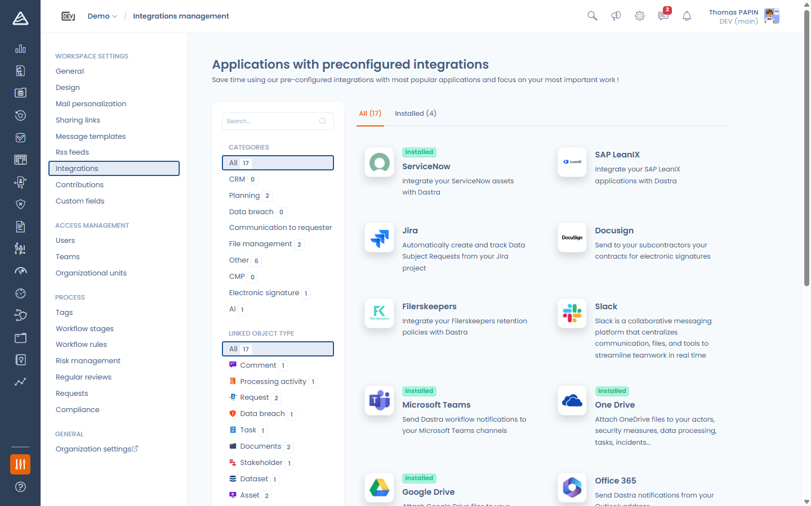
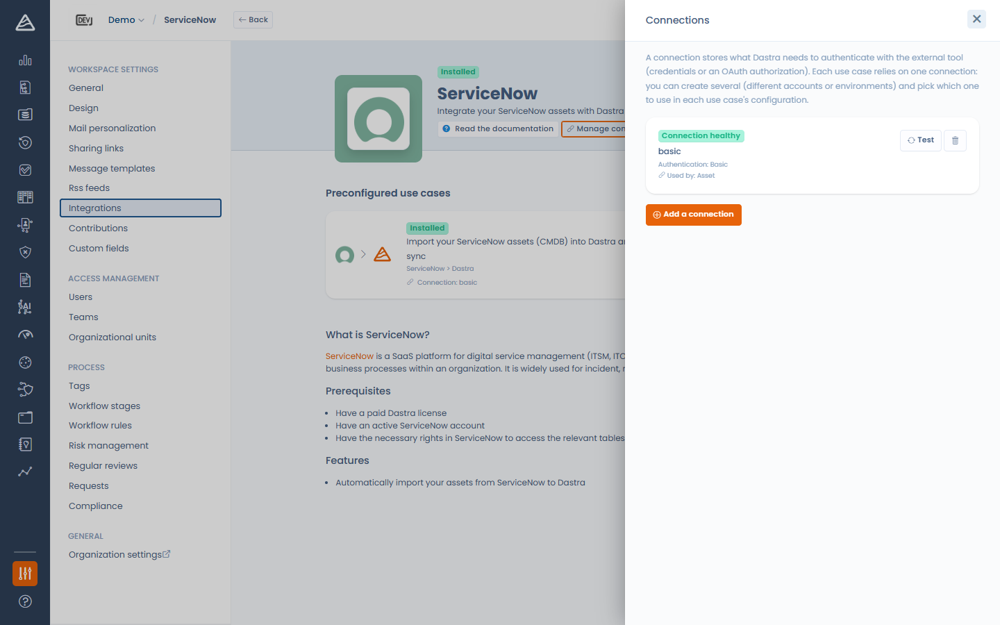
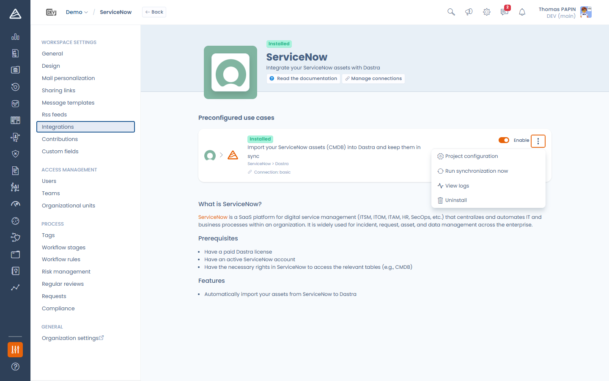
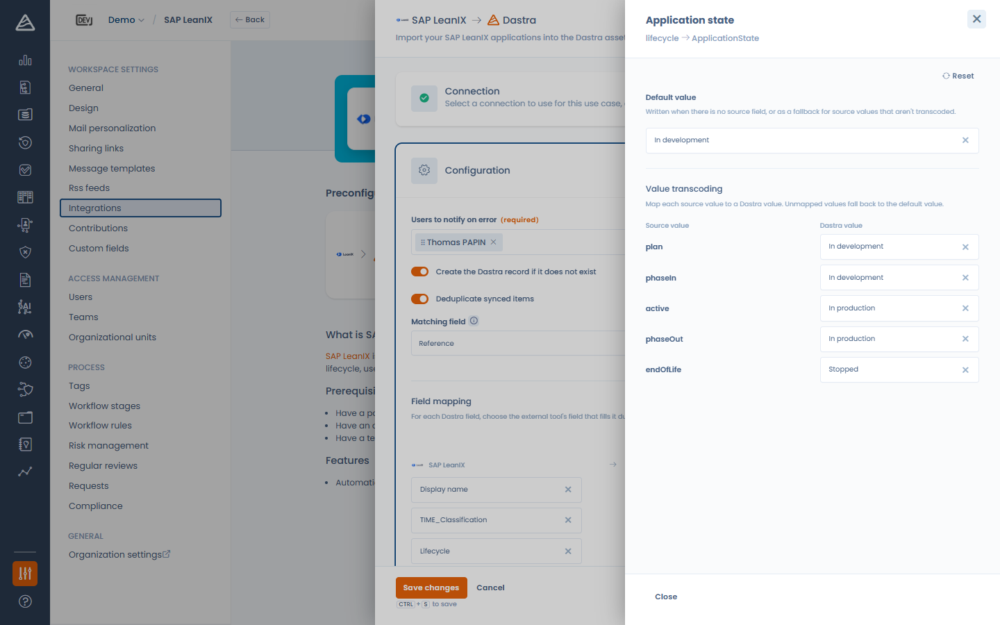
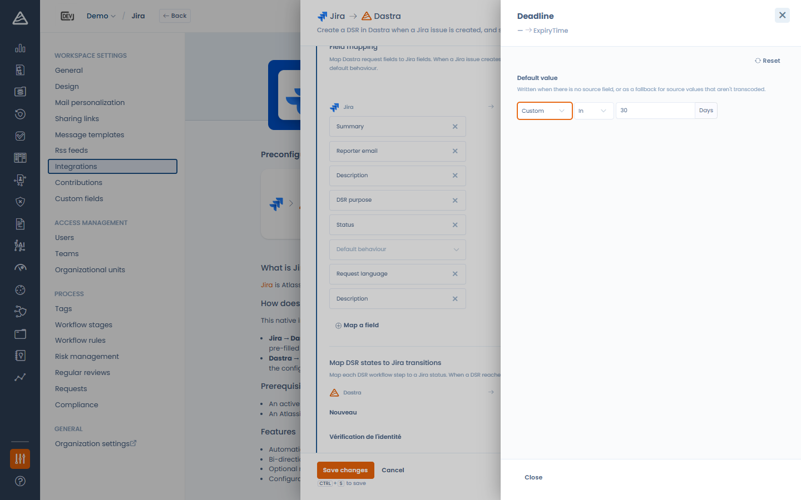
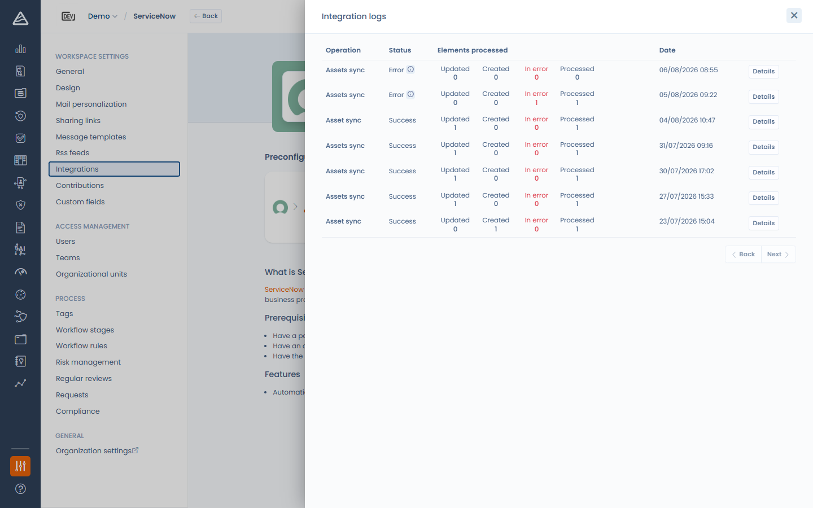

# Verbindingen, gebruiksscenario's en veldmapping

Deze pagina beschrijft de begrippen die alle native integraties gemeen hebben. Voor connectorspecifieke instructies verwijzen we naar de aparte pagina's (ServiceNow, SAP LeanIX, Jira, Microsoft Teams enzovoort).

## De integratiestore

Open **Instellingen voor werkruimte** > **Integraties** in uw werkruimte. De catalogus toont alle beschikbare integraties, te filteren op categorie en op het Dastra-object waarop ze betrekking hebben, met de tabbladen **Alles** en **Geïnstalleerd**.

<figure><figcaption>
De integratiestore
</figcaption></figure>

Klik op een integratie om de pagina ervan te openen. Die toont de beschikbare gebruiksscenario's, elk met de richting van de gegevensstroom (bijvoorbeeld ServiceNow > Dastra), de beschrijving en, voor connectoren die zich bij een externe tool authenticeren, een knop **Beheer de verbindingen**.

## Verbindingen

Een verbinding legt vast wat Dastra nodig heeft om zich bij de externe tool te authenticeren: inloggegevens (gebruikersnaam en wachtwoord of API-sleutel, door Dastra versleuteld opgeslagen) of een gedelegeerde **OAuth**-autorisatie (Dastra slaat geen wachtwoord op).

U kunt meerdere verbindingen met dezelfde tool aanmaken, bijvoorbeeld een productie-instantie en een sandbox, en kiezen welke verbinding elk gebruiksscenario gebruikt.

Klik op **Beheer de verbindingen** om het verbindingenpaneel te openen. Per verbinding ziet u:

* de status: **Operationele verbinding**, **Wachten op toestemming** (OAuth is gestart maar niet afgerond) of **Verbinding mislukt** (met de laatste foutmelding en het aantal fouten),
* de authenticatiemethode,
* de gebruiksscenario's die ervan afhangen.

In dit paneel test u een verbinding met **Tester** (een geslaagde test wist ook de foutstatus) en verwijdert u een verbinding met het verwijderpictogram.

<figure><figcaption>
Het verbindingenpaneel
</figcaption></figure>

Om een verbinding aan te maken, klikt u op **Voeg een verbinding toe**:

1. Geef de verbinding een **Naam van de verbinding** (bijvoorbeeld Productie-instantie). Dat is optioneel, maar handig als u er meerdere hebt.
2. Kies de **Authentificatiemethode** wanneer de connector er meer dan één ondersteunt: **Basis (inloggegevens / API-sleutel)** of **OAuth**. De integratie [HTTP / Custom API](custom-http.md) biedt ook **API key / token** en **OAuth 2.0 (client credentials)**: bij die laatste authenticeert Dastra zich met zijn eigen client-ID en geheim, zonder aanmelding van een gebruiker, en vernieuwt het de toegangstokens automatisch.
3. Vul de velden in die de connector vraagt (URL van de instantie, API-token enzovoort).
4. Klik op **Verbinden**, of bij OAuth op **Opslaan en inloggen**. U wordt dan doorgestuurd naar de externe tool om Dastra te autoriseren.

<figure><figcaption>
Een verbinding aanmaken
</figcaption></figure>


**Ingetrokken OAuth-verbinding.** Wanneer de autorisatie van een OAuth-verbinding is ingetrokken of verlopen, detecteert Dastra dat de eerste keer dat de verbinding wordt gebruikt en toont het een melding over een integratiefout met een knop **Reauthorize**. De knop opent het verbindingenpaneel van de integratie. Klik bij de betreffende verbinding op **Reauthorize** om de autorisatie opnieuw te starten: de verbinding en de gebruiksscenario's die ervan afhankelijk zijn, blijven behouden.



Verbindingen die workflowregels gebruiken. Bij de integratie [HTTP / Custom API](custom-http.md) is een verbinding niet aan een gebruiksscenario gebonden: elke actie **Send an HTTP request** van een workflowregel kiest rechtstreeks de te gebruiken verbinding en meerdere regels kunnen dezelfde verbinding delen. Het verbindingenpaneel toont hoeveel regels elke verbinding gebruiken. Wist u een verbinding, dan worden de regels die ervan afhangen uitgeschakeld. Zie ook [Een HTTP-verzoek versturen](../settings/workflow-rules.md#een-http-verzoek-verzenden) bij de workflowregels.


## Een gebruiksscenario installeren

Klik op **Integratie toevoegen** op de kaart van een gebruiksscenario. Het configuratiepaneel leidt u door maximaal drie stappen:

1. **Verbinding**: selecteer een bestaande verbinding of maak er een aan in de keuzelijst.
2. **Configuratie**: de connectorspecifieke instellingen (synchronisatieopties, veldmapping enzovoort). Deze stap komt beschikbaar zodra u een geldige verbinding hebt geselecteerd.
3. **Webhook**: alleen voor connectoren die gebeurtenissen van de externe tool ontvangen (bijvoorbeeld Jira). Deze stap komt beschikbaar nadat u de configuratie hebt opgeslagen.

Na de installatie biedt de kaart van het gebruiksscenario:

* een schakelaar **Inschakelen**,
* een item **Configuratie** om de configuratie opnieuw te openen,
* **Synchronisatie starten** (alleen importconnectoren) om meteen te synchroniseren,
* **Toon logs** om eerdere uitvoeringen te bekijken,
* **Verwijderen**.

<figure><figcaption>
Een geïnstalleerd gebruiksscenario en zijn acties
</figcaption></figure>


Als u een gebruiksscenario verwijdert, worden de bijbehorende inloggegevens gewist. Activa, verzoeken en andere records die de integratie heeft aangemaakt, blijven behouden: ze behoren tot uw werkruimte.


## Veldmapping

Importgebruiksscenario's hebben een sectie **Veldmapping**: kies voor elk Dastra-veld het veld van de externe tool dat het tijdens de synchronisatie vult. Een veld zonder bron behoudt zijn **Standaardgedrag**.

* Verplichte Dastra-velden zijn gemarkeerd met een rode asterisk. U kunt de configuratie niet opslaan zolang een verplicht veld noch een bron noch een standaardwaarde heeft.
* **Een veld mappen** voegt een rij toe voor elk ander Dastra-veld, ook voor uw aangepaste velden.
* De lijst met bronnen wordt waar mogelijk live bij de externe tool opgehaald, zodat ook uw aangepaste attributen aan de bronzijde verschijnen.

<figure><figcaption>
De veldmappingeditor
</figcaption></figure>

### Geavanceerde opties

Elke rij heeft een paneel **Geavanceerd** met twee opties:

* **Standaardwaarde**: wordt weggeschreven wanneer er geen bronveld is, of als terugvaloptie voor bronwaarden die niet zijn getranscodeerd. Bij datumvelden kiest u **Vandaag** of een relatieve datum (bijvoorbeeld over 30 dagen), die wordt bepaald wanneer het record wordt aangemaakt.
* **Transcodering van waarden**: voor gesloten lijsten (statussen, levenscyclusfasen enzovoort) koppelt u elke bronwaarde aan een Dastra-waarde. Waarden die u niet koppelt, krijgen de standaardwaarde.

Een gesloten-lijstveld dat aan een bronveld is gekoppeld, moet een transcodering hebben: zolang die ontbreekt, toont de rij een waarschuwing en kan de configuratie niet worden opgeslagen.

<figure><figcaption>
Standaardwaarde en transcodering van waarden
</figcaption></figure>

Bij datumvelden kan de standaardwaarde dynamisch zijn en wordt ze bepaald wanneer het record wordt aangemaakt:

<figure><figcaption>
Een relatieve standaarddatum (hier: over 30 dagen) op de deadline van het verzoek
</figcaption></figure>

### AI-suggesties

Is de AI-assistent ingeschakeld voor uw account, dan stelt de knop **Suggereer met IA** een volledige mapping voor (en elke rij heeft een eigen suggestieknop). Suggesties overschrijven nooit velden die u al hebt gemapt en worden altijd ter controle voorgelegd voordat u opslaat.

## Synchronisatie en logs

* Importconnectoren (ServiceNow, SAP LeanIX, Filerskeepers) synchroniseren dagelijks. U kunt op elk moment een synchronisatie starten met **Synchronisatie starten**.
* **Toon logs** toont elke uitvoering met het resultaat en de tellers: aangemaakte, bijgewerkte, gemarkeerde en foutieve items, met de foutdetails wanneer er iets misging.

<figure><figcaption>
Integratielogs
</figcaption></figure>
