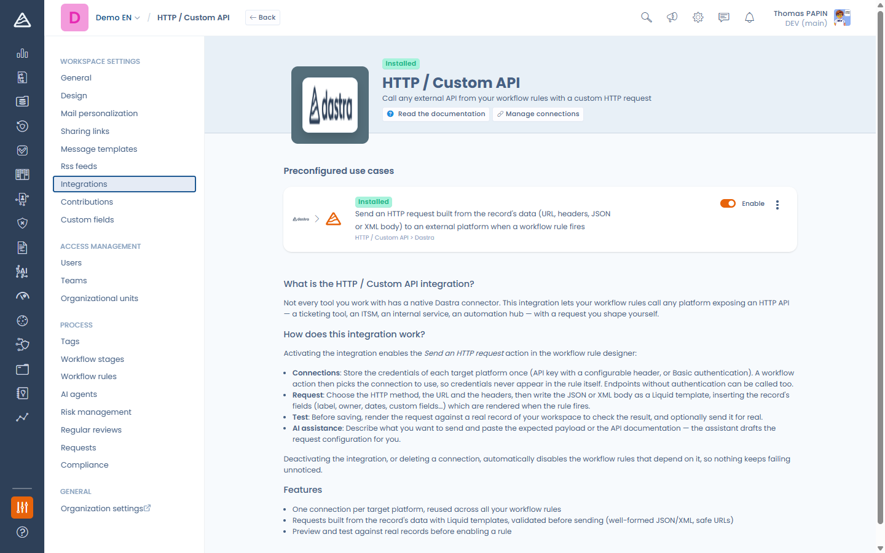

# HTTP / Custom API

## Werking van de integratie

Met de integratie HTTP / Custom API kunnen uw workflowregels elk platform aanroepen dat een HTTP-API aanbiedt, wanneer een regel wordt geactiveerd: een ticketingtool, een ITSM-systeem, een interne dienst of een automatiseringshub. U stelt het verzoek zelf samen: de methode, de URL, de headers en een JSON- of XML-body die is opgebouwd uit de gegevens van het item. Gebruik deze integratie wanneer er voor uw tool geen native connector bestaat.

<figure><figcaption>
De workflowactie Send an HTTP request
</figcaption></figure>

## Vereisten

* Een eindpunt op het doelplatform dat een HTTP-verzoek accepteert (GET, POST, PUT, PATCH of DELETE) en de bijbehorende referenties: een API-sleutel of token, een gebruikersnaam en wachtwoord, of een OAuth 2.0-client (client-ID, clientgeheim en token-URL).
* De machtiging Integraties op de werkruimte, om de integratie te activeren, verbindingen te beheren en HTTP-verzoekacties toe te voegen of te wijzigen. Ontwerpers van workflows zonder deze machtiging kunnen de rest van een regel die zo'n actie bevat nog wel bewerken, of de actie verwijderen, maar ze niet toevoegen of wijzigen.
* Een doel dat bereikbaar is via internet: Dastra blokkeert verzoeken naar privé- of interne netwerkadressen.

## Installatie

1. Open in Dastra **Instellingen voor werkruimte** > **Integraties** en selecteer **HTTP / Custom API**.
2. Activeer het gebruiksscenario: in deze stap voert u geen referenties in, de schakelaar activeert alleen de actie voor de werkruimte.
3. Klik op **Beheer de verbindingen** en voeg één verbinding per doelplatform toe. Een verbinding bevat één manier van authenticeren:
   * **API key / token**: de sleutel, de header die ze draagt (standaard `Authorization`) en een optioneel voorvoegsel voor de waarde (standaard `Bearer ` wanneer de header `Authorization` is). Laat het voorvoegsel leeg voor een header zoals `X-API-Key`.
   * **Basis (inloggegevens / API-sleutel)**: een gebruikersnaam en een wachtwoord.
   * **OAuth 2.0 (client credentials)**: een token-URL, een client-ID en een clientgeheim (plus optionele scopes). Dastra vraagt de toegangstokens zelf aan en vernieuwt ze voordat ze verlopen.

   De optionele **Base URL** wordt alleen gebruikt voor de verbindingstest: Dastra stuurt er een GET naartoe met de referenties en verwacht een succesvol antwoord.

<figure><figcaption>
De integratie is een activeringsschakelaar, de referenties staan op de verbindingen
</figcaption></figure>

<figure><figcaption>
Een verbinding met een API-sleutel toevoegen
</figcaption></figure>


De referenties staan op de verbinding, nooit in de workflowregel. Meerdere regels kunnen één verbinding delen en een werkruimte kan zoveel verbindingen hebben als er doelplatformen zijn. Het beheer van de verbindingen toont hoeveel regels elke verbinding gebruiken.


## Een verzoek versturen vanuit een workflowregel

Zodra de integratie actief is, biedt de ontwerper van workflowregels de actie **Send an HTTP request**:

* **Method** en **URL**: de URL moet absoluut zijn (`https://…`). De host ligt vast, het pad en de query string kunnen variabelen bevatten.
* Tabblad **Authentication**: kies de te gebruiken verbinding, of **No authentication** voor een openbaar eindpunt. U kunt hier ook een verbinding aanmaken.
* Tabblad **Headers**: maximaal 20 aangepaste headers. De waarden accepteren variabelen. De authenticatieheader van de verbinding wint altijd van een header met dezelfde naam.
* Tabblad **Body** (POST, PUT en PATCH): kies het formaat (**JSON**, **XML** of **No body**) en schrijf de body als sjabloon.

Typ `{{` in de URL, in een headerwaarde of in de body om de velden van het item in te voegen (label, eigenaar, datums, aangepaste velden enzovoort). Ze worden ingevuld wanneer de regel wordt geactiveerd. De ingevulde body moet geldige JSON of XML zijn, anders wordt er niets verstuurd en wordt de uitvoering van de regel als fout gelogd.

### Het verzoek testen

**Test the request** vult de URL, de headers en de body in met een echt item van uw werkruimte en valideert ze. De authenticatieheader wordt getoond met een gemaskeerd geheim. **Preview** verstuurt niets. **Send the request** voert de echte aanroep uit en toont de antwoordstatus van het doel en, bij een fout, het begin van de foutmelding.

<figure><figcaption>
Proefrun van het verzoek met een echt item
</figcaption></figure>

### Het verzoek genereren met AI

Met de AI-assistent van Dastra stelt de knop naast het URL-veld (**Generate with AI**) het hele verzoek op: beschrijf wat het moet doen en plak de payload die het doel verwacht, of een fragment uit de API-documentatie ervan. Alleen de namen en typen van de velden van het item worden met de assistent gedeeld, nooit uw gegevens en nooit uw referenties. Het ontwerp bevat nooit authenticatie: die blijft op de verbinding staan. Controleer het ontwerp en gebruik daarna de testknop.

<figure><figcaption>
Het verzoek opstellen vanuit een instructie en de verwachte payload
</figcaption></figure>

## Logs

Elke levering die een regel uitvoert, wordt vastgelegd in de integratielogs van het gebruiksscenario (**Toon logs** in het menu van het gebruiksscenario): de regel, de methode, de doelhost en de antwoordstatus, nooit de volledige URL, de headers of de body. De uitvoeringslogs van de regel zelf bewaren de gedetailleerde foutmelding. Een regel die voor hetzelfde item blijft mislukken, probeert het na drie pogingen niet meer.

<figure><figcaption>
Integratielogs van de HTTP-leveringen
</figcaption></figure>

## Deactiveren en verwijderen

Het gebruiksscenario uitschakelen, het verwijderen of een verbinding verwijderen schakelt de workflowregels die ervan afhangen automatisch uit (ze worden niet verwijderd), zodat niets ongemerkt blijft mislukken. Schakel de regels opnieuw in zodra de afhankelijkheid is hersteld.


Verzoeken verlopen na 15 seconden. Een 2xx-antwoord geldt als geslaagd. Al het andere wordt gelogd als een mislukking, met het begin van het antwoord van het doel. Verzoeken naar privé- of interne adressen worden altijd geblokkeerd.

