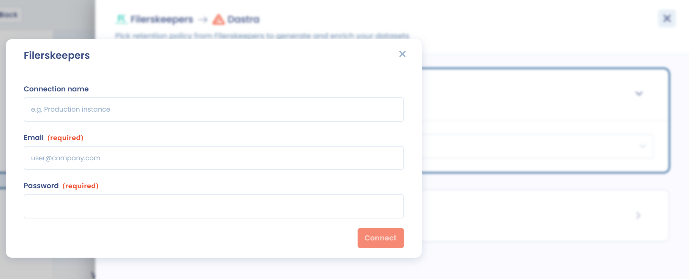

# Filerskeepers

## Over Filerskeepers

[Filerskeepers](https://www.filerskeepers.co/) is een dienst die kant-en-klare bewaartermijnschema's levert, met de wettelijke bewaarvereisten uit de hele wereld.\
De dienst helpt bedrijven te bepalen hoe lang ze elk type gegevens moeten bewaren of wissen om aan de toepasselijke regelgeving te voldoen.

## Vereisten

* Een betaalde Dastra-licentie.
* Een Filerskeepers-account. Hebt u er nog geen en bent u al klant van Dastra, dan kunt u [contact opnemen met ons verkoopteam](https://meetings-eu1.hubspot.com/yann-forveille/rendez-vous-avec-un-expert?message=Filerskeepers+Integration), dat u een voordelig tarief kan aanbieden.
* Een in de Filerskeepers-software ingestelde repository met bewaartermijnen (een "Schedule"). De integratie heeft deze repository nodig om toegang te krijgen tot uw cataloggegevens.


Het gebruik van de connector is onderworpen aan de gebruiksvoorwaarden van Filerskeepers. De gegevens van Filerskeepers zijn uitsluitend bestemd voor intern gebruik binnen uw organisatie: ze mogen niet worden gekopieerd, geëxporteerd, gedeeld of commercieel gebruikt. Filerskeepers-inloggegevens kunnen slechts aan één Dastra-organisatie worden gekoppeld. Als de dienst eindigt, moet u alle Filerskeepers-gegevens verwijderen. Dastra is niet verantwoordelijk voor de inhoud of de updates van Filerskeepers.


## Installatie

De installatie volgt de gemeenschappelijke integratiestroom (zie [Verbindingen, gebruiksscenario's en veldmapping](connections.md)):

1. Open **Instellingen voor werkruimte** > **Integraties** en selecteer **Filerskeepers**.
2. Klik bij het gebruiksscenario voor datasets op **Integratie toevoegen**.
3. Kies in de stap **Verbinding** de optie **Voeg een verbinding toe**. Voer het **E-mailadres van de Filerskeepers-gebruiker** en het **Uw Filerskeepers-wachtwoord** in van een Filerskeepers-beheerdersaccount en klik op **Verbinden**. Dastra gebruikt deze inloggegevens om een toegangstoken voor de Filerskeepers-API te verkrijgen.

<figure><figcaption>
Verbinding maken met Filerskeepers
</figcaption></figure>

4. Selecteer in de stap **Configuratie** de Schedule die u met Dastra wilt synchroniseren. Deze stap is nodig om de installatie af te ronden.

<figure><figcaption></figcaption></figure>

## Configuratie

Open de configuratie opnieuw via het menu van het gebruiksscenario, met het item **Configuratie**.

* **Selecteer het retentieplan (Schedule) Filerskeepers dat u wilt synchroniseren** (verplicht): de Filerskeepers-schedule die met Dastra wordt gesynchroniseerd.
* De schakelaar die de bewaartermijnen gesynchroniseerd houdt: als die is ingeschakeld, worden de datasets die met Filerskeepers zijn gesynchroniseerd één keer per dag bijgewerkt.
* **Gebruikers te waarschuwen in geval van creatie/bijwerking van gegevenssets** (verplicht als synchronisatie is ingeschakeld, maximaal 10): deze gebruikers ontvangen een e-mail met de datasets die zijn aangemaakt of bijgewerkt.
* De schakelaar die ontbrekende datasets aanmaakt: als die is ingeschakeld, wordt voor elk gegevenstype dat in uw Filerskeepers-account is gedeclareerd een dataset aangemaakt.
* De optionele keuzelijst voor het rechtsgebied, zichtbaar wanneer het aanmaken van datasets is ingeschakeld: ze bepaalt welk rechtsgebied wordt gesynchroniseerd voor de aangemaakte datasets. Komt geen rechtsgebied overeen, dan gebruikt Dastra de referentiebewaartermijn (Gouden standaard).


Schakelt u het aanmaken van datasets in, dan worden er automatisch veel datasets in uw werkruimte aangemaakt.


### Een synchronisatie uitvoeren

Om te synchroniseren zonder op de dagelijkse uitvoering te wachten, opent u het menu van het gebruiksscenario en klikt u op **Synchronisatie starten**. Een synchronisatie die u met de hand start, maakt de ontbrekende datasets aan, ook als de optie om datasets aan te maken is uitgeschakeld.

**Toon logs**, in hetzelfde menu, toont de eerdere uitvoeringen en hun resultaat.

## De bewaartermijn selecteren

De Filerskeepers-connector biedt meerdere werkwijzen:

* Weergave van de keuzelijst voor bewaartermijnen op basis van uw Filerskeepers-repository met bewaartermijnen (in de software een "Schedule" genoemd).

Wanneer u vanaf nu in Dastra een dataset opent, verschijnt in de sectie **Bewaartermijnen** een knop om een bewaartermijn te selecteren: **Vul in met Filerskeepers**.

<figure><figcaption>
Kiezen uit de Filerskeepers-schedule
</figcaption></figure>

Met deze knop selecteert u rechtstreeks een dataset uit uw Filerskeepers-repository. **Deze bewaartermijn wordt automatisch met Dastra gesynchroniseerd** als u die optie in de integratieconfiguratie hebt ingeschakeld.

Selecteer een dataset met de knop **Selecteer**.

<figure><figcaption>
Tabel met bewaartermijnen in de schedule
</figcaption></figure>

Zodra u de bewaartermijn hebt geselecteerd, sluit het venster en worden de details van de bewaartermijn getoond.

<figure><figcaption>
Een gesynchroniseerde bewaartermijn
</figcaption></figure>


Alleen bewaartermijnen die bij actieve gegevensopslag horen, worden gesynchroniseerd.


## Gegevenssynchronisatie tussen Dastra en Filerskeepers

Een aantal velden uit Filerskeepers wordt automatisch aan uw bewaartermijn gekoppeld:

* **De bewaarduur** (vanaf)
* **De beschrijving van het bewaarbeleid**
* **De juridische motivering, de link en het rechtsgebied**, die samen in het veld voor de motivering worden gezet
