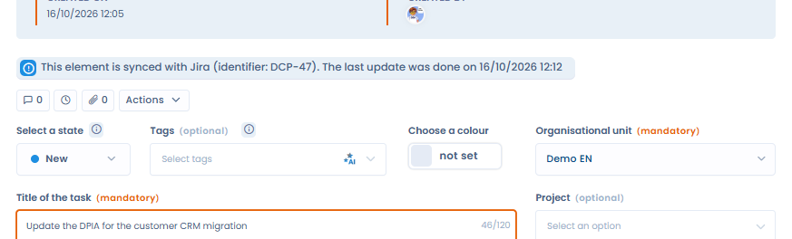

# Jira

## Werking van de integratie

De Jira-integratie biedt twee gebruiksscenario's. Ze delen dezelfde Jira-verbinding en hebben elk een eigen configuratie: Jira-project, tickettype, veldmapping, mapping van stappen naar statussen en webhook.

| Gebruiksscenario | Wat het doet |
| --- | --- |
| Verzoeken van betrokkenen | Een Jira-ticket maakt een verzoek van een betrokkene (DSR) in Dastra aan of werkt het bij. Wanneer het verzoek een workflowstap bereikt, gaat het gekoppelde ticket naar de Jira-status die bij die stap hoort. |
| Taken | U stuurt een Dastra-taak naar Jira, waar ze een ticket wordt. De taak en het ticket blijven daarna gekoppeld: status, verantwoordelijke en gemapte velden komen terug uit Jira, en stapwijzigingen in Dastra verplaatsen het ticket naar de overeenkomstige Jira-status. |

U kunt één gebruiksscenario installeren of beide.

## Vereisten

* Een Jira Cloud-instantie (bijvoorbeeld `https://your-company.atlassian.net`) en een project voor elk gebruiksscenario.
* Afhankelijk van de authenticatiemethode:
  * Basis: het e-mailadres van een Jira-account en een [API-token](https://id.atlassian.com/manage-profile/security/api-tokens) voor die account.
  * OAuth: u hoeft geen token aan te maken. U meldt zich aan met uw Atlassian-account en geeft Dastra toestemming.
* Elk gebruiksscenario wordt alleen getoond aan gebruikers die de bijbehorende module en machtiging hebben:

| Gebruiksscenario | Module | Machtiging |
| --- | --- | --- |
| Verzoeken van betrokkenen | Verzoeken van betrokkenen | Schrijftoegang op verzoeken |
| Taken | Taken | Schrijftoegang op taken |


De methode OAuth verschijnt in de lijst **Authentificatiemethode** wanneer ze beschikbaar is in uw Dastra-omgeving. Gebruik anders een API-token.


## Installatie

1. Open **Instellingen voor werkruimte** > **Integraties** en selecteer **Jira**.
2. Klik bij het gewenste gebruiksscenario op **Integratie toevoegen**.
3. Voeg een verbinding toe, of selecteer de Jira-verbinding die u al voor het andere gebruiksscenario gebruikt:
   * Basis: vul de **URL van de instantie**, de **Email** en het **API token** in en klik op **Verbinden**.
   * OAuth: vul de **URL van de instantie** in en klik op **Opslaan en inloggen**. U wordt doorgestuurd naar Atlassian om Dastra toestemming te geven.

<figure><figcaption>
Dastra verbinden met Jira
</figcaption></figure>


Richten beide gebruiksscenario's zich op dezelfde Jira-instantie, geef dan elk een eigen project of tickettype. Elk gebruiksscenario leest alleen de tickets van zijn eigen project en tickettype: twee gebruiksscenario's op hetzelfde project en tickettype zouden om dezelfde tickets concurreren.


## Gebruiksscenario Verzoeken van betrokkenen

### Configuratie

* **Jira-project**: het project dat u synchroniseert.
* **Tickettype**: het tickettype dat een verzoek van een betrokkene voorstelt.
* **Mapping van velden**: koppel de velden van het Dastra-verzoek aan Jira-velden. Wanneer een Jira-ticket een DSR aanmaakt of bijwerkt, vult de gekozen Jira-waarde elk veld in. De bronnen zijn de standaardvelden van Jira (samenvatting, e-mailadres van de aanvrager, beschrijving, status) en uw aangepaste Jira-velden.
* **Koppel de DSR-statussen aan Jira-overgangen**: koppel elke workflowstap van de DSR aan een Jira-status. Wanneer een verzoek die stap bereikt, laat Dastra het gekoppelde ticket overgaan. Laat een stap op **Geen overgang** staan om ze over te slaan.
* **Standaard organisatie-eenheid (verplicht)**: de eenheid die wordt toegewezen aan verzoeken die de integratie aanmaakt.

<figure><figcaption>
Het gebruiksscenario Verzoeken van betrokkenen configureren
</figcaption></figure>


Het veld e-mail van het verzoek moet worden gemapt (of een standaardwaarde krijgen): het identificeert de betrokkene. Zonder dit veld kunt u de configuratie niet opslaan.


#### Velden met een gesloten lijst van waarden

Sommige Dastra-velden accepteren alleen een vaste lijst van waarden, zoals **Type recht**. Wanneer u er een aan een Jira-veld koppelt, toont de rij **Mapping vereist** tot u aan Dastra aangeeft hoe de Jira-waarden worden omgezet. Open het paneel **Geavanceerd** van de rij en doe dan het volgende:

* koppel elke Jira-waarde aan een Dastra-waarde, en/of
* stel een **Standaardwaarde** in, die wordt gebruikt wanneer de Jira-waarde met niets overeenkomt.

Zolang een rij onvolledig is, kunt u de configuratie niet opslaan. Jira-velden met gesloten waarden (statussen, keuzelijsten) bieden hun mogelijke waarden aan in hetzelfde paneel **Geavanceerd**. Zie [Verbindingen en veldmapping](connections.md) voor de details van de mappingeditor.

<figure><figcaption>
Jira-waarden omzetten naar rechten van betrokkenen in het paneel Geavanceerd
</figcaption></figure>

#### Workflowstappen en Jira-statussen

<figure><figcaption>
Workflowstappen van de DSR koppelen aan Jira-statussen
</figcaption></figure>

Wanneer een verzoek een gekoppelde stap bereikt, zoekt Dastra een Jira-overgang van de huidige status van het ticket naar de gekoppelde status:

* het ticket staat al in die status: er gebeurt niets;
* de Jira-workflow biedt zo'n overgang niet: het ticket blijft ongewijzigd en het integratielogboek toont een vermelding **Sync error** met de huidige status en de doelstatus. Pas de Jira-workflow of de mapping van de stappen aan.

## Gebruiksscenario Taken

### Configuratie

* **Jira-project** en **Tickettype**: waar de tickets terechtkomen die uit taken worden aangemaakt. Ze mogen verschillen van die van het gebruiksscenario Verzoeken van betrokkenen.
* **Mapping van velden**: kies voor elk taakveld het Jira-ticketveld dat het voedt. Telkens als een ticket dat aan een taak is gekoppeld in Jira wordt bijgewerkt, worden de gemapte waarden naar de taak gekopieerd. Velden zonder mapping blijven onaangeroerd.
  * De bronnen zijn de standaardvelden van Jira (samenvatting, beschrijving, status, e-mailadres van de verantwoordelijke, prioriteit, vervaldatum) en uw aangepaste Jira-velden.
  * De doelen zijn de taakvelden, inclusief de aangepaste velden van de taak.
  * De workflowstap en de verantwoordelijke worden niet als doel aangeboden: ze volgen de mapping van stappen naar statussen en de regel voor de verantwoordelijke hieronder.
* Prioriteit werkt in twee richtingen. Het woordenboek van waarden dat u instelt in het paneel **Geavanceerd** van de rij **Prioriteit** zet Jira-prioriteiten om in Dastra-prioriteiten en bepaalt ook welke Jira-prioriteit wordt ingesteld wanneer een taak naar Jira gaat. Zonder vermelding in het woordenboek wordt de Dastra-prioriteit onder haar eigen naam verstuurd (`Low`, `Medium`, `High`), wat overeenkomt met het standaardprioriteitenschema van Jira.
* **Map task steps to Jira statuses**: koppel elke workflowstap van een taak aan een Jira-status. Wanneer een taak die stap bereikt, verplaatst Dastra het gekoppelde ticket naar die status. Wijzigt het ticket in Jira van status, dan gaat de taak naar de gekoppelde stap. Alleen gekoppelde stappen worden gesynchroniseerd, in beide richtingen.

Een standaard organisatie-eenheid is niet nodig: dit gebruiksscenario maakt nooit objecten aan in Dastra.

<figure><figcaption>
Het gebruiksscenario Taken configureren
</figcaption></figure>

### Een taak naar Jira sturen

Open in een taak het actiemenu, klik op **Send to Jira** en bevestig.

<figure><figcaption>
Een taak vanuit haar actiemenu naar Jira sturen
</figcaption></figure>

Dastra maakt een ticket aan in het geconfigureerde project en tickettype, met:

* het label van de taak als samenvatting, de beschrijving van de taak als platte tekst en de vervaldatum van de taak;
* de Jira-prioriteit, gekozen zoals hierboven uitgelegd;
* een link naar de taak in Dastra, zichtbaar op het Jira-ticket;
* de Jira-status die hoort bij de huidige stap van de taak, wanneer die stap is gekoppeld.

De taak toont daarna de banner **Dit element is gesynchroniseerd met Jira**, met de ticketsleutel en de datum van de laatste update, en de actie **Send to Jira** verdwijnt.

<figure><figcaption>
Een taak gekoppeld aan haar Jira-ticket
</figcaption></figure>

Aandachtspunten:

* De actie is beschikbaar voor elke taak van de werkruimte, ongeacht waarop ze betrekking heeft (verwerkingsactiviteit, risico, audit, verzoek enzovoort), voor gebruikers met schrijftoegang op taken, wanneer het gebruiksscenario Taken is geïnstalleerd, geconfigureerd en actief.
* Ze wordt niet aangeboden bij een gearchiveerde taak of bij een taak die al aan een extern systeem is gekoppeld.
* Het versturen gebeurt handmatig, taak per taak: een taak aanmaken of wijzigen maakt nooit zelf een Jira-ticket aan.
* Een taak twee keer versturen (bijvoorbeeld vanuit twee browsertabbladen) maakt nooit een tweede ticket aan: Dastra antwoordt dat de taak al aan haar ticket is gekoppeld.
* Kunnen de link of de beginstatus niet worden ingesteld, dan wordt het ticket toch aangemaakt en aan de taak gekoppeld.

### Wat gesynchroniseerd blijft

| Wijziging | Richting | Effect |
| --- | --- | --- |
| De taak gaat naar een gekoppelde stap | Dastra → Jira | Het ticket gaat naar de gekoppelde Jira-status. |
| Het ticket wijzigt van status in Jira | Jira → Dastra | De taak gaat naar de gekoppelde stap. Haar toestand (open, in uitvoering, afgesloten) en haar activerings- en afsluitdatum worden bijgewerkt zoals bij een wijziging in Dastra. Bereikt ze de laatste stap, dan worden ook de subtaken afgesloten. |
| De verantwoordelijke wijzigt in Jira | Jira → Dastra | De taak wordt toegewezen aan de actieve gebruiker van uw organisatie met hetzelfde e-mailadres als de Jira-verantwoordelijke. De nieuwe verantwoordelijke wordt op de hoogte gebracht. |
| Een gemapt veld wijzigt in Jira | Jira → Dastra | De waarde wordt naar de taak gekopieerd, omgezet met het woordenboek van waarden van de rij wanneer er een is. |

Wijzigingen vanuit Jira verschijnen in de geschiedenis van de taak en activeren meldingen en workflowregels, zoals wijzigingen in Dastra. Een wijziging die uit Jira komt, wordt nooit teruggestuurd naar Jira.

Kan een stapwijziging niet worden toegepast in Jira omdat de Jira-workflow geen overgang naar de gekoppelde status biedt, dan blijft het ticket ongewijzigd en toont het integratielogboek een vermelding **Sync error** met de huidige status en de doelstatus.

Beperkingen van deze versie:

* Alleen tickets die uit een Dastra-taak zijn aangemaakt, worden gesynchroniseerd. De andere tickets van het project worden genegeerd en vanuit Jira wordt geen taak aangemaakt.
* Nadat het ticket is aangemaakt, gaan alleen stapwijzigingen van Dastra naar Jira. Latere wijzigingen van het label, de beschrijving, de vervaldatum of de prioriteit in Dastra worden niet naar Jira gestuurd.
* Is het e-mailadres van de Jira-verantwoordelijke verborgen door de privacyinstellingen van Atlassian, of komt het met geen enkele actieve gebruiker van uw organisatie overeen, dan blijft de verantwoordelijke van de taak ongewijzigd en toont het integratielogboek de reden. Het e-mailadres zelf wordt nooit in het logboek geschreven.
* Een verantwoordelijke in Jira verwijderen maakt de toewijzing van de taak niet ongedaan.
* Opmerkingen en bijlagen worden niet gesynchroniseerd.

### Kolommen van de takenlijst

De kolomkiezer van de takenlijst biedt **Integratiebron**, **Extern integratie-ID** en **Datum van laatste synchronisatie externe integratie**. Ze zijn standaard verborgen.

## Webhook (Jira naar Dastra)

Elk gebruiksscenario heeft een eigen webhook-URL: wijzigingen in Jira bereiken Dastra via die URL. Sla eerst de configuratie op: de URL wordt beschikbaar zodra het gebruiksscenario is geconfigureerd. In de stap **Webhook** zijn er dan twee opties:

* Handmatige registratie: kopieer de **URL van de webhook** en ga in Jira naar **Project settings > Automation** (of **Webhooks**) om een webhook toe te voegen die naar deze URL wijst. Gebruik voor verzoeken van betrokkenen de gebeurtenissen "issue created" en "issue updated". Voor taken volstaat "issue updated".
* **Automatische registratie (optioneel)**: klik op **Webhook registreren in Jira** en Dastra registreert de webhook voor u via de Jira-API, gefilterd op het project en tickettype van het gebruiksscenario. Hiervoor is de globale machtiging Administer Jira nodig op de geconfigureerde account. Opnieuw registreren vervangt de vorige webhook. U verwijdert de webhook met **Verwijder de webhook**.

<figure><figcaption>
De Jira-webhook registreren
</figcaption></figure>


Webhooks die zijn geregistreerd voordat het gebruiksscenario Taken bestond, blijven werken: hun URL richt zich nog steeds op het gebruiksscenario Verzoeken van betrokkenen.


## Integratielogboek

Klik op **Toon logs** bij een gebruiksscenario om te zien wat de synchronisatie met Jira heeft gedaan. Een vermelding **Sync error** zegt wat niet is uitgevoerd en waarom: bijvoorbeeld een Jira-workflow die de verwachte statuswijziging niet toestaat, of een verantwoordelijke die niet kon worden gekoppeld.

## Deactiveren en verwijderen

* Een gebruiksscenario deactiveren stopt de synchronisatie ervan. Het andere gebruiksscenario blijft werken. Bij taken wordt de actie **Send to Jira** niet meer aangeboden. De synchronisatie hervat voor de wijzigingen die na de heractivering plaatsvinden.
* Een gebruiksscenario verwijderen wist de configuratie ervan en verwijdert de webhook die ervoor in Jira is geregistreerd, wanneer die automatisch is geregistreerd. De verzoeken van betrokkenen en de Jira-tickets die al zijn aangemaakt, blijven bewaard en taken behouden de sleutel van hun Jira-ticket.
