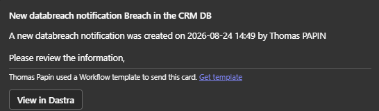
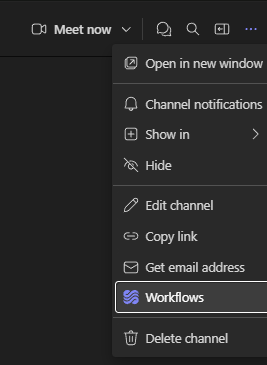
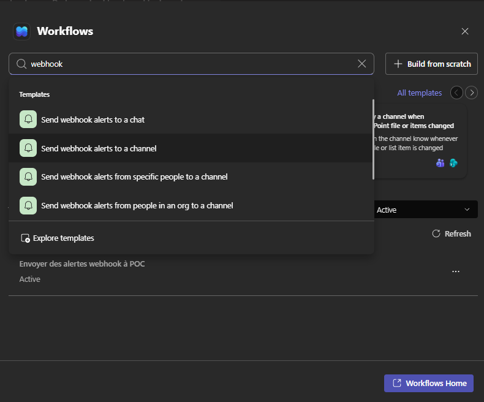
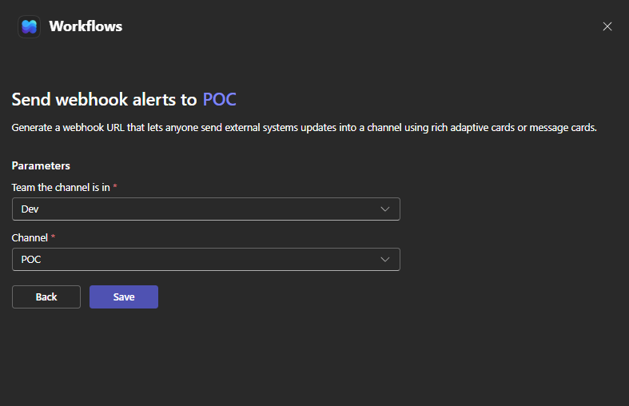
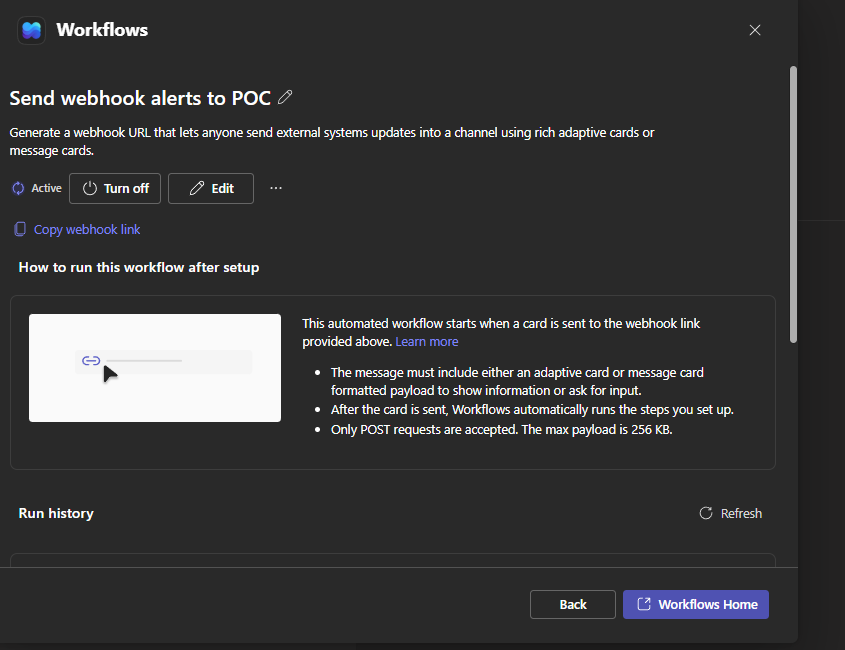
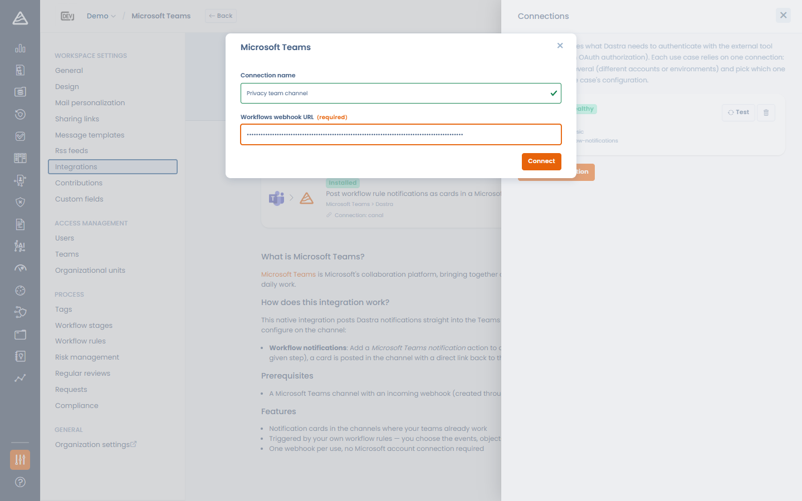
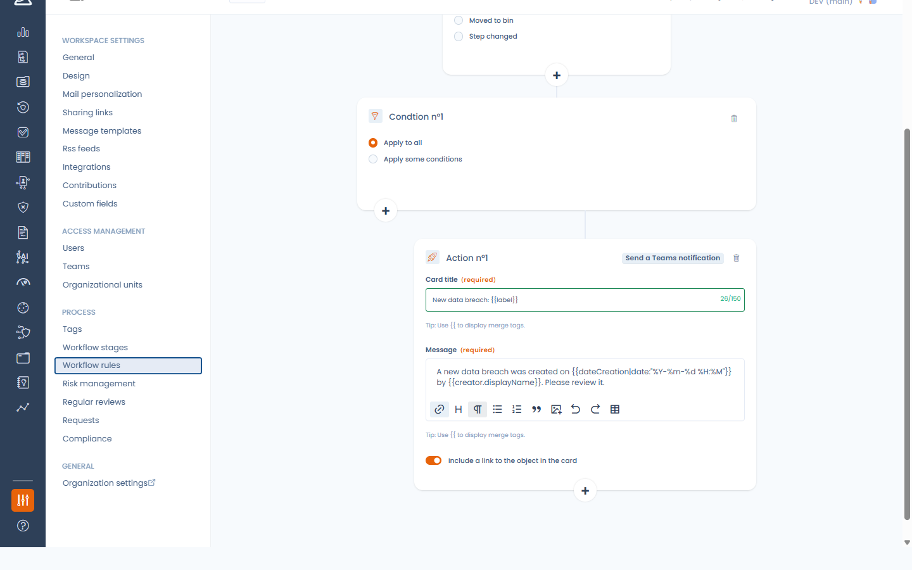

# Microsoft Teams

## Werking van de integratie

De Microsoft Teams-integratie plaatst de workflowmeldingen van Dastra als kaarten in een Microsoft Teams-kanaal. Wanneer een workflowregel wordt geactiveerd (er wordt een datalek aangemaakt, een verzoek gaat naar een volgende stap enzovoort), stuurt Dastra een Adaptive Card met een titel, een bericht en eventueel een link naar het item in Dastra.

<figure><figcaption>
Een workflowmelding van Dastra in Teams
</figcaption></figure>

## Vereisten

U hebt een Microsoft Teams-kanaal nodig met een inkomende webhook die is aangemaakt via de app Workflows (Power Automate):

1. Open het kanaal in Teams en klik op **...** > **Workflows**.

<figure><figcaption>
De optie Workflows in het kanaalmenu
</figcaption></figure>

2. Zoek naar "webhook" en kies het sjabloon **Send webhook alerts to a channel**.

<figure><figcaption>
Het webhooksjabloon kiezen
</figcaption></figure>

3. Selecteer het team en het kanaal en klik op **Save**.

<figure><figcaption>
De workflow aan het kanaal koppelen
</figcaption></figure>

4. Klik in het bevestigingsscherm op **Copy webhook link**. Dit is de URL die u in Dastra plakt (ze ziet eruit als `https://prod-XX.westeurope.logic.azure.com/workflows/...`).

<figure><figcaption>
De URL van de webhook kopiëren
</figcaption></figure>


Microsoft heeft de klassieke inkomende webhooks van Office 365 (kanaalconnectors) in april 2026 stopgezet. De app Workflows is de vervanger van Microsoft en de integratie steunt erop.


## Installatie

1. Open in Dastra **Instellingen voor werkruimte** > **Integraties** en selecteer **Microsoft Teams**.
2. Klik bij het gebruiksscenario **Publiceer de meldingen van uw workflowregels als kaarten in een Microsoft Teams-kanaal** op **Integratie toevoegen**.
3. Voeg een verbinding toe en plak de **Workflows webhook URL**.
4. Klik op **Verbinden**. Dastra plaatst meteen een testkaart met de titel **Testmelding Dastra** in het kanaal om de URL te controleren.

<figure><figcaption>
De Microsoft Teams-integratie installeren
</figcaption></figure>


De URL van de webhook moet een HTTPS-eindpunt van Power Automate zijn (`*.logic.azure.com`, `*.azure-api.net` of `*.api.powerplatform.com`). Andere hosts worden geweigerd.


Wilt u meerdere kanalen notificeren, maak dan één verbinding per kanaal aan (elke Workflows-webhook richt zich op één kanaal).

## Meldingen versturen vanuit een workflowregel

Zodra de integratie is geïnstalleerd en ingeschakeld, biedt de ontwerper van [workflowregels](../settings/workflow-rules.md) de actie **Stuur een Teams-notificatie**.

U configureert ze zoals de actie voor e-mailmeldingen:

* **Titel van de kaart**: ondersteunt samenvoegvariabelen (bijvoorbeeld de naam van het item).
* **Bericht**: opgemaakte tekst met samenvoegvariabelen.
* **Een link naar het object in de kaart opnemen**: voegt een knop **Bekijk in Dastra** aan de kaart toe.

U kiest geen ontvanger: de kaart wordt afgeleverd in het kanaal achter de webhook.

<figure><figcaption>
De workflowactie Stuur een Teams-notificatie
</figcaption></figure>


De Teams-actie verschijnt alleen in de lijst met acties wanneer de integratie in de werkruimte is geïnstalleerd en ingeschakeld.


## Verwijderen

Wanneer u de Microsoft Teams-integratie verwijdert, wordt de URL van de webhook gewist en worden alle workflowregels die de Teams-actie gebruiken automatisch uitgeschakeld (niet verwijderd), zodat uw regels niet gaan mislukken. Schakel ze opnieuw in nadat u de integratie opnieuw hebt geïnstalleerd.
