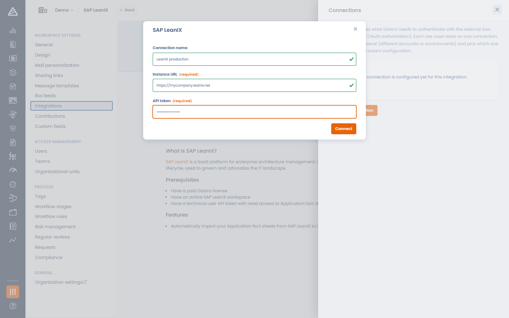
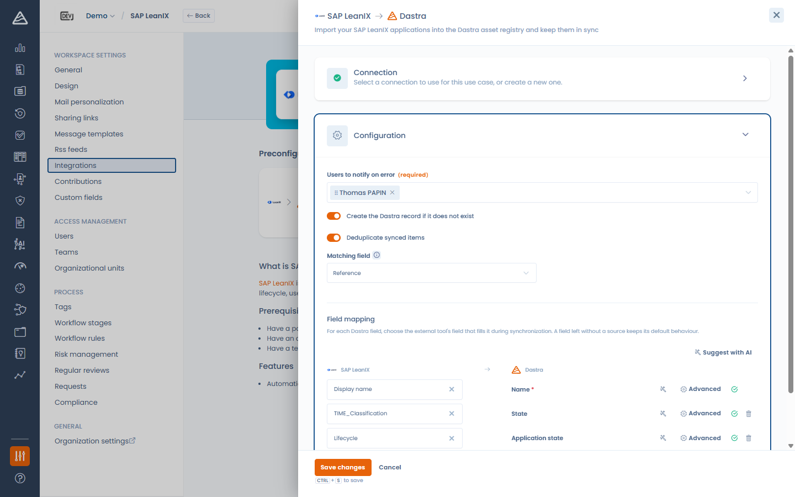

# SAP LeanIX

## Over SAP LeanIX

[SAP LeanIX](https://www.leanix.net/) is een platform voor enterprise-architectuurbeheer: organisaties gebruiken het om hun applicatielandschap in kaart te brengen en te beheren in de vorm van fact sheets.

## Werking van de integratie

De integratie importeert uw SAP LeanIX-fact sheets van het type Application in het activaregister van Dastra en houdt ze gesynchroniseerd:

* Elke LeanIX-applicatie wordt een activum in uw werkruimte, of werkt een bestaand activum bij.
* De synchronisatie loopt dagelijks en u kunt ze op elk moment handmatig starten.
* Bestaande activa worden bijgewerkt en nooit gedupliceerd: de koppeling gebeurt op de identificatie van het LeanIX-fact sheet en eventueel op een veld naar keuze (zie het dedupliceren hieronder).
* De integratie verwijdert nooit activa: applicaties die uit LeanIX verdwijnen, krijgen alleen een label.

## Vereisten

* De URL van uw SAP LeanIX-instantie, bijvoorbeeld `https://your-company.leanix.net`.
* Een API-token van een technische gebruiker van LeanIX, aangemaakt door uw LeanIX-beheerder.


Gebruik de hoofd-URL van uw LeanIX-instantie, zonder pad naar een werkruimte (bijvoorbeeld `https://your-company.leanix.net`, niet `https://your-company.leanix.net/MyWorkspace`).


## Installatie

1. Open **Instellingen voor werkruimte** > **Integraties** en selecteer **SAP LeanIX**.
2. Klik bij het gebruiksscenario **Importeer uw SAP LeanIX-applicaties in het Dastra-activa-register en houd ze gesynchroniseerd** op **Integratie toevoegen**.
3. Voeg een verbinding toe: vul een **Naam van de verbinding**, de **URL van de instantie** en het **API token** in en klik op **Verbinden**. Dastra controleert het token bij uw instantie.

<figure><figcaption>
Dastra verbinden met SAP LeanIX
</figcaption></figure>

## Configuratie

In de configuratiestap bepaalt u hoe de applicaties worden geïmporteerd:

* **Gebruikers te notificeren in geval van een fout** (verplicht): deze gebruikers ontvangen een e-mail wanneer een synchronisatie mislukt.
* **Maak het Dastra-register aan als het nog niet bestaat**: als u deze optie uitschakelt, worden alleen bestaande activa bijgewerkt.
* **Dubbele elementen synchroniseren**: vergelijkt de binnenkomende applicaties met de bestaande activa op een **Correspondentieveld** (**Label** of **Referentie**), zodat ze worden bijgewerkt in plaats van gedupliceerd.
* **Veldmapping**: kies welk LeanIX-veld elk Dastra-veld vult (zie [Verbindingen, gebruiksscenario's en veldmapping](connections.md)).

<figure><figcaption>
De SAP LeanIX-import configureren
</figcaption></figure>

### Bijzonderheden van de veldmapping

* De lijst met bronvelden wordt live opgehaald uit uw LeanIX-datamodel. Uw aangepaste attributen zijn dus beschikbaar, samen met hun mogelijke waarden voor de transcodering.
* De standaardmapping werkt zonder aanpassing: Display name wordt **Label**, Description wordt **Beschrijving** en Lifecycle wordt **Status van de aanvraag**, met een vooraf ingevulde transcodering (plan/phase-in wordt in ontwikkeling, active wordt in productie, phase-out/end-of-life wordt gestopt) die u in het paneel **Geavanceerd** aanpast.
* Koppel een willekeurig LeanIX-veld (bijvoorbeeld een interne applicatie-identificatie) aan de **Referentie** van het activum om het doorzoekbaar te maken in Dastra en het te gebruiken als correspondentieveld voor het dedupliceren.

## Synchronisatie van de gegevens

De synchronisatie loopt automatisch eenmaal per dag. U start ze ook op elk moment met **Synchronisatie starten** op de kaart van het gebruiksscenario. Met **Toon logs** volgt u de uitvoeringen (tellers voor aangemaakt, bijgewerkt en gemarkeerd, en details van fouten).

### Applicaties die in SAP LeanIX zijn verwijderd

Wanneer een eerder geïmporteerd activum niet meer in LeanIX bestaat, verwijdert Dastra het niet: het voegt het label `To-delete-sap-leanix` toe, zodat u het kunt nakijken en beslissen. Verschijnt het fact sheet later opnieuw in LeanIX, dan wordt het label automatisch verwijderd.

Vindt het dedupliceren meerdere overeenkomende activa voor één binnenkomende applicatie, dan krijgen de kandidaten het label `To-merge-sap-leanix` voor een handmatige samenvoegbeslissing.


Geïmporteerde activa behoren tot uw werkruimte: als u de integratie verwijdert, blijven ze (en hun labels) ongewijzigd.

