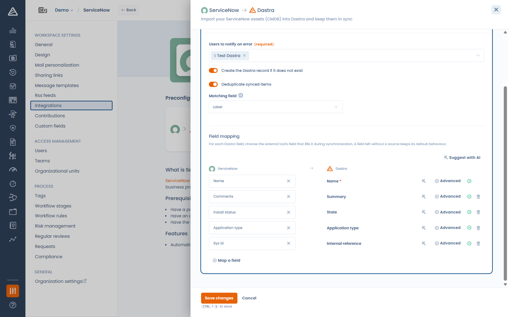

# ServiceNow

## Over ServiceNow

Met de [ServiceNow](https://www.servicenow.com/)-integratie synchroniseert u bedrijfsapplicaties uit de ServiceNow-CMDB automatisch naar Dastra.

U kunt hiermee:

* dubbele gegevensinvoer vermijden;
* de technische activa die in de organisatie worden gebruikt centraliseren;
* deze activa gebruiken in uw verwerkingsregister, datasets, effectbeoordelingen, risicoanalyses, audits enzovoort;
* ervoor zorgen dat de informatie uit ServiceNow in Dastra up-to-date blijft.

## Vereisten

* Een betaalde Dastra-licentie met toegang tot de module Integraties / Connectoren.
* Een ServiceNow-instantie (bijvoorbeeld `https://your-instance.service-now.com`) die REST API-aanroepen van externe bronnen toestaat, en afhankelijk van de authenticatiemethode:
  * OAuth 2.0 (aanbevolen): de mogelijkheid om in uw instantie een OAuth-applicatie te registreren,
  * Basis: een serviceaccount met leesrechten op `cmdb_ci_business_app`.

## Installatie

De installatie volgt de gemeenschappelijke integratiestroom (zie [Verbindingen, gebruiksscenario's en veldmapping](connections.md)):

1. Ga naar de ServiceNow-integratiepagina in de integratiemarktplaats van Dastra.\
   Voorbeeld:\
   [https://app.dastra.eu/workspace/0/settings/integrations/servicenow](https://app.dastra.eu/workspace/0/settings/integrations/servicenow)
2. Klik bij het gebruiksscenario voor het importeren van activa op **Integratie toevoegen**.
3. Voeg een verbinding toe en kies de **Authentificatiemethode** (zie hieronder).
4. Rond de stap **Configuratie** af. Ze is verplicht om de installatie te voltooien.

<figure><figcaption>
De ServiceNow-verbinding aanmaken
</figcaption></figure>

## Authenticatiemethoden

### OAuth 2.0 (aanbevolen)

Dastra slaat nooit een wachtwoord op. ServiceNow geeft tokens met een korte levensduur uit die Dastra automatisch vernieuwt.

1. Maak in ServiceNow een OAuth-app voor Dastra aan: All > Application Registry (in recente versies: Inbound integrations > Authorization code grant), type OAuth API endpoint for external clients.
2. Stel de redirect-URL in op `https://api.dastra.eu/v1/integrationaccounts/callback/servicenow`.
3. Zorg dat de scopebeperking van de app op Broadly scoped staat (of declareer de scope `useraccount`): een securely scoped app zonder scopes weigert de tokenuitwisseling.
4. Maak in Dastra de verbinding aan met de methode **OAuth**, vul de **URL van de instantie**, de OAuth client ID en de OAuth client secret in, klik op **Opslaan en inloggen** en autoriseer Dastra in ServiceNow.

### Basisauthenticatie

Gebruikersnaam en wachtwoord van een ServiceNow-account, door Dastra versleuteld opgeslagen.


Recente ServiceNow-instanties beperken basisauthenticatie op de REST API op accountniveau. Gebruikt u basisauthenticatie, maak dan een speciaal serviceaccount aan waarbij Web service access only is aangevinkt, nooit een persoonlijke gebruiker of een beheerdersaccount. Symptoom van de beperking: een antwoord `401 User is not authenticated`, ook met geldige inloggegevens.


## Configuratie

* Selecteer de **Gebruikers te notificeren in geval van een fout** (verplicht). Zij ontvangen een e-mail wanneer een synchronisatie mislukt, met informatie over de bijgewerkte activa.
* **Maak het Dastra-register aan als het nog niet bestaat**: als deze optie is ingeschakeld, wordt een activum aangemaakt als het niet in Dastra bestaat, op basis van de externe referentie.
* **Dubbele elementen synchroniseren**: vergelijk binnenkomende applicaties met bestaande activa op een **Correspondentieveld** (**Label** of **Referentie**) om ze bij te werken in plaats van duplicaten aan te maken.
* **Veldmapping**: kies welk ServiceNow-veld (uit `cmdb_ci_business_app`) elk Dastra-veld vult. De keuzelijsten worden live uit het gegevenswoordenboek van uw instantie gelezen, zodat u keuzewaarden naar Dastra-waarden kunt transcoderen. Zie [Verbindingen, gebruiksscenario's en veldmapping](connections.md).


Let op: als u de aanmaakoptie inschakelt, kunnen er automatisch veel activa in uw werkruimte worden aangemaakt. Configureer de externe referenties daarom zorgvuldig.


<figure><figcaption>
De ServiceNow-configuratie: opties en veldmapping
</figcaption></figure>

## Gegevenssynchronisatie tussen Dastra en ServiceNow

De synchronisatie loopt automatisch één keer per dag en u kunt ze op elk moment starten met **Synchronisatie starten** op de kaart van het gebruiksscenario. Bij elke synchronisatie worden velden uit ServiceNow gekoppeld aan uw repository met Dastra-activa. Standaard worden de volgende gegevens opgehaald en bijgewerkt:

* het label van het activum
* de beschrijving (de Short Description van ServiceNow)
* het type applicatie
* de installatiestatus
* het type activum (altijd geïmporteerd als Software)
* het bijbehorende gebied of domein (AreaId)
* de bijbehorende labels
* de externe identificatie van ServiceNow (`sys_id`)
* de externe bron (`ServiceNow`)
* de datum van de laatste synchronisatie
* de eigenaar van het activum

U kunt elk van deze standaardgedragingen per veld overschrijven in de editor voor de **Veldmapping**. Al deze gegevens zorgen voor een betrouwbare en actuele koppeling tussen uw ServiceNow-CMDB en uw Dastra-repository.

## Beheer van activa die in ServiceNow zijn verwijderd

Wanneer Dastra merkt dat een eerder gesynchroniseerd activum niet meer in ServiceNow bestaat, wordt het niet automatisch in Dastra verwijderd.

In plaats daarvan voegt Dastra een automatisch label (`To-delete-servicenow`) aan het activum toe om aan te geven dat het in ServiceNow is verwijderd. Verschijnt de applicatie later opnieuw in ServiceNow, dan wordt het label automatisch verwijderd.

Zo:

* blijft de geschiedenis in Dastra bewaard,
* voorkomt u onbedoelde verwijderingen,
* kunt u verouderde activa handmatig nakijken.

Vindt de ontdubbeling voor één binnenkomende applicatie meerdere overeenkomende activa, dan krijgen de kandidaten het label `To-merge-servicenow` zodat u handmatig over het samenvoegen kunt beslissen.
