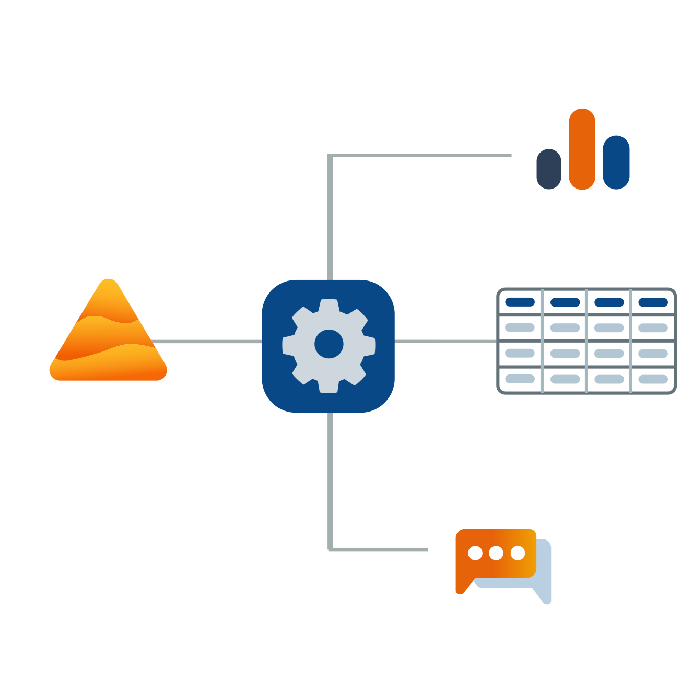

# Zapier

Stel connectoren in tussen Dastra en uw andere favoriete applicaties om uw workflows te automatiseren en tijd te besparen.


[Ga naar de Dastra-pagina in de Zapier-catalogus](https://zapier.com/apps/dastra/integrations)


## Over Zapier

Zapier is een online automatiseringstool die uw applicaties en services met elkaar verbindt. U kunt twee of meer applicaties met elkaar verbinden om terugkerende taken te automatiseren, zonder code te schrijven en zonder ontwikkelaars nodig te hebben.

Met Zapier zet u Zaps (of integraties) op.

Een Zap is een geautomatiseerde workflow die uw applicaties en services met elkaar verbindt. Elke Zap bestaat uit een trigger en een of meer acties. Wanneer u uw Zap activeert, voert die de acties uit telkens wanneer de triggergebeurtenis zich voordoet.

## De drie belangrijkste concepten 

* **Trigger:**\
  Een gebeurtenis die een Zap start. Als u bijvoorbeeld elke keer dat u een e-mail ontvangt een sms wilt sturen, is de trigger "nieuwe e-mail in inbox".
* **Actie:**\
  Een gebeurtenis die een Zap uitvoert nadat die is getriggerd. In hetzelfde voorbeeld is de actie "een sms versturen".
* **Zap:**\
  Een trigger en een reeks acties die samen een geautomatiseerde workflow vormen. Bijvoorbeeld een sms sturen telkens wanneer u een e-mail ontvangt.

## Sjablonen voor een snelle configuratie

We hebben voorgeconfigureerde sjablonen voor geautomatiseerde workflows die u meteen kunt instellen. Ongeveer tien sjablonen zijn al beschikbaar, op onze [integratiepagina](https://www.dastra.eu/en/integrations) of rechtstreeks in de [sectie Integraties](https://app.dastra.eu/workspace/0/settings/integrations) van de Dastra-webapplicatie.

We voegen regelmatig nieuwe sjablonen toe om aan uw automatiseringsbehoeften te voldoen. U kunt ons ook uw ideeën voor geautomatiseerde workflows sturen, zodat we ze als sjabloon kunnen aanbieden.

## Een aanpasbare integratie-editor 

Wilt u een workflow automatiseren waarvoor nog geen sjabloon bestaat, of een bestaand sjabloon lichtjes aanpassen, gebruik dan [de Zap-editor van Zapier](https://zapier.com/apps/dastra/integrations).

Met de Zap-editor bouwt u een Zap vanaf nul, zonder ook maar één regel code te schrijven.

Kies in de [Zapier-catalogus](https://zapier.com/apps) de applicatie die u met Dastra wilt verbinden, configureer een trigger en selecteer daarna de actie die moet worden uitgevoerd. U kunt acties in een applicatie van derden starten vanuit een gebeurtenis in Dastra, of een actie in Dastra starten na een gebeurtenis in een applicatie van derden. Duizenden applicaties zijn compatibel met Zapier.

## Functies van Dastra die met Zapier kunnen worden geautomatiseerd 

Een Zap bestaat uit een trigger en een of meer acties. Dastra biedt momenteel 2 triggers en 6 acties. De triggers en acties aan de kant van derden hangen af van wat de uitgevers van Zapier-compatibele applicaties aanbieden. We breiden deze lijst na verloop van tijd uit, zodat u zoveel mogelijk functies van Dastra kunt automatiseren.

* **Bestaande triggers:**

1. Nieuw verzoek van een betrokkene aangemaakt
2. Nieuwe taak aangemaakt

* **Bestaande acties:**

1. Een taak aanmaken
2. Een stakeholder aanmaken
3. Een verzoek van een betrokkene aanmaken
4. Een stakeholder koppelen aan een bestaande verwerkingsactiviteit
5. Een stakeholder zoeken
6. Een stakeholder zoeken of aanmaken als die niet bestaat

U kunt vertrekken van een van de twee triggers van Dastra om taken uit te voeren in applicaties van derden, of vertrekken van een trigger van een applicatie van derden om een van de zes acties in Dastra uit te voeren.


[Bekijk hier de volledige catalogus van Zapier-applicaties.](https://zapier.com/apps)



Zie de [documentatie van Zapier](https://zapier.com/help) voor meer informatie over het instellen van een connector.


U bent nu klaar om te automatiseren en uw eerste connector in te stellen.

Om uw verzoeken van betrokkenen te automatiseren, volgt u de stapsgewijze handleiding (in het Frans): [Automatiser l'exercice des droits avec Zapier](https://www.dastra.eu/fr/guide/automatisation-exercice-de-droits/51571).
