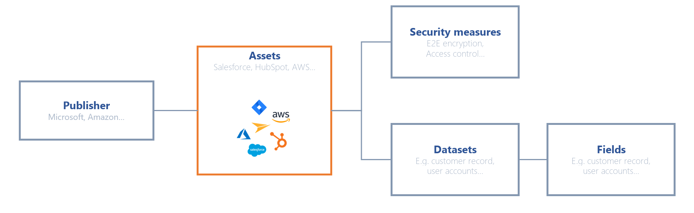

# Gegevens in kaart brengen

## Alles begint met het in kaart brengen van gegevens

Breng de gegevens van uw organisatie zo nauwkeurig mogelijk in kaart voordat u uw verwerkingsactiviteiten aanmaakt. In de toepassing heet deze module **Referenties**. De mapping verbindt vier soorten elementen: de uitgever van een actief, het actief zelf, de beveiligingsmaatregelen die erop van toepassing zijn en de datasets die het bevat, die uit gegevensvelden bestaan.

<figure><figcaption>
Structuur van de gegevensmapping
</figcaption></figure>

Om alle persoonsgegevens van uw informatiesysteem te inventariseren, volgt u deze werkwijze:

1. **Identificeer de activa**: software, bestanden, plug-ins, servers, machines enzovoort.
2. **Identificeer de uitgever van het actief, indien van toepassing**: voer de gegevens in van het bedrijf dat dit actief produceert. Het kan dan worden vermeld bij uw verwerkers wanneer u het verwerkingsregister opbouwt.
3. **Inventariseer de gegevens**: vermeld de bijbehorende datasets (u kunt de verwerkersovereenkomst raadplegen die met de verwerker is ondertekend). Zie [Gegevens en retentie](../ropa/activity/datasets.md) voor meer informatie.
4. **Vermeld de beveiligingsmaatregelen** die zijn getroffen.

Met deze mapping maakt u verwerkingsactiviteiten gemakkelijker aan, omdat u vertrekt van de realiteit van uw gegevens.

Wilt u deze inventaris niet opbouwen, of is de software die u gebruikt standaard, maak dan uw repository van activa aan vanuit de bibliotheek met voorgedefinieerde sjablonen, die veelvoorkomende activa op de markt bevat (Salesforce, Jira enzovoort).

Om één stroom van de leverancier tot de verwerkingsactiviteit te volgen, zie [Een gegevensstroom in kaart brengen](../../examples/data-mapping.md).

## De gegevensmapping openen

1. [Ga naar uw werkruimte](../../getting-started/setup/workspace.md#naar-een-werkruimte-gaan).
2. Klik in het zijmenu onder **Data inventory** op **Referenties**.
3. De pagina **Rapportage** opent: één kaart per repository, met het aantal elementen dat ze bevat.

Klik daarna op de repository die u wilt openen. Voor het pad om ze te openen, de lijstfuncties die alle repositories delen en de grafieken, zie [Referenties](repositories/README.md).

## De repositories van de mapping

Elke repository heeft een eigen pagina:

* [Activa](repositories/assets.md): de software, servers en andere dragers die uw gegevens bevatten.
* [Actoren](repositories/stakeholders.md): de verwerkers, uitgevers en andere bedrijven en personen met wie u werkt, en hun sub-verwerkers.
* [Datasets](repositories/datasets.md): de groepen gegevensvelden, met hun bewaarregels.
* [Verklarende woordenlijst voor gegevens](repositories/data-glossary.md): de gegevensvelden, met hun categorie en gevoeligheidsniveau.
* [Beveiligingsmaatregelen](repositories/security-measures.md): de technische en organisatorische maatregelen die de gegevens beschermen.
* [Categorieën van betrokkenen](repositories/subject-categories.md): de groepen personen van wie u gegevens verwerkt.

Om een verband te documenteren dat het platform niet afleidt, bijvoorbeeld een actief dat aan een stakeholder is gekoppeld, zie [Generieke relaties](relationships.md). Om deze repositories in uw register te hergebruiken, zie [Verwerkingsregister](../ropa/README.md).

## Uw lijst met beveiligingsmaatregelen opbouwen

Beveiligingsmaatregelen hebben hun eigen repository (zie [Beveiligingsmaatregelen](repositories/security-measures.md)): voer ze één keer in en koppel ze daarna aan activa in de sectie **Bijbehorende beveiligingsmaatregelen** van het formulier van een actief. Die informatie staat vaak in de verwerkersovereenkomst die met de uitgever is ondertekend. Kies korte namen (Antivirus, Applicatiefirewall, Toegangscontroles) zodat een maatregel van het ene actief naar het andere kan worden hergebruikt.

## Uw verwerkers beheren

Een verwerker is een [stakeholder](repositories/stakeholders.md) in uw mapping. Voer die in als **Uitgever** van het actief: de verwerker kan dan als verwerker worden aangeduid wanneer het actief in een verwerkingsactiviteit wordt vermeld. In het formulier van de stakeholder kunt u ook de sub-verwerkers van de verwerker opslaan, om de hele keten van onderaanneming in kaart te brengen.
