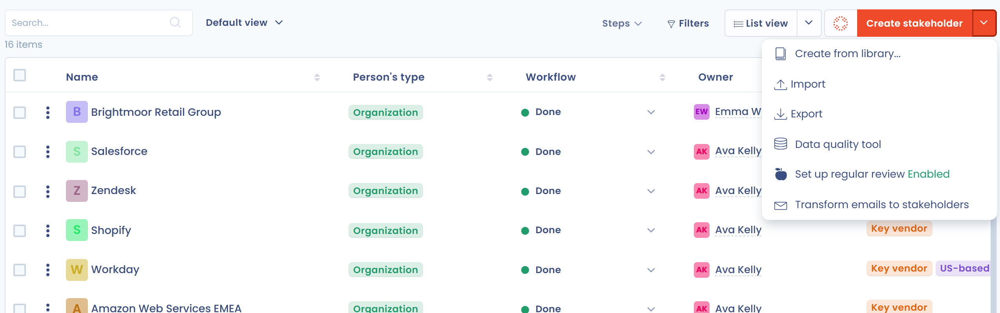

# Actoren

Stakeholders zijn de bedrijven en personen die aan uw gegevensverwerking zijn gekoppeld: verwerkers, softwareuitgevers, aanbieders van AI-modellen, gezamenlijke verwerkingsverantwoordelijken, openbare instanties, klanten enzovoort. In tegenstelling tot gebruikers melden ze zich niet aan bij Dastra.

Voer elke stakeholder één keer in deze repository in. Activa, verwerkingsactiviteiten, contracten en datalekken verwijzen er daarna naar, zodat een wijziging van de gegevens overal geldt.

## Een stakeholder toevoegen

Open **Data inventory** > **Referenties** > **Actoren**. U kunt:

* op **Nieuwe actor** klikken en daarna **Ingebouwde sjabloon** kiezen om te beginnen met een sjabloon uit de bibliotheek, of **Gepersonaliseerd** om vanaf nul te beginnen;
* op de AI-knop links van **Nieuwe actor** klikken om de stakeholder te beschrijven en de assistent een concept te laten opstellen (deze optie hangt af van de functies die voor uw organisatie zijn ingeschakeld);
* op de pijl naast **Nieuwe actor** klikken en daarna op **Maak vanuit de bibliotheek**;
* stakeholders importeren uit een bestand: pijl naast **Nieuwe actor** en daarna **Importeren**. Zie [Uw gegevens importeren (Excel, CSV)](../../general/import.md);
* e-mails omzetten in stakeholders: pijl naast **Nieuwe actor** en daarna **Transformeer e-mails naar belanghebbenden**. Dit opent de integratie voor inkomende e-mail in de instellingen van de werkruimte.

<figure><figcaption>
De lijst van stakeholders
</figcaption></figure>

## Het formulier van de stakeholder invullen

| Sectie | Veld | Inhoud |
| --- | --- | --- |
| **Algemene informatie** | **Persoon** of **Bedrijf** | De aard van de stakeholder. Het naamveld is **Volledige naam** voor een persoon en **Naam van de organisatie** voor een bedrijf, verplicht. |
| | **Interne referentie**, **Organisatie-eenheid** | Uw referentie en de eenheid die de stakeholder kan zien. Zonder eenheid zien alle eenheden hem. |
| | **Eigenaar van de Actor** | De gebruiker die verantwoordelijk is voor de stakeholder. |
| | **Beschrijving/biografie**, **Website url** | Een vrije beschrijving en het adres van de website. |
| | **Bedrijfsregistratienummer** | Alleen voor een bedrijf. Is de SIRET-integratie ingeschakeld, dan kunt u in de SIRET-database zoeken en wordt het adres voor u ingevuld. |
| | **Postadres** | **Land**, **Postadres**, **Stad**, **Postcode** en **Regio**. |
| | **Contactgegevens** | **Naam van contact persoon**, **Functietitel contact opnemen**, **e-mail van het contact** en **Telefoonnummer van het contact**. |
| **Sub-verwerkers** | | De sub-verwerkers van de stakeholder, vaak genoemd in de verwerkersovereenkomst. Selecteer ze in de lijst of maak ze aan en voer daarna bij elk het **Land waar de gegevens zich bevinden** en een beschrijving in. Zo brengt u de hele keten van onderaanneming in kaart. |
| **Verwante activa** | | De activa die de stakeholder publiceert. Door een actief te selecteren wordt de stakeholder de **Uitgever** ervan: heeft het actief al een andere uitgever, dan vraagt Dastra u de vervanging te bevestigen. |

De [aangepaste velden](../../general/custom-fields.md) die voor stakeholders zijn gedefinieerd, worden aan het formulier toegevoegd en u kunt een logo en [labels](../../general/tags.md) bijvoegen.

De werkbalk van het formulier geeft toegang tot de bijgevoegde documenten, opmerkingen, vragenlijsten, taken, contracten en risico's die aan de stakeholder zijn gekoppeld, afhankelijk van uw rechten en de ingeschakelde functies. Ze bevat ook:

* **Gekoppelde elementen**: de [generieke relaties](../relationships.md) van de stakeholder;
* **Gerelateerde verwerkingen**: de verwerkingsactiviteiten die de stakeholder gebruiken, met een knop **Link naar verwerkingen (register, ontvangers...)** om er meer toe te voegen;
* **Historisch**;
* de terugkerende beoordeling van de stakeholder. Zie [Terugkerende beoordeling (frisheid)](../../regular-review.md);
* de werkstroomstap van de stakeholder, wanneer werkstroomstappen zijn gedefinieerd.

Het actiemenu van het formulier biedt **Dupliceren**, **Samenvoegen**, **Exporteren** en **Verwijderen**.

## Stakeholders in de lijst vinden

Naast de filters die worden beschreven in [Referenties](README.md), biedt de lijst:

* het filter **Verantwoordelijkheid**: softwareuitgever (uitgever van ten minste één actief), aanbieder van een AI-model (uitgever van ten minste één AI-model) of ontvanger in een verwerkingsactiviteit (verwerker, gezamenlijke verwerkingsverantwoordelijke, openbare instantie enzovoort);
* de filters **Type**, **Land**, **Stappen** en **Filteren op tags** en de organisatorische eenheid;
* de tabel- en kaartweergave;
* de kolommen **Sub-verwerkers** en **Related contracts**, standaard verborgen, in **Kolommen aanpassen**.

Bij een selectie omvatten de bulkacties **Link naar verwerkingen (register, ontvangers...)**, **Vragenlijsten versturen**, **Beoordeling**, **Samenvoegen** en **Exporteren**.

## Waar stakeholders worden gebruikt

* In een verwerkingsactiviteit kan een stakeholder een verwerkingsverantwoordelijke, een gezamenlijke verwerkingsverantwoordelijke, een verwerker of een andere ontvanger zijn. Zie [Stakeholders](../../ropa/activity/stakeholders.md) en [Ontvangers](../../ropa/activity/recipients/README.md) van de activiteit.
* Als **Uitgever** van een actief. Zie [Activa](assets.md).
* In contracten, datalekken, risico's en vragenlijsten.


Het verwijderen van een stakeholder verwijdert de verwijzingen ernaar in verwerkingsactiviteiten (ontvangers, verwerkingsverantwoordelijke, stakeholder), incidenten, organisatorische eenheden en discussies. Taken, vragenlijsten en bijgevoegde bestanden blijven bewaard.

