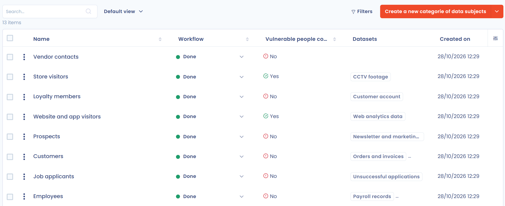

# Categorieën van betrokkenen

Een categorie van betrokkenen groepeert personen van wie u gegevens verwerkt: werknemers, klanten, kandidaten, minderjarigen enzovoort. In het menu heet de repository **Categorie van betrokken personen**.

Maak elke categorie hier één keer aan en selecteer haar daarna in uw datasets, verwerkingsactiviteiten, datalekken en verzoeken, zodat uw rapporten overal dezelfde populaties tellen.

## Een categorie toevoegen

Open **Data inventory** > **Referenties** > **Categorie van betrokken personen**. U kunt:

* op **Categorie van personen toevoegen** klikken om een leeg formulier te openen;
* op de pijl naast die knop klikken en daarna op **Maak vanuit de bibliotheek** om categorieën uit de bibliotheek te kopiëren;
* categorieën importeren uit een bestand: pijl naast de knop en daarna **Importeren**. Zie [Uw gegevens importeren (Excel, CSV)](../../general/import.md).

<figure><figcaption>
De lijst van categorieën, met de kolom Datasets
</figcaption></figure>

## Het formulier van de categorie invullen

| Veld | Inhoud |
| --- | --- |
| **Gelabeld** | De naam van de categorie, verplicht. |
| **Samenvatting** | Een vrije beschrijving. |
| **Betrokken kwetsbare personen** | Vink dit aan wanneer de categorie mensen in een onevenwichtige situatie groepeert, zoals minderjarigen, werknemers of ouderen. |

De werkbalk van het formulier geeft toegang tot de taken en AI-systemen die aan de categorie zijn gekoppeld, afhankelijk van uw rechten en de ingeschakelde functies. Ze bevat ook de verwerkingsactiviteiten die de categorie gebruiken, de datasets van de categorie (zie hieronder), de activiteitengeschiedenis en, wanneer werkstroomstappen zijn gedefinieerd, de werkstroomstap.

Het actiemenu van het formulier biedt **Samenvoegen** en **Verwijderen**. Er is geen **Gegevenskwaliteitsinstrument** voor categorieën.

## Datasets van een categorie

Een dataset kan op meerdere categorieën betrekking hebben en een categorie op meerdere datasets. Deze koppeling helpt u voor een bepaalde populatie te vinden welke gegevens u bewaart, bijvoorbeeld wanneer u een [verzoek van een betrokkene](../../requests/README.md) behandelt.

* Om de datasets van een categorie te zien, opent u het formulier ervan: de knop met het aantal datasets toont ze. Klik op een dataset om hem te openen. Schakel in de lijst van categorieën de kolom **Datasets** in via **Kolommen aanpassen**: u kunt de lijst ook op dataset filteren.
* Om een dataset te koppelen of te ontkoppelen, opent u de dataset en voegt u daarna de categorie toe of verwijdert u ze in het veld **Categorieën betrokken personen**. Zie [Datasets](datasets.md). De lijst van datasets kan ook worden gefilterd op **Categorie van betrokken personen**.
* Om de koppelingen te importeren, gebruikt u de kolom **Datasets** van het importbestand van de categorieën. Ze bevat de namen of identificatoren van datasets, gescheiden door een verticale streep (`|`). Alleen de datasets die al in de werkruimte bestaan, worden gekoppeld: Dastra maakt de andere niet aan.
* Om de koppelingen te exporteren, is de kolom **Datasets** opgenomen in de export van de lijst.

## Categorieën in de lijst vinden

Bij een selectie kunt u **De werkstroomfase wijzigen**, **Samenvoegen** en **Verwijderen**.

## Waar categorieën worden gebruikt

* In een verwerkingsactiviteit toont de sectie **Betrokken personen** de betrokken categorieën, met hun volume. Zie [Betrokken personen](../../ropa/activity/data-subjects.md).
* In datasets, via **Categorieën betrokken personen**. Zie [Datasets](datasets.md).


Het verwijderen van een categorie verwijdert alle verwijzingen ernaar in verwerkingsactiviteiten, datalekken, verzoeken om rechten uit te oefenen en datasets.

