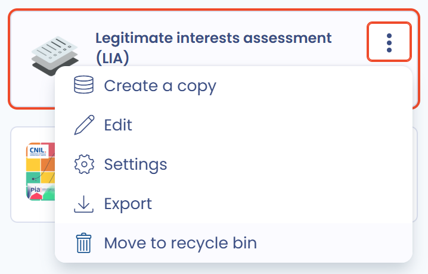

# Een vragenlijst of een sjabloon verwijderen

In Dastra gaat een vragenlijst of een sjabloon voor vragenlijsten eerst naar de prullenbak voordat het definitief wordt verwijderd. Deze stap beschermt tegen onbedoeld verwijderen: zolang het item in de prullenbak staat, kunt u het herstellen.

## Een vragenlijst verwijderen

### Naar de prullenbak verplaatsen

1. Klik in een lijst met vragenlijsten (**Alle audits**, **Mijn vragenlijsten** of het dashboard van een sjabloon) op de drie puntjes van de betreffende rij.
2. Klik op **Verplaats naar de prullenbak** en bevestig.

U kunt de vragenlijst ook openen en **Verplaats naar de prullenbak** kiezen in het menu naast de hoofdknop. Om meerdere vragenlijsten tegelijk te verwerken selecteert u de rijen en gebruikt u de bijbehorende bulkactie.

<figure><figcaption>
De actie Verplaats naar de prullenbak in het menu van een vragenlijst
</figcaption></figure>

### Herstellen of definitief verwijderen

1. Klik boven de lijst op **Filters** en schakel **Bekijk prullenbak** in.
2. Klik in het menu van de vragenlijst op **Herstellen** om hem terug in uw lijsten te zetten, of op **Verwijderen** om hem definitief te verwijderen.

<figure><figcaption>
De prullenbak van vragenlijsten: Herstellen of Verwijderen
</figcaption></figure>


Een definitief verwijderde vragenlijst kunt u niet meer terugzetten.


## Een sjabloon verwijderen

Ook sjablonen voor vragenlijsten hebben een prullenbak.

1. Klik in **Vraagmodellen** op de drie puntjes van het sjabloon.
2. Klik op **Verplaats naar de prullenbak** en bevestig.

<figure><figcaption>
Het menu van een sjabloon voor vragenlijsten
</figcaption></figure>

Om een sjabloon te herstellen of definitief te verwijderen schakelt u boven aan de lijst met sjablonen **Bekijk prullenbak** in. Klik in het menu van het sjabloon op **Herstellen** of **Permanent verwijderen**.

<figure><figcaption>
De prullenbak van sjablonen voor vragenlijsten
</figcaption></figure>


Het aantal sjablonen hangt af van uw abonnement, en de prullenbak van sjablonen telt mee in dit quotum: een sjabloon in de prullenbak bezet nog een plaats tot het definitief is verwijderd. Wilt u een kopie van een sjabloon bewaren voordat u het verwijdert, exporteer het dan als JSON via het menu van het sjabloon: u kunt het later opnieuw importeren.

