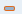
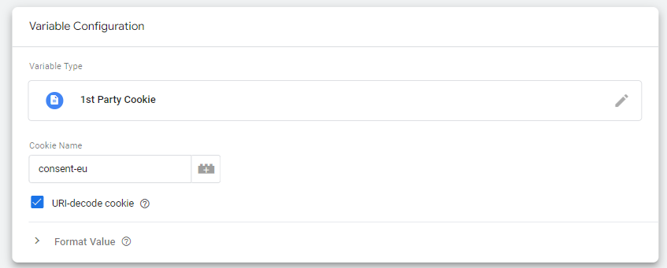
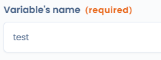
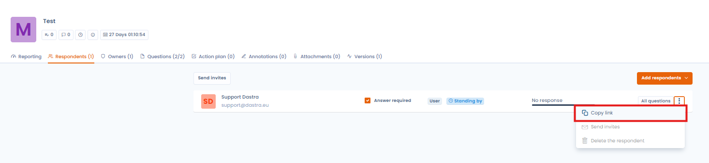
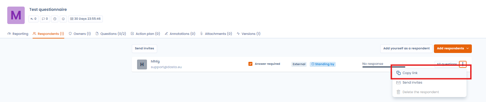

# Veelgestelde vragen

## Kan ik een DPIA uitvoeren voor meerdere verwerkingen?

Een gegevensbeschermingseffectbeoordeling kan betrekking hebben op één verwerking of op een geheel van soortgelijke verwerkingen. Eén DPIA kan worden gebruikt om meerdere verwerkingen te beoordelen die qua aard, reikwijdte, context, doeleinden en risico's vergelijkbaar zijn.

Bijvoorbeeld:

* lokale overheden die elk een soortgelijk camerabewakingssysteem invoeren, kunnen één analyse van dat systeem uitvoeren, ook al wordt het vervolgens door afzonderlijke verwerkingsverantwoordelijken ingezet;
* een spoorwegexploitant (één verwerkingsverantwoordelijke) kan één effectbeoordeling uitvoeren voor het camerabewakingssysteem dat in meerdere stations is geïnstalleerd.

In Dastra is het standaardmodel van de PIA gekoppeld aan één verwerking. U kunt het sjabloon wijzigen zodat de PIA niet aan een verwerking is gekoppeld. In dat geval maakt u de PIA, exporteert u hem en voegt u hem toe aan de documentatie van de betreffende verwerkingsactiviteiten.

## Kan een e-mailsjabloon automatisch worden ingesteld wanneer een vragenlijst wordt aangemaakt?

U kunt een e-mailsjabloon maken dat u gebruikt in de uitnodigingen voor vragenlijsten: klik in het planningsformulier naast het **Uitnodigingsbericht** op **Selecteer een sjabloon**.

Voor andere automatiseringen gebruikt u een werkstroomregel. Reacties op vragenlijsten zijn een entiteit van werkstroomregels, met de naam **Indiening van questionnaire**. Om een regel te maken opent u een reactie, klikt u op de pijl naast de hoofdknop en daarna op **Regel voor werkstromen** en **Een werkstroomregel maken**. Een regel kan bijvoorbeeld een melding versturen of een taak aanmaken wanneer een reactie voldoet aan de voorwaarden die u hebt bepaald. Zie de pagina [Werkstroomregels](../settings/workflow-rules.md).

## Kan ik als externe respondent afbeeldingen in de antwoorden plaatsen?

Nee, dat is niet mogelijk. Deze optie is beschikbaar als u een interne respondent (Dastra-gebruiker) bent.

## Kan op basis van het antwoord op een vragenlijst automatisch een taak worden voorgesteld?

Ja, dat kan bij het vraagtype **Lange tekst** door het vakje **Stel automatisch een taak(en) voor op basis van het antwoord** aan te vinken.

## Kan ik een sjabloon voor vragenlijsten publiceren voor alle Dastra-gebruikers?

Ja, dat doet u vanuit de sjablooneditor door op **Draag bij** te klikken:

<figure><figcaption></figcaption></figure>

## Wat betekenen de kleuren in de antwoorden op een vragenlijst?

In de secties van de vragenlijst zijn kleuren gekoppeld aan de pictogrammen van de vragen.

Dit betekenen de kleuren:

| Kleur | Afbeelding | Beschrijving |
| --- | --- | --- |
| Grijs met rode cirkel |  | Verplichte vraag niet beantwoord |
| Zwart met rode cirkel |  | Verplichte vraag beantwoord |
| Grijs |  | Optionele vraag niet beantwoord |
| Groen |  | Alle vragen van de sectie zijn beantwoord. Optionele vraag beantwoord |
| Groen met rode cirkel |  | Alle vragen van de sectie zijn beantwoord. Verplichte vraag beantwoord |
| Zwart |  | Optionele vraag beantwoord. Sommige vragen van de sectie zijn nog niet beantwoord |

## Wat doet u bij de foutmelding "Error: there is a duplicate slug for the following questions" bij het opslaan van een vragenlijst? 

<figure><figcaption></figcaption></figure>

Deze melding geeft aan dat een of meer vragen in de vragenlijst exact dezelfde **Naam variabele** hebben, wat de fout veroorzaakt.

<figure><figcaption></figcaption></figure>

Vragen met dezelfde **Naam variabele** herkent u aan de foutmelding "De variabelenaam {slug} is aanwezig in een andere vraag" boven die vragen.

<figure><figcaption></figcaption></figure>

Los het probleem op door de **Naam variabele** van elke dubbele vraag te wijzigen zodat die uniek is, bijvoorbeeld door aan het einde van elke **Naam variabele** een oplopend nummer toe te voegen.

<figure><figcaption></figcaption></figure>

Zodra de vragenlijst geen dubbele **Naam variabele** meer bevat, kunt u hem normaal opslaan.

## Wat doet u bij de foutmelding "Geblokkeerd vanwege te veel verzonden e-mails"? 

<figure><figcaption></figcaption></figure>

Deze melding verschijnt wanneer al 5 uitnodigingen per e-mail vanuit dezelfde vragenlijst naar een respondent zijn verstuurd.

Verschijnt deze melding, dan kunt u de respondent toch uitnodigen door hem de uitnodigingslink voor de vragenlijst te sturen, die u hier vindt:

<figure><figcaption></figcaption></figure>

## Wat doet u als u de vragenlijst niet kunt controleren en valideren, terwijl u eigenaar van de vragenlijst bent?

Dat kan gebeuren wanneer de respondent zijn vragenlijst nog niet heeft afgerond door na het invullen op **Finaliseren** te klikken.

In dat geval kunt u als eigenaar de status van de vragenlijst bekijken vanuit het perspectief van de respondent, met de toegangslink voor de respondent die u hier vindt:

<figure><figcaption></figcaption></figure>

## Is er een limiet op het aantal sjablonen voor vragenlijsten?

Ja, het aantal beschikbare sjablonen hangt af van uw abonnement. Dit quotum wordt gedeeld door alle werkruimten van uw organisatie. De prullenbak van sjablonen telt mee in het quotum: verwijderde sjablonen die niet definitief zijn gewist, bezetten nog een plaats. Hebt u de limiet bereikt, leeg dan de prullenbak in het beheer van sjablonen om plaatsen vrij te maken.

## Kan een toegangslink voor een vragenlijst met meerdere mensen worden gedeeld?

Ja. Wanneer een respondent per e-mail een uitnodigingslink ontvangt, is voor de eerste toegang via die link geen pincode nodig. Stuurt de respondent de link door naar een collega, dan moet die persoon zijn toegang bevestigen met een pincode die per e-mail wordt ontvangen. Dit mechanisme zorgt voor beveiliging en maakt tegelijk samenwerking binnen een extern team mogelijk, zonder dat een Dastra-account nodig is.

## Kan een externe respondent zelf andere respondenten toevoegen?

Nee, alleen de eigenaar van de vragenlijst kan in de Dastra-interface nieuwe respondenten toevoegen. Wil een externe respondent een collega betrekken, dan zijn er twee mogelijkheden: de eigenaar voegt het nieuwe e-mailadres rechtstreeks toe in het beheer van de vragenlijst, of de respondent deelt zijn uitnodigingslink. De collega moet dan zijn toegang bevestigen met een pincode die per e-mail wordt verstuurd.

## Is er een automatische herinnering wanneer een vragenlijst op validatie wacht?

Momenteel ontvangt de eigenaar een melding (in Dastra en per e-mail) wanneer de respondent de vragenlijst afrondt, maar er is geen systeem voor periodieke automatische herinneringen. Om geen vragenlijsten in behandeling te missen zijn er twee alternatieven: controleer regelmatig **Mijn vragenlijsten**, gefilterd op de status **In afwachting van validatie**, of stel een werkstroomregel in om op regelmatige tijdstippen een vragenlijst of melding te versturen.

## Vereisen dynamische selectievragen specifieke machtigingen voor respondenten?

Ja. De vraagtypen **Dynamische selector met één keuze** en **Dynamische meerkeuzeselector** tonen lijsten met objecten uit Dastra (activa, verwerkingsactiviteiten, actoren enzovoort). Om die lijst te zien moet de respondent leestoegang hebben tot de bijbehorende objecten in Dastra. Een externe respondent zonder Dastra-account, of zonder de juiste machtigingen, kan de lijst niet zien.
