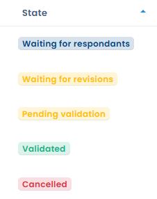
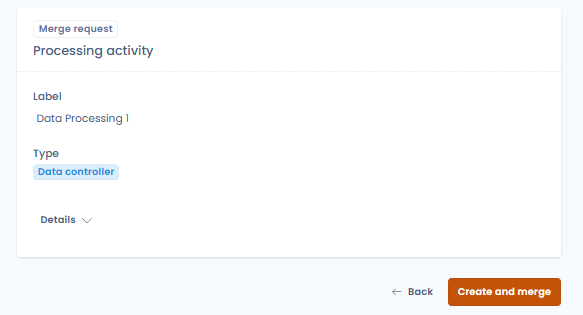

# Vragenlijsten opvolgen

## Dashboard met antwoorden

Klik in **Vraagmodellen** op een sjabloon om het dashboard met antwoorden te openen. Dat dashboard biedt vijf weergaven:

* **Reacties**: lijst van alle antwoorden met hun status (wachten op antwoorden, begonnen, wachten op validatie, geldig, geannuleerd, deadline overschreden), hun score en het gekoppelde object;
* **Gedetailleerd bord**: vergelijking naast elkaar van alle antwoorden per categorie en score, nuttig voor benchmarking tussen entiteiten of verwerkingsactiviteiten;
* **Statistieken**: geaggregeerde statistieken over alle antwoorden voor dat sjabloon;
* **Details**: configuratie en metagegevens van het sjabloon;
* **Vragenlijst**: de inhoud van het sjabloon, die u kunt afdrukken of exporteren.

Open **Alle audits** om de antwoorden van alle sjablonen tegelijk op te volgen.

<figure><figcaption>
Het dashboard met antwoorden van een sjabloon
</figcaption></figure>

<figure><figcaption>
De statussen van de antwoorden, waaronder Geannuleerd (rode badge)
</figcaption></figure>

## Rapportage per antwoord

Een antwoord openen geeft toegang tot een gedetailleerde rapportageweergave:

* **Status**: verloop van **Wachten op antwoorden** naar **Begonnen**, **Wachten op validatie** en **Geldig**;
* **Score**: totale score op het maximale aantal punten;
* **Voltooid**: aantal beantwoorde vragen op het totaal;
* **Reactietijd**: hoe lang het invullen van de vragenlijst duurde;
* **Aandachtspunten**: antwoorden die op basis van de configuratie van het sjabloon automatisch zijn gemarkeerd omdat ze aandacht vragen;
* **Resultaten van de analyse**: automatische analyseblokken op basis van de antwoorden (nalevingsniveau, risicobeoordeling enzovoort);
* **Scores per categorie**: weergegeven als radardiagram of staafdiagram.

Antwoorden op meerkeuzevragen worden beknopt weergegeven:

* alleen de opties die de respondent heeft geselecteerd, worden getoond;
* de link **Alle opties weergeven** onder elke vraag toont de niet-geselecteerde opties van die vraag, en de link **Opties verbergen** keert terug naar de beknopte weergave;
* een onbeantwoorde vraag wordt aangeduid met een koppelteken (-), zonder lijst van opties.

<figure><figcaption>
Alleen de geselecteerde opties worden getoond; de andere opties blijven per vraag beschikbaar
</figcaption></figure>

## Acties op een antwoord

Het menu naast de hoofdknop van het antwoord groepeert de volgende acties, afhankelijk van de status van het antwoord en uw rechten:

* **Deze audit verlengen**: zie [Een audit of PIA plannen](schedule.md);
* **Vragenlijst exporteren**: zie [Een rapport exporteren](export.md);
* **Uitnodigingen versturen**: nodigt de respondenten opnieuw uit zolang het antwoord wacht op antwoorden of begonnen is;
* **Annuleer de vragenlijst**;
* **Deel de audit**: deelt het rapport via een link, alleen wanneer het antwoord geldig is;
* **Het sjabloon wijzigen**;
* **Regel voor werkstromen**;
* **Verplaats naar de prullenbak**: zie [Een vragenlijst of een sjabloon verwijderen](delete.md).

### Werkstroomregels

Antwoorden op vragenlijsten kunnen werkstroomregels activeren. De actie **Regel voor werkstromen** in het menu van het antwoord toont de regels die op antwoorden van toepassing zijn, met hun status en geschiedenis, en laat u er een aanmaken met **Een werkstroomregel maken**. Kies in de regelontwerper de entiteit **Indiening van questionnaire**. Zie [Werkstroomregels](../settings/workflow-rules.md) voor de werking van regels.

## AI-analyse (bèta)

Start vanuit de rapportageweergave van een antwoord de **Analyse IA** om te krijgen:

* een algemene nalevings- of risicoscore;
* een schriftelijke samenvatting van de belangrijkste bevindingen;
* een uitsplitsing per criterium (volledigheid, wettelijke basis, beveiligingsmaatregelen enzovoort);
* voorgestelde taken om de vastgestelde tekortkomingen aan te pakken.


De AI-analyse is een bètafunctie. Interpreteer de resultaten voorzichtig en laat ze nalezen door een gekwalificeerde professional.


## Een antwoord valideren

Klik na het nalezen van het antwoord op **Controleer en valideer de audit** om het de status **Geldig** te geven. Deze actie is voorbehouden aan de goedkeurders van het antwoord. Goedkeuring, verzoeken om revisie en definitieve validatie staan beschreven in [Een vragenlijst valideren](validate.md).

## Een vragenlijst annuleren

Een goedkeurder kan een vragenlijst annuleren zonder terug te gaan naar de lijst met vragenlijsten. De actie **Annuleer de vragenlijst** staat:

* in de validatiestap van een antwoord dat wacht op validatie, naast **Valideer de vragenlijst** en **Vraag revisie aan**;
* in het menu van het antwoord, in elke status zolang het antwoord nog niet is geannuleerd of naar de prullenbak is verplaatst.

<figure><figcaption>
De actie Annuleer de vragenlijst staat in de validatiestap
</figcaption></figure>

Annuleren vraagt om een bevestiging en accepteert een optionele opmerking. De opgegeven reden wordt bewaard in de geschiedenis en blijft zichtbaar voor de respondent.

Een geannuleerd antwoord krijgt de status **Geannuleerd**, getoond als rode badge in de lijst, de filters, de rapportageweergave en de exports. De respondent kan het niet meer bewerken en het wordt niet opgenomen in de resultaten.

Om een geannuleerde vragenlijst te hervatten, opent u die en klikt u op **Vragenlijst opnieuw invullen**. Dastra brengt u naar het uitnodigingsscherm om de respondenten opnieuw uit te nodigen.

## Antwoorden samenvoegen in het gekoppelde object

Bij vragenlijsten waarvan het sjabloon een aanmaaktype is (verzamelen van een verwerkingsproject, datalek, activum, contract, AI-systeem of stakeholder), kunt u de verzamelde antwoorden samenvoegen in een Dastra-object. Met deze actie maakt u het object aan, of werkt u het gekoppelde object bij, op basis van de gegevens die in het formulier zijn ingevoerd, zonder extra handmatige invoer.

De knop verschijnt pas zodra het antwoord geldig is en is actief voor de goedkeurders van het antwoord. Ze heet **Gegevens samenvoegen**, gevolgd door het type object, wanneer het antwoord al aan een object is gekoppeld. Anders heet ze **Aanmaak verzoek**, gevolgd door het type object.

Open het geldige antwoord en klik op deze knop: een bevestigingsvenster toont de velden die in het doelobject worden bijgewerkt.

<figure><figcaption>
De samenvoegknop brengt de antwoorden op de vragenlijst terug in het gekoppelde Dastra-object
</figcaption></figure>

<figure><figcaption>
De samenvoeging bevestigen en de verwerkingsactiviteit aanmaken op basis van de verzamelde antwoorden
</figcaption></figure>

Deze functie is vooral nuttig bij externe gegevensverzameling via een Trust Center, waar derden (leveranciers, verwerkers) informatie invullen die daarna in uw interne registers moet worden doorgevoerd. Zie [Projecten voor verwerkingsactiviteiten, incidenten, activa, contracten, AI-systemen of stakeholders verzamelen via een Trust Center](../trust-center/creation-questionnaires.md).

## Een vragenlijstsjabloon met AI vertalen

De AI kan alle secties en vragen van een sjabloon naar een andere taal vertalen. De werkwijze staat beschreven in [Een vragenlijst vertalen met AI](translate.md).

## Een actieplan genereren

Wanneer een antwoord geldig is, kan een goedkeurder in de rapportageweergave op **Genereer een actieplan** klikken om automatisch taken aan te maken op basis van de gegeven antwoorden. De taken worden voorgesteld volgens de configuratie van het sjabloon en toegevoegd aan de module voor taakbeheer van Dastra.
