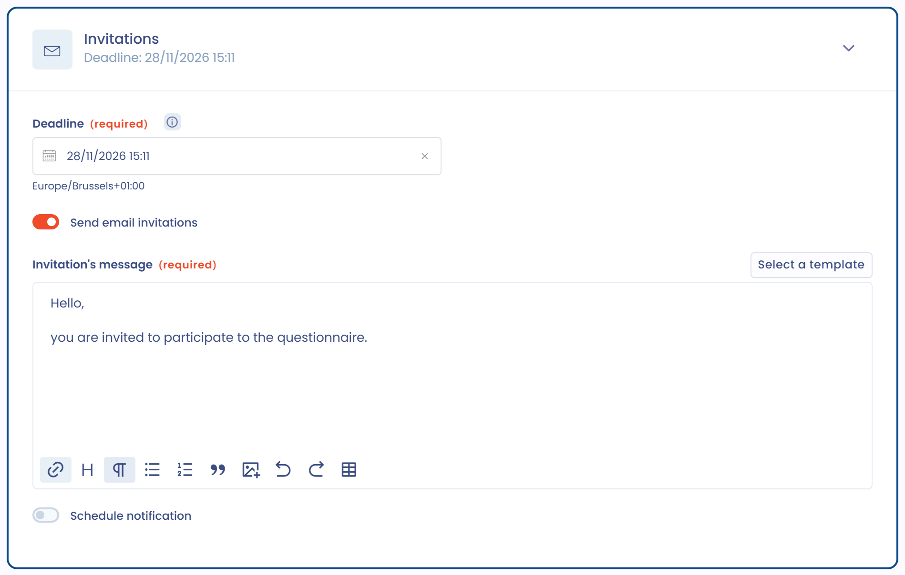

# Een audit of PIA plannen

Een vragenlijst plannen betekent een sjabloon naar de respondenten versturen, of de vragenlijst zelf beantwoorden. Deze pagina behandelt de vier creatiemodi, de planningsinstellingen en de koppeling met andere objecten in Dastra.

## Een planning starten

Zodra het sjabloon voor de vragenlijst is gemaakt en aangepast, klikt u op **Plan een audit**. De knop staat in de lijst **Vraagmodellen**, boven aan de pagina van een sjabloon en, voor PIA-, TIA- en LIA-vragenlijsten, in de betreffende verwerkingsactiviteit (zie [Effectbeoordeling (PIA / DPIA)](types/dpia.md)).

Het venster **Een vragenlijst plannen** biedt vier creatiemodi.

<figure><figcaption>
De vier creatiemodi van een vragenlijst
</figcaption></figure>

### Snelle vragenlijst

**Snelle creatie**: u beantwoordt de vragenlijst zelf en slaat de configuratie over. Dastra maakt de vragenlijst meteen aan, met u als respondent en als goedkeurder, zonder beoordelingsstap of uitnodiging per e-mail, en opent het antwoordformulier. Deze modus past bij interne zelfevaluaties.

### Vragenlijstcampagne

**Respondenten uitnodigen**: u nodigt gebruikers, teams en actoren uit om de vragenlijst te beantwoorden. Deze modus opent het planningsformulier dat in de volgende paragraaf wordt beschreven. Interne en externe respondenten ontvangen een e-mail met een link naar een onlineomgeving waar ze hun antwoorden invullen. Mensen die niet hebben gereageerd, nodigt u opnieuw uit met **Uitnodigingen versturen** in het menu van de reactie.

### Uitnodigingslink

**Uitnodigingslink maken**: u deelt de link naar uw vragenlijst. In het venster dat opent:

1. Kies de **Organisatie-eenheid** en, als het sjabloon aan een objecttype is gekoppeld, het betreffende object.
2. Klik op **Link kopiëren** en deel de link.

Deze modus schakelt het delen via een link voor het sjabloon zelf in: er is geen schakelaar om aan te zetten. Iedereen met de link wordt respondent van de vragenlijst. Bij elke toegang wordt een vragenlijst gegenereerd en de link blijft beschikbaar tot u hem uitschakelt: zet de optie uit om reeds verstuurde links ontoegankelijk te maken. Komt het e-mailadres dat de respondent invult overeen met een Dastra-account, dan wordt het overgenomen naar de aanmeldstap, en de respondent wordt rechtstreeks naar de identiteitsprovider van zijn organisatie gestuurd als SSO is ingesteld.

Om de link terug te vinden of later uit te schakelen opent u de pagina van het sjabloon en klikt u onder de titel op de knop **Toegang**. Het venster **Instellingen uitnodigingslink** opent, met de schakelaar **Enable the ability to respond to the questionnaire by link**. Hetzelfde venster is beschikbaar via het menu naast **Plan een audit**. Een sjabloon dat in een Trust Center wordt gebruikt, kan niet worden uitgeschakeld zolang het niet uit dat Trust Center is verwijderd.

<figure><figcaption>
De instellingen voor het delen van een sjabloon via een link
</figcaption></figure>

### AI-ondersteunde reactie

**AI-ondersteunde reactie**: u bespaart tijd door met AI een reactie op een vragenlijst te genereren. Dit is een creatiemodus, geen actie in een vragenlijst die al openstaat. De optie is grijs wanneer de AI-functie voor vragenlijsten niet is ingeschakeld voor uw organisatie.

In het venster **AI-ondersteunde reactie**:

1. Vul de **Formulering vragenlijst** in en kies de **Organisatie-eenheid**.
2. Selecteer, als het sjabloon aan een object is gekoppeld, het betreffende item: de gegevens ervan worden naar de AI gestuurd.
3. Voeg zo nodig aanwijzingen toe bij **Geef gedetailleerde instructies aan de assistent** (maximaal 300 tekens).
4. Kies de **Answer language**. De antwoorden worden in die taal geschreven, ongeacht de taal van de interface, en Dastra onthoudt de keuze van de ene generatie op de andere.
5. Voeg met **Voeg een document toe** maximaal drie documenten toe (PDF, Word, Markdown, HTML, JSON, CSV of tekst: projectnotities, beveiligingsbeleid, verwerkersovereenkomst, bestaande analyse enzovoort), of geef een websiteadres op bij **Website-URL**.
6. Klik op **Genereer**.

Dastra maakt de vragenlijst aan, met u als respondent en als goedkeurder, vult de antwoorden in die de AI voorstelt en opent de vragenlijst. Controleer elk antwoord, pas het zo nodig aan en rond de vragenlijst daarna af zoals elke andere reactie. Deze modus is vooral nuttig voor lange vragenlijsten zoals DPIA's, TIA's of LIA's, wanneer u al over documentatie beschikt.

Een indicator **Gebruik** verschijnt zodra uw quotum aan AI-credits 80 % bereikt. De generatie wordt geblokkeerd wanneer het quotum is overschreden.


Het gebruik van de AI-ondersteunde reactie verbruikt AI-credits. Zie de pagina [AI-assistent](../general/ai-assistant/README.md) voor details over uw quotum en gebruik.


<figure><figcaption>
Het antwoord op een vragenlijst genereren met AI
</figcaption></figure>

## Planningsinstellingen

De modus **Respondenten uitnodigen** opent een formulier met vier secties.

<figure><figcaption>
De sectie Algemene informatie van het planningsformulier
</figcaption></figure>

### Algemene informatie

* **Formulering vragenlijst** en **Organisatie-eenheid** zijn verplicht.
* **Auditobject** verschijnt wanneer het sjabloon aan een objecttype is gekoppeld (zie de paragraaf "De vragenlijst koppelen aan andere objecten in Dastra" hieronder).
* **De vragenlijst vooraf invullen** kopieert de velden van het gekoppelde object naar de antwoorden. Voor een sjabloon van het type PIA heet de optie **Vul de DPIA automatisch aan uit de verwerking**.
* **Deactiveer de goedkeuringsstap** publiceert de reactie zodra de respondenten die hebben afgerond (zie [Een vragenlijst valideren](validate.md)).

### Respondenten

Kies eerst de antwoordmodus:

* **Individuele audit**: elke respondent beantwoordt zijn eigen vragenlijst. Voegt u meerdere respondenten toe, dan genereert Dastra voor elk van hen een aparte vragenlijst. Deze modus past bij het verzamelen van vergelijkbare informatie bij meerdere personen of entiteiten (beoordelingen van leveranciers, evaluaties per afdeling) en het opstellen van geconsolideerde rapportages.
* **Collaboratieve audit**: de respondenten werken samen aan dezelfde vragenlijst. Deze modus past bij lange of multidisciplinaire vragenlijsten waarbij meerdere teams betrokken zijn (bijvoorbeeld een DPIA waarvoor juridische, IT- en businessteams input leveren).

Klik daarna op **Respondenten toevoegen**:

* **Gebruikers toevoegen** en **Een team toevoegen** voor Dastra-gebruikers;
* **E-mails toevoegen** voor externe respondenten;
* **E-mails toevoegen van actoren** om het contactadres van actoren in uw werkruimte te gebruiken;
* **Voeg jezelf toe als vertegenwoordiger**;
* **Importeer emails met .csv bestand**, met de kolommen `email` en `displayName` (UTF-8, puntkomma als scheidingsteken).

Een vragenlijst accepteert maximaal 50 respondenten. Elke respondent kan verplicht zijn of niet: de reactie gaat naar de status in afwachting van validatie zodra alle verplichte respondenten hun antwoorden hebben afgerond.

<figure><figcaption>
De sectie Respondenten van het planningsformulier
</figcaption></figure>

### Uitnodigingen

* **Deadline**: de uiterste datum en tijd om te antwoorden. Ze wordt voorgesteld op basis van de **Standaard reactietermijn** van het sjabloon.
* **Uitnodigingen per e-mail verzenden**: schakel de optie uit als u de toegangslinks liever zelf verstuurt. Schrijf anders het **Uitnodigingsbericht**, of hergebruik een berichtsjabloon met **Selecteer een sjabloon**.
* **Plan de verzending van de melding**: kies een **Datum waarop de e-mail is verzonden**, binnen de komende 70 uur.

Een externe respondent moet mogelijk zijn identiteit bevestigen met een code van 6 cijfers die per e-mail wordt verstuurd voordat hij toegang krijgt tot de vragenlijst. De [veelgestelde vragen](faq.md) leggen uit wanneer.

<figure><figcaption>
De sectie Uitnodigingen van het planningsformulier
</figcaption></figure>

### Goedkeurders

Goedkeurders controleren de reacties en valideren de vragenlijst. Kies minstens één van de **Vereiste goedkeurders** en schakel zo nodig **Voeg optionele goedkeurders toe** in. Het volledige proces staat in [Een vragenlijst valideren](validate.md).

## Reacties importeren

Om reacties te importeren die u al hebt verzameld, opent u de pagina van het sjabloon, klikt u op de pijl naast **Plan een audit** en daarna op **Antwoorden importeren**. Download het xlsx-sjabloonbestand, vul het in volgens de vereiste indeling voor elke vraag en importeer het daarna (xlsx of csv).

## Terugkerende vragenlijsten en vernieuwing

Antwoord in de configuratie van het sjabloon **Ja** op **Moet deze audit op terugkerende basis worden uitgevoerd?** en stel de **Dagen tussen elke audit** in. Een gevalideerde reactie toont dan de datum waarop ze moet worden vernieuwd, en het label **Te vernieuwen** markeert in de lijsten de reacties die moeten worden vernieuwd.

Om een reactie te vernieuwen opent u de reactie en kiest u **Deze audit verlengen** in het menu. U kunt de versie van het sjabloon kiezen en daarna aangeven of de vernieuwde vragenlijst de antwoorden van de vorige behoudt. Antwoordt u **Neen**, dan begint u met een lege vragenlijst en worden de oude antwoorden gearchiveerd.

## De vragenlijst koppelen aan andere objecten in Dastra

U kunt de vragenlijst koppelen aan een andere module van Dastra. Kies in de configuratie van het sjabloon, nadat u het een naam en een beschrijving hebt gegeven, een objecttype bij **Geauditeerd element**. De mogelijke objecten zijn actoren, activa, verwerkingsactiviteiten, datalekken, verzoeken, beveiligingsmaatregelen, datasets, risicobeoordelingen, AI-systemen en contracten.

<figure><figcaption>
Het veld Auditobject bij het plannen
</figcaption></figure>

Bestaat het sjabloon al, dan kunt u er achteraf nog een object aan koppelen: open het menu van het sjabloon (de drie puntjes), klik op **Instellingen** en vul **Geauditeerd element** in.

Wanneer u de vragenlijst daarna plant, verschijnt het veld **Auditobject**. Met de selector kiest u het exacte object waaraan u de reactie koppelt.


U kunt een vragenlijst maar aan één object in Dastra koppelen.


## Directe toegang tot een DPIA vanuit een verwerkingsactiviteit

Voor vragenlijsten van het type PIA start u de effectbeoordeling vanuit een verwerkingsactiviteit. In de stap **Impactanalyse** van de verwerkingsactiviteit opent de knop **Maak een DPIA** de bijbehorende vragenlijst zonder de verwerkingsactiviteit te verlaten.
