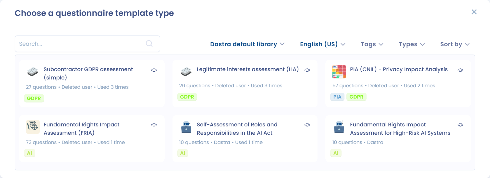

# Een vragenlijstsjabloon aanmaken

Een vragenlijstsjabloon beschrijft de secties, de vragen en de scoreregels van een vragenlijst. U maakt het één keer aan en plant het daarna zo vaak als nodig. Open **Vragenlijsten** > **Vraagmodellen** om de sjablonen te bereiken.

## Een vragenlijstsjabloon aanmaken of wijzigen

Klik bovenaan de lijst **Vraagmodellen** op **Maak een sjabloon** om een sjabloon aan te maken. De knop is grijs wanneer u het aantal sjablonen van uw abonnement hebt bereikt.

<figure><figcaption><p>De lijst met vragenlijstsjablonen</p></figcaption></figure>

Het venster **Kies het type audit** biedt vier opties:

* **Geautomatiseerde audit**: kies een vooraf gedefinieerd sjabloon uit de Dastra-bibliotheek. Zie [Geautomatiseerde vragenlijstsjablonen](#geautomatiseerde-vragenlijstsjablonen).
* **Gepersonaliseerde audit**: bouw uw eigen sjabloon. Zie [Aangepaste vragenlijstsjablonen](#aangepaste-vragenlijstsjablonen).
* **Creëren met AI**: de AI-assistent genereert het sjabloon op basis van uw beschrijving. U kunt met de knop **+** documenten toevoegen (een interne auditlijst in Word, een beveiligingsvragenlijst in PDF enzovoort): de assistent zet de aangeleverde vragenlijst om in secties, vragen, vraagtypen en antwoordopties. Geef het type vragenlijst op (**Standaard**, **Cyber compliance** of **Training**) en daarna, onder **Meer opties**, de gewenste secties, het aantal vragen (van 1 tot 50) en, voor een trainingsvragenlijst, het moeilijkheidsniveau. U bekijkt het resultaat vooraf voordat u het sjabloon aanmaakt. De optie is grijs wanneer de AI-functie voor vragenlijsten niet is ingeschakeld voor uw organisatie.
* **Upload een sjabloon**: importeer een bestaand sjabloon met **JSON-bestand** (een uit Dastra geëxporteerd sjabloon) of **Excel-bestand** (een vragenlijst in Excel- of CSV-indeling).

<figure><figcaption><p>De vier opties om een sjabloon aan te maken</p></figcaption></figure>

<figure><figcaption><p>Een vragenlijstsjabloon met AI aanmaken op basis van een document</p></figcaption></figure>


In tegenstelling tot geautomatiseerde vragenlijsten zijn gepersonaliseerde vragenlijsten volledig aanpasbaar. Op basis van de antwoorden die respondenten kiezen, kunt u automatisch een actieplan genereren of de risico's bij het sjabloon in kaart brengen.


## Geautomatiseerde vragenlijstsjablonen

Dastra biedt veel geautomatiseerde vragenlijstsjablonen die de naleving documenteren en processen aansturen. Ze omvatten DPIA's, TIA's, LIA's en vragenlijsten voor verwerkers.

Filter de bibliotheek in het selectievenster met **Gegevensbron van de bibliotheek**, **Lokaal**, **Labels** en **Soorten**, of zoek een sjabloon op naam. Klik op het oogpictogram van een sjabloon om de details te zien. Klik op het sjabloon om het te installeren: Dastra maakt een kopie in uw werkruimte en opent de pagina ervan.

<figure><figcaption><p>De bibliotheek met vragenlijstsjablonen</p></figcaption></figure>

Vanaf de pagina van het sjabloon kunt u:

* het sjabloon wijzigen met **Het sjabloon wijzigen**;
* een vragenlijst plannen met **Plan een audit**.


Sommige vragenlijsttypen (DPIA, TIA, LIA) kunt u ook rechtstreeks vanuit een verwerkingsactiviteit starten, bijvoorbeeld vanuit de stappen **Impactanalyse**, **Ontvangers** of **Doeleinden**. Zie de speciale pagina's hieronder voor details.


## Aangepaste vragenlijstsjablonen

Klik op **Gepersonaliseerde audit** om uw eigen sjabloon aan te maken. Het paneel **Maak een audittemplate** opent: vul het in (zie de volgende paragraaf) en bouw daarna de secties en vragen in de sjablooneditor. Klik op **Opslaan** om uw wijzigingen te bewaren of op **Opslaan en stoppen** om de editor te sluiten.

<figure><figcaption><p>De sjablooneditor</p></figcaption></figure>

### Het sjabloon configureren

Het configuratiepaneel opent wanneer u een sjabloon aanmaakt. Om er later naar terug te keren, opent u het menu van het sjabloon in de lijst en klikt u op **Instellingen**, of klikt u in de editor op **Configureren**. Het heet **Het sjabloon configureren** wanneer u het opnieuw opent.

<figure><figcaption><p>Het configuratiepaneel van een sjabloon</p></figcaption></figure>

| Veld | Doel |
| --- | --- |
| **Naam**, **Samenvatting**, logo | De identiteit van het sjabloon in de lijsten en de bibliotheek. |
| **Geauditeerd element** | Het type object waaraan elke respons is gekoppeld (zie [Beoordeelde items](#beoordeelde-items)). |
| **Personen verantwoordelijk voor de vragenlijst** | De goedkeurders die standaard worden geselecteerd bij het plannen. U kunt ze nog wijzigen. |
| **Type audit** | Het gedrag van de vragenlijst in de toepassing (zie [Soorten sjablonen](#soorten-sjablonen)). |
| **Labels** | Labels om de sjablonen te filteren. |
| **Standaard reactietermijn** | Het aantal dagen dat bij het plannen als deadline wordt voorgesteld. Standaard is dat 30 dagen. |
| **Analyseblokken voor respondenten tonen** | Respondenten zien de analyseblokken en de scores en kunnen hun antwoorden exporteren. |
| **Moet deze audit op terugkerende basis worden uitgevoerd?** | Als u **Ja** antwoordt, stelt u de **Dagen tussen elke audit** in. Zie [Een audit of PIA plannen](../schedule.md). |

### Beoordeelde items

U kunt vragenlijsten aan items in Dastra koppelen. Door in **Geauditeerd element** het type beoordeeld item te kiezen, dwingt u af dat alle responsen op basis van dat sjabloon aan een object van het gekozen type worden gekoppeld. Dit vragenlijstsjabloon is bijvoorbeeld altijd gekoppeld aan een verwerkingsactiviteit.

De mogelijke objecttypen zijn stakeholders, activa, verwerkingsactiviteiten, datalekken, verzoeken, beveiligingsmaatregelen, datasets, risicobeoordelingen, AI-systemen en contracten.

U kunt een vragenlijst ook niet aan een bepaald object koppelen. De respons is dan altijd gekoppeld aan een organisatorische eenheid, wat bijvoorbeeld geschikt is voor algemene nalevingsvragenlijsten.

### Soorten sjablonen

Het veld **Type audit** classificeert het sjabloon en wijzigt het gedrag ervan in de toepassing. Dastra biedt 19 typen, in de lijst als volgt gegroepeerd:

| Groep | Typen |
| --- | --- |
| Impactanalyses | Gegegevensefffectbeoordeling (Data Protection Impact Assessement), Transfer impact analyse (TIA), Analyse van de wettelijke basis van verwerking (LIA), Wettelijke basis voor toestemming, AI system impact assessment |
| Conformiteit | Cyberconformiteit, Conformiteit privacy, CSR compliance |
| Subcontractanten/Derden | Audit van verwerkers, Acteurscreatie |
| E-Learning | Training |
| Privacy by design | Projectverzameling van verwerking |
| Incidentbeheer | Datalekken veroorzaken |
| Vermogensbeheer | Activa maken |
| Contracten | Contracten maken |
| AI | Creatie van een AI-systeem, AI system risk assessment, Evaluatie van rollen en verantwoordelijkheden |
| Overige | Standaard audit |

Sommige typen activeren een specifiek gedrag:

* Standaard audit: een standaardvragenlijst met standaardrapportage;
* Cyberconformiteit: een vragenlijst voor naleving van een specifieke regelgeving, met een nalevingsscore;
* Gegegevensefffectbeoordeling (Data Protection Impact Assessement): dit sjabloon toont een risicomatrix (met de vereiste configuratie) en kan worden opgeroepen in de stap **Impactanalyse** van een verwerkingsactiviteit. Zie [Een DPIA-sjabloon maken of wijzigen](pia.md);
* Audit van verwerkers: dit sjabloon wordt opgeroepen in de stap met de ontvangers die verwerkers zijn van een verwerkingsactiviteit;
* Transfer impact analyse (TIA): een vragenlijst om de risico's van een doorgifte van gegevens buiten de EU te analyseren;
* Analyse van de wettelijke basis van verwerking (LIA): een vragenlijst over de wettelijke basis van het gerechtvaardigd belang, om te controleren dat die belangen niet zwaarder wegen dan de rechten en vrijheden van personen;
* Training: een vragenlijst voor trainingsquizzen. U geeft het juiste antwoord aan onder de aangeboden antwoorden en toont de juiste antwoorden aan het einde van de vragenlijst;
* de aanmaaktypen (verzamelen van een verwerkingsproject, datalek, activum, contract, AI-systeem of stakeholder): zodra de respons is gevalideerd, worden de gegevens ervan gebruikt om het bijbehorende object aan te maken of bij te werken (zie [Vragenlijsten opvolgen](../monitor.md)). Deze sjablonen voeden ook het verzamelen vanuit een Trust Center (zie [Projecten voor verwerkingsactiviteiten, incidenten, activa, contracten, AI-systemen of stakeholders verzamelen via een Trust Center](../../trust-center/creation-questionnaires.md)).

### Scoreberekeningsregel voor meerkeuzevragen

Bij een meerkeuzevraag waarvan de antwoorden een score hebben, bepaalt het veld **Scoring calculation rule** welke score wordt bewaard:

* **Sum of values** (standaard): telt de scores van alle geselecteerde antwoorden op;
* **Maximale waarde**: houdt alleen de hoogste score van de geselecteerde antwoorden aan. In een DPIA weerspiegelt het risiconiveau van een vraag over gegevenscategorieën dan de gevoeligste categorie, niet de som van de aangevinkte categorieën.

De **Maximale score** van de vraag staat onder de keuzelijst. De regel geldt voor de totaalscore, de percentagescore en de score per categorie, en wordt met het sjabloon bewaard.

<figure><figcaption><p>Scoreberekeningsregel van een meerkeuzevraag</p></figcaption></figure>

## Een sjabloon laden dat u zelf bezit

U kunt een van uw vragenlijstsjablonen in JSON-indeling importeren. Klik bij het aanmaken van het sjabloon op **Upload een sjabloon**, daarna op **JSON-bestand** en sleep het bestand erin. Om dit bestand te krijgen, exporteert u een sjabloon via het menu ervan met **Exporteren**.

## Vragen met dynamische selectie

Onder de vraagtypen van de sjablooneditor verbinden twee typen een vraag rechtstreeks met gegevens in uw Dastra-werkruimte: **Single dynamic selection** en **Multiple dynamic selection**.

Deze vraagtypen tonen de respondent een lijst met objecten uit Dastra: activa, verwerkingsactiviteiten, stakeholders, beveiligingsmaatregelen, datasets, gegevensvelden, AI-systemen, contracten enzovoort. De respondent selecteert een of meer items uit zijn bibliotheek als antwoord.


Om de lijst correct weer te geven, moet de respondent leestoegang hebben tot de bijbehorende objecten in Dastra. Een externe respondent zonder Dastra-account, of zonder de juiste rechten, kan de lijst niet zien.


## Aangepaste velden invullen vanuit een vragenlijst

U kunt een vragenlijst gebruiken om aangepaste velden in Dastra-registers automatisch in te vullen. Configureer de variabele van de vraag met het voorvoegsel `custom_`, gevolgd door de technische naam van het veld.



### De vraag van het sjabloon configureren

Open in **Vragenlijsten** het betreffende sjabloon en voeg de vraag toe die het aangepaste veld moet invullen. Kies een vraagtype dat compatibel is met het veldtype.

Open de eigenschappen van de vraag en schakel **Wilt u de naam van de variabele aanpassen (alleen voor gevorderde gebruikers)?** in. Vul bij **Naam variabele** `custom_` in, gevolgd door de technische naam van het veld.

Gebruik voor een veld met de technische naam `business_owner`:

```
custom_business_owner
```

Sla daarna de wijzigingen van het sjabloon op.



### Syntaxis van de variabele

De naam van de variabele moet het formaat `custom_variable_name` hebben. Gebruik de technische naam van het veld precies zoals die is geschreven na het voorvoegsel.


Het aangepaste veld hoeft niet te verschijnen onder **Selecteer een variabele om in kaart te brengen**. Vul de volledige naam van de variabele rechtstreeks in.



Het voorvoegsel `custom_` is verplicht. Gebruik voor het veld `business_owner` dus `custom_business_owner` en niet `business_owner`.


## Versiebeheer van sjablonen

Wanneer u een sjabloon wijzigt dat al in gebruik is, biedt Dastra twee opties:

* **Huidige versie overschrijven**: de wijzigingen vervangen het sjabloon ter plaatse, zonder versiegeschiedenis. Bestaande antwoorden blijven bewaard, maar antwoorden op vragen die zijn verwijderd of herstructureerd, worden mogelijk niet meer weergegeven of meegeteld. Voordat u bevestigt, ziet u een vergelijking tussen de opgeslagen versie en uw wijzigingen en kunt u nog annuleren.
* **Maak een nieuwe versie**: er wordt een nieuwe versie van het sjabloon aangemaakt. U kunt die als **concept** laten staan terwijl u ze voorbereidt en daarna promoveren tot **hoofdversie** wanneer ze klaar is. Bestaande vragenlijsten blijven de vorige hoofdversie gebruiken tot u uitdrukkelijk overschakelt.

Gebruik de versiekiezer in de sjabloninterface om tussen versies te navigeren. De versie die als hoofdversie is gemarkeerd, wordt gebruikt voor alle nieuwe campagnes.

De actie **Vergelijk de versies** toont twee versies naast elkaar. Elke sectie en elke vraag heeft een status: **Unchanged**, **Modified**, **Removed**, **Added** of **Moved**; een item dat alleen is verplaatst, wordt niet gemeld als verwijderd en daarna toegevoegd. Bij de vergelijking hoort een herinnering aan de gevolgen voor de reeds verzamelde antwoorden.

<figure><figcaption><p>Twee versies van een vragenlijstsjabloon vergelijken</p></figcaption></figure>


Het aantal beschikbare sjablonen hangt af van uw abonnement. Dit quotum wordt gedeeld door alle werkruimten van uw organisatie. De prullenbak van sjablonen telt mee voor het quotum: denk eraan hem regelmatig te legen om plaatsen vrij te maken.


## Geschiedenis, export en bijdrage

In de editor geeft het menu naast de knop **Opslaan** toegang tot meerdere acties:

* **Maak een versie**;
* **Plan een audit**;
* **Configureren**;
* **Historisch**: eerdere wijzigingen aan het sjabloon bekijken en herstellen;
* **Exporteren**: het sjabloon downloaden (JSON, Excel, CSV, PDF, Word, HTML of Markdown);
* **Draag bij**: het sjabloon publiceren voor alle Dastra-gebruikers, voor gebruikers die mogen bijdragen.

Zie [Een vragenlijst of een sjabloon verwijderen](../delete.md) om een sjabloon te verwijderen.

## Analyseblokken

Analyseblokken tonen een aangepaste tekst op basis van de score van de vragenlijst of de gegeven antwoorden.

## Verder lezen


[Een audit of PIA plannen](../schedule.md)



[Een rapport exporteren](../export.md)



[PIA / DPIA](../types/dpia.md)



[Transfer Impact Assessment (TIA)](../types/tia.md)



[Beoordeling van het gerechtvaardigd belang (LIA)](../types/lia.md)



[Een DPIA-sjabloon maken of wijzigen](pia.md)

