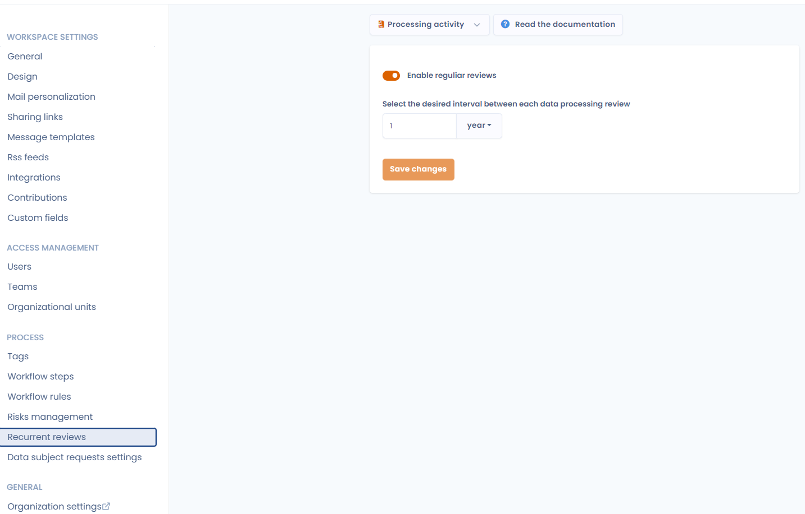
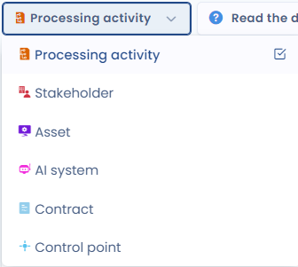
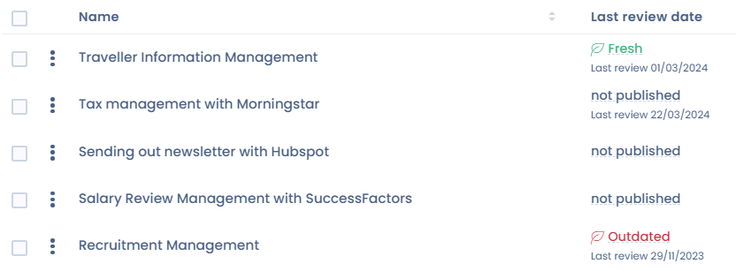
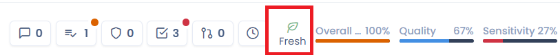
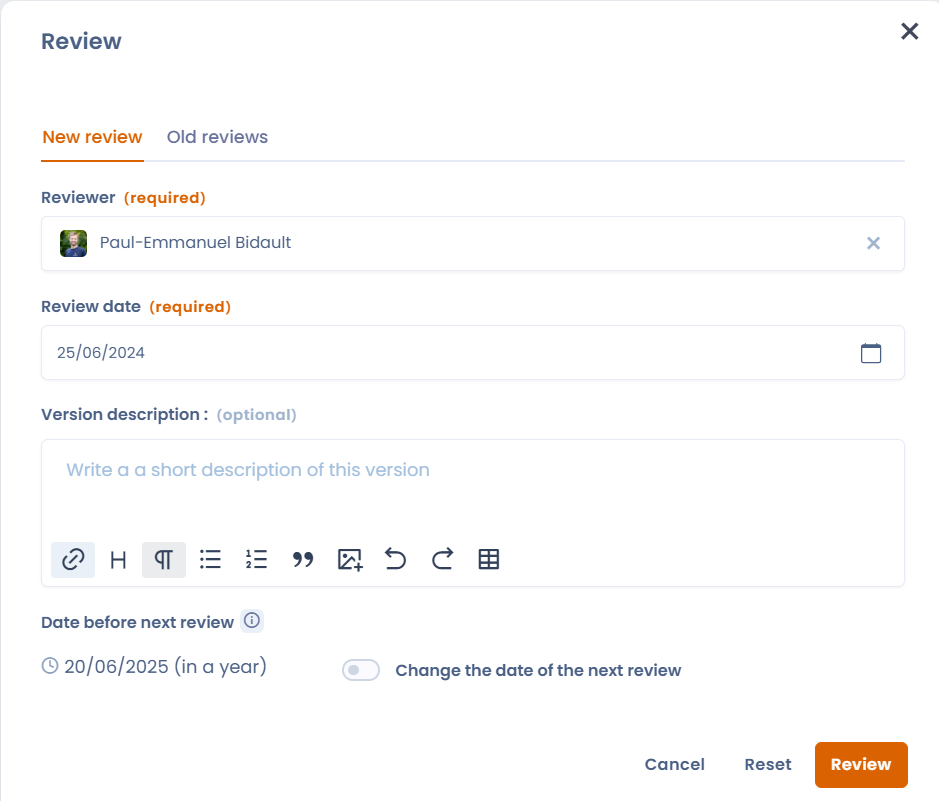

# Terugkerende beoordeling (frisheid)

## Wat de frisheidsindicator is

Frisheid is een indicator die aangeeft wanneer een item voor het laatst in Dastra is beoordeeld. Dat kan een verwerkingsactiviteit zijn, een object uit uw repository of zelfs een contract. Wanneer u deze functie activeert, bepaalt u voor het item een toekomstige beoordelingsdatum en neemt de frisheid af naarmate die datum nadert. Zo controleert u dat de gegevens in de toepassing regelmatig worden nagekeken.

<figure><figcaption>
Werkingsschema van de frisheidsindicator
</figcaption></figure>

## De frisheidsindicator activeren

Om de frisheid van een objecttype te activeren, gaat u naar de instellingen van uw werkruimte en selecteert u het tabblad **Terugkerende beoordelingen**.

<figure><figcaption>
Het configuratiemenu voor de terugkerende beoordelingen
</figcaption></figure>

In dit menu activeert u de frisheid voor de verschillende objecten die over deze functie beschikken, via de keuzelijst met objecttypen.

<figure><figcaption>
De lijst van objecten waarvoor u de frisheid kunt activeren
</figcaption></figure>

Schakel de optie **Schakel regelmatige beoordelingen in** in en stel het gewenste interval tussen twee beoordelingen in.

De frisheid van een item komt overeen met het aantal dagen tussen de laatste datum waarop het item als vers is gemarkeerd en zijn toekomstige beoordelingsdatum.

De beoordelingsdatum ligt in de toekomst en wordt berekend vanaf de laatste datum waarop het item als vers is gemarkeerd, plus het gewenste interval tussen twee beoordelingen.

Dit interval is hetzelfde voor alle items van hetzelfde type waarvoor de beoordeling is geactiveerd.

## De frisheidsindicator deactiveren

Om de optie te deactiveren, schakelt u **Schakel regelmatige beoordelingen in** uit in het tabblad **Terugkerende beoordelingen** van de instellingen van uw werkruimte.

## De frisheidsindicator weergeven

Alle objecten met deze functionaliteit hebben een frisheidskolom die u aan de overzichtstabellen kunt toevoegen. Deze kolom heet **Frisheid** en laat u de frisheidsstatus van elk item volgen.

De frisheid wordt alleen weergegeven voor gepubliceerde items.

<figure><figcaption>
De frisheidskolom
</figcaption></figure>

U vindt deze indicator ook in het snelmenu van het item.

<figure><figcaption>
De frisheidsindicator in het snelmenu van een item
</figcaption></figure>

## Regels voor de weergave van de beoordelingsstatussen

Er zijn drie mogelijke frisheidsstatussen: fris, binnenkort of verouderd. Standaard gelden de volgende weergaveregels:

<table><thead><tr><th width="258">Beoordelingsstatus</th><th>Weergaveregel</th></tr></thead><tbody><tr><td>Fris (groen)</td><td>
Het item is onlangs beoordeeld en vraagt geen onmiddellijke aandacht. 

Deze status wordt weergegeven totdat de huidige datum in de laatste 10 procent van het verwachte interval sinds de laatste beoordeling valt.
</td></tr><tr><td>binnenkort (oranje)</td><td>
Het item moet worden gecontroleerd. 

Deze status wordt weergegeven tijdens de laatste tien procent van het geplande interval sinds de laatste beoordeling.
</td></tr><tr><td>Verouderd (rood)</td><td>
Het item voldoet niet meer aan het beoordelingsbeleid. 

Deze status wordt weergegeven wanneer de huidige datum later is dan de datum van de laatste beoordeling plus het ingestelde interval.
</td></tr></tbody></table>


Voorbeeld: u hebt een interval van 1 jaar ingesteld voor de beoordeling van verwerkingsactiviteiten. Voor een verwerkingsactiviteit die op 1 januari is beoordeeld:

* wordt ze tot 25 november als fris weergegeven
* wordt ze vanaf 25 november als binnenkort weergegeven
* wordt ze op 31 december als verouderd weergegeven, tot ze opnieuw is beoordeeld.


## Een item beoordelen

U kunt op elk moment een item beoordelen, zonder te wachten op de volgende beoordelingsdatum. Klik daarvoor in een tabelweergave op de cel in de frisheidskolom van het item. De functionaliteit moet daarvoor geactiveerd zijn voor dit element en de kolom moet worden weergegeven.

U komt dan in het beoordelingsvenster van het item. Vanuit dit venster raadpleegt u ook oudere beoordelingen. Het tabblad **Oude recensies** biedt ook de knop **Delete all reviews**, waarmee u de beoordelingsgeschiedenis van het item wist. Een bevestigingsvenster legt de gevolgen uit, omdat deze actie niet ongedaan kan worden gemaakt.

<figure><figcaption>
Het beoordelingsvenster van een item
</figcaption></figure>

Wanneer u een item beoordeelt, begint een nieuwe frisheidscyclus vanaf de huidige datum tot de volgende beoordelingsdatum. Die datum wordt standaard berekend volgens het beoordelingsinterval dat voor het item is ingesteld (zie hierboven). U kunt deze standaarddatum negeren en voor dit item een specifieke vervaldatum toepassen door de optie **De volgende beoordelingsdatum wijzigen** in te schakelen en een nieuwe datum te selecteren. De volgende beoordelingsdatum ligt minstens een dag in de toekomst.

## Meldingen

De maker van het element en de gebruikers die aan het element zijn gekoppeld (bijvoorbeeld de eigenaars bij verwerkingsactiviteiten) ontvangen een e-mail wanneer een element de status verouderd bereikt. Die e-mail herinnert eraan dat het element al lange tijd niet is herzien en dat het tijd is om het te vernieuwen.
