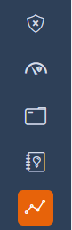
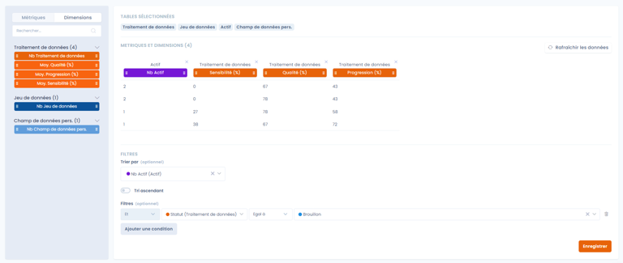

# Aangepaste rapportage

Deze pagina legt uit hoe aangepaste rapporten in Dastra werken.

Met deze functie stelt u rapporten samen die aan uw specifieke behoeften zijn aangepast, ongeacht of u beginner of gevorderd gebruiker bent. U haalt zo de belangrijke informatie uit de gegevens van Dastra.

## Snel aan de slag

1. Klik in het linkermenu op **Rapportage**.

    
<figure><figcaption></figcaption></figure>

2. Rapporten zijn in categorieën ingedeeld. Voordat u uw eerste rapport aanmaakt, maakt u een eerste categorie aan.
3. Klik op **Create Report** en kies een van de twee opties: een nieuw rapport aanmaken of een rapport aanmaken op basis van een sjabloon.

### Woordenlijst

* Metriek: een metriek is een meetbare waarde waarmee u elementen groepeert (aggregeert). Voorbeeld: het aantal verwerkingsactiviteiten, de gemiddelde verwerkingstijd van een taak.
* Dimensie: anders dan een metriek laat een dimensie geen aggregatie van gegevens toe. Het is een eenvoudige eigenschap (een kolom) van een element. Voorbeeld: naam van de verwerkingsactiviteit, status van de verwerkingsactiviteit, referentie.

## Een rapport samenstellen

### Basisprincipes

1. Gegevensselectie: kies de gegevens die u in uw rapport wilt opnemen. In de interface bladert u door uw gegevenssets en selecteert u de relevante variabelen (metrieken en dimensies) uit de verschillende tabellen van Dastra.
2. Geavanceerde filters: verfijn uw resultaten met geavanceerde filters. Stel specifieke criteria in om alleen de gegevens te halen die voor uw analyse relevant zijn.
3. Grafieken aanpassen: pas grafieken en tabellen aan en kies de diagramstijlen die het best bij uw behoeften passen.
4. Meervoudige export: exporteer uw rapporten in verschillende formaten: PDF, Word, HTML, Excel, CSV, JSON of Markdown. Deel uw resultaten met collega's, klanten of partners en koppel uw gegevens aan hulpmiddelen zoals Power BI.

## Gegevensselectie

### Gegevenstabellen selecteren

Selecteer de gegevenstabellen die u wilt bevragen: verwerkingsactiviteiten, stappen van verwerkingsactiviteiten, doeleinden, labels enzovoort. In elk rapport kunt u maximaal 6 verschillende tabellen bevragen.

<figure><figcaption></figcaption></figure>

Klik op **Volgende** wanneer u de tabellen hebt geselecteerd.


Zodra de tabellen zijn geselecteerd, kunt u niet meer terug om ze te wijzigen.


#### Het rapport opbouwen met metrieken en dimensies

Bouw uw rapport op door de metrieken en dimensies te selecteren die u wilt tonen.

<figure><figcaption></figcaption></figure>

Klik rechtsonder op de pagina op **Opslaan**.

#### Link naar het dossier van het object

Voor tabellen van objecten die een dossier hebben (verwerkingsactiviteiten, verzoeken om rechten uit te oefenen, datalekken, activa, stakeholders, audits, beveiligingsmaatregelen, contracten, AI-systemen en taken) voegt de dimensie **Link naar de bron (url)** aan elke rij een klikbare link **Details** toe. Die link opent het dossier van het object in de juiste module, in een nieuw tabblad en met de huidige werkruimte. De kolom wordt ook in exports opgenomen, als URL.

<figure><figcaption>
De dimensie Link naar de bron (url) aan het rapport toevoegen
</figcaption></figure>

<figure><figcaption>
Elke rij toont een link Details die het dossier van het object opent
</figcaption></figure>


De gegevens worden automatisch per dimensie geaggregeerd om de geselecteerde metrieken te berekenen.


Voorbeeld: selecteert u de variabelen "aantal verwerkingsactiviteiten" en "status", dan krijgt u een rapport dat als volgt is gegroepeerd:

| Status | Aantal verwerkingsactiviteiten |
| --- | --- |
| Concept | 12 |
| Actief | 560 |

## Weergave van het aangepaste rapport en grafische visualisatie

Zodra het rapport is aangemaakt, wordt u doorgestuurd naar de weergavepagina van het rapport.

Klik op **Add Chart** om een grafiek toe te voegen.

U kunt dan verschillende diagramtypen kiezen (staafdiagram, cirkeldiagram, lijndiagram enzovoort).

## Prullenbak

Een verwijderd rapport of een verwijderde categorie komt eerst in de prullenbak terecht: u kunt het terugzetten zolang het niet definitief is verwijderd.

* Een item naar de prullenbak verplaatsen: klik in het actiemenu van een rapport op **Verplaats naar de prullenbak** en bevestig. Het actiemenu van een categorie, in het linkerpaneel, biedt dezelfde actie: de categorie en al haar rapporten gaan naar de prullenbak.
* De prullenbak bekijken: schakel de optie **Bekijk prullenbak** in boven de lijst met rapporten, of in het menu van het paneel met categorieën.
* Terugzetten: in de prullenbak zet **Herstellen** het item terug in de actieve lijst. Het terugzetten van een categorie zet ook de rapporten terug die samen met de categorie naar de prullenbak zijn verplaatst. Zet u een rapport terug waarvan de categorie in de prullenbak staat, dan wordt ook die categorie teruggezet.
* Definitief verwijderen: in de prullenbak wist **Verwijderen** het item na bevestiging. Het verwijderen van een categorie verwijdert ook al haar rapporten. Deze actie kan niet ongedaan worden gemaakt.


Acties in de prullenbak vereisen het recht om aangepaste rapporten te bewerken.

