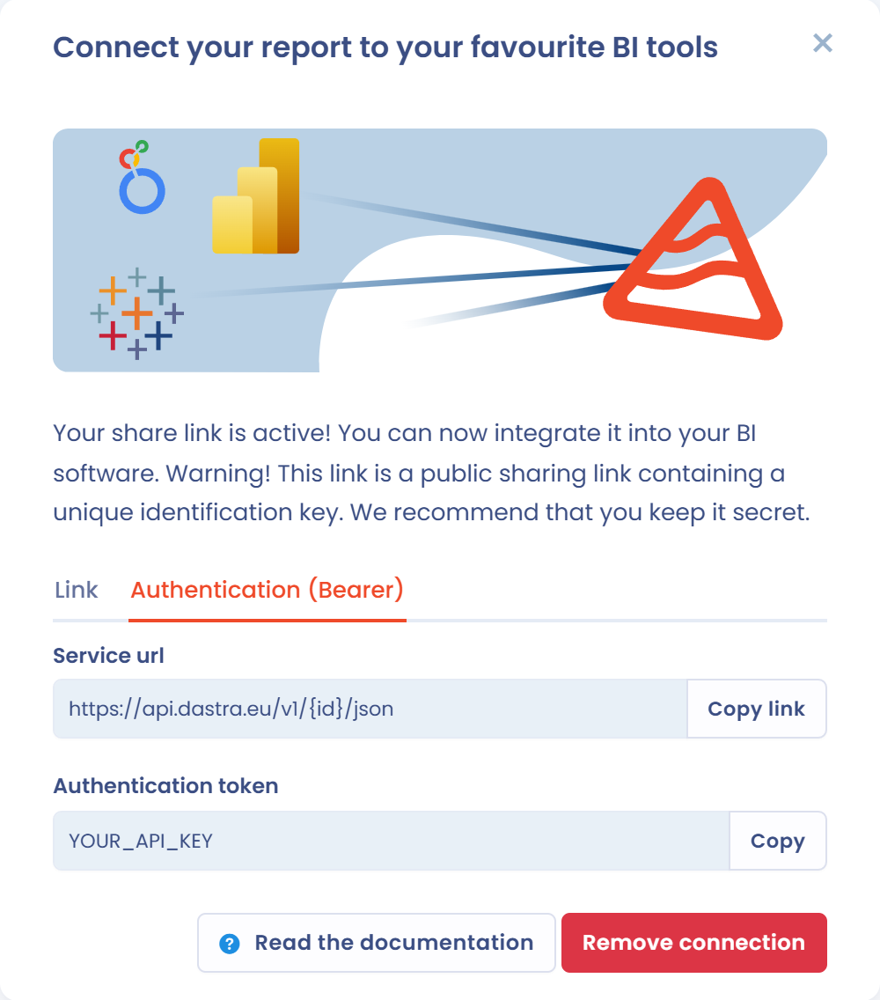

# Integratie met hulpmiddelen voor gegevensanalyse (BI)


Om deze functie te gebruiken, moet uw abonnement het plan **Enterprise** omvatten en moet u de machtiging **Geavanceerde configuratie** hebben.


Met Dastra importeert u [aangepaste rapporten](README.md) in uw BI-tool (Power BI, Google Looker, Tableau Software enzovoort). U analyseert de gegevens grondig met uw tool en de rapporten worden automatisch ververst.

## Instellen in Dastra

1. Open in de module **Rapportages** een rapport en klik op **Connect BI Tools**.
2. Klik in het venster dat opent op **Create connect link**. De link wordt naar uw klembord gekopieerd.

Het venster toont daarna twee tabbladen, afhankelijk van hoe uw tool verbinding maakt:

* **Link**: het openbare adres van het rapport, dat u in de tool plakt. Iedereen die deze link heeft, heeft toegang tot de ruwe gegevens van het rapport.
* **Authentication (Bearer)**: de **Service url** en het **Authentication token**, die u afzonderlijk invoert. Uw tool stuurt het token mee in de HTTP-header `Authorization: Bearer <token>`. Geef de voorkeur aan dit tabblad wanneer uw tool een header kan toevoegen: het adres alleen geeft dan geen toegang tot de gegevens.

<figure><figcaption>
Het verbindingsvenster voor BI-tools
</figcaption></figure>


Geef de link of het token niet door aan personen die de gegevens van het rapport niet mogen zien.


Om de toegang af te sluiten, klikt u in hetzelfde venster op **Verbinding verwijderen** en bevestigt u. De link en het token werken dan niet meer: u kunt een nieuwe verbinding aanmaken met **Create connect link**.

## Instellen in de BI-tool

### Microsoft Power BI

1. **Open Power BI Desktop :**
   * Start Power BI Desktop op uw machine.
2. **Maak verbinding met de gegevensbron Web:**
   * Ga in Power BI Desktop naar het tabblad Home.
   * Klik op Get Data en selecteer daarna **Web**.
3. **Voer de URL van de JSON-link in:**
   * Voer in het venster Get Data Web dat verschijnt de URL van uw JSON-bestand of API in (als u een JSON-deellink hebt).
   * Zorg ervoor dat de URL naar een JSON-bestand of een API verwijst die JSON-gegevens teruggeeft.
   * Klik op OK.
4. **Authenticatie (indien vereist):**
   * Met de link van het tabblad **Link** is geen authenticatie nodig: selecteer **Anonymous**.
   * Voer met het tabblad **Authentication (Bearer)** de **Service url** in bij stap 3, klik daarna op **Advanced** en voeg bij de parameters van de HTTP-verzoekheader de header `Authorization` toe met als waarde `Bearer ` gevolgd door het token. Selecteer daarna **Anonymous**.
5. **Toegang tot de JSON-gegevens:**
   * Power BI maakt verbinding met de URL en haalt het JSON-bestand op.
   * Zodra de verbinding is gelegd, verschijnt een voorbeeldvenster met JSON-gegevens. U kunt de gegevens verkennen in de vorm van geneste lijsten, objecten of tabellen.


* **Prestaties**: als uw JSON-bestand groot is of diepe hiërarchieën bevat, kan Power BI enige tijd nodig hebben om de gegevens te laden en te transformeren.
* **Gegevens verversen:** als de JSON-gegevens regelmatig worden bijgewerkt (bijvoorbeeld door een API), kunt u in Power BI Service een gegevensverversing instellen om automatisch de nieuwste gegevens op te halen.


### Google Looker 

Google Looker maakt verbinding met Google BigQuery, een datawarehouse van Google Cloud dat JSON-bestanden kan opslaan en verwerken.

**1. Google BigQuery als gegevensbron gebruiken**

1. **Upload het JSON-bestand naar Google Cloud Storage :**
   * Is uw JSON-bestand toegankelijk via een deellink, begin dan met het uploaden van het bestand naar **Google Cloud Storage**.
   * Maak het openbaar of stel de juiste machtigingen in.
2. **Laad de JSON-gegevens in BigQuery:**
   * Ga naar de Google Cloud Platform-console (Google Cloud Console).
   * Ga naar **BigQuery** en selecteer of maak een project.
   * Selecteer in **BigQuery** uw dataset en klik op **Create Table.**
   * Selecteer **Google Cloud Storage** als bron en voer de URL van uw JSON-bestand in het veld **URL** in.
   * Stel het gegevensformaat in op **JSON** en controleer of **BigQuery** de structuur van uw bestand correct kan interpreteren.
3. **Verbind BigQuery met Looker :**
   * Zodra het JSON-bestand in BigQuery is geladen, kunt u Looker met BigQuery verbinden.
   * Ga in Looker naar Admin > Connections en voeg BigQuery toe als gegevensbron.
   * Zodra de verbinding is gelegd, kunt u de BigQuery-gegevens rechtstreeks in Looker bevragen en visualiseren.

**2. ETL-tools gebruiken om JSON in Looker te integreren**

Moet u de integratie van JSON-gegevens uit een API of extern bestand in Looker automatiseren, dan kunt u ETL-tools (Extract, Transform, Load) gebruiken, zoals Fivetran, Stitch of Airflow. Deze tools kunnen JSON-gegevens extraheren, transformeren en laden in een datawarehouse dat met Looker compatibel is.

**Voorbeeld met Fivetran :**

1. Verbind een REST API of JSON-bron met Fivetran.
2. Transformeer de gegevens zodat ze aan de vereisten van uw datawarehouse voldoen.
3. Laad de gegevens in het warehouse (bijvoorbeeld BigQuery).
4. Verbind Looker met dit datawarehouse om de gegevens te bevragen en te visualiseren.

### Tableau Software 

**1. Open Tableau Desktop** :

* Start Tableau Desktop op uw machine.

**2. Maak verbinding met een webgegevensbron**:

* Ga in Tableau Desktop naar het menu File en selecteer New Data Source.
* Klik in het venster voor de keuze van de gegevensbron op Web Data Connector. Met deze optie maakt u verbinding met gegevens uit verschillende webbronnen, waaronder JSON-bestanden via een API of URL.

**3. Voer de JSON-URL in:**

* U moet in het venster dat verschijnt de URL van het JSON-bestand of de API invoeren.

**4. Authenticatie:**

* Met de link van het tabblad **Link** is geen authenticatie nodig.
* Kan uw connector een HTTP-header toevoegen, gebruik dan het tabblad **Authentication (Bearer)**: voer de **Service url** en de header `Authorization: Bearer <token>` in.

**5. De JSON-gegevens analyseren in Tableau :**

* Tableau maakt verbinding met de URL, downloadt het JSON-bestand en probeert het om te zetten naar een begrijpelijk tabelformaat (een tabel of een gestructureerde gegevensweergave).
* Tableau kan de structuur van JSON-gegevens automatisch detecteren, maar is het bestand zeer complex of genest, dan moet u soms in de gegevenseditor aanpassingen doen om de gegevens af te vlakken of om te zetten naar een geschikt formaat.


* **Beperkingen van JSON-bestanden:** als uw JSON-bestand groot is of sterk genest, kan Tableau moeite hebben het correct te parseren.\
  Soms moet u het transformeren of vereenvoudigen voordat u het integreert.
* **Authenticatie en beveiliging:** vereist uw JSON-link een API-sleutel, zorg dan voor een goed beheer van autorisaties en inloggegevens. Sommige API's hebben beperkingen op het aantal verzoeken of vereisen specifieke autorisaties.
* **Gegevens verversen:** als JSON-gegevens regelmatig wijzigen (bijvoorbeeld via een API die realtime updates levert), kunt u Tableau zo configureren dat de gegevens met regelmatige tussenpozen automatisch worden ververst, om uw rapporten up-to-date te houden.

