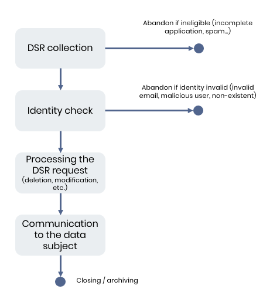
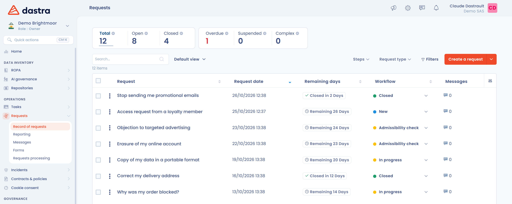

# Verzoeken van betrokkenen om hun rechten uit te oefenen

Dankzij de AVG kunnen Europese burgers een bedrijf of organisatie die hun persoonsgegevens verwerkt, vragen hun rechten te laten uitoefenen. De organisatie moet het uitoefenen van die rechten vergemakkelijken.


[Rechten van betrokkenen](../../gdpr/concepts/rights.md)


Daarvoor moet de organisatie procedures opzetten om deze verzoeken te beantwoorden en om te bewijzen dat ze dat heeft gedaan. Dat betekent vastgelegde stappen en documentatie die in een register wordt bijgehouden.

## Het proces voor het beheer van een verzoek van een betrokkene

Het beheer van een verzoek om rechten uit te oefenen komt neer op 4 hoofdstappen:

<figure><figcaption>
Het beheerproces van een verzoek
</figcaption></figure>

Meer details over het beheer van verzoeken vindt u op deze pagina:


[Verzoeken van betrokkenen beheren](manage.md)


## Het register van verzoeken van betrokkenen

In Dastra bouwt u een register op dat alle verleden, huidige en toekomstige verzoeken bundelt. Om het te openen klikt u in de zijbalk op **Verzoeken** en daarna op **Register van verzoeken**.

<figure><figcaption>
Het register van verzoeken
</figcaption></figure>

Het menu **Verzoeken** geeft toegang tot vijf pagina's:

* **Register van verzoeken**: de lijst van alle verzoeken, met filters en kolommen.
* **Rapportage**: de opvolgingsindicatoren (zie [Statistieken van verzoeken](process.md#statistieken-van-verzoeken)).
* **Berichten**: de uitwisselingen met aanvragers (zie [Berichten van aanvragers](process.md#berichten-van-aanvragers)).
* **Collectie-widgets**: de widgets die verzoeken op uw website verzamelen. Deze pagina is alleen beschikbaar voor gebruikers die verzamelformulieren mogen beheren.
* **Uitvoering van verzoeken**: de interface voor de eigenaren van activa (zie [Interface voor de behandeling van verzoeken](advanced/asset-owners.md)).

## Een nieuw verzoek toevoegen

U voegt op 5 manieren een nieuw verzoek toe in Dastra:

1. [Het verzoek rechtstreeks in de tool invoeren](manage.md#een-verzoek-handmatig-aanmaken).
2. [Verzoeken importeren uit een Excel-, CSV- of tekstbestand](manage.md#verzoeken-importeren-en-exporteren).
3. [Verzoeken ontvangen via een verzameladres voor e-mail](manage.md#een-verzoek-aanmaken-via-een-verzameladres-voor-e-mail).
4. [Een verzamelformulier (widget) instellen](widget.md) op uw website.
5. [Verzoeken aanmaken via de REST API](api.md).

### Een verzoek handmatig aanmaken

Klik op **Maak een aanvraag**. Vul in het venster dat opent de titel, het type of de typen verzoek, de datum, de taal van de aanvrager, het e-mailadres (optioneel) en de organisatie-eenheid in en klik op **Creëren**. Dastra opent het verzoek zodat u het kunt uitwerken en behandelen.

<figure><figcaption>
Het venster voor het aanmaken van een verzoek
</figcaption></figure>

### Het register van verzoeken importeren en exporteren

U importeert en exporteert het hele register. Om verzoeken te importeren klikt u op de pijl naast de knop **Maak een aanvraag** en daarna op **Importeren**.

<figure><figcaption></figcaption></figure>

Klik in het importscherm op **Het bestandssjabloon downloaden** om het verwachte formaat te zien (**Zie kolomindeling** toont de kolommen) en sleep daarna uw bestand (csv, txt of xlsx) naar het uploadgebied. Volg de stappen van de wizard (gegevens importeren, kolommen koppelen, importeren en resultaat) om de verzoeken in Dastra te importeren. Na de import staan de verzoeken in het register.

<figure><figcaption></figcaption></figure>

### Een widget voor verzoeken instellen

Verzoeken kunnen ook afkomstig zijn van een speciale widget die u in Dastra configureert.

Zie onze [handleiding voor het instellen van de widget voor verzoeken van betrokkenen](widget.md).


[Een widget voor verzoeken van betrokkenen instellen](widget.md)

