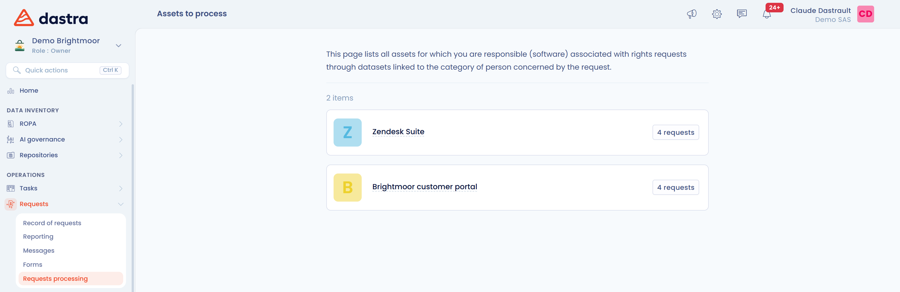
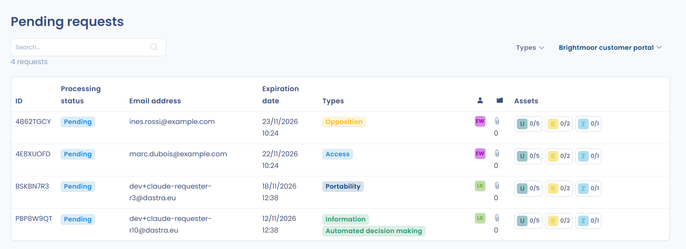

# Verwerkingsinterface voor verzoeken (eigenaren van activa)

Is een gebruiker ingesteld als eigenaar van een activum dat is gekoppeld aan een dataset waarop een verzoek betrekking heeft, dan krijgt die gebruiker een eigen interface om dat verzoek te behandelen. De gebruiker heeft geen toegang tot de lijst met verzoeken, maar heeft wel toegangsrechten tot de repository nodig.

Ga om de interface te openen naar het menu **Verzoeken** en kies **Uitvoering van verzoeken**. De pagina **Activa te behandelen** toont de activa waarvoor de gebruiker verantwoordelijk is, en de pagina **Aanvragen in afwachting van uitvoering** toont de verzoeken die op behandeling wachten, met filters op type en op activum.

Beschikbare functies:

* De lijst met te behandelen verzoeken bekijken.
* De datasets openen waarop het verzoek betrekking heeft.
* Bewijzen aanleveren en de gevraagde gegevens kopiëren of verwijderen.
* De behandeling van een dataset afronden, of de dataset als niet van toepassing markeren, met een opmerking.

<figure><figcaption>
Activa te behandelen
</figcaption></figure>

<figure><figcaption>
Aanvragen in afwachting van uitvoering
</figcaption></figure>

Open een verzoek om de datasets ervan te zien, gegroepeerd per activum. De pagina biedt **Toon de aanvraag**, **Mapping** en **Inclusief andere datasets**. Klik op **Controleren** om de details van een dataset te zien en daarna op **Mark as done** zodra het bewijs is aangeleverd of de gegevens zijn gekopieerd of verwijderd. Klik op **Niet van toepassing** als de dataset niet van toepassing is: de knop **N/A** van een activum past deze status toe op al zijn datasets. Zijn alle datasets behandeld, dan toont Dastra **Bezorging klaar!**.

<figure><figcaption>
Een behandeld verzoek
</figcaption></figure>
