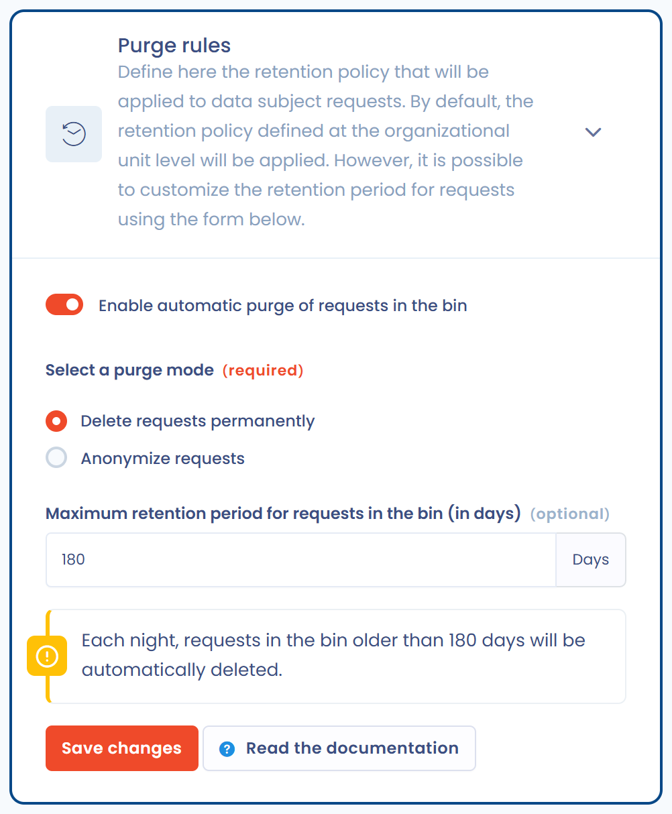

# Opschoonregels voor verzoeken


U hebt beheerdersrechten op de werkruimte nodig om deze functie te gebruiken.


U kunt het opschonen van verzoeken in de prullenbak automatiseren om uw interne bewaarbeleid na te leven, en in het bijzonder het beginsel van opslagbeperking van de AVG.

U bepaalt:

* de reikwijdte van de verzoeken waarop het opschonen van toepassing is,
* de purgeermodus (verwijderen of anonimiseren),
* de maximale bewaartermijn waarna het opschonen automatisch plaatsvindt.

Open om dit in te stellen de instellingen voor de werkruimte, ga naar het onderdeel **Proces**, daarna naar **Verzoeken tot uitoefening van rechten** en naar de sectie **Regels voor opschonen**.

***

## Betrokken verzoeken

Het opschonen geldt alleen voor verzoeken in de prullenbak. Open, gesloten of gearchiveerde verzoeken blijven ongemoeid.

Dastra controleert elke nacht de verzoeken aan de hand van hun datum van verplaatsing naar de prullenbak. Een verzoek dat de ingestelde maximumtermijn overschrijdt (bijvoorbeeld 180 dagen), wordt opgeschoond. Het opschonen omvat:

* verzoeken die langer in de prullenbak staan dan de ingestelde termijn;
* alle soorten verzoeken (inzage, wissing, bezwaar enzovoort);
* alle verzoeken, ongeacht hun herkomst (portaal, API, import).

***

## Purgeermodi

Kies bij **Selecteer een purgeermodus** een van de twee modi.

### Verzoeken verwijderen

De betrokken verzoeken worden definitief uit Dastra verwijderd. Deze actie is onomkeerbaar.

* Persoonsgegevens en de inhoud van de uitwisselingen worden verwijderd.
* Bijlagen en gerelateerde bestanden worden gewist.
* Auditlogs bewaren alleen technische metagegevens (tijdstempel, gebruiker, bewerking).

### Anonimisering van verzoeken

De verzoeken blijven zichtbaar in Dastra, maar hun persoonsgegevens worden vervangen door willekeurige waarden die niets met de aanvrager te maken hebben. Deze modus bewaart een niet-identificeerbaar statistisch spoor voor uw rapporten en indicatoren.

* De velden met persoonsgegevens (achternaam, voornaam, e-mailadres, adres, plaats, postcode) worden vervangen door gegenereerde waarden en de tekst van het verzoek wordt vervangen.
* De uitgewisselde berichten en de bijlagen worden verwijderd.
* Niet-identificerende metagegevens (type verzoek, status, datums) blijven bewaard voor rapportage.
* De bijbehorende activiteitenlogs worden opgeschoond.

<figure><figcaption>
De opschoonregels instellen
</figcaption></figure>

***

## Bewaartermijn voor het opschonen

Vul bij **Maximale bewaartijd in de prullenbak (in dagen)** de maximale leeftijd in van een verzoek in de prullenbak voordat het wordt opgeschoond, bijvoorbeeld 180 dagen. De termijn wordt geteld vanaf de datum waarop het verzoek naar de prullenbak is verplaatst.

Dastra haalt elke nacht rond 02:30 UTC de betrokken verzoeken op en voert het opschonen uit in de geselecteerde modus.

***

## Voorbeeldconfiguratie

* Purgeermodus: Verzoeken verwijderen
* Maximale termijn: 180 dagen (6 maanden)

Elke nacht worden alle verzoeken die langer dan 180 dagen in de prullenbak staan, automatisch verwijderd.

***

## Aanbevelingen

* Stel een termijn in die past bij uw interne bewaarbeleid voor verzoeken (bijvoorbeeld 5 jaar, oftewel 1.825 dagen).
* Kies verwijderen voor een volledige wissing.
* Kies anonimiseren als u activiteitsstatistieken wilt bewaren.
* Controleer of **Automatische verwijdering van in de prullenbak geplaatste verzoeken inschakelen** aanstaat: anders vindt er geen opschoning plaats.
