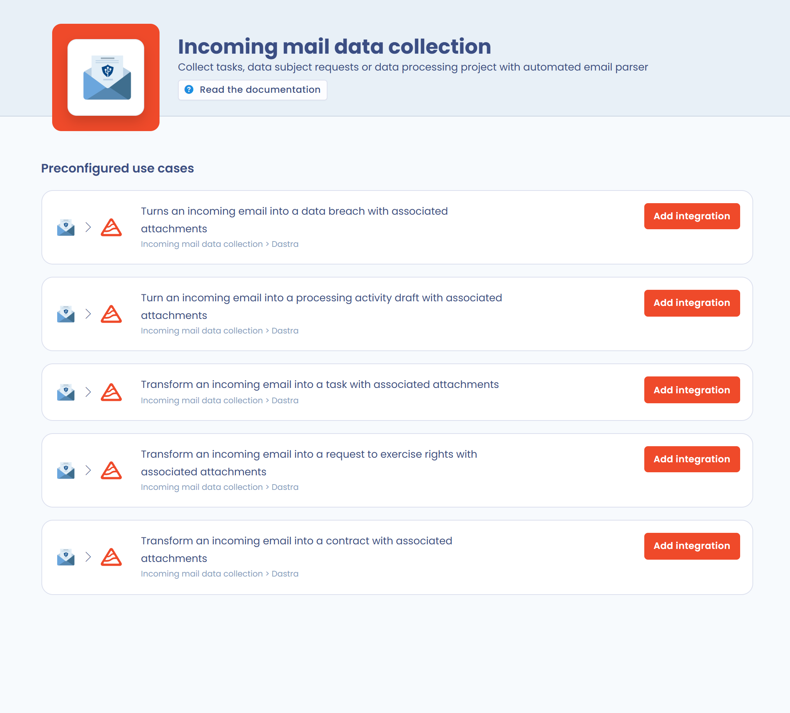

# Verzoeken van betrokkenen beheren

## Een verzoek aanmaken

U maakt op 5 manieren een verzoek van een betrokkene aan in Dastra:

1. Handmatig, vanuit het register van verzoeken.
2. Door een bestand te importeren (zie [Verzoeken importeren en exporteren](manage.md#verzoeken-importeren-en-exporteren)).
3. Automatisch, via een verzameladres voor e-mail.
4. Automatisch, via een formulier voor het verzamelen van verzoeken.
5. Automatisch, via de REST API.

### Een verzoek handmatig aanmaken

Om handmatig een verzoek aan te maken vanuit het register klikt u in de zijbalk op **Verzoeken**, daarna op **Register van verzoeken** en vervolgens op de knop **Maak een aanvraag**.

<figure><figcaption>
Het register van verzoeken
</figcaption></figure>


U kunt verzoeken ook automatisch aanmaken (zie hieronder).


### Een verzoek aanmaken via een verzameladres voor e-mail

Om verzoeken aan te maken vanuit een verzameladres voor e-mail activeert u eerst de integratie **Incoming mail data collection** (zie [Gegevens verzamelen via inkomende e-mail](../settings/mailboxes.md)).

Open daarvoor **Instellingen voor werkruimte**, daarna de sectie **Integraties** en klik op de kaart **Incoming mail data collection**.

<figure><figcaption>
De integratie "Incoming mail data collection" in Dastra
</figcaption></figure>


Is deze integratie nog niet geïnstalleerd, installeer ze dan. Vanuit het register van verzoeken leidt de optie **Transformeer e-mails naar verzoeken van betrokkenen** in het menu van de knop **Maak een aanvraag** er rechtstreeks naartoe.


Klik daarna in de lijst **Voorgeconfigureerde gebruikssituaties** op **Integratie toevoegen** bij de regel **Transform an incoming email into a request to exercise rights with associated attachments**. Er wordt automatisch een e-mailadres aangemaakt.

<figure><figcaption></figcaption></figure>

Elke e-mail die naar dit adres wordt gestuurd, wordt dan een verzoek in Dastra, met de bijlagen.

### Een verzoek aanmaken via een verzamelformulier

Om automatisch verzoeken aan te maken vanuit een verzamelformulier (widget), zie de pagina "Een widget voor verzoeken van betrokkenen instellen":


[Een widget voor verzoeken van betrokkenen instellen](widget.md)


### Een verzoek aanmaken via de API

Verzoeken kunnen ook vanuit een andere tool worden aangemaakt via de REST API van Dastra. Zie de pagina "API-integratie":


[API-integratie](api.md)


## Verzoeken importeren en exporteren

Klik op de pijl naast de knop **Maak een aanvraag** en daarna op **Importeren**.

Volg vervolgens de handleiding voor [het importeren van gegevens in Dastra](../general/import.md).

Om te exporteren klikt u in hetzelfde menu op **Exporteren**.
