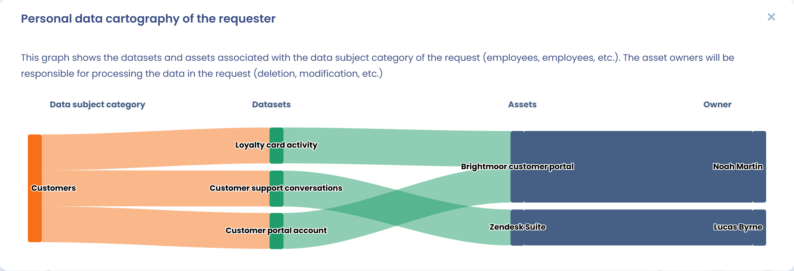
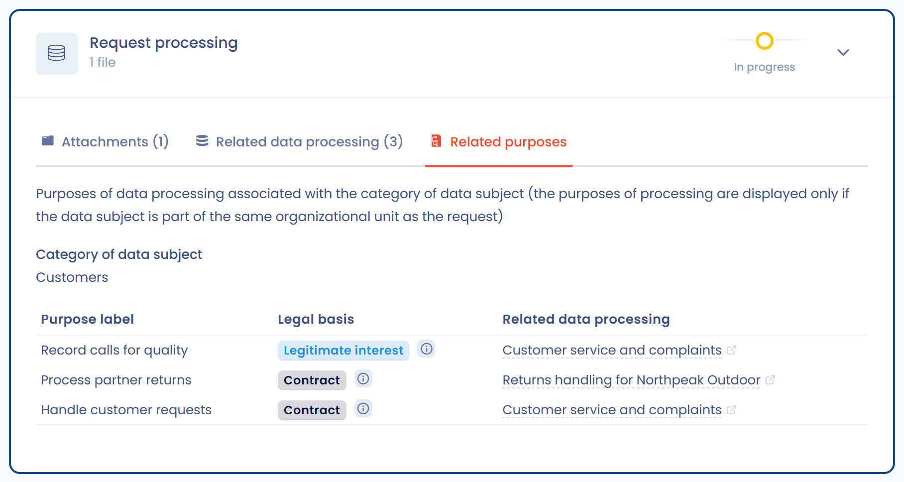
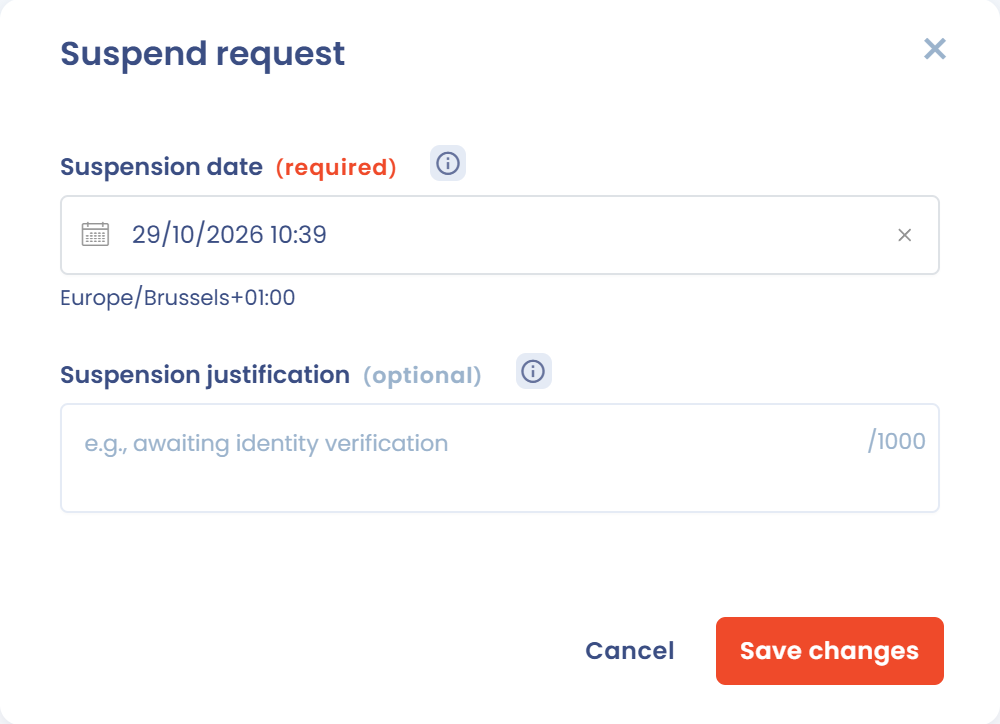
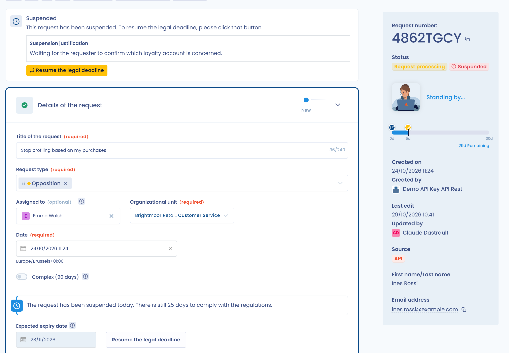

# Verzoeken bewerken en behandelen

Met Dastra beheert u de hele levenscyclus van een verzoek van een betrokkene om zijn rechten uit te oefenen (DSAR).\
In de interface kunt u:

* Het verzoek kwalificeren: type recht, organisatie-eenheid, beheer van termijnen.
* De identiteit van de aanvrager controleren door de verzamelde informatie aan te vullen of aan te passen.
* De bijbehorende gegevens behandelen door de gekoppelde datasets te raadplegen, bewijsstukken te uploaden en de eigenaren te verwittigen.
* Rechtstreeks antwoorden aan de aanvrager, desgewenst met hulp van de AI-assistent, met volledige traceerbaarheid van de uitwisselingen.
* Het verzoek afsluiten door de reden van afsluiting vast te leggen.

Elke stap wordt gedocumenteerd en in de geschiedenis vastgelegd, zodat u de naleving kunt aantonen en betrokkenen een duidelijk antwoord geeft.

***

## Het verzoek kwalificeren

Wanneer een verzoek wordt geregistreerd, verschijnt het in het register van verzoeken.\
In de sectie **Kwalificatie van het verzoek** kunt u:

1. De betrokken typen verzoek bepalen.
2. Het verzoek toewijzen aan een operator en aan een **Organisatie-eenheid**.
3. De behandeltermijnen beheren.

<figure><figcaption>
De sectie Kwalificatie van het verzoek
</figcaption></figure>

De sectie bevat ook de **Taal van de browser** (de voorkeurstaal van de aanvrager), de **Labels**, het **Bericht van de aanvraag** (afkomstig van de aanvrager), **Aanvullende informatie over de aanvraag** en de **Persoonsreferentie**.

### Typen verzoek

Dastra biedt 17 typen verzoek:

| Type | Wat de aanvrager vraagt |
| --- | --- |
| Informatie | Informatie over de verwerking van hun gegevens |
| Toegang | Een kopie van hun persoonsgegevens (artikel 15) |
| Rectificatie | De correctie van onjuiste gegevens (artikel 16) |
| Verwijdering | De verwijdering van hun gegevens (artikel 17) |
| Beperking | De beperking van de verwerking (artikel 18) |
| Tegenstand | Een verwerking te stoppen die op gerechtvaardigde belangen is gebaseerd of voor marketing wordt gebruikt (artikel 21) |
| Hernieuwbaarheid | Hun gegevens in een gestructureerd formaat te ontvangen of te laten overdragen (artikel 20) |
| Lot van data na de dood | Instructies vast te leggen over het lot van hun gegevens na hun overlijden (Frans recht) |
| Afwezigheid van een geautomatiseerde beslissing | Niet te worden onderworpen aan een beslissing die uitsluitend op geautomatiseerde verwerking is gebaseerd (artikel 22) |
| Toegang tot administratieve documenten | Toegang tot administratieve documenten, voor Franse overheidsinstanties |
| Request to DPO | Een verzoek gericht aan de functionaris voor gegevensbescherming |
| Third party request | Een verzoek van een derde |
| Data protection complaint | Een klacht over de omgang met persoonsgegevens |
| Verkoop/ delen van mijn gegevens is niet toegestaan | Zich af te melden voor de verkoop of het delen van persoonlijke informatie (Californisch recht) |
| Beperk het gebruik van gevoelige persoonlijke informatie | Het gebruik van gevoelige persoonlijke informatie te beperken (Californisch recht) |
| Intrekking van toestemming | Een eerder gegeven toestemming in te trekken (artikel 7, lid 3) |
| Andere | Elk verzoek dat in geen van de bovenstaande typen past |

De namen van deze typen zijn de labels van de Nederlandse applicatie. De typen Request to DPO, Third party request en Data protection complaint hebben geen Nederlandse vertaling in de applicatie.

Een verzoek kan meerdere typen omvatten.

### Behandeltermijnen

De wettelijke termijn wordt berekend vanaf de datum van het verzoek:

* Standaard 30 dagen.
* 20 dagen wanneer het type **Toegang tot administratieve documenten** (vrijheid van informatie) is geselecteerd.
* 90 dagen wanneer u **Complexe aanvraag (90 dagen)** selecteert. Deze optie heeft voorrang op de twee andere termijnen en de verlenging moet worden gemotiveerd.

U kunt de **Vervaldatum** ook met één klik instellen: de knoppen **+8d**, **+30d** en **+90d** tellen 8, 30 of 90 dagen op bij de datum van het verzoek.

Als u het verzoek opschort (zie [Een verzoek opschorten](process.md#een-verzoek-opschorten)), schuift de **Verwachte vervaldatum** de termijn op met de duur van de opschorting.

***

## De identiteit controleren

Met Dastra controleert u de identiteit van de persoon die het verzoek heeft ingediend.\
U kunt de informatie die via het oorspronkelijke formulier is verzameld, aanvullen of wijzigen:

* E-mailadres, voornaam, achternaam.
* Aanvullende gegevens: land, postadres, telefoonnummer, gebruikers-ID enzovoort.
* Categorie van de betrokkene (bijvoorbeeld nieuwsbriefabonnees, klanten, werknemers).

<figure><figcaption>
De sectie met identificatiegegevens
</figcaption></figure>

Komt het verzoek van een verzamelformulier, dan zijn de velden die de aanvrager heeft ingevuld (het bericht en het e-mailadres) vergrendeld en niet te bewerken.

Hebben andere verzoeken hetzelfde e-mailadres, dan toont het zijpaneel de link **n requests with similar e-mail**. Gebruik die om dubbele verzoeken op te sporen.

***

## Uitvoering van het verzoek

De sectie **Uitvoering van het verzoek** bundelt alle acties rond de behandeling. Ze heeft drie tabbladen: **Bijlagen**, **Gegevensverwerking van bijbehorende gegevens** en **Bijbehorende doelen**.

### Bijlagen

U kunt bewijsbestanden of exports met gegevens van de aanvrager uploaden.\
Deze bestanden kunt u daarna bij het antwoord voegen. Bij elk bestand staan knoppen om het te bekijken, af te schermen (afhankelijk van uw abonnement), te downloaden of te verwijderen. Met **Download alles (.zip)** downloadt u alle bestanden tegelijk. Bestanden mogen maximaal 100 MB groot zijn.

<figure><figcaption>
Bestanden aan het verzoek toevoegen
</figcaption></figure>

Om gegevens van derden in een document te verbergen voordat u het verstuurt, zie [Documenten afschermen](redaction.md).


Gezondheidsgegevens: Dastra heeft geen HDS-certificering (de Franse certificering voor het hosten van gezondheidsgegevens), maar onze host, Microsoft Azure, wel. Houd daar rekening mee voordat u documenten met gezondheidsgegevens via de interface verstuurt.


### Gegevensverwerking van bijbehorende gegevens

Dastra identificeert automatisch de datasets die bij de categorie van de betrokkene horen.\
Elke dataset moet afzonderlijk worden behandeld.

* Beschikbare statussen: **In behandeling** / **Voltooid**. Een dataset kan ook als niet van toepassing worden ingesteld.
* Weergave van de algemene voortgang (in procenten).

Het tabblad **Gegevensverwerking van bijbehorende gegevens** toont alle relevante datasets volgens een cumulatief model: die van de organisatie-eenheid die aan het verzoek is toegewezen, die van al haar bovenliggende eenheden (tot aan de top van de hiërarchie) en die van al haar onderliggende eenheden. Zo wordt geen geërfde dataset over het hoofd gezien tijdens de behandeling.

<figure><figcaption>
De datasets die van de bovenliggende en onderliggende eenheden zijn geërfd, worden volgens een cumulatief model weergegeven
</figcaption></figure>


Een verzoek kan niet als 100 % behandeld worden verklaard zolang geërfde datasets niet zijn behandeld of uitdrukkelijk als niet van toepassing zijn gemarkeerd.


Heeft de operator die het verzoek behandelt geen toegangsrechten tot sommige van de getoonde datasets, dan nodigt een visuele aanduiding die operator uit contact op te nemen met de betrokken eigenaren.

#### Details van een dataset

Klik op de knop **Cartografie** om de verbanden tussen de categorie van de betrokkene, de datasets en de activa te bekijken.

<figure><figcaption>
Het verband tussen de categorie van de betrokkene en de eigenaar die u moet contacteren
</figcaption></figure>

Met **Controleren** opent u de gedetailleerde informatie:

* Betrokken velden met persoonsgegevens (bijvoorbeeld volledige naam, e-mailadres).
* Wettelijke basis en bewaartermijn.
* Regels voor het wissen na afloop van de bewaartermijn.

<figure><figcaption>
Snelle toegang tot het detail van het activum
</figcaption></figure>

#### Een dataset als behandeld markeren

Voor elke dataset:

1. Controleer de informatie.
2. Motiveer de uitgevoerde behandeling (bijvoorbeeld wissing, rectificatie) bij **Justificatie**. Dit veld is verplicht en met **Genereer** stelt AI de tekst op.
3. Voeg zo nodig bewijsbestanden toe.
4. Klik op **Valider**.

Betreft het verzoek de dataset niet, klik dan op **Niet van toepassing**. De status wordt bijgewerkt en de opmerking blijft bewaard.

<figure><figcaption>
Interface voor de behandeling van verzoeken, specifiek voor het activum
</figcaption></figure>

#### Samenwerking en meldingen

U kunt de eigenaren van de betrokken activa automatisch verwittigen.\
Klik op **Verantwoordelijken op de hoogte brengen**: in een venster selecteert u de personen die u per e-mail wilt verwittigen en klikt u op **Verzenden**.

<figure><figcaption>
De eigenaren van de activa snel verwittigen
</figcaption></figure>

### Bijbehorende doelen

Het tabblad **Bijbehorende doelen** toont in een tabel de verwerkingsdoeleinden die aan de categorie van de betrokkene zijn gekoppeld (**Doel**), met hun **Juridische basis** en de **Gegevensverwerking van bijbehorende gegevens**. Doeleinden verschijnen alleen als ze tot dezelfde organisatie-eenheid behoren als het verzoek.

<figure><figcaption>
De doeleinden die aan de categorie van de betrokkene zijn gekoppeld
</figcaption></figure>

***

## Op het verzoek antwoorden

Is de behandeling afgerond, dan antwoordt u rechtstreeks aan de aanvrager in de sectie **Antwoord op het verzoek**.

* Klik op **Genereer met AI**: de AI-assistent stelt in het venster **DSR AI-chatbot** een conform en aanpasbaar bericht voor.
* Pas het bericht aan met de suggesties: formeler, minder formeel, korter, langer, met emoji's, het verzoek goedkeuren, de identiteit valideren. U kunt ook uw eigen instructie typen met **Een aangepaste instructie gebruiken**.
* Klik op **Gebruik dit bericht** en verstuur het daarna rechtstreeks vanuit Dastra.

<figure><figcaption>
Berichten uitwisselen met de aanvrager, desgewenst met AI
</figcaption></figure>

***

## Een verzoek afsluiten

Om een verzoek af te sluiten klikt u op **Sluit de aanvraag** in het menu **Acties** of onderaan de pagina. Doe in het venster dat opent het volgende:

1. Kies in de lijst **Sluitingsmotief voor de aanvrager** de reden van afsluiting. Dit veld is verplicht.
2. Voeg bij **Geef de reden voor sluiting op (zichtbaar voor de aanvrager)** een toelichting toe die de aanvrager in zijn ruimte ziet. Dit veld is optioneel.
3. Voeg bij **Interne sluitingsmotief (onzichtbaar voor de aanvrager)** zo nodig een notitie voor uw team toe.
4. Controleer de **Sluitingsdatum**.
5. Om de aanvrager per e-mail te verwittigen, selecteert u **Send a notification to** gevolgd door zijn adres. Het vakje verschijnt alleen als het verzoek een e-mailadres heeft en is standaard niet aangevinkt.
6. Klik op **Opslaan**.

<figure><figcaption>
Het venster voor het afsluiten van een verzoek
</figcaption></figure>

Is het verzoek opgeschort, dan wordt de opschorting bij het afsluiten automatisch opgeheven. Een afgesloten verzoek kunt u opnieuw openen met de knop **heropenen**.

***

## Aanvullende acties op een verzoek

Naast de hoofdstappen (kwalificatie, controle, behandeling en antwoord) biedt Dastra een menu **Acties** waarmee u geavanceerde handelingen op een verzoek uitvoert.

<figure><figcaption>
Snel toegang tot de vele aanvullende acties
</figcaption></figure>

Beschikbare acties zijn onder meer:

* **Aangepaste velden**: specifieke velden toevoegen of wijzigen om het verzoek aan te vullen.
* **Kopieer de link naar de portaltoegang van de betrokkene**: een directe link delen met de betrokkene.
* **Stuur een e-mail**: rechtstreeks vanuit het platform een bericht over het verzoek versturen.
* **Exporteren**: de informatie van het verzoek exporteren.
* **Regels voor de workflow**: een automatiseringsregel toepassen of activeren.
* **Vraag opschorten**: de wettelijke behandeltermijn onderbreken (zie hieronder).
* **Sluit de aanvraag**: het verzoek handmatig als afgerond markeren.
* **Toegangstoken resetten**: een nieuwe beveiligde link voor de aanvrager aanmaken.
* **anonimiseren**: de identificerende gegevens van het verzoek wissen. Deze actie is beschikbaar zodra het verzoek is afgesloten.
* **Bestanden opschonen**: de verstuurde bijlagen verwijderen. Het menu toont het aantal, bijvoorbeeld **Bestanden opschonen (1)**. Hun namen en datums blijven bewaard. Deze actie verschijnt pas zodra het verzoek is afgesloten.
* **Verplaats naar de prullenbak**: het verzoek in de prullenbak plaatsen. Daarna gelden de opschoningsregels (zie [Opschoningsregels voor verzoeken](advanced/purge.md)).

### Een verzoek opschorten

In sommige gevallen moet u een verzoek tijdelijk opschorten (bijvoorbeeld terwijl u wacht op de controle van de identiteit).\
De opschorting onderbreekt de wettelijke termijn, die pas weer loopt zodra de opschorting is opgeheven.

<figure><figcaption>
Een verzoek opschorten terwijl u bijvoorbeeld wacht op een antwoord van de aanvrager
</figcaption></figure>

* **Datum van opschorting**: verplicht.
* **Reden voor opschorting**: vrij tekstveld om de reden te documenteren (bijvoorbeeld wachten op bewijsstukken).

Klik daarna op **Opslaan**.

Zodra het verzoek is opgeschort, toont de interface duidelijk de status en biedt ze de knop **Hervat de wettelijke deadline**.

<figure><figcaption></figcaption></figure>

De teller van de resterende dagen wordt automatisch herberekend, rekening houdend met de periode van opschorting.

***

## Berichten van aanvragers

De pagina **Berichten** van het menu **Verzoeken** bundelt, verzoek per verzoek, de berichten die met aanvragers zijn uitgewisseld. Elke groep toont de titel van het verzoek en de naam van de aanvrager. U kunt de lijst filteren op operator (**Toegewezen aan**), op afzender (**Afzender van bericht**), op type bericht (**Berichten van onderwerpen**, **Berichten van de operator** of **Alle berichten**) en op periode.

<figure><figcaption>
De inbox met berichten van aanvragers
</figcaption></figure>

Een bericht van een aanvrager dat nog niet is gelezen, is gemarkeerd met een enveloppictogram. Zodra het is gelezen, verschijnt een vinkje **Geraadpleegd**. Om het gesprek te openen klikt u op **Tonen**: in het verzoek markeert de knop **Markeren als gelezen** de nieuwe berichten als gelezen.

## Statistieken van verzoeken

De pagina **Rapportage** van het menu **Verzoeken** toont de activiteit van de module over de periode die u kiest (30, 90, 180 of 365 dagen, of een eigen periode). Ze toont onder meer:

* het aantal aangemaakte, afgesloten, te laat afgesloten en complexe verzoeken;
* de gemiddelde afsluitingstijd;
* de evolutie van open en afgesloten verzoeken;
* de verdeling van de verzoeken per type, per stap, per operator en per reden van afsluiting.

U kunt filteren op organisatie-eenheid en op stap, de prullenbak opnemen, **Filters** gebruiken (bijvoorbeeld om een verzamelformulier te kiezen of geanonimiseerde verzoeken uit te sluiten) en de pagina afdrukken met **Afdrukken**.

<figure><figcaption>
De statistieken van verzoeken
</figcaption></figure>

***

## Algemene opvolging

Elk verzoek bewaart de volledige geschiedenis:

* Uitgewisselde berichten.
* Toegevoegde bijlagen.
* Status en voortgang van de behandeling.

Zo zijn traceerbaarheid en naleving gewaarborgd bij een audit.
