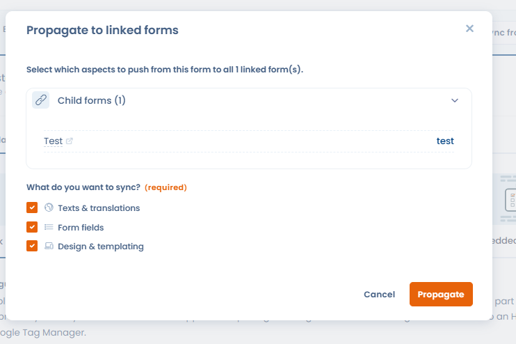

# Synchronisatie van widgets

Hebben meerdere widgets voor verzoeken van betrokkenen een vergelijkbare configuratie (dezelfde velden, dezelfde teksten), dan kunt u ze synchroniseren. U wijst één widget aan als bron, synchroniseert onderliggende widgets vanuit die bron en geeft daarna elke wijziging met één klik door aan alle gekoppelde widgets.

Dit is vooral nuttig voor organisaties die meerdere varianten van dezelfde widget beheren (bijvoorbeeld een widget voor het wissen van een account die in verschillende toepassingen of geografische markten is ingezet).

In de toepassing is een widget een formulier: open het via **Verzoeken** > **Collectie-widgets**. De synchronisatieknoppen staan boven aan de formulierpagina, naast **Overzicht**.

## Inhoud synchroniseren vanuit een andere widget

U importeert als volgt de configuratie van een bestaande widget in de huidige widget:

1. Klik op de keuzelijstknop voor synchronisatie naast **Overzicht**.
2. Klik op **Synchroniseren vanuit een ander formulier**.
3. Selecteer bij **Bronformulier** de bronwidget.
4. Selecteer onder **Wat wilt u synchroniseren?** de elementen die u wilt importeren: **Teksten en vertalingen**, **Formuliervelden** en **Ontwerp en uiterlijk**.
5. Klik op **Synchroniseren**.

<figure><figcaption>
De synchronisatieknop naast Overzicht importeert de configuratie van een bronwidget
</figcaption></figure>

<figure><figcaption>
De bronwidget en de te importeren elementen selecteren
</figcaption></figure>

Na de synchronisatie wordt de widget een onderliggende widget van de bronwidget. Het label van de knop verandert en de keuzelijst biedt nu **Wissen** om de koppeling met de bron te verwijderen.

## Wijzigingen doorgeven aan onderliggende widgets

Hebt u wijzigingen in de bronwidget aangebracht, dan geeft u ze met één klik door aan alle gekoppelde widgets:

1. Klik op **Wijzigingen doorvoeren naar gekoppelde formulieren**, gevolgd door het aantal onderliggende widgets tussen haakjes.
2. Controleer de lijst met onderliggende widgets en selecteer daarna de elementen die u wilt doorgeven.
3. Klik op **Propagate**.

<figure><figcaption>
Wijzigingen van de bronwidget doorgeven aan alle onderliggende widgets (teksten, velden, ontwerp)
</figcaption></figure>


De knop **Wijzigingen doorvoeren naar gekoppelde formulieren** verschijnt alleen bij een widget met ten minste één onderliggende widget. In dat geval is de synchronisatieknop verborgen: een bronwidget kan zelf niet vanuit een andere widget worden gesynchroniseerd.

