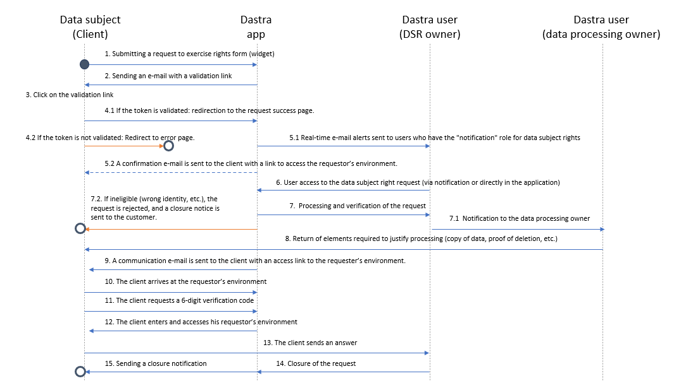

# Een widget voor verzoeken van betrokkenen instellen

De Dastra-widget voegt een formulier voor verzoeken van betrokkenen rechtstreeks toe aan uw website. In de applicatie beheert u de widget onder **Verzoeken** > **Collectie-widgets**: klik op **Nieuwe widget** om er een toe te voegen.

U kunt de widget op vijf manieren aanpassen:

* Algemene instellingen: de aangeboden typen verzoeken, doorverwijzingen en de link naar het privacybeleid.
* Visuele aanpassing: kleuren, logo, achtergrondafbeelding, pictogrammen, lettertype en voortgangsbalk.
* Velden: standaardvelden en aangepaste velden, verplicht of optioneel.
* Integratiemodi: in een pagina, in een modaal venster (pop-up), in een iframe of op een speciale webpagina.
* Meertalig: alle teksten van de widget vertalen en aanpassen.

***

## Integratieverloop

Het onderstaande schema toont hoe een widget voor verzoeken van betrokkenen in Dastra werkt:

<figure><figcaption>
Het traject van een verzoek dat via de widget is verzameld
</figcaption></figure>

Het proces verloopt als volgt:

1. De betrokkene dient een verzoek in via de widget.
2. Het verzoek wordt naar Dastra gestuurd en geregistreerd.
3. U wordt op de hoogte gebracht en kunt het verzoek in het platform kwalificeren en behandelen.
4. De betrokkene ontvangt een antwoord in het portaal van de aanvrager.

***

## Algemene instellingen

Open een formulier en ga naar de sectie **Instellingen**. U bepaalt:

* De **Naam** van de widget en de **Organisatie-eenheid**.
* De beschikbare typen verzoeken, met de vraag **Voor welke soorten rechten?**: **Standaard rechtssoorten**, **Bepaalde soorten rechten** (u kiest dan de typen bij **Kies specifieke verzoektypen**) of **Geen soort recht (eenvoudige vorm)**, waarbij de persoon geen type verzoek hoeft te kiezen.
* De links **Redirect-link bij succes (na de identificatiefase)**, **Redirect-link in geval van een fout (bijv. verlopen van de validatielink)** en **Link naar privacybeleid**. Alle drie de links zijn optioneel.

<figure><figcaption>
Instellingen van de widget
</figcaption></figure>

***

## Het uiterlijk aanpassen

In de sectie **Sjablonen van het formulier** stemt u het formulier af op uw merk. Het voorbeeld wordt bijgewerkt terwijl u wijzigt.

Beschikbare opties:

* **Logo** en **Achtergrondafbeelding** (aangeboden bij de opmaak van de koptekst **Achtergrond afbeelding** of bij de modus met een speciale webpagina).
* Kleuren: **Primaire kleur**, **Secundaire kleur** (bij de opmaak van de koptekst **Standaard**), **Titels kleur**, **Kleur tekst** en **Gedempte kleur**.
* **Opmaak koptekst**: **Standaard**, **Plat**, **Achtergrond afbeelding** of **Geen header**.
* **Widget schaduw**: **Groot**, **Standaard** of **Geen schaduw**.
* **Pictogrammen weergeven**: **Geen pictogrammen** of **Standaard pictogrammen**.
* **De voortgangsbalk weergeven**.
* **Lettertypefamilienaam**: de naam van een lettertype dat op uw website is geïnstalleerd.
* **Aangepaste CSS**, voor gevorderde gebruikers.

<figure><figcaption>
Het uiterlijk van de widget aanpassen
</figcaption></figure>

***

## De velden aanpassen

De sectie **Formulier aanpassen** toont links de **Actieve velden** en rechts de **Beschikbare velden**. Klik op een beschikbaar veld om het toe te voegen, sleep de actieve velden om hun volgorde te wijzigen en klik op een actief veld om het te bewerken.

* Het e-mailadres is altijd aanwezig. Standaard vraagt het formulier ook om de voornaam, de achternaam, de referentie van de aanvrager en het bericht.
* U kunt standaardvelden toevoegen: **Telefoonnummer**, **Adres**, **Zip code**, **Stad**, **Country code**, **Bestanden van betrokkene** en **Categorie van betrokkene**.
* U kunt uw eigen **aangepaste velden** toevoegen, aangemaakt in de aangepaste velden van verzoeken.
* Elk veld heeft een schakelaar **Vereist**.
* Klik bij het veld **Categorie van betrokkene** op **Categorieën configureren** om de categorieën te kiezen die aan de persoon worden aangeboden.

<figure><figcaption>
De beschikbare velden in de widget aanpassen
</figcaption></figure>

***

## Voorwaardelijke logica (skip logic)

Per veld bepaalt u wanneer het wordt weergegeven: **Altijd weergeven**, **Weergeven op basis van het type aanvraag** of **Aangepaste weergavevoorwaarden**. Bij aangepaste voorwaarden verschijnt een veld alleen als het antwoord op een eerdere vraag aan een gedefinieerde voorwaarde voldoet.

De aangeboden operatoren hangen af van het type veld, zoals bij workflowregels:

* vergelijkingen (kleiner dan, groter dan en de varianten met gelijkheid) voor getallen en datums;
* "komt voor in" en "komt niet voor in" voor keuzelijsten en keuzerondjes;
* "bevat alles", "sluit alles uit", "is leeg" en "is niet leeg" voor selectievakjes;
* aanwezigheid of afwezigheid van een waarde voor optionele velden.

Het voorbeeld van het formulier past deze regels toe. Ze worden bij de respondent dynamisch geïnterpreteerd: het formulier past zich in real time aan terwijl de antwoorden worden ingevuld.

U kunt dan:

* Velden tonen of verbergen op basis van het type recht dat wordt uitgeoefend, de aard van het verzoek of een eerder antwoord.
* Meerdere scenario's beheren in één enkele widget, zonder voor elke variant een apart formulier aan te maken en bij te houden.
* De onderhoudslast beperken wanneer de inhoud verandert of de compliance-eisen wijzigen.

***

## De widget installeren

De sectie **Installatie** biedt vier integratiemodi, te kiezen bij **Type weergave widget**:

* **Geïntegreerd in de pagina** (aanbevolen): een HTML-fragment dat u plaatst waar het formulier moet verschijnen.
* **Modaal venster (pop-up)**: een knop opent het formulier in een venster.
* **Speciale webpagina (opgegeven URL)**: Dastra host een pagina en u deelt de URL, bijvoorbeeld in uw privacybeleid.
* **Ingebed in een Iframe**: een iframe dat u in uw pagina plaatst. Met de optie **Formaat van iframe automatisch aanpassen** vermijdt u een schuifbalk; anders ligt de hoogte vast op 1000 px.

De verstrekte code bestaat uit een HTML-fragment en een JavaScript-script dat u op uw site of in een tagmanager (bijvoorbeeld Google Tag Manager) invoegt. Voor geavanceerde opties (taal, vooraf ingevulde velden, meerdere widgets op één pagina) zie [Technische integratie](integration.md).

<figure><figcaption>
De installatiehandleiding
</figcaption></figure>

***

## Teksten en vertalingen

De widget is meertalig: voeg in de sectie **Teksten en lokalisaties** talen toe met **Voeg een taal toe** en pas de vertalingen aan.\
De eerste taal in de lijst is de standaardtaal: Dastra gebruikt die wanneer de browsertaal van de persoon niet beschikbaar is.

<figure><figcaption>
De teksten van de widget aanpassen
</figcaption></figure>

Klik per taal op **Bewerken** om de teksten te openen, gegroepeerd in vier secties (**General settings**, **Types of right**, **Contact form** en **Aangepaste velden**). U kunt bewerken:

* De paginanaam (voor de modus met een speciale webpagina).
* De berichten die vóór de links naar het privacybeleid worden getoond.
* De tekst van knoppen en instructies.
* De vertaling van de categorieën van betrokkenen en van aangepaste velden (label, beschrijving, tijdelijke tekst en opties).

<figure><figcaption>
Een deel van de teksten wijzigen
</figcaption></figure>

***

## Resultaat voor de betrokkene

Eenmaal geconfigureerd kunnen betrokkenen met de widget het type recht kiezen dat ze willen uitoefenen en hun verzoek indienen.\
Het formulier past zich aan de configuratie aan (talen, uiterlijk, velden).
