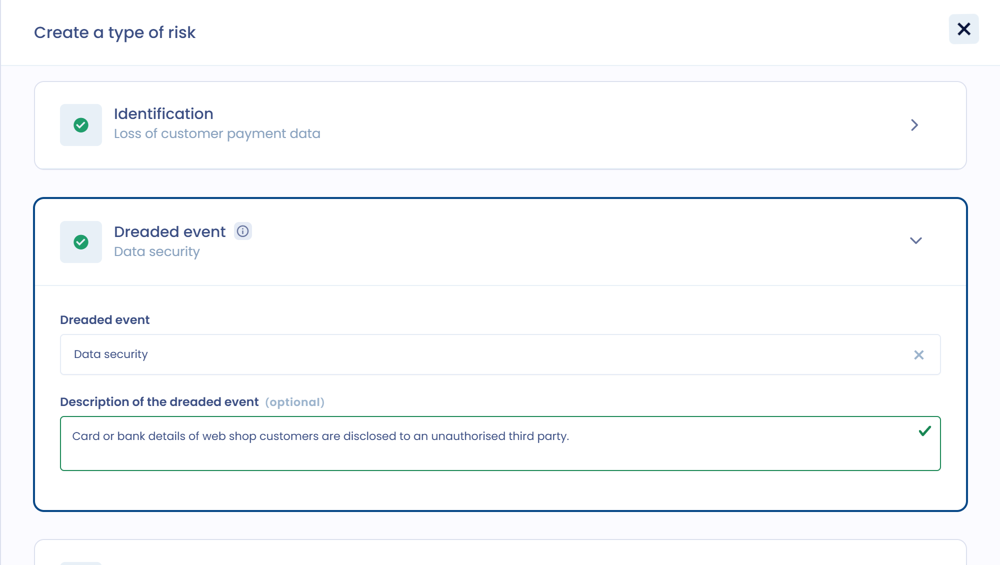
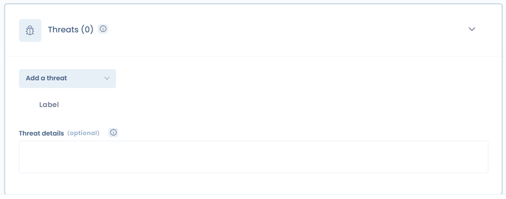
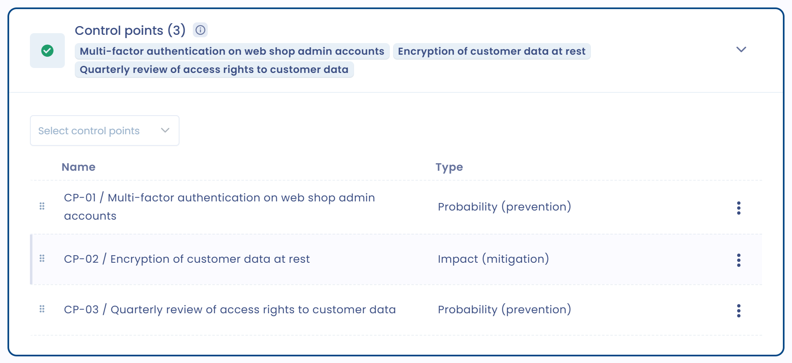

# 1. Identificeren

Om een risico aan te maken, opent u **Risicobeheer** > **Risico's**, kiest u het tabblad van het betrokken objecttype en klikt u op **Creëer een risico**. U kunt het ook aanmaken vanaf de pagina van een verwerkingsactiviteit (zie [Een risico koppelen aan een verwerkingsactiviteit](../attach-to-processing.md)). Het onderdeel **Identificatie** wordt geopend.

<figure><figcaption>
Het onderdeel Identificatie van een risico
</figcaption></figure>

Vul de identificatiegegevens in:

* de organisatorische eenheid: standaard die van de verwerkingsactiviteit als het risico daaraan is gekoppeld;
* het betrokken object, bijvoorbeeld de verwerkingsactiviteit;
* de eigenaar van het risico, die verantwoordelijk is voor de opvolging en het beheer van het risico;
* de identificatiedatum;
* het type risico, gekozen uit de repository;
* een samenvatting van het risico, specifiek voor dit object.


Met Dastra kunt u een repository van risicotypen opbouwen. De repository bespaart tijd en laat u een risicotype hergebruiken voor andere objecten.


Staat uw risicotype niet in de repository, voeg het dan vanaf deze pagina toe met **Creëer een risicotype**.

## Een risicotype toevoegen 

U kunt risicotypen ook beheren in **Risicobeheer** > **Soorten risico**, met de knop **Creëer een risicotype**.

U hergebruikt een risicotype om hetzelfde risico voor zoveel objecten als u wilt te genereren. U wilt bijvoorbeeld hetzelfde risico bij meerdere van uw verwerkers identificeren: voer het risicotype één keer in en hergebruik het voor elke verwerker of dienstverlener.

Geef het risicotype in het onderdeel **Identificatie** een naam en een interne referentie. Labels zijn optioneel.

<figure><figcaption>
Een risicotype: naam, referentie en gevreesde gebeurtenis
</figcaption></figure>

Een risico is de combinatie van een gevreesde gebeurtenis en een of meer bedreigingen die ze kunnen veroorzaken. Het wordt gemeten in waarschijnlijkheid (kans dat het zich voordoet) en ernst (impact).

### Gevreesde gebeurtenis

Om een risicotype toe te voegen, bepaalt u de gevreesde gebeurtenis en de impact ervan. De gevreesde gebeurtenis is het gevolg van het optreden van een risico.

Klassiek worden voor informatiebeveiliging en privacy drie soorten gevreesde gebeurtenissen genoemd. De AVG roept u op om de [beveiliging](https://eur-lex.europa.eu/legal-content/NL/TXT/?uri=CELEX%3A32016R0679#d1e3428-1-1) van persoonsgegevens langs deze drie lijnen te waarborgen (artikel 32):

* inbreuk op de **vertrouwelijkheid**
* inbreuk op de **beschikbaarheid**
* inbreuk op de **integriteit**

U kunt uw eigen categorieën gevreesde gebeurtenissen aanmaken met **Creëer een gevreesde gebeurtenis**, bijvoorbeeld een industrieel ongeval of een daad van corruptie. Het aantal gevreesde gebeurtenissen is niet beperkt. De module richt zich eerst op risico's voor informatiesystemen.

Geef voor elke gevreesde gebeurtenis in het veld **Beschrijving van de gevreesde gebeurtenis** aan welke impact ze veroorzaakt.

De impact varieert naargelang de context en het object waarvoor het risico wordt behandeld. Bij risico's met betrekking tot persoonsgegevens is de impact de schade voor personen: identiteitsdiefstal, valse beschuldiging, verlies van de burgerlijke staat enzovoort.

### Bedreigingen

Bepaal voor elke gevreesde gebeurtenis de bedreiging of bedreigingen waardoor ze zich kan voordoen. Bedenk een scenario: gebruik eerdere gebeurtenissen of uw verbeelding om te anticiperen op wat er kan gebeuren.

Selecteer in het onderdeel **Bedreigingen** een bestaande bedreiging met **Een bedreiging toevoegen** of maak er een aan. Het veld **Beschrijving van de bedreiging** beschrijft het scenario.

<figure><figcaption>
Het onderdeel Bedreigingen van een risicotype
</figcaption></figure>

Dastra biedt sjablonen voor generieke bedreigingen. Om ze te importeren, opent u **Risicobeheer** > **Bedreigingen**, opent u het menu van de knop **Bedreiging creëren** en klikt u op **Maak vanuit de bibliotheek**.

### Bronnen

Risicobronnen zijn de elementen waardoor de gevreesde gebeurtenis zich kan voordoen: wie of wat kan de oorsprong ervan zijn?

Houd rekening met menselijke bronnen, bijvoorbeeld een IT-beheerder, een cyberaanvaller of een vreemde staat, en met niet-menselijke bronnen, bijvoorbeeld water, een aardbeving of een niet-gericht computervirus.

Selecteer of maak de bronnen aan in het onderdeel **Bronnen** en beschrijf ze vervolgens in **Beschrijving van de bron**.

<figure><figcaption>
Het onderdeel Bronnen van een risicotype
</figcaption></figure>

### Controlepunten

Bepaal voor elk risicotype de bestaande of geplande maatregelen waarmee het risico wordt aangepakt. Deze controlepunten kunnen van verschillende aard zijn: beveiligingsmaatregelen, technische, organisatorische, juridische of functionele maatregelen.

Selecteer in het onderdeel **Controlepunten** bestaande controlepunten met **Controlepunten selecteren** of maak nieuwe aan met **Maak een controlepunt aan**. Elk controlepunt bepaalt:

* zijn invloed: de impact (beperking) of de waarschijnlijkheid (preventie) van het risico verminderen;
* de mogelijke antwoorden en hun score, van 0 tot 100 punten. Standaard biedt een nieuw controlepunt de antwoorden **Ja** (1 punt), **Neen** (0 punten) en **Niet van toepassing**;
* zijn eigenaar, zijn prioriteit (1 is de hoogste, 10 de laagste) en, indien nodig, een terugkerende evaluatie met het aantal dagen tussen twee controles.

<figure><figcaption>
Het onderdeel Controlepunten van een risicotype
</figcaption></figure>

Voor risico's op het gebied van informatiebeveiliging benoemt ISO 27001 standaardcontrolepunten. De beveiligingsgids voor persoonsgegevens van de CNIL stelt er ook verschillende voor.

### Voorbeoordeling

In een risicotype kunt u een beoordeling opnemen. Die wordt overgenomen in elk risico dat met dit type wordt aangemaakt, wat tijd bespaart. Ze is optioneel.

De beoordeling gebeurt in waarschijnlijkheid en ernst, volgens de schaal die u hebt ingesteld (zie [Beoordelen](assess.md)).

U kunt het initiële risico instellen: het theoretische risico dat aan de activiteit verbonden is, vóór enige beheersmaatregel (interne controle).

U kunt ook het restrisico instellen: het risico dat overblijft nadat beheersmaatregelen, met name controlepunten, zijn ingevoerd. Het mag niet hoger zijn dan het initiële risico.

<figure><figcaption>
De voorbeoordeling van het initiële en het resterende risico
</figcaption></figure>
