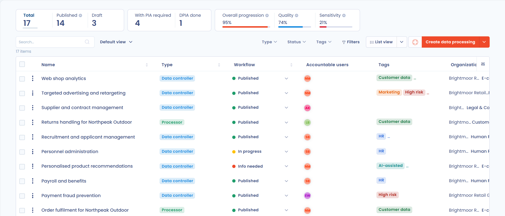

# Verwerkingsregister

## Inleiding

Met het verwerkingsregister brengt u uw gegevensverwerkingen in kaart en houdt u overzicht over wat u doet met de betrokken persoonsgegevens. Een volledig register bijhouden is verplicht volgens artikel 30 van de AVG. Het is daarnaast een instrument om uw gegevens beter te begrijpen en de bijbehorende waardeketen te beheersen, van het ontstaan van de gegevens tot het gebruik ervan.

Dastra biedt een register en vragenlijsten die u stap voor stap begeleiden bij het in kaart brengen van uw verwerkingsactiviteiten.

## Het Dastra-register in het kort

Het verwerkingsregister van Dastra voldoet aan alle wettelijke vereisten. Beide registers, dat van de verwerkingsverantwoordelijke en dat van de verwerker, steunen op repositories (stakeholders, activa, datasets, gegevens, risico's en beveiligingsmaatregelen). Daarmee brengt u uw verwerkingsactiviteiten in kaart en bespaart u tijd in het dagelijkse beheer.

Verwerkingsactiviteiten kunnen worden gekopieerd en sjablonen voor verwerkingsactiviteiten staan in een bibliotheek die voor alle gebruikers vrij toegankelijk is. Een workflow is ingebouwd, zoeken is standaard beschikbaar en u exporteert verwerkingsactiviteiten in verschillende indelingen (PDF, Word, HTML, Excel, CSV, JSON, Markdown) en importeert ze uit CSV-, Excel- of JSON-bestanden. U kunt ook documenten, datalekken of risico's aan uw verwerkingsactiviteiten koppelen.

<figure><figcaption>
Het verwerkingsregister: bovenaan de indicatortegels, daaronder de lijst van verwerkingsactiviteiten
</figcaption></figure>

## Register van de verwerkingsverantwoordelijke en register van de verwerker

Artikel 30 van de AVG bevat specifieke verplichtingen voor het register van de verwerkingsverantwoordelijke en voor het register van de verwerker. Als uw organisatie zowel als verwerker als als verwerkingsverantwoordelijke optreedt, moet uw register de twee categorieën activiteiten duidelijk onderscheiden.

In dat geval raadt de Franse toezichthouder CNIL aan twee registers bij te houden:

1. een register voor de verwerkingen van persoonsgegevens waarvoor u zelf verantwoordelijk bent,
2. een register voor de verwerkingen die u als verwerker uitvoert namens uw klanten.


[Register van de verwerkingsverantwoordelijke](controller.md)



[Register van de verwerker](processor.md)


## De methoden om het verwerkingsregister op te stellen

U kunt het register op twee manieren opbouwen:

* Top-down: u begint met een inventaris van de gegevensverwerkingen en verzamelt daarna per verwerkingsactiviteit de specifieke informatie (gegevens, verwerkers enzovoort).
* Bottom-up: u begint met een inventaris van de gegevens (software, datasets en velden met persoonsgegevens) en maakt daaruit de verwerkingsactiviteiten aan.

### De juiste methode kiezen

Er is geen juiste of foute methode: alles hangt af van de context van uw organisatie, de vaardigheden van het DPO-team, de bereikbaarheid van de mensen die de gegevens gebruiken, enzovoort.

Deze tabel vergelijkt de twee benaderingen:

<table><thead><tr><th width="129">Methode</th><th width="178">Doelgroep</th><th>Voordelen</th><th>Nadelen</th></tr></thead><tbody><tr><td>Top-down</td><td>Kleine organisaties of lokale overheden Bedrijven met een zwakke datacultuur Juridische teams met weinig affiniteit met IT</td><td>Snel op te zetten Minder werk Sluit goed aan op de juridische verwachtingen van de AVG</td><td>Kan lastig zijn als het team dat het register opstelt de gegevens van de organisatie niet kent Veeleisender voor operationele medewerkers De gegevensinventaris is veel minder waardevol, omdat ze alleen voor juridische doeleinden is gemodelleerd Op lange termijn complexer te onderhouden</td></tr><tr><td>Bottom-up</td><td>Grote of middelgrote organisaties Met een sterke datacultuur Juridische teams met sterke affiniteit met IT</td><td>Een inventaris van de gegevens is minder abstract dan rechtstreeks verwerkingsactiviteiten aanmaken Het register weerspiegelt de werkelijkheid van de organisatie Het register is op lange termijn gemakkelijker te onderhouden Meer medewerkers van de organisatie zijn betrokken Verwerkingsactiviteiten worden meer geautomatiseerd aangemaakt</td><td>Over het geheel moeilijker en tijdrovender om in te voeren Het project vraagt om goede governance</td></tr></tbody></table>

Dastra ondersteunt beide benaderingen. Voor een top-down aanpak maakt u verwerkingsactiviteiten aan [op basis van sjablonen](templates.md). Kiest u voor de bottom-up aanpak, [bouw dan eerst uw datamap](../mapping/README.md) en maak daarna een verwerkingsactiviteit rechtstreeks aan vanuit een activum (software, database).

## Uw verwerkingsregister opzetten

Wilt u weten hoe u uw verwerkingsregister ontwerpt en beheert, begin dan hier:


[Uw register opzetten](establish.md)


Wilt u weten hoe u één van uw verwerkingsactiviteiten opstelt en beheert, begin dan hier:


[Een verwerkingsactiviteit aanmaken](declare.md)


Wilt u de verschillende stappen van de vragenlijst begrijpen, lees dan:


[Een verwerkingsactiviteit invullen](activity/README.md)


Wilt u weten hoe u het verwerkingsregister deelt, lees dan:


[Het verwerkingsregister delen](share.md)


## Acties uitvoeren op meerdere verwerkingsactiviteiten tegelijk

Vink in de weergave **Tabel** de vakjes links van de verwerkingsactiviteiten aan waarmee u wilt werken. Boven de lijst verschijnt dan de knop **Kies een bulkactie**. Afhankelijk van uw rechten en van de functies die in uw werkruimte zijn ingeschakeld, biedt die de volgende acties:

* **De werkstroomfase wijzigen**
* **Exporteren**
* **Actoren koppelen**: stakeholders of ontvangers toevoegen aan of verwijderen van alle geselecteerde verwerkingsactiviteiten
* **Velden bewerken**: de waarde van een of meer velden op alle geselecteerde verwerkingsactiviteiten wijzigen
* **Samenvoegen**: zie [Elementen samenvoegen](../general/merge.md)
* **Vragenlijsten versturen**
* **Beoordeling**
* **Delen**
* **Verplaats naar de prullenbak**

## Meer informatie


[Register van verwerkingen](../../gdpr/concepts/ropa.md)



[Risico koppelen aan een Verwerking](../risks/attach-to-processing.md)



[Planning](../tasks/README.md)

