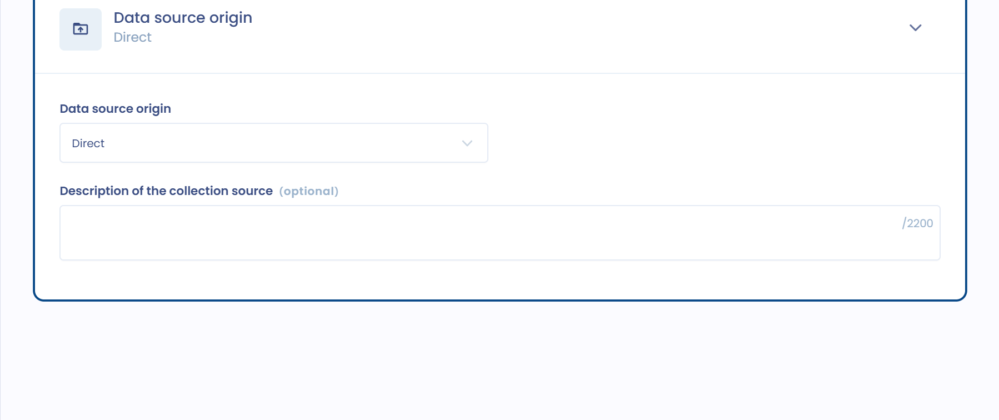
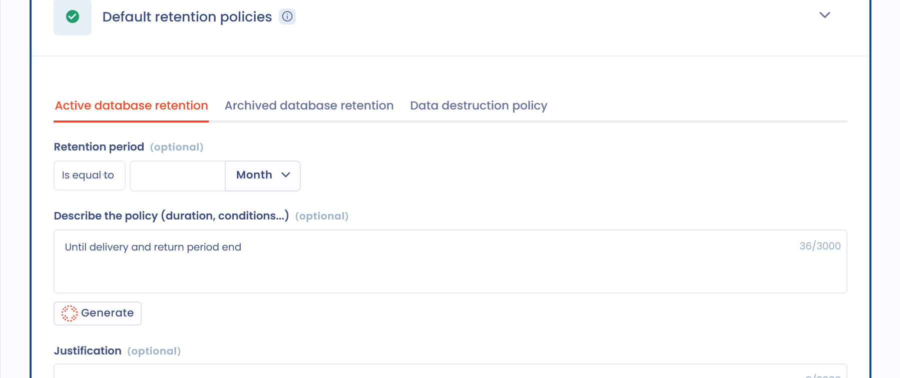

# Gegevens en retentie

[Artikel 30 van de AVG](https://gdpr-info.eu/art-30-gdpr/) vereist ook dat het register de categorieën van verwerkte gegevens vermeldt.

In deze sectie definieert u de categorieën van verwerkte gegevens. Ze kunnen algemeen of gevoelig zijn. Sommige gegevens houden een groter risico in voor natuurlijke personen, zoals gegevens over gezondheid, politieke opvattingen of vakbondslidmaatschap. Ook gegevens over strafrechtelijke veroordelingen en strafbare feiten zijn bijzonder beschermd.

Ook het nationale identificatienummer (zoals het sofinummer of rijksregisternummer) kan als gevoelig gegeven worden beschouwd.

Het verzamelen van gevoelige gegevens is in beginsel verboden. Alleen de uitzonderingen van [artikel 9 van de AVG](https://gdpr-info.eu/art-9-gdpr/) laten het toe.

## Datasets

Een dataset groepeert de gegevens van een specifiek element, bijvoorbeeld een tabel in een database of een papieren verzamelformulier.

### Verschillende manieren om datasets te gebruiken

U kunt datasets op verschillende manieren gebruiken:

* Geval 1: een dataset koppelen aan één activum. De dataset komt dan overeen met de gegevens van het activum en is niet generiek.
* Geval 2: een dataset koppelen aan de verwerkingsactiviteit. Deze dataset kan specifiek zijn voor de verwerkingsactiviteit en wordt niet hergebruikt in een andere verwerkingsactiviteit.
* Geval 3: generieke datasets koppelen aan de verwerkingsactiviteit. De dataset kan dan in meerdere verwerkingsactiviteiten worden hergebruikt.

Om generieke datasets te gebruiken, raden we de volgende werkwijze aan:

* Open de sectie **Gegevens** van de verwerkingsactiviteit.
* Open de datasetpagina van de datamapping in een nieuw tabblad.
* Selecteer de dataset in de verwerkingsactiviteit.
* Moet de dataset worden aangepast, maak dan een andere aan: ga naar het andere tabblad en dupliceer de generieke dataset, waarbij u de gewenste velden verwijdert of toevoegt.
* Voor meer duidelijkheid raden we aan deze datasets van een label te voorzien, zodat u ze in de datasetkiezer gemakkelijk kunt onderscheiden. Bijvoorbeeld een label "generiek" en een label voor de toegevoegde of verwijderde gegevens.


Een dataset kan aan meerdere verwerkingsactiviteiten worden gekoppeld. Wanneer u een dataset bewerkt die door meerdere verwerkingsactiviteiten wordt gebruikt, waarschuwt Dastra u dat uw wijzigingen ze allemaal beïnvloeden. Verschillen de gegevensvelden sterk voor één verwerkingsactiviteit, maak dan een kopie van de dataset en pas de kopie aan.


### Datasets zonder velden gebruiken

U kunt ook nog generieker te werk gaan door de gegevensvelden van de dataset niet te specificeren en de dataset te benoemen naar een categorie van gegevens (dat is onder de AVG bijvoorbeeld ook geldig).

Afhankelijk van de verwerkingsactiviteit kunt u een andere aanpak kiezen, naargelang de gevoeligheid ervan voor de rechten en vrijheden van de betrokkenen.

### Datasets aan de verwerkingsactiviteit toevoegen

In de sectie **Gegevens** hebt u twee mogelijkheden:

* Zijn uw datasets al gedocumenteerd in uw datamapping, klik dan op **Datasets selecteren** en selecteer de datasets die u aan de verwerkingsactiviteit wilt koppelen.
* Anders klikt u op **Een dataset toevoegen** om de **Wizard voor het maken van gegevenssets** te openen. Maak de dataset aan met de AI-assistent (**AI gegenereerd**), vanuit een bestaande dataset (**Een bestaande dataset als model gebruiken**), door de gegevensvelden te selecteren (**Stap voor stap handleiding**) of vanaf nul (**Lege gegevensset**).

Elke dataset van de verwerkingsactiviteit toont zijn bewaarregels en de doeleinden die hij dient. Schakel **Velden weergeven** in om ook de gegevensvelden van elke dataset te tonen. Standaard is een dataset gekoppeld aan alle doeleinden van de verwerkingsactiviteit: via het menu **...** van de dataset selecteert u een of meer specifieke doeleinden. Hetzelfde menu laat u de dataset **Bewerken**, **Dupliceren**, de **Details** bekijken of de koppeling met de verwerkingsactiviteit verwijderen (**Link verwijderen**).

Klik op een dataset om hem te openen en de hieronder beschreven informatie aan te vullen.

### De herkomst van de gegevens aan de dataset koppelen

In elke dataset geeft u de herkomst van de gegevens op in **Herkomst van de collectie**: **Direct**, **Indirect** of **Direct en indirect**.

Met het veld **Beschrijving van de herkomst van de collectie** voegt u nodige details toe.

<figure><figcaption>
Herkomst van de gegevens
</figcaption></figure>

### Een activum aan de dataset koppelen

Datasets zijn bedoeld om aan [activa](assets.md) te worden gekoppeld.

U koppelt een activum aan uw dataset in het veld **Gerelateerde activa**, in het blok **Algemene informatie** van de dataset.

<figure><figcaption>
Activumkiezer
</figcaption></figure>

Een dataset kan slechts aan één activum worden gekoppeld: de datasets van een activum zijn specifiek voor dat activum.

Beschouwt u bijvoorbeeld boekhoudsoftware als een activum, dan kunnen er meerdere datasets aan zijn gekoppeld, zoals "factureringsgegevens" met de gegevens van de module voor factuuropvolging, of "klantgegevens" met de gegevens van de klantaccounts.

### Categorieën van betrokkenen koppelen

Voor elke dataset kunt u een of meer categorieën van betrokkenen koppelen in **Categorieën betrokken personen**.

Zo ziet u welke gegevens bij welke betrokkenen horen. Het vergemakkelijkt ook uw datamappingwerk.

<figure><figcaption>
Kiezer voor categorieën van betrokkenen
</figcaption></figure>


Het opgeven van de betrokkenen is nuttig bij het beheer van [verzoeken van betrokkenen](../../requests/README.md): u ziet snel welke datasets betrokken zijn en vindt de gegevens waarop het verzoek betrekking heeft.


### Gegevensvelden koppelen

Elke dataset moet worden aangevuld met gegevensvelden. Deze velden zijn de gegevens zelf.

Klik in het blok **Velden voor persoonlijke gegevens** op **Gegevens bijvoegen**. De velden in de kiezer zijn die uit uw gegevenswoordenlijst.

<figure><figcaption>
Kiezer voor gegevensvelden
</figcaption></figure>

Bestaat een veld nog niet, klik dan op **Gegevens toevoegen** om het aan te maken en aan de dataset toe te voegen.

U kunt velden indelen in vooraf gedefinieerde categorieën van gegevens, zoals **Burgerlijke staat, identiteit, identificatiegegevens, afbeeldingen...**, **Persoonlijke leven**, **Professioneel leven** of **Economische en financiële informatie**. Deze categorieën volgen de categorieën die de Franse toezichthoudende autoriteit (CNIL) aanbeveelt.

<figure><figcaption>
Kiezer voor de categorie van gegevens
</figcaption></figure>

In het gegevensveld geeft u ook het gevoeligheidsniveau van de gegevens aan: **Standaard**, **Zeer persoonlijke gegevens** of **Gevoelige gegevens**, bijvoorbeeld gezondheidsgegevens.

Voor bijzondere categorieën van gegevens moet u de verzameling van deze gegevens rechtvaardigen, en met name de wettelijke grondslag ervan, in **Wettelijke basis voor inzameling** en **Rechtvaardiging voor het verzamelen van gevoelige gegevens**.

<figure><figcaption>
Gevoelige gegevens
</figcaption></figure>


Gevoelige gegevens tellen mee in de indicator **Gevoeligheid** van de verwerkingsactiviteit. Datasets die ze bevatten, krijgen de badge **Gevoelig** in de sectie **Gegevens**.


### Een bewaarbeleid aan de dataset koppelen

In elke dataset kunt u standaard bewaarbeleid definiëren in het blok **Standaard bewaartijden**.

<figure><figcaption>
Bewaartermijnen
</figcaption></figure>

Deze bewaartermijnen zijn standaardwaarden: u kunt ze per verwerkingsactiviteit aanpassen (zie hieronder).

U kunt een bewaring in de actieve database, een bewaring in de gearchiveerde database en een vernietigingsbeleid definiëren:

* **Actieve basis**: de actieve database is de huidige database van de verwerking.
* **Tussentijdse archivering**: tussentijdse archivering is een beperktere vorm van opslag.
* **Definitief verwijderen**: beschrijf de voorwaarden waaronder de gegevens worden verwijderd of overgedragen voor definitieve archivering.

Voor de actieve en de gearchiveerde database geeft u de **Bewaartermijn** op, daarna **Beschrijf de regel (duur, voorwaarden...)** en voegt u een **Rechtvaardiging** toe. Voor het vernietigingsbeleid vult u de **Beschrijving van de regel voor gegevenswissing** en de **Rechtvaardiging** ervan in.

## Bewaring van gegevens

Beperkte bewaring van gegevens is een van de algemene beginselen van de bescherming van persoonsgegevens, die [artikel 5, lid 1, onder e), van de AVG](https://gdpr-info.eu/art-5-gdpr/) in herinnering brengt. Persoonsgegevens moeten

> worden bewaard in een vorm die het mogelijk maakt de betrokkenen te identificeren gedurende een periode die niet langer is dan voor de doeleinden waarvoor de persoonsgegevens worden verwerkt noodzakelijk is.

In de praktijk moet u bij het invoeren van een verwerkingsactiviteit plannen wat er met de gegevens gebeurt zodra het doeleinde is bereikt. De gegevens moeten dan definitief worden vernietigd, geanonimiseerd of voor een nieuw verenigbaar doeleinde worden verwerkt.

De bewaartermijn hangt af van het doeleinde van de verwerking en de aard van de gegevens. Bewaartermijnen kunnen per type gegevens worden vastgesteld. Bij loonbeheer worden de gegevens van de loonstrook bijvoorbeeld 1 maand in de actieve database bewaard en 5 jaar in tussentijdse archivering, terwijl de gegevens van de betalingsopdracht in de actieve database worden bewaard zolang nodig is om de loonstrook uit te reiken, en vanaf de afsluiting 10 jaar in tussentijdse archivering.

De duur kan worden uitgedrukt als een waarde of, als dat niet mogelijk is, als de criteria waarmee de bewaartermijn wordt bepaald (bijvoorbeeld tot opzegging). De CNIL raadt, met name in haar [aanbeveling van 11 oktober 2005 over elektronische archivering in de privésector](https://www.legifrance.gouv.fr/affichCnil.do?id=CNILTEXT000017651957) (in het Frans), aan procedures in te voeren om bewaartermijnen te beheren op het niveau van de categorie van gegevens en met name om het wissen of vernietigen van gegevens te beheren.

### Het bewaarbeleid van een dataset aanpassen voor een verwerkingsactiviteit

De gegevensvelden van een generieke dataset kunnen niet van de ene verwerkingsactiviteit tot de andere verschillen. De bewaartermijn kan dat wel. U kunt de bewaartermijn van een dataset aanpassen voor een bepaalde verwerkingsactiviteit: de standaardbewaartermijn van de dataset geldt dan niet meer voor deze verwerkingsactiviteit.

Daarvoor moet de dataset aan de verwerkingsactiviteit zijn toegevoegd. Klik in de sectie **Gegevens** op een van de bewaarknoppen van de dataset: **Actieve basis**, **Tussentijdse archivering** of **Definitief verwijderen**. Een groene knop betekent dat de regel is gedefinieerd, een rode knop **Actieve basis** betekent dat ze ontbreekt.

<figure><figcaption>
Bewaarknoppen van een dataset, met een aangepaste regel
</figcaption></figure>

Het paneel **Houdbaarheid aanpassen** opent. Het herinnert u aan de betrokken dataset. Schakel **De regel aanpassen** in en geef daarna de **Bewaartermijn**, **Beschrijf de regel (duur, voorwaarden...)** en de **Rechtvaardiging** op die alleen voor deze verwerkingsactiviteit gelden.

<figure><figcaption>
De bewaartermijn aanpassen voor een verwerkingsactiviteit
</figcaption></figure>

Wanneer een bewaartermijn op het niveau van de verwerkingsactiviteit is aangepast, verschijnt een potloodpictogram op de bijbehorende knop.

Om de bewaarregel te wijzigen die voor de dataset in alle verwerkingsactiviteiten geldt, klikt u op de dataset bovenaan het paneel.

Op lange termijn kan het doel zijn het gebruik van generieke datasets te beperken en naar een nauwkeurigere mapping toe te werken, via verwerkingsactiviteiten (geval 2) of via activa (geval 1).
