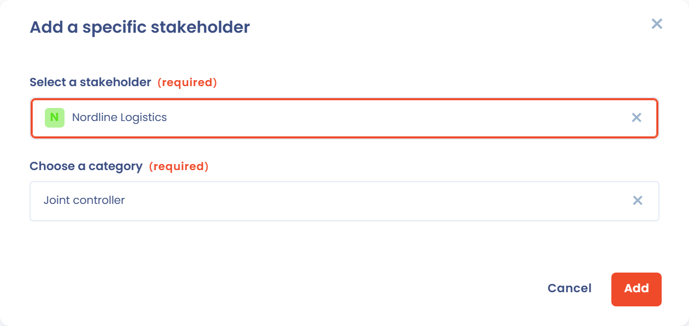

# Stakeholders

De sectie **Stakeholders** is de tweede sectie van een verwerkingsactiviteit. Ze bundelt twee lijsten:

* de gebruikers: personen met een account op het Dastra-platform die aan de verwerkingsactiviteit zijn toegewezen;
* de stakeholders: de organisaties, afdelingen of personen die bij de verwerking zijn betrokken, zoals de verwerkingsverantwoordelijke, de functionaris voor gegevensbescherming, gezamenlijke verwerkingsverantwoordelijken of de verantwoordelijke voor de uitvoering van de verwerking.

## Gebruikers aan een verwerkingsactiviteit toevoegen

In Dastra koppelt u gebruikers aan een verwerkingsactiviteit.

Het gaat hier niet om stakeholders, maar om gebruikers: personen met een account op het Dastra-platform.

1. Klik in de sectie **Stakeholders** op **Gebruikers toevoegen**.
2. Selecteer in **Eigenaar van de verwerking** een of meer gebruikers.
3. Kies in **Rollen toewijzen** de rol van deze gebruikers.
4. Klik op **Toevoegen**.

De gebruikers verschijnen in de tabel met hun **Opdracht**, die u op elk moment in de tabel kunt wijzigen.

De zo gedefinieerde rollen helpen u het beheer en de uitvoering van uw verwerkingsactiviteiten in Dastra te organiseren:

* **Goedkeurder**: de Dastra-gebruiker die nagaat of de verwerkingsactiviteit en de bijbehorende elementen, zoals ze in Dastra zijn beschreven, aan de verwachtingen van de organisatie voldoen. Deze persoon kan een andere zijn dan de ondertekenaar van de verwerkingsverantwoordelijke. Het kan bijvoorbeeld gaan om een afdelingshoofd, een FG of een FG-relais.
* **Verantwoordelijk**: de gebruiker die de nodige acties op de verwerkingsactiviteit uitvoert en ze beschrijft. Dat kan het invoeren van beveiligingsmaatregelen zijn, het beheer van toegang of elke andere taak die nodig is om de naleving van de verwerking te waarborgen. Dit kan een projectmanager zijn of een vaste verantwoordelijke van de afdeling.
* **Op de hoogte**: gebruikers die op de hoogte moeten blijven van de voortgang en de status van de verwerkingsactiviteit, zonder een actieve rol bij de validatie of de uitvoering ervan. Het kan gaan om leden van het managementteam, projectmanagers of andere stakeholders die belang hebben bij de verwerking.

Toegewezen gebruikers ontvangen meldingen over de acties die op de verwerkingsactiviteit worden uitgevoerd en zijn de standaardontvangers van de bijbehorende taken en meldingen.


Het toewijzen van een gebruiker beperkt de toegang tot de verwerkingsactiviteit niet. Gebruik het systeem van rollen en machtigingen om de toegang te beperken.


## De belangrijkste stakeholders van de verwerkingsactiviteit identificeren

U kunt de stakeholders opgeven die bij de uitvoering van de verwerking betrokken zijn. Dat kan bijvoorbeeld een afdeling van een bedrijf zijn (zoals de afdeling personeelszaken), maar bij een project ook een vaste persoon (bijvoorbeeld een projectmanager).

U geeft ook, indien van toepassing, de vertegenwoordiger van de verwerkingsverantwoordelijke en de gezamenlijke verwerkingsverantwoordelijke(n) op.

De eerste rijen van de stakeholdertabel worden overgenomen van de entiteit van de organisatorische eenheid die u in de sectie **Algemeen** hebt geselecteerd en zijn gemarkeerd met een slotpictogram:

* de **Verwerkingsverantwoordelijke** (of **Organisatie (verwerker)** voor een activiteit als verwerker),
* de **Functionaris voor gegevensbescherming (DPO)**,
* de **Vertegenwoordiger**.

Om ze te wijzigen, bewerkt u de entiteit in het beheer van de organisatorische eenheden.

## Een specifieke stakeholder toevoegen

1. Klik in de sectie **Stakeholders** op **Voeg specifieke stakeholder toe**.
2. Zoek in **Een actor kiezen** in de stakeholderlijst, of klik op **Nieuwe actor** om een nieuwe toe te voegen.
3. Selecteer in **Kies een titel** de rol van deze stakeholder: **Gezamenlijke verwerkingsverantwoordelijke**, **Vertegenwoordiger van de verwerkingsverantwoordelijke**, **Verantwoordelijk voor de uitvoering van de verwerking**, **Operationele Verantwoordelijke** of **Andere**. Kiest u **Andere**, geef dan de rol op in **Functietitel**.
4. Klik op **Toevoegen**.

<figure><figcaption>
Beschikbare categorieën voor een specifieke stakeholder
</figcaption></figure>

## Een gezamenlijke verwerkingsverantwoordelijke toevoegen

Om een gezamenlijke verwerkingsverantwoordelijke toe te voegen, voegt u een nieuwe stakeholder toe en selecteert u **Gezamenlijke verwerkingsverantwoordelijke** in **Kies een titel**.

<figure><figcaption>
Een gezamenlijke verwerkingsverantwoordelijke aan de verwerkingsactiviteit toevoegen
</figcaption></figure>

## Een verantwoordelijke voor de uitvoering van de verwerking toevoegen

De verantwoordelijke voor de uitvoering van de verwerking is de afdeling die operationeel verantwoordelijk is voor de verwerking. Dat is doorgaans de afdeling die de gegevens gebruikt en de verwerkingsactiviteit uitvoert.

Het kan een afdeling zijn of een persoon.

Voeg deze in Dastra toe als stakeholder met de titel **Verantwoordelijk voor de uitvoering van de verwerking**.

## Een vertegenwoordiger van de verwerkingsverantwoordelijke toevoegen

De vertegenwoordiger van de verwerkingsverantwoordelijke is de operationele vertegenwoordiger van de verwerkingsverantwoordelijke. Dat kan bijvoorbeeld een lid van het directiecomité zijn of een gemeenteraadslid (waarbij de verwerkingsverantwoordelijke door de burgemeester wordt vertegenwoordigd).

Voeg deze in Dastra toe als stakeholder met de titel **Vertegenwoordiger van de verwerkingsverantwoordelijke**.

## Een operationele verantwoordelijke toevoegen

De operationele verantwoordelijke (in het Engels Operational Data Controller of ODC) is een begrip dat sommige organisaties intern gebruiken voor een persoon met specifieke verantwoordelijkheden in het operationele beheer van de verwerking van persoonsgegevens.

Voeg deze in Dastra toe als stakeholder met de titel **Operationele Verantwoordelijke**.

### Rol van de operationele verantwoordelijke in de AVG-governance

De operationele verantwoordelijke is geen begrip uit de AVG, maar sommige organisaties gebruiken het intern voor een persoon met specifieke operationele verantwoordelijkheden bij het beheer van verwerkingsactiviteiten.

### Uitvoering van gegevensverwerking

* De operationele verantwoordelijke fungeert vaak als operationeel relais van de verwerkingsverantwoordelijke binnen een bedrijfseenheid (bijvoorbeeld HR, marketing of IT).
* Hij of zij voert de gegevensverwerkingen dagelijks uit, volgens de instructies van de verwerkingsverantwoordelijke en in overeenstemming met de beginselen van gegevensbescherming.

### Toepassing van compliancemaatregelen

* De operationele verantwoordelijke zorgt ervoor dat verwerkingen worden uitgevoerd volgens het interne compliancebeleid en de verplichtingen inzake gegevensbescherming.
* Hij of zij past de technische en organisatorische maatregelen toe die het bedrijf heeft vastgesteld om de beveiliging en de vertrouwelijkheid van persoonsgegevens te waarborgen.

### Samenwerking met de FG en de verwerkingsverantwoordelijke

* De operationele verantwoordelijke werkt nauw samen met de functionaris voor gegevensbescherming (FG) om te zorgen dat de gegevensverwerkingen de regels voor gegevensbescherming naleven.
* Hij of zij kan optreden als vaste contactpersoon voor de FG, met name bij de afhandeling van verzoeken van betrokkenen (bijvoorbeeld inzage, rectificatie of verwijdering).

### Beheer van incidenten en datalekken

* De operationele verantwoordelijke kan betrokken zijn bij het opsporen en beheren van datalekken en past de interne procedures toe om snel te reageren en incidenten indien nodig te melden.
* Hij of zij volgt incidenten op en helpt corrigerende maatregelen in te voeren.

### Documentatie en bijhouden van het verwerkingsregister

* De operationele verantwoordelijke draagt bij aan het bijwerken van het verwerkingsregister, documenteert de verwerkingen waarvoor hij of zij verantwoordelijk is en zorgt dat de relevante informatie correct aan de verwerkingsverantwoordelijke of de FG wordt doorgegeven.

### Verschil tussen de verwerkingsverantwoordelijke en de operationele verantwoordelijke

| Criterium | Verwerkingsverantwoordelijke | Operationele verantwoordelijke |
| --- | --- | --- |
| Rol | Bepaalt de doeleinden en de middelen van de verwerking | Voert de verwerkingsactiviteiten in de praktijk uit |
| Besluitvorming | Beslist waarom en hoe gegevens worden verwerkt | Past de beslissingen toe en beheert de uitvoering |
| Wettelijke verantwoordelijkheid | Draagt de wettelijke verantwoordelijkheid bij niet-naleving | Werkt onder het gezag van de verwerkingsverantwoordelijke |
| Interactie met de FG | Werkt met de FG om beleid vast te stellen | Voert de aanbevelingen van de FG uit |
